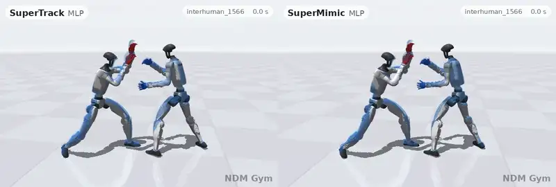

<div align="center">
<h1>NDM Gym</h1>

<a href="LICENSE"></a>

<a href="https://github.com/isaac-sim/IsaacLab"></a>
<a href="https://github.com/google-deepmind/mujoco_warp"></a>
<a href="https://huggingface.co/frankzydou/ndm-gym"></a>

**Neural Dynamics Modeling Gym**: neural world models for physics-based humanoid control.

<a href="#-results">Results</a> · <a href="#-installation">Installation</a> · <a href="#-getting-started">Getting started</a> ·
<a href="#-documentation">Documentation</a> · <a href="#-citation">Citation</a>
</div>

NDM Gym trains controllers that learn through a neural world model. Every algorithm shares one pipeline, so a comparison
changes only the algorithm. The tasks are LAFAN1 motion tracking, two G1s tracking a two-person clip and HDMI's human-object
interaction (Isaac Lab 3 with MuJoCo-Warp, the Unitree G1 with 29 DoF), and MuscleVAE's muscle-actuated character (Newton with
MuJoCo-Warp). The neural dynamics models (NDMs) also stand in for the simulator.

<p align="center"></p>
<p align="center"><i>SuperTrack (top) and SuperMimic (bottom) with each task's selected configuration, the same motion and window in both rows. Error, SuperTrack / SuperMimic: LAFAN1 15.3 / 26.6 mm and two G1s 12.1 / 14.5 mm over the 6 s shown (MPJPE, root-relative), muscles 24.3 / 49.2 mm over the walk clip (MPJPE, root frame).</i></p>
<p align="center"><sub>Motions from LAFAN1 (© 2018 Ubisoft Entertainment; CC BY-NC-ND 4.0), InterHuman and MuscleVAE, rendered for non-commercial illustration only; not covered by this repository's MIT license (<a href="NOTICE">see NOTICE</a>).</sub></p>

## 🔥 News

- **[2026-11]** MuscleVAE's muscle-actuated character: SuperTrack and SuperMimic tuned alike, with results and commands
  ([below](#muscle-actuated-character)).
- **[2026-11]** [BlinkMimic](https://github.com/fuyichen0725/blinkmimic)'s training recipe as options (`--algo blinkmimic`), and
  its systems options (collection and updates as CUDA graphs, no host synchronization) for LAFAN1, two-G1 and muscle training
  ([details](docs/blinkmimic.md)). `pip install` now gives the library without the simulator ([details](docs/installation.md)).
- **[2026-11]** Trained weights on [Hugging Face](https://huggingface.co/frankzydou/ndm-gym): the G1 / LAFAN1 runs behind the [results](#-results).
- **[2026-11]** HDMI's 13 human-object interaction tasks (HDMI's PPO teacher as the model-free baseline), MuscleVAE's
  muscle-actuated character, NDMs as simulators ([throughput](benchmarks/ndm_speed/results.md)), RigidFormer inference
  kernels, and two G1s tracking a two-person clip in one scene ([results](benchmarks/g1_boxing/results.md)).
- **[2026-11]** RigidFormer's final configurations and training speed options: SuperTrack-RF and SuperMimic-RF on fresh seeds ([results](#-results)).
- **[2026-10]** A benchmark covering SuperTrack and SuperMimic on G1 / LAFAN1: [results](#-results) and [ablations](benchmarks/g1_lafan1_tracking/ablations.md).
- **[2026-10]** [RigidFormer](https://frank-zy-dou.github.io/projects/RigidFormer/) world-model backbone (`--wm_backbone rigidformer`).
- **[2026-10]** First release, equivalence-tested against an unofficial SuperMimic reproduction (no official code is released).

## ✨ Features

- **Algorithms:** SuperTrack and SuperMimic, both learning by backpropagation through a world model; BlinkMimic's recipe and
  systems options (`--algo blinkmimic`, and each change as an option of its own).
- **World models:** acceleration (SuperTrack) and increment (SuperMimic) models, each with an MLP or a
  [RigidFormer](docs/rigidformer_backbone.md) backbone.
- **Tasks:** motion tracking on LAFAN1 (G1); two G1s in one scene tracking a two-person clip; HDMI's 13 human-object
  interaction tasks (G1, contact forces predicted by the world model); MuscleVAE's character with 284 Hill-type muscles and
  fatigue.
- **NDMs as simulators:** throughput and open-loop accuracy against the physics engine, with inference paths as fused
  Triton kernels ([results](benchmarks/ndm_speed/results.md)).
- **Evaluation:** tracking errors on every clip, push robustness, held-out clips (`--clips`), side-by-side videos and an
  offline world-model benchmark.
- **Fair comparisons:** equal tuning budgets, selection rules declared before the runs, confidence intervals
  ([details](benchmarks/g1_lafan1_tracking/results.md#how-the-numbers-were-obtained)).

| | MLP world model (default) | RigidFormer world model |
|---|---|---|
| **SuperTrack** | `--algo supertrack` | **SuperTrack-RF**: `--algo supertrack --wm_backbone rigidformer` |
| **SuperMimic** | `--algo supermimic` | **SuperMimic-RF**: `--algo supermimic --wm_backbone rigidformer` |
| world-model parameters | 8.75 M (SuperTrack), 8.82 M (SuperMimic) | 0.88 M |

## 🔧 Installation

Linux with an NVIDIA GPU.

```bash
git clone --recursive https://github.com/Frank-ZY-Dou/ndm-gym.git && cd ndm-gym
bash scripts/setup.sh                 # Isaac Lab 3 and locked dependencies into ~/ndm_gym/venv, motions and G1 into data/
source ~/ndm_gym/venv/bin/activate    # ndm-train and ndm-eval on PATH
```

The library alone (world models, policies, algorithms; no simulator, no training):
`pip install "ndm_gym @ git+https://github.com/Frank-ZY-Dou/ndm-gym"` ([details](docs/installation.md)).

## 🚀 Getting Started

```bash
# train (scripts/run_train.sh adds a memory cap, CPU pinning and a GPU lock)
ndm-train --algo supertrack --st_fail_w 5 --st_balance_w 4 --max_hours 3 --log_dir logs/st
ndm-train --algo supermimic --reward_std_scale 0.7 --action_noise 0.3 --imag_start_perturb 0.3 --max_hours 3 --log_dir logs/sm

# evaluate every checkpoint as it is written; push robustness of one checkpoint
ndm-eval --run_dir logs/st --watch
ndm-eval --run_dir logs/st --ckpt logs/st/ckpt_012000.pt --push_mag 0 1 2 --out_json push.json

# compare: curves, then side-by-side videos of recorded evaluations
python tools/plot.py logs/st logs/sm --labels SuperTrack SuperMimic --out compare.png
ndm-eval --run_dir logs/st --ckpt <ckpt> --record st.npz      # and the same for sm.npz
MUJOCO_GL=egl python tools/compare_videos.py st.npz sm.npz --labels SuperTrack SuperMimic --out videos/

# world models offline: a training and a test set from one policy, then a fit
python -m ndm_gym.wmbench.collect --ckpt logs/st/ckpt_006000.pt --out wm_train.pt --seed 0
python -m ndm_gym.wmbench.collect --ckpt logs/st/ckpt_006000.pt --out wm_test.pt --seed 1
python -m ndm_gym.wmbench.fit --algo supertrack --train wm_train.pt --test st=wm_test.pt --out wm_st.csv
```

<details>
<summary><b>Two G1s, one two-person clip</b></summary>

```bash
# InterHuman's clip retargeted to two G1s (see the tool's docstring; HoloMotion's HoloRetarget and a licensed SMPL model)
python tools/convert_interhuman.py --pkl <InterHuman>/motions/1566.pkl --smpl_model <SMPL_NEUTRAL.pkl> \
    --robot_mjcf data/g1_description/g1_29dof.xml --out data/interhuman/interhuman_1566.npz

ndm-train --algo supertrack --st_fail_w 5 --st_balance_w 4 --motions interhuman --paired \
    --motion_dir data/interhuman/interhuman_1566.npz --max_hours 3 --log_dir logs/box_st
ndm-eval --run_dir logs/box_st --ckpt <ckpt> --motions interhuman --paired --motion_dir data/interhuman/interhuman_1566.npz --record box.npz
MUJOCO_GL=egl python tools/render.py box.npz box.mp4 --pair --seconds 11

# throughput of the two-robot scene: physics, and a RigidFormer checkpoint's world model with its inference path
python -m ndm_gym.wmbench.speed_pair --pair data/interhuman/interhuman_1566.npz --mode physics --num_envs 4096 --out speed.csv
python -m ndm_gym.wmbench.speed_pair --pair data/interhuman/interhuman_1566.npz --mode ndm --wm_ckpt <ckpt> \
    --inference_copy amp --fused --rf_kernels whole --num_envs 4096 --out speed.csv
```

</details>

<details>
<summary><b>Human-object interaction (HDMI's tasks)</b></summary>

```bash
bash tools/download_hdmi.sh && python tools/convert_hdmi.py    # HDMI's clips and objects into data/hdmi/ (not redistributed)
MUJOCO_GL=egl python tools/render_hoi.py suitcase.mp4 --task move_suitcase    # a reference clip in HDMI's look; --states: a recorded rollout

# one task (13 in ndm_gym/tasks/hdmi_tasks.py); HDMI's PPO teacher as the model-free baseline
python -m ndm_gym.train_hoi --task move_suitcase --algo supertrack --st_fail_w 5 --st_contact_force --max_hours 3 --log_dir logs/hoi_st
python -m ndm_gym.train_hoi --task move_suitcase --algo supermimic --action_noise 0.3 --max_hours 3 --log_dir logs/hoi_sm
python -m ndm_gym.train_ppo_hoi --task move_suitcase --max_hours 3 --log_dir logs/hoi_ppo
python -m ndm_gym.evaluate_hoi --run_dir logs/hoi_st      # every checkpoint; --ckpt for one

# the NDM as a simulator: transitions, an offline fit with its open-loop errors, throughput against physics
python -m ndm_gym.wmbench.collect_hoi --task move_suitcase --seed 0 --out hoi_s0.pt
python -m ndm_gym.wmbench.collect_hoi --task move_suitcase --seed 1 --out hoi_s1.pt
python -m ndm_gym.wmbench.fit_hoi --task move_suitcase --kind accel --backbone rigidformer --train hoi_s0.pt --test held=hoi_s1.pt --out fit.csv
python -m ndm_gym.wmbench.speed_hoi --task move_suitcase --mode physics --num_envs 4096 --out speed.csv
python -m ndm_gym.wmbench.speed_hoi --task move_suitcase --mode ndm --backbone rigidformer --compile reduce-overhead --num_envs 4096 --out speed.csv
```

</details>

<details>
<summary><b>MuscleVAE</b></summary>

```bash
bash tools/download_musclevae.sh && python tools/convert_musclevae.py   # character, muscles, motions (not redistributed)
bash tools/download_mass_meshes.sh                                      # MASS's bone meshes, for rendering

# their released tracking policy in our simulator (Newton, 120 Hz, muscle forces every substep), then a render in their look
bash tools/download_musclevae_pretrained.sh
python tools/replay_musclevae.py --out_dir replay
MUJOCO_GL=egl python tools/render_musclevae.py walk.mp4 --states replay/states_lafan_walk_0.npz --ref

# SuperTrack and SuperMimic on the character: the commands are under Results. Evaluation of a checkpoint
python tools/evaluate_muscles.py --ckpt logs/<run>/last.pt

# transitions for a muscle NDM, and the simulator's throughput
python -m ndm_gym.wmbench.collect_muscles --out mvae/data
python -m ndm_gym.wmbench.speed_muscles --mode physics --ball_joints euler --joint_damping ode --out speed_muscles.csv
```

</details>

## 📊 Results

SuperTrack and SuperMimic share each task's simulator, data, networks and evaluation, and have equal tuning budgets. ↑: higher
is better; ↓: lower is better. Details and commands are under each task below.

<table>
<thead>
<tr><th>Task</th><th>Measure</th><th>SuperTrack</th><th>SuperMimic</th></tr>
</thead>
<tbody>
<tr><td rowspan="2"><b>LAFAN1 tracking</b><br><sub>MLP world model<br>40 clips, A100 40GB, seeds 1-3</sub></td><td>return ↑, 3 h</td><td>0.832 ± 0.009</td><td>0.824 ± 0.013</td></tr>
<tr><td>MPJPE, root-relative ↓</td><td>20.0 ± 0.7 mm</td><td>28.4 ± 0.5 mm</td></tr>
<tr><td rowspan="2"><b>LAFAN1 tracking</b><br><sub>RigidFormer world model<br>40 clips, A100 40GB, seeds 7-9</sub></td><td>return ↑, 3 h</td><td>0.832 ± 0.003</td><td>0.804 ± 0.007</td></tr>
<tr><td>MPJPE, root-relative ↓</td><td>21.0 ± 1.3 mm</td><td>33.1 ± 0.5 mm</td></tr>
<tr><td rowspan="2"><b>Two G1s</b><br><sub>a two-person clip, MLP world model<br>A100 80GB, seed 0</sub></td><td>return ↑, 3 h</td><td>0.887</td><td>0.886</td></tr>
<tr><td>MPJPE, global / local ↓</td><td>106 / 12.5 mm</td><td>96 / 20.0 mm</td></tr>
<tr><td rowspan="3"><b>Muscles</b><br><sub>MuscleVAE's character, MLP world model<br>A100 40GB, seeds 1-3</sub></td><td>MPJPE, root frame ↓, best checkpoint within 3 h</td><td>36.4 ± 1.9 mm</td><td>63.6 ± 4.1 mm</td></tr>
<tr><td>episodes ended ↓</td><td>0.014 ± 0.011</td><td>0.059 ± 0.027</td></tr>
<tr><td>joint error ↓</td><td>10.9 ± 0.9°</td><td>10.1 ± 0.6°</td></tr>
</tbody>
</table>

### LAFAN1 motion tracking

<!-- videos:begin -->
<table>
<tr>
<td></td>
<td></td>
</tr>
<tr>
<td></td>
<td></td>
</tr>
<tr>
<td></td>
<td></td>
</tr>
</table>
<p align="center"><i>SuperTrack (left) and SuperMimic (right): the selected configurations, seed 2, 3 h checkpoints on an A100. One clip per motion category that both completed, its 10 s with the most motion. Blue ghost: the reference.</i></p>
<!-- videos:end -->
<p align="center"><sub>Renders of LAFAN1 motions (© 2018 Ubisoft Entertainment; CC BY-NC-ND 4.0; <a href="https://github.com/ubisoft/ubisoft-laforge-animation-dataset">https://github.com/ubisoft/ubisoft-laforge-animation-dataset</a>), retargeted to the G1 (LAFAN1 Retargeting Dataset), resampled, cut to 10 s and rendered. For non-commercial illustration only; not covered by this repository's MIT license (see <a href="NOTICE">NOTICE</a>).</sub></p>

All 40 LAFAN1 clips, retargeted to the G1, for training and evaluation. Selected configurations, seeds 1-3, 3 h on one A100.
Each cell is the mean ± std over seeds; each seed averages three standard evaluations (the push rows use one push test). H100
results and diagnostics are in [`results.md`](benchmarks/g1_lafan1_tracking/results.md); the checkpoints are on
[Hugging Face](https://huggingface.co/frankzydou/ndm-gym) (`g1_lafan1_tracking/`; non-commercial use, as LAFAN1).

<!-- results:begin -->
| | SuperTrack | SuperMimic |
|---|---|---|
| normalized return | 0.832 ± 0.009 | 0.824 ± 0.013 |
| failed clips (of 40) | 0.9 ± 0.8 | 1.2 ± 1.2 |
| MPJPE, root-relative (mm) | 20.0 ± 0.7 | 28.4 ± 0.5 |
| joint-angle error (deg) | 2.32 ± 0.06 | 4.89 ± 0.03 |
| root-orientation error (rad) | 0.059 ± 0.003 | 0.051 ± 0.004 |
| body-velocity error (m/s) | 0.224 ± 0.006 | 0.203 ± 0.003 |
| failed clips under root pushes of 1 m/s every 2 s | 7.7 ± 2.3 | 1.7 ± 0.6 |
| failed clips under root pushes of 2 m/s every 2 s | 24.7 ± 1.2 | 9.3 ± 1.2 |
| iterations in 3 h | 12,670 | 13,540 |
<!-- results:end -->

With the RigidFormer world model: the final configurations with every speed option, fresh seeds 7-9.

| | SuperTrack-RF | SuperMimic-RF |
|---|---|---|
| normalized return | 0.832 ± 0.003 | 0.804 ± 0.007 |
| failed clips (of 40) | 0.4 ± 0.5 | 0.8 ± 0.4 |
| MPJPE, root-relative (mm) | 21.0 ± 1.3 | 33.1 ± 0.5 |
| joint-angle error (deg) | 2.24 ± 0.05 | 6.05 ± 0.62 |
| failed clips under root pushes of 1 m/s every 2 s | 5.3 ± 1.2 | 1.3 ± 0.6 |
| failed clips under root pushes of 2 m/s every 2 s | 24.3 ± 3.1 | 9.0 ± 2.0 |
| iterations in 3 h | 12,676 | 10,710 |

<details>
<summary><b>Videos with the RigidFormer world model</b></summary>

<!-- videos_rf:begin -->
<table>
<tr>
<td></td>
<td></td>
</tr>
<tr>
<td></td>
<td></td>
</tr>
<tr>
<td></td>
<td></td>
</tr>
</table>
<p align="center"><i>SuperTrack-RF (left) and SuperMimic-RF (right): the final configurations with every speed option, seed 8, 3 h checkpoints (12,677 / 10,694 iterations) on an A100. Same clips and windows.</i></p>
<!-- videos_rf:end -->
<p align="center"><sub>Renders of LAFAN1 motions (© 2018 Ubisoft Entertainment; CC BY-NC-ND 4.0; <a href="https://github.com/ubisoft/ubisoft-laforge-animation-dataset">https://github.com/ubisoft/ubisoft-laforge-animation-dataset</a>), retargeted to the G1 (LAFAN1 Retargeting Dataset), resampled, cut to 10 s and rendered. For non-commercial illustration only; not covered by this repository's MIT license (see <a href="NOTICE">NOTICE</a>).</sub></p>

</details>

```bash
# selected configurations, MLP world model
ndm-train --algo supertrack --st_fail_w 5 --st_balance_w 4 --max_hours 3
ndm-train --algo supermimic --reward_std_scale 0.7 --action_noise 0.3 --imag_start_perturb 0.3 --max_hours 3
# RigidFormer world model, with every speed option (they leave the algorithms unchanged)
SPEED="--wm_cudagraphs --pi_cudagraphs --fused_adam --elementwise_3x3 --combo_kernels --compile_eager \
       --rf_fused_train --rf_bptt_keep_blocks --rf_fit_keep_ops"
ndm-train --algo supertrack --wm_backbone rigidformer --wm_lr 4e-4 --st_fail_w 5 --st_balance_w 2 --wm_batches 5 $SPEED --max_hours 3
ndm-train --algo supermimic --wm_backbone rigidformer --wm_lr 4e-4 --reward_std_scale 0.7 --action_noise 0.3 --imag_start_perturb 0.4 \
          --wm_batches 7 $SPEED --critic_cudagraphs --max_hours 3
```

### Two G1s, one two-person clip

Two G1s in one scene, with robot-robot contacts, track the two sides of an InterHuman boxing clip (CC BY-NC-SA 4.0, not
redistributed). One policy controls both. 3 h of training each on an A100 80GB, five evaluations of the last checkpoint
([details](benchmarks/g1_boxing/results.md); commands under [Getting started](#-getting-started)).

<p align="center"></p>
<p align="center"><i>SuperTrack (left) and SuperMimic (right), MLP world models, 3 h. Blue ghosts: the references.</i><br><sub>Render of InterHuman clip 1566 (CC BY-NC-SA 4.0), retargeted to the G1; shared under that license, not the MIT license (see <a href="NOTICE">NOTICE</a>).</sub></p>

| | SuperTrack | SuperMimic |
|---|---|---|
| pair success | 5 / 5 | 5 / 5 |
| normalized return | 0.887 | 0.886 |
| MPJPE, global (mm) | 106 | 96 |
| MPJPE, local (mm) | 12.5 | 20.0 |
| iterations in 3 h | 31,428 | 29,768 |

At 4096 pairs the physics runs 0.31 M robot-steps per second; with their inference paths the MLP runs 8.4 M (27.0x) and
the RigidFormer 1.9 M (6.0x).

### Muscle-actuated character

MuscleVAE's character with 284 Hill-type muscles and fatigue, on its three clips, in our Newton simulator, MLP world model.
Each algorithm's configuration is selected in rounds of 1 h runs under one rule. The selections then train with seeds 1-3 for
up to 3 h, each stopped once its error stops falling, and the best checkpoint among those with at most 10% of the episodes
ended is evaluated again with a seed it did not train with ([details](benchmarks/musclevae/results.md)). MuscleVAE's files
and weights of policies trained on them are not redistributed.

<p align="center"><br>
</p>
<p align="center"><i>SuperTrack (left) and SuperMimic (right) on MuscleVAE's walk and run: each algorithm's best seed of its 3 h runs (SuperTrack seed 2, iteration 24,000; SuperMimic seed 3, iteration 10,000), muscles red by activation, the reference in blue. Root-frame MPJPE over the clips' episodes: walk 24.3 / 49.2 mm, run 45.6 / 72.5 mm.</i></p>

| | SuperTrack | SuperMimic |
|---|---|---|
| MPJPE, root frame (mm) | 36.4 ± 1.9 | 63.6 ± 4.1 |
| episodes ended (share) | 0.014 ± 0.011 | 0.059 ± 0.027 |
| joint error (deg) | 10.9 ± 0.9 | 10.1 ± 0.6 |

```bash
MUSCLE_RECIPE="--pi_ema 0.995 --lr 4e-4 --pi_opt muon --wm_opt muon --wm_only_iters 0 --pi_batch 2048 --lr_decay_len 300 \
               --lr_decay_by 1400 --wm_hidden 1024 1024 1024"   # BlinkMimic's recipe, the parts muscle training implements
MUSCLE_SYS="--no_sync --fused_adam --update_graphs --graph_early --collect_graph --reset_masked --ckpt_light"   # speed only
python -m ndm_gym.train_muscles --algo supertrack --st_fail_w 5 --st_balance_w 4 $MUSCLE_RECIPE $MUSCLE_SYS --wm_batches 8 --pi_lr_mult 4 \
       --wm_lr 1.5e-3 --max_hours 3
python -m ndm_gym.train_muscles --algo supermimic --reward_std_scale 0.5 --action_noise 0.3 --imag_start_perturb 0.3 $MUSCLE_RECIPE \
       $MUSCLE_SYS --wm_batches 5 --pi_lr_mult 2 --max_hours 3
```

### NDMs as simulators (HDMI's scenes)

One H100 80GB, 4096 environments, million env-steps per second (in parentheses, the ratio to physics). The MLP runs as
a bf16 copy, the RigidFormer with fused Triton blocks ([details](benchmarks/ndm_speed/results.md)).

| task | physics | MLP | RigidFormer |
|---|---|---|---|
| move_suitcase | 0.35 | 16.28 (45.9x) | 2.30 (6.5x) |
| open_door-feet | 0.44 | 16.47 (37.1x) | 2.31 (5.2x) |
| truman | 0.36 | 16.21 (45.3x) | 2.30 (6.4x) |

With the acceleration parameterization, the RigidFormer's open-loop errors are lower than the MLP's on all 13 tasks for
keypoints after 8 steps and for the object after 32 (median ratios 0.90 and 0.76).

### Key findings

1. **Main comparison on LAFAN1** (SuperTrack / SuperMimic): return 0.832 / 0.824, failed clips 0.9 / 1.2 of 40, MPJPE 20.0 /
   28.4 mm, failed clips under 1 m/s pushes 7.7 / 1.7 and under 2 m/s pushes 24.7 / 9.3.
2. **Where the differences come from:** with SuperTrack's offsets about the reference pose, SuperMimic's MPJPE is 25.0 mm;
   without imagination kicks, SuperMimic fails 6.0 / 18.7 clips under the pushes. SuperMimic's action noise and kicks change
   SuperTrack's push failures by -3.3 / -6.7 clips (not significant) and raise its MPJPE by 2.7 mm.
3. **SuperTrack's additions** to the paper's objective (failure penalty, balance weights, task penalties, world-space root
   terms) raise return from 0.53 to 0.83 and lower MPJPE from 96 to 20 mm.
4. **SuperMimic's tuned changes and critic:** with the round-1 configuration (without its reward kernels ×0.7, action noise
   0.3 and imagination kicks), it fails 4.3 / 11.0 more clips under the pushes; without the critic, all 40 clips fail at 3 h.
5. **RigidFormer** (a tenth of the parameters): offline, at a learning rate of 4e-4 picked on the benchmark's test sets, 7-16%
   lower open-loop error in distribution and 11-21% out of it; at the shared default 2e-4, -4% / -11% (SuperTrack's model) and
   +8% / +0% (SuperMimic's). Online, SuperTrack-RF / SuperMimic-RF: return 0.832 / 0.804, MPJPE 21.0 / 33.1 mm. Tuned online as the
   MLP was, it shows no significant difference at equal iterations. In 3 h with the same speed options the MLP runs about 3x
   more iterations: SuperTrack's return is 0.861 with the MLP; SuperMimic's MLP drops late (0.137 at about 33k iterations).
   Under dynamics shifts 9 of 10 conditions show no significant difference, nor does sample efficiency; on held-out clips
   SuperTrack-RF shows none, and SuperMimic-RF's final configuration a return 0.005 lower [-0.009, -0.000]
   ([results](benchmarks/g1_lafan1_tracking/results.md)).
6. **H100:** return 0.82 after 1.25 h (SuperTrack) and 1.48 h (SuperMimic); the paper reports 1.2 h with its own configuration.
   With action noise 0.3, SuperMimic's evaluations drop after about 20k iterations (return 0.074 at 3 h); with the paper's 0.1
   they do not (0.854 at 3 h) ([details](benchmarks/g1_lafan1_tracking/results.md#noise-check-supermimic-with-action-noise-01)).
7. **Muscles** (seeds 1-3, up to 3 h): root-frame MPJPE 36.4 ± 1.9 (SuperTrack) and 63.6 ± 4.1 mm (SuperMimic), episodes ended
   0.014 and 0.059, joint error 10.9 ± 0.9 and 10.1 ± 0.6 deg. BlinkMimic's systems options cut the time per iteration by about
   45% with no significant change in the results (three seeds, p >= 0.19;
   [details](benchmarks/musclevae/results.md#the-systems-options)).

## 🔬 Ablations

<!-- ablations:begin -->
✅ helps · ⚖️ trade-off · ❌ hurts · ➖ no clear effect. Policy rows: leave-one-out study, seeds 1-3, 3 h; RigidFormer rows: the tuned configurations at equal iterations (seeds 1-3) and the final ones at 3 h against the MLP with the same speed options (seeds 7-9). An effect counts when its Welch 95% interval excludes 0 (return, failed clips, MPJPE, failed clips under 1 and 2 m/s pushes). World-model rows: open-loop 32-step error of offline fits, three per variant (bold: significant). Preliminary single-seed runs and all numbers: [`ablations.md`](benchmarks/g1_lafan1_tracking/ablations.md).

| | | factor | effect |
|---|---|---|---|
| ✅ | SuperTrack | failure penalty and balance weights together | higher return, fewer failed clips, fewer failed clips under 1 and 2 m/s pushes |
| ✅ | SuperTrack | task penalties (action rate, joint limits) | higher return, fewer failed clips, fewer failed clips under 1 and 2 m/s pushes |
| ✅ | SuperTrack | world-space root terms | higher return, lower MPJPE |
| ✅ | SuperTrack | the four additions to the paper's objective together | higher return, fewer failed clips, lower MPJPE, fewer failed clips under 1 and 2 m/s pushes |
| ⚖️ | SuperTrack | failure penalty | fewer failed clips, higher MPJPE, fewer failed clips under 1 and 2 m/s pushes |
| ❌ | SuperTrack | imagination noise on the offsets | more failed clips at 2 m/s pushes |
| ❌ | SuperTrack | SuperMimic's action noise and imagination kicks | higher MPJPE |
| ❌ | SuperTrack | RigidFormer world model, final configuration (SuperTrack-RF), at 3 h, where the MLP runs 2.8x the iterations | lower return, higher MPJPE, more failed clips at 2 m/s pushes |
| ➖ | SuperTrack | balance weights | none beyond seed noise |
| ➖ | SuperTrack | RigidFormer world model, tuned (SuperTrack-RF), at equal iterations | none beyond seed noise |
| ✅ | SuperMimic | narrower reward kernels (×0.7) | lower MPJPE, fewer failed clips at 1 m/s pushes |
| ✅ | SuperMimic | simulator action noise 0.3 instead of 0.1 | fewer failed clips at 1 m/s pushes |
| ✅ | SuperMimic | imagination kicks | fewer failed clips under 1 and 2 m/s pushes |
| ✅ | SuperMimic | the critic | higher return, fewer failed clips, fewer failed clips under 1 and 2 m/s pushes |
| ✅ | SuperMimic | the tuned changes together (against round 1) | fewer failed clips under 1 and 2 m/s pushes |
| ✅ | SuperMimic | offsets about the reference pose (SuperTrack's actions) | lower MPJPE |
| ✅ | SuperMimic | RigidFormer world model, final configuration (SuperMimic-RF), at 3 h, where the MLP runs 3.1x the iterations and its evaluations drop late | higher return, fewer failed clips, fewer failed clips under 1 and 2 m/s pushes |
| ➖ | SuperMimic | RigidFormer world model, tuned (SuperMimic-RF), at equal iterations | none beyond seed noise |
| ✅ | World model, offline | more training data | open-loop error **-22%** in distribution, **-19%** out of it |
| ✅ | World model, offline | no LayerNorm (both world models) | open-loop error **-17 to -16%** in distribution, **-14%** out of it |
| ✅ | World model, offline | RigidFormer backbone at the default learning rate, SuperTrack's model | open-loop error -4% in distribution, **-11%** out of it |
| ✅ | World model, offline | RigidFormer backbone (lr 4e-4, as trained online), SuperTrack's model (SuperTrack-RF) | open-loop error **-16%** in distribution, **-21%** out of it |
| ✅ | World model, offline | RigidFormer backbone (lr 4e-4, as trained online), SuperMimic's model (SuperMimic-RF) | open-loop error **-7%** in distribution, **-11%** out of it |
| ❌ | World model, offline | L2 loss; pre-failure windows (both world models) | open-loop error **+6 to +8%** in distribution, **+5 to +7%** out of it |
| ➖ | World model, offline | RigidFormer backbone at the default learning rate, SuperMimic's model | open-loop error +8% in distribution, +0% out of it |
| ➖ | World model, offline | training data from a noisier policy (both world models; the three fits differ widely) | open-loop error -16 to +2% in distribution, -17 to -2% out of it |
| ➖ | World model, offline | error-prioritized windows; input noise; 4 integration substeps; GELU / ELU / Mish instead of SiLU | open-loop error -3 to +2% in distribution, -3 to +2% out of it |
<!-- ablations:end -->

## 📚 Documentation

| | |
|---|---|
| [`docs/index.md`](docs/index.md) | guides and the API reference, a MkDocs site (`make docs`): [installation](docs/installation.md), [quickstart](docs/quickstart.md), [tasks](docs/tasks.md), [world models](docs/world_models.md), [algorithms](docs/algorithms.md) |
| [`benchmarks/g1_lafan1_tracking/`](benchmarks/g1_lafan1_tracking/) | the benchmark covering SuperTrack and SuperMimic: results and ablations |
| [`benchmarks/g1_boxing/`](benchmarks/g1_boxing/) | two G1s tracking a two-person clip: tracking and speed |
| [`benchmarks/musclevae/results.md`](benchmarks/musclevae/results.md) | the muscle-actuated character: setup, tuning and results |
| [`benchmarks/ndm_speed/`](benchmarks/ndm_speed/) | NDMs as simulators: throughput and accuracy against physics |
| [`docs/rigidformer_backbone.md`](docs/rigidformer_backbone.md) | RigidFormer world-model backbone: design, speed, validation |
| [`docs/blinkmimic.md`](docs/blinkmimic.md) | BlinkMimic: its relation to SuperTrack and SuperMimic, its changes as options |
| [`docs/hoi_design.md`](docs/hoi_design.md), [`docs/hdmi_task_spec.md`](docs/hdmi_task_spec.md) | human-object interaction: design, and HDMI's task as implemented, with references into HDMI's code |
| [`docs/musclevae_design.md`](docs/musclevae_design.md) | MuscleVAE: simulator, muscle model, policy port, validation |

<details>
<summary><b>Repository layout</b></summary>

| Path | What |
|---|---|
| `ndm_gym/core/` | rotations, differentiable articulation FK, MLPs, running normalizers, Muon |
| `ndm_gym/robots/` | Unitree G1 29-DoF spec (`g1.py`); MuscleVAE's character and muscles (`musclevae_char.py`, `muscles.py`) |
| `ndm_gym/motion/` | motion library (50 Hz goals) and loaders (`sources/lafan1.py`, `hoi.py`, `musclevae.py`, `interhuman.py`) |
| `ndm_gym/sim/` | Isaac Lab 3 + MuJoCo-Warp tracking simulator, one or two G1s (`rigid/isaaclab_mjwarp.py`); HDMI's scenes (`rigid/hdmi_sim.py`); MuscleVAE on Newton (`rigid/muscle_sim.py`); Isaac Lab's launcher |
| `ndm_gym/tasks/` | `tracking.py` (SuperMimic's setup), `contact.py`; `hdmi.py`, `hdmi_tasks.py` (HDMI's 13 tasks); `muscle_tracking.py` |
| `ndm_gym/worldmodels/` | `accel.py` (SuperTrack), `increment.py` (SuperMimic), `semi_implicit.py` (BlinkMimic), `rigidformer.py` (backbone), `hoi.py`, `muscle.py`; inference copies (`g1_infer.py`) |
| `ndm_gym/kernels/` | fused Triton kernels: RigidFormer blocks (inference, training), muscle geometry |
| `ndm_gym/policies/` | tracking policy and critic; HOI and muscle policies; MuscleVAE's released policy (`musclevae_pretrained.py`) |
| `ndm_gym/algos/` | `common.py` (world-model fitting, imagination starts), `supertrack.py`, `supermimic.py`, `blinkmimic.py`, `eprobe.py`, `hoi_algos.py`, `muscle_algos.py`, `ppo_hoi.py` |
| `ndm_gym/wmbench/` | offline world-model benchmark; NDM throughput against physics (`speed_hoi.py`, `speed_muscles.py`, `speed_pair.py`) |
| `ndm_gym/train.py`, `ndm_gym/evaluate.py` | `ndm-train`, `ndm-eval`; `train_hoi.py`, `train_ppo_hoi.py`, `evaluate_hoi.py`; `train_muscles.py` |
| `scripts/`, `tools/` | install and launch scripts; rendering, plots, ablation tables, diagnostics |
| `benchmarks/` | studies run with the library: results, ablations, speed |
| `docs/` | guides, the API reference and the design documents (`mkdocs.yml`) |
| `tests/` | equivalence tests against the upstream code, component tests |
| `third_party/supermimic` | upstream checkout (submodule) for the equivalence tests |

</details>

## 🧪 Development

```bash
python -m pytest tests          # CPU; the equivalence tests compare against third_party/supermimic
```

## 📄 Papers

Implemented:
- **SuperTrack:** L. Fussell, K. Bergamin, D. Holden. *SuperTrack: Motion Tracking for Physically Simulated Characters
  using Supervised Learning.* ACM Transactions on Graphics 40(6), 2021. [DOI](https://doi.org/10.1145/3478513.3480527)
- **SuperMimic:** Q. Liao, Y. Shao, J. Long, K. Zakka, R. Horowitz, P. Abbeel, K. Sreenath. *SuperMimic: Scaling
  Humanoid Whole-Body Control with One Differentiable World Model.* CoRL 2026. [arXiv:2610.28480](https://arxiv.org/abs/2610.28480)
- **BlinkMimic** (code, no paper): F. Chen. *BlinkMimic: Whole-Body Motion Tracking for the Unitree G1 in Minutes on One
  GPU.* 2026. [code](https://github.com/fuyichen0725/blinkmimic) · built on InstantTrack
  ([code](https://github.com/Huy-Quang-Dao/instantTrack))
- **RigidFormer:** Z. Dou, M. Guo, H. Wu, D. Roble, T. Stuyck, W. Matusik. *RigidFormer: Learning Rigid Dynamics using
  Transformers.* arXiv preprint, 2026. [arXiv:2605.09196](https://arxiv.org/abs/2605.09196) ·
  [project page](https://frank-zy-dou.github.io/projects/RigidFormer/)
- **HDMI** (the human-object interaction tasks): H. Weng, Y. Li, N. Sobanbabu, Z. Wang, Z. Luo, T. He, D. Ramanan,
  G. Shi. *HDMI: Learning Interactive Humanoid Whole-Body Control from Human Videos.* arXiv preprint, 2025.
  [arXiv:2509.16757](https://arxiv.org/abs/2509.16757) · [code](https://github.com/LeCAR-Lab/HDMI)
- **MuscleVAE** (the muscle-actuated character): Y. Feng, X. Xu, L. Liu. *MuscleVAE: Model-Based Controllers of
  Muscle-Actuated Characters.* SIGGRAPH Asia 2023 Conference Papers. [DOI](https://doi.org/10.1145/3610548.3618137) ·
  [arXiv:2312.07340](https://arxiv.org/abs/2312.07340) · [code](https://github.com/wangchek/MuscleVAE_)

Data:
- **LAFAN1** (motions and the held-out split, subject 5): F. G. Harvey, M. Yurick, D. Nowrouzezahrai, C. Pal. *Robust
  Motion In-betweening.* SIGGRAPH 2020. [DOI](https://doi.org/10.1145/3386569.3392480)
- **MASS** (MuscleVAE's skeleton and the bone meshes of our renders): S. Lee, M. Park, K. Lee, J. Lee. *Scalable
  Muscle-Actuated Human Simulation and Control.* ACM Transactions on Graphics 38(4), 2019.
  [DOI](https://doi.org/10.1145/3306346.3322972)

Simulation:
- **Isaac Lab:** M. Mittal et al. *Isaac Lab: A GPU-Accelerated Simulation Framework for Multi-Modal Robot Learning.*
  arXiv preprint, 2025. [arXiv:2511.04831](https://arxiv.org/abs/2511.04831)
- **MuJoCo:** E. Todorov, T. Erez, Y. Tassa. *MuJoCo: A physics engine for model-based control.* IROS 2012.
  [DOI](https://doi.org/10.1109/IROS.2012.6386109)

## 📝 Citation

```bibtex
@misc{ndmgym2026,
  title        = {NDM Gym: Neural Dynamics Modeling Gym},
  author       = {{NDM Gym Contributors}},
  year         = {2026},
  howpublished = {\url{https://github.com/Frank-ZY-Dou/ndm-gym}}
}
```

## 📜 License and Acknowledgments

MIT ([`LICENSE`](LICENSE)). The code started from [zita-ch/supermimic_vibed](https://github.com/zita-ch/supermimic_vibed)
@ `ee0608f` (MIT, Chong Zhang), an unofficial SuperMimic reproduction (no official code is released). BlinkMimic's options
are ported from [BlinkMimic](https://github.com/fuyichen0725/blinkmimic) (MIT, Fuyi Chen), derived from
[InstantTrack](https://github.com/Huy-Quang-Dao/instantTrack) (MIT, Huy-Quang-Dao); their notices are in the ported files
and [`THIRD_PARTY_NOTICES.md`](THIRD_PARTY_NOTICES.md). Isaac Lab
(BSD-3-Clause), Newton and MuJoCo Warp (Apache-2.0) are used unmodified. LAFAN1 motions (Ubisoft La Forge,
CC BY-NC-ND 4.0) and their G1 retargets (Hugging Face
[lvhaidong/LAFAN1_Retargeting_Dataset](https://huggingface.co/datasets/lvhaidong/LAFAN1_Retargeting_Dataset)), which
stay under that license, are downloaded by `tools/download_data.sh` and not redistributed. The G1 description (URDF,
meshes) is BSD-3-Clause (Unitree). HDMI and MuscleVAE have no license: their files are downloaded at pinned commits by
`tools/download_hdmi.sh` and `tools/download_musclevae*.sh`, used locally and never committed, and nothing of their code
is copied (the task and the policy are re-implemented from their papers and documented behavior). MASS's bone meshes
(Apache-2.0) are downloaded by `tools/download_mass_meshes.sh`. InterHuman (CC BY-NC-SA 4.0) is not redistributed;
`tools/convert_interhuman.py` calls HoloMotion's HoloRetarget (Apache-2.0) from the user's own installation.
