<div align="center">
<h1>NDM Gym</h1>

<a href="LICENSE"></a>

<a href="https://github.com/isaac-sim/IsaacLab"></a>
<a href="https://github.com/google-deepmind/mujoco_warp"></a>

**Neural Dynamics Modeling Gym**: neural world models for physics-based humanoid control.
</div>

<!-- videos:begin -->
<table>
<tr>
<td>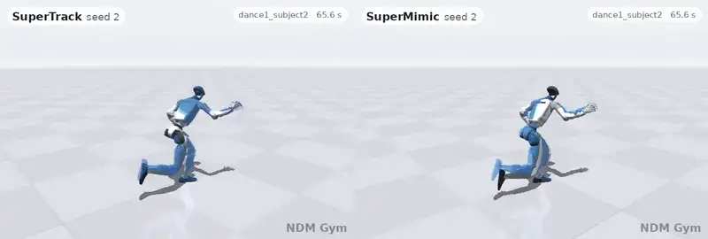</td>
<td>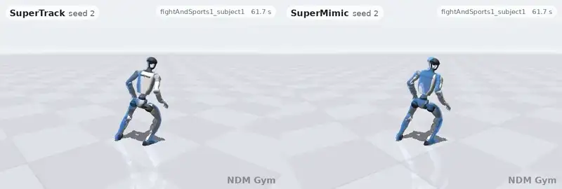</td>
</tr>
<tr>
<td>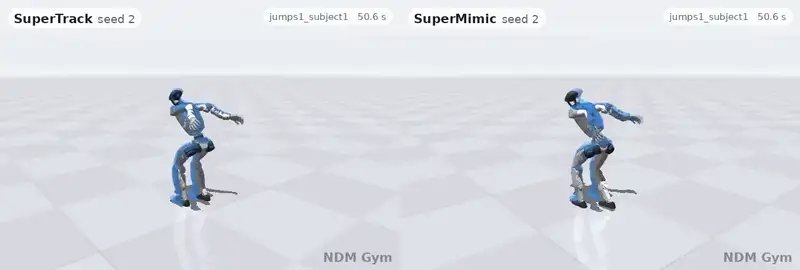</td>
<td>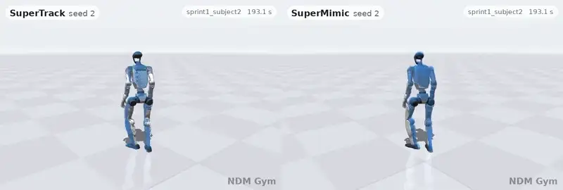</td>
</tr>
<tr>
<td>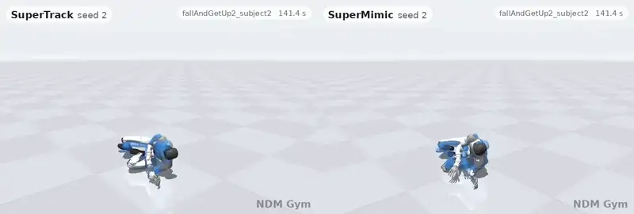</td>
<td>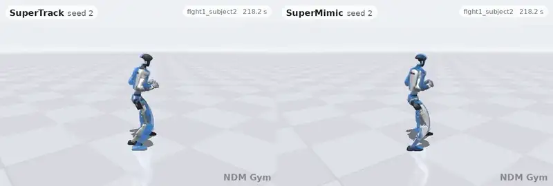</td>
</tr>
</table>
<p align="center"><i>SuperTrack (left) and SuperMimic (right): the selected configurations, seed 2, 3 h checkpoints on an A100. One clip per motion category that both completed, its 10 s with the most motion. Blue ghost: the reference.</i></p>
<!-- videos:end -->
<p align="center"><sub>Renders of LAFAN1 motions (© 2018 Ubisoft Entertainment; CC BY-NC-ND 4.0; <a href="https://github.com/ubisoft/ubisoft-laforge-animation-dataset">https://github.com/ubisoft/ubisoft-laforge-animation-dataset</a>), retargeted to the G1 (LAFAN1 Retargeting Dataset), resampled, cut to 10 s and rendered. For non-commercial illustration only; not covered by this repository's MIT license (see <a href="NOTICE">NOTICE</a>).</sub></p>

<!-- videos_rf:begin -->
<table>
<tr>
<td>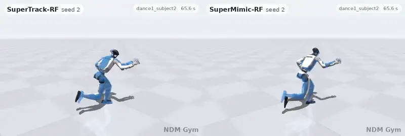</td>
<td>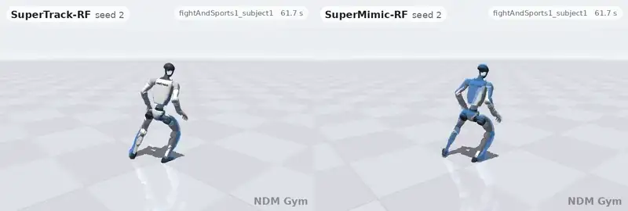</td>
</tr>
<tr>
<td>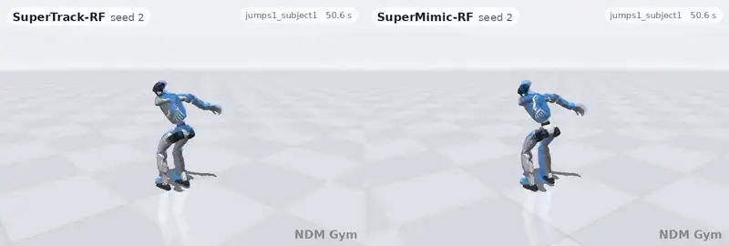</td>
<td>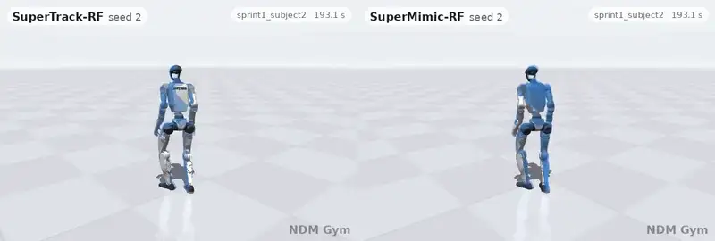</td>
</tr>
<tr>
<td>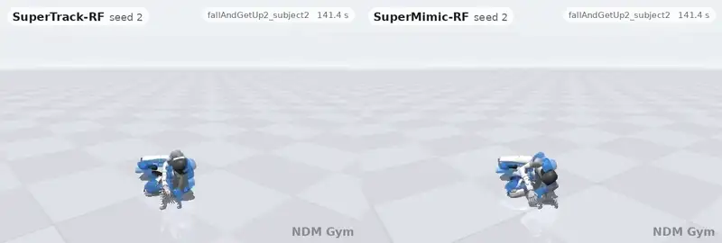</td>
<td>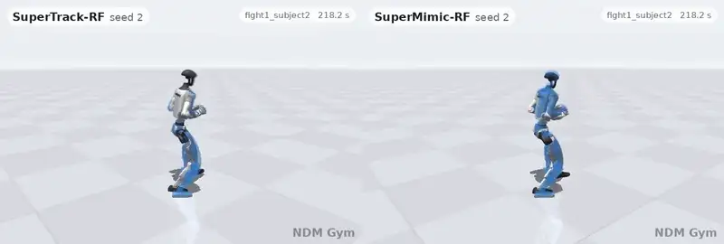</td>
</tr>
</table>
<p align="center"><i>SuperTrack-RF (left) and SuperMimic-RF (right): the RigidFormer setting picked so far (RF-S, world-model learning rate 4e-4; online tuning in progress), seed 2, checkpoints at equal iterations (12,670 / 13,540) on an A100. Same clips and windows.</i></p>
<!-- videos_rf:end -->
<p align="center"><sub>Renders of LAFAN1 motions (© 2018 Ubisoft Entertainment; CC BY-NC-ND 4.0; <a href="https://github.com/ubisoft/ubisoft-laforge-animation-dataset">https://github.com/ubisoft/ubisoft-laforge-animation-dataset</a>), retargeted to the G1 (LAFAN1 Retargeting Dataset), resampled, cut to 10 s and rendered. For non-commercial illustration only; not covered by this repository's MIT license (see <a href="NOTICE">NOTICE</a>).</sub></p>

NDM Gym trains controllers that learn through a world model. Every algorithm shares one pipeline (Isaac Lab 3 with
MuJoCo-Warp, the Unitree G1 with 29 DoF, LAFAN1 motions), so a comparison changes only the algorithm.

## 🔥 News

- **[2026-10]** A benchmark covering SuperTrack and SuperMimic on G1 / LAFAN1: [results](#-results) and [ablations](benchmarks/g1_lafan1_tracking/ablations.md).
- **[2026-10]** [RigidFormer](https://frank-zy-dou.github.io/projects/RigidFormer/) world-model backbone (`--wm_backbone rigidformer`).
- **[2026-10]** First release, equivalence-tested against an unofficial SuperMimic reproduction (no official code is released).

## ✨ Features

- **Algorithms:** SuperTrack and SuperMimic, both learning by backpropagation through a world model.
- **World models:** acceleration (SuperTrack) and increment (SuperMimic) models, each with an MLP or a
  [RigidFormer](docs/rigidformer_backbone.md) backbone.
- **Evaluation:** tracking errors on every clip, push robustness, held-out clips (`--clips`), side-by-side videos and an
  offline world-model benchmark.
- **Fair comparisons:** equal tuning budgets, selection rules declared before the runs, confidence intervals
  ([details](benchmarks/g1_lafan1_tracking/results.md#how-the-numbers-were-obtained)).

| | MLP world model (default) | RigidFormer world model |
|---|---|---|
| **SuperTrack** | `--algo supertrack` | **SuperTrack-RF**: `--algo supertrack --wm_backbone rigidformer` |
| **SuperMimic** | `--algo supermimic` | **SuperMimic-RF**: `--algo supermimic --wm_backbone rigidformer` |
| world-model parameters | 8.75 M (SuperTrack), 8.82 M (SuperMimic) | 0.88 M |

Benchmark settings: SuperTrack adds `--st_fail_w 5 --st_balance_w 4`, SuperMimic `--reward_std_scale 0.7 --action_noise 0.3
--imag_start_perturb 0.3`, and the RigidFormer runs `--wm_lr 4e-4`.

## 🛠️ Installation

Linux with an NVIDIA GPU.

```bash
git clone --recursive https://github.com/Frank-ZY-Dou/ndm-gym.git && cd ndm-gym
bash scripts/setup.sh                 # Isaac Lab 3 and locked dependencies into ~/ndm_gym/venv, motions and G1 into data/
source ~/ndm_gym/venv/bin/activate    # ndm-train and ndm-eval on PATH
```

## 🚀 Getting Started

```bash
# train (scripts/run_train.sh adds a memory cap, CPU pinning and a GPU lock)
ndm-train --algo supertrack --st_fail_w 5 --st_balance_w 4 --max_hours 3 --log_dir logs/st
ndm-train --algo supermimic --reward_std_scale 0.7 --action_noise 0.3 --imag_start_perturb 0.3 --max_hours 3 --log_dir logs/sm

# evaluate every checkpoint as it is written; push robustness of one checkpoint
ndm-eval --run_dir logs/st --watch
ndm-eval --run_dir logs/st --ckpt logs/st/ckpt_012000.pt --push_mag 0 1 2 --out_json push.json

# compare: curves, then side-by-side videos of recorded evaluations
python tools/plot.py logs/st logs/sm --labels SuperTrack SuperMimic --out compare.png
ndm-eval --run_dir logs/st --ckpt <ckpt> --record st.npz      # and the same for sm.npz
MUJOCO_GL=egl python tools/compare_videos.py st.npz sm.npz --labels SuperTrack SuperMimic --out videos/

# world models offline: a training and a test set from one policy, then a fit
python -m ndm_gym.wmbench.collect --ckpt logs/st/ckpt_006000.pt --out wm_train.pt --seed 0
python -m ndm_gym.wmbench.collect --ckpt logs/st/ckpt_006000.pt --out wm_test.pt --seed 1
python -m ndm_gym.wmbench.fit --algo supertrack --train wm_train.pt --test st=wm_test.pt --out wm_st.csv
```

## 📊 Results

Selected configurations, seeds 1-3, 3 h on one A100, all 40 LAFAN1 clips. Each cell is the mean ± std over seeds;
each seed averages three standard evaluations (the push rows use one push test). H100 results and diagnostics are in
[`results.md`](benchmarks/g1_lafan1_tracking/results.md).

<!-- results:begin -->
| | SuperTrack | SuperMimic |
|---|---|---|
| normalized return | 0.832 ± 0.009 | 0.824 ± 0.013 |
| failed clips (of 40) | 0.9 ± 0.8 | 1.2 ± 1.2 |
| MPJPE, root-relative (mm) | 20.0 ± 0.7 | 28.4 ± 0.5 |
| joint-angle error (deg) | 2.32 ± 0.06 | 4.89 ± 0.03 |
| root-orientation error (rad) | 0.059 ± 0.003 | 0.051 ± 0.004 |
| body-velocity error (m/s) | 0.224 ± 0.006 | 0.203 ± 0.003 |
| failed clips under root pushes of 1 m/s every 2 s | 7.7 ± 2.3 | 1.7 ± 0.6 |
| failed clips under root pushes of 2 m/s every 2 s | 24.7 ± 1.2 | 9.3 ± 1.2 |
| iterations in 3 h | 12,670 | 13,540 |
<!-- results:end -->

### Key findings

1. **Main comparison.** Return and failed clips are on par (0.832 and 0.824; 0.9 and 1.2 of 40). SuperTrack tracks more
   precisely (MPJPE 20.0 against 28.4 mm). SuperMimic fails fewer clips under pushes (1.7 / 9.3 against 7.7 / 24.7 at
   1 / 2 m/s).
2. **Where the differences come from.**
   - Action parameterization: with SuperTrack's offsets about the reference pose, SuperMimic's MPJPE falls to 25.0 mm
     (-3.3 mm).
   - Imagination kicks: without them SuperMimic fails 6.0 / 18.7 clips under the pushes.
   - Giving SuperTrack SuperMimic's action noise and kicks changes its push failures by -3.3 / -6.7 clips (not
     significant) and raises its MPJPE by 2.7 mm.
3. **What SuperTrack needs.**
   - The four additions to the paper's objective (failure penalty, balance weights, task penalties, world-space root
     terms) raise return from 0.53 to 0.83 and cut MPJPE from 96 to 20 mm.
   - Without the task penalties, training is unstable (return -0.17).
   - Without the world-space root terms, return falls to 0.66 and MPJPE rises to 137 mm.
4. **What SuperMimic needs.**
   - Its tuned changes (reward kernels ×0.7, action noise 0.3, imagination kicks) account for its push robustness: the
     round-1 configuration fails 4.3 / 11.0 more clips.
   - Without the critic, it fails all 40 clips at 3 h (return 0.03).
5. **RigidFormer.**
   - Its world model predicts better offline with its learning rate tuned: at 4e-4, picked on the benchmark's test sets
     (the MLP keeps 2e-4), the open-loop error is 7-16% lower in distribution and 11-21% lower out of it (three fits
     each, all significant); at the shared default 2e-4 it is -4% / -11% for SuperTrack's model and +8% / +0% for
     SuperMimic's (only the -11% significant). It has a tenth of the parameters.
   - Its policies are not better at equal iterations, and an iteration costs about 3x as much.
   - Three pre-declared checks ([results](benchmarks/g1_lafan1_tracking/results.md#rigidformer-check-1-dynamics-shifts)):
     under friction and payload shifts, 9 of 10 conditions show no significant difference (SuperTrack-RF's MPJPE is
     higher at friction 0.5); the sample-efficiency hypothesis holds for neither algorithm; on 7 held-out LAFAN1 clips,
     neither generalizes significantly better or worse.
   - It is now being tuned online, as the MLP was.
6. **H100.**
   - SuperTrack first reaches return 0.82 after 1.25 h and SuperMimic after 1.48 h (the paper reports 1.2 h with its own
     configuration).
   - After about 20k iterations, SuperMimic's evaluations drop (0.074 at 3 h) while its training episodes keep
     improving. Its 3 h policies track only with their training action noise
     ([details](benchmarks/g1_lafan1_tracking/results.md#supermimics-late-drop-diagnostic)).
   - With the paper's action noise 0.1 instead of 0.3 (noise check, seeds 1-3), no seed drops: at 3 h the return is
     0.854 ± 0.003 with 0.2 failed clips, and 3.0 / 11.7 clips fail under 1 / 2 m/s pushes
     ([details](benchmarks/g1_lafan1_tracking/results.md#noise-check-supermimic-with-action-noise-01)).

## 🔬 Ablations

<!-- ablations:begin -->
✅ helps · ⚖️ trade-off · ❌ hurts · ➖ no clear effect. Policy rows: leave-one-out study, seeds 1-3, 3 h; an effect counts when its Welch 95% interval against the full configuration excludes 0 (return, failed clips, MPJPE, failed clips under 1 and 2 m/s pushes). World-model rows: open-loop 32-step error of offline fits, three per variant (bold: significant). Preliminary single-seed runs and all numbers: [`ablations.md`](benchmarks/g1_lafan1_tracking/ablations.md).

| | | factor | effect |
|---|---|---|---|
| ✅ | SuperTrack | failure penalty and balance weights together | higher return, fewer failed clips, fewer failed clips under 1 and 2 m/s pushes |
| ✅ | SuperTrack | task penalties (action rate, joint limits) | higher return, fewer failed clips, fewer failed clips under 1 and 2 m/s pushes |
| ✅ | SuperTrack | world-space root terms | higher return, lower MPJPE |
| ✅ | SuperTrack | the four additions to the paper's objective together | higher return, fewer failed clips, lower MPJPE, fewer failed clips under 1 and 2 m/s pushes |
| ⚖️ | SuperTrack | failure penalty | fewer failed clips, higher MPJPE, fewer failed clips under 1 and 2 m/s pushes |
| ❌ | SuperTrack | imagination noise on the offsets | more failed clips at 2 m/s pushes |
| ❌ | SuperTrack | SuperMimic's action noise and imagination kicks | higher MPJPE |
| ❌ | SuperTrack | RigidFormer world model (SuperTrack-RF), at 3 h | lower return, more failed clips, higher MPJPE |
| ❌ | SuperTrack | RigidFormer world model (SuperTrack-RF), at equal iterations | higher MPJPE |
| ➖ | SuperTrack | balance weights | none beyond seed noise |
| ✅ | SuperMimic | narrower reward kernels (×0.7) | lower MPJPE, fewer failed clips at 1 m/s pushes |
| ✅ | SuperMimic | simulator action noise 0.3 instead of 0.1 | fewer failed clips at 1 m/s pushes |
| ✅ | SuperMimic | imagination kicks | fewer failed clips under 1 and 2 m/s pushes |
| ✅ | SuperMimic | the critic | higher return, fewer failed clips, fewer failed clips under 1 and 2 m/s pushes |
| ✅ | SuperMimic | the tuned changes together (against round 1) | fewer failed clips under 1 and 2 m/s pushes |
| ✅ | SuperMimic | offsets about the reference pose (SuperTrack's actions) | lower MPJPE |
| ❌ | SuperMimic | RigidFormer world model (SuperMimic-RF), at 3 h | lower return, higher MPJPE, more failed clips at 1 m/s pushes |
| ➖ | SuperMimic | RigidFormer world model (SuperMimic-RF), at equal iterations | none beyond seed noise |
| ✅ | World model, offline | more training data | open-loop error **-22%** in distribution, **-19%** out of it |
| ✅ | World model, offline | no LayerNorm (both world models) | open-loop error **-17 to -16%** in distribution, **-14%** out of it |
| ✅ | World model, offline | RigidFormer backbone at the default learning rate, SuperTrack's model | open-loop error -4% in distribution, **-11%** out of it |
| ✅ | World model, offline | RigidFormer backbone (lr 4e-4, as trained online), SuperTrack's model (SuperTrack-RF) | open-loop error **-16%** in distribution, **-21%** out of it |
| ✅ | World model, offline | RigidFormer backbone (lr 4e-4, as trained online), SuperMimic's model (SuperMimic-RF) | open-loop error **-7%** in distribution, **-11%** out of it |
| ❌ | World model, offline | L2 loss; pre-failure windows (both world models) | open-loop error **+6 to +8%** in distribution, **+5 to +7%** out of it |
| ➖ | World model, offline | RigidFormer backbone at the default learning rate, SuperMimic's model | open-loop error +8% in distribution, +0% out of it |
| ➖ | World model, offline | training data from a noisier policy (both world models; the three fits differ widely) | open-loop error -16 to +2% in distribution, -17 to -2% out of it |
| ➖ | World model, offline | error-prioritized windows; input noise; 4 integration substeps; GELU / ELU / Mish instead of SiLU | open-loop error -3 to +2% in distribution, -3 to +2% out of it |
<!-- ablations:end -->

## 📚 Documentation

| | |
|---|---|
| [`benchmarks/g1_lafan1_tracking/`](benchmarks/g1_lafan1_tracking/) | the benchmark covering SuperTrack and SuperMimic: results and ablations |
| [`docs/rigidformer_backbone.md`](docs/rigidformer_backbone.md) | RigidFormer world-model backbone: design, speed, validation |

<details>
<summary><b>Repository layout</b></summary>

| Path | What |
|---|---|
| `ndm_gym/core/` | rotations, differentiable articulation FK, MLPs, running normalizers |
| `ndm_gym/robots/g1.py` | Unitree G1 29-DoF spec: joints, actuators, default pose, assets |
| `ndm_gym/motion/` | motion library (50 Hz goals) and loaders (`sources/lafan1.py`) |
| `ndm_gym/sim/rigid/` | Isaac Lab 3 + MuJoCo-Warp tracking simulator with return-based resets |
| `ndm_gym/tasks/tracking.py` | observations, the tracking reward of SuperMimic's setup, termination, critic features |
| `ndm_gym/worldmodels/` | `accel.py` (SuperTrack), `increment.py` (SuperMimic), `rigidformer.py` (backbone) |
| `ndm_gym/policies/` | tracking policy and critic |
| `ndm_gym/algos/` | `common.py` (world-model fitting, imagination starts), `supertrack.py`, `supermimic.py` |
| `ndm_gym/wmbench/` | offline world-model benchmark |
| `ndm_gym/train.py`, `ndm_gym/evaluate.py` | `ndm-train`, `ndm-eval` |
| `scripts/`, `tools/` | install and launch scripts; rendering, plots, ablation tables, diagnostics |
| `benchmarks/` | studies run with the library: results and ablations |
| `tests/` | equivalence tests against the upstream code, component tests |
| `third_party/supermimic` | upstream checkout (submodule) for the equivalence tests |

</details>

## 🧪 Development

```bash
python -m pytest tests          # CPU; the equivalence tests compare against third_party/supermimic
```

## 📄 Papers

Implemented:
- **SuperTrack:** L. Fussell, K. Bergamin, D. Holden. *SuperTrack: Motion Tracking for Physically Simulated Characters
  using Supervised Learning.* ACM Transactions on Graphics 40(6), 2021. [DOI](https://doi.org/10.1145/3478513.3480527)
- **SuperMimic:** Q. Liao, Y. Shao, J. Long, K. Zakka, R. Horowitz, P. Abbeel, K. Sreenath. *SuperMimic: Scaling
  Humanoid Whole-Body Control with One Differentiable World Model.* CoRL 2026. [arXiv:2610.28480](https://arxiv.org/abs/2610.28480)
- **RigidFormer:** Z. Dou, M. Guo, H. Wu, D. Roble, T. Stuyck, W. Matusik. *RigidFormer: Learning Rigid Dynamics using
  Transformers.* arXiv preprint, 2026. [arXiv:2605.09196](https://arxiv.org/abs/2605.09196) ·
  [project page](https://frank-zy-dou.github.io/projects/RigidFormer/)

Data:
- **LAFAN1** (motions and the held-out split, subject 5): F. G. Harvey, M. Yurick, D. Nowrouzezahrai, C. Pal. *Robust
  Motion In-betweening.* SIGGRAPH 2020. [DOI](https://doi.org/10.1145/3386569.3392480)

Simulation:
- **Isaac Lab:** M. Mittal et al. *Isaac Lab: A GPU-Accelerated Simulation Framework for Multi-Modal Robot Learning.*
  arXiv preprint, 2025. [arXiv:2511.04831](https://arxiv.org/abs/2511.04831)
- **MuJoCo:** E. Todorov, T. Erez, Y. Tassa. *MuJoCo: A physics engine for model-based control.* IROS 2012.
  [DOI](https://doi.org/10.1109/IROS.2012.6386109)

Planned (human-object interaction):
- **HDMI:** H. Weng, Y. Li, N. Sobanbabu, Z. Wang, Z. Luo, T. He, D. Ramanan, G. Shi. *HDMI: Learning Interactive
  Humanoid Whole-Body Control from Human Videos.* arXiv preprint, 2025.
  [arXiv:2509.16757](https://arxiv.org/abs/2509.16757) · [code](https://github.com/LeCAR-Lab/HDMI)
- **OmniRetarget** (data): L. Yang, X. Huang, Z. Wu, A. Kanazawa, P. Abbeel, C. Sferrazza, C. K. Liu, R. Duan, G. Shi.
  *OmniRetarget: Interaction-Preserving Data Generation for Humanoid Whole-Body Loco-Manipulation and Scene
  Interaction.* arXiv preprint, 2025. [arXiv:2509.26633](https://arxiv.org/abs/2509.26633)

## 📝 Citation

```bibtex
@misc{ndmgym2026,
  title        = {NDM Gym: Neural Dynamics Modeling Gym},
  author       = {{NDM Gym Contributors}},
  year         = {2026},
  howpublished = {\url{https://github.com/Frank-ZY-Dou/ndm-gym}}
}
```

## 📜 License and Acknowledgments

MIT ([`LICENSE`](LICENSE)). The code started from [zita-ch/supermimic_vibed](https://github.com/zita-ch/supermimic_vibed)
@ `ee0608f` (MIT, Chong Zhang), an unofficial SuperMimic reproduction (no official code is released). Isaac Lab
(BSD-3-Clause), Newton and MuJoCo Warp (Apache-2.0) are used unmodified. LAFAN1 motions (Ubisoft La Forge,
CC BY-NC-ND 4.0) and their G1 retargets (Hugging Face
[lvhaidong/LAFAN1_Retargeting_Dataset](https://huggingface.co/datasets/lvhaidong/LAFAN1_Retargeting_Dataset)), which
stay under that license, are downloaded by `tools/download_data.sh` and not redistributed. The G1 description (URDF,
meshes) is BSD-3-Clause (Unitree).
