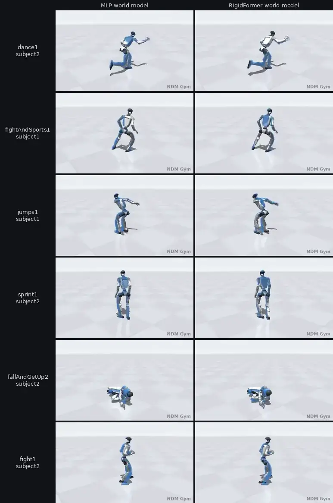
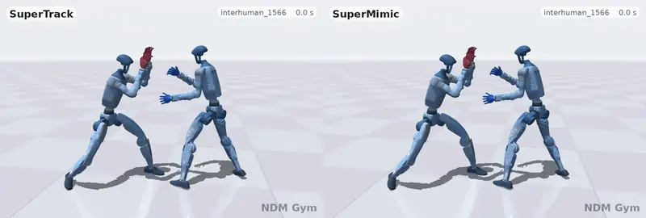
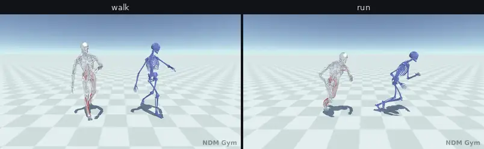
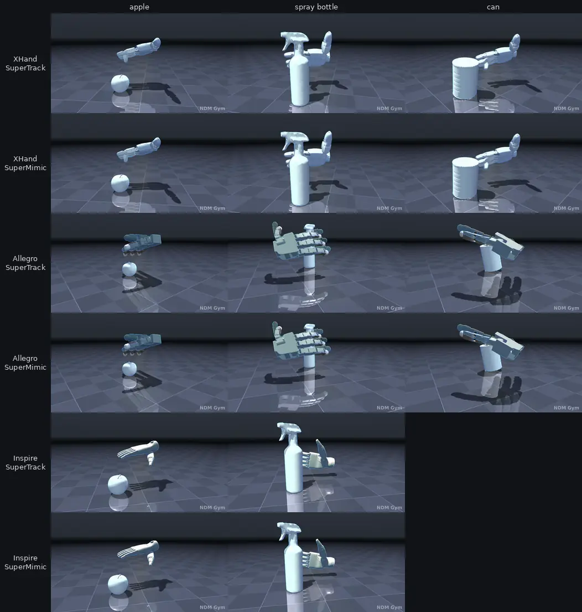
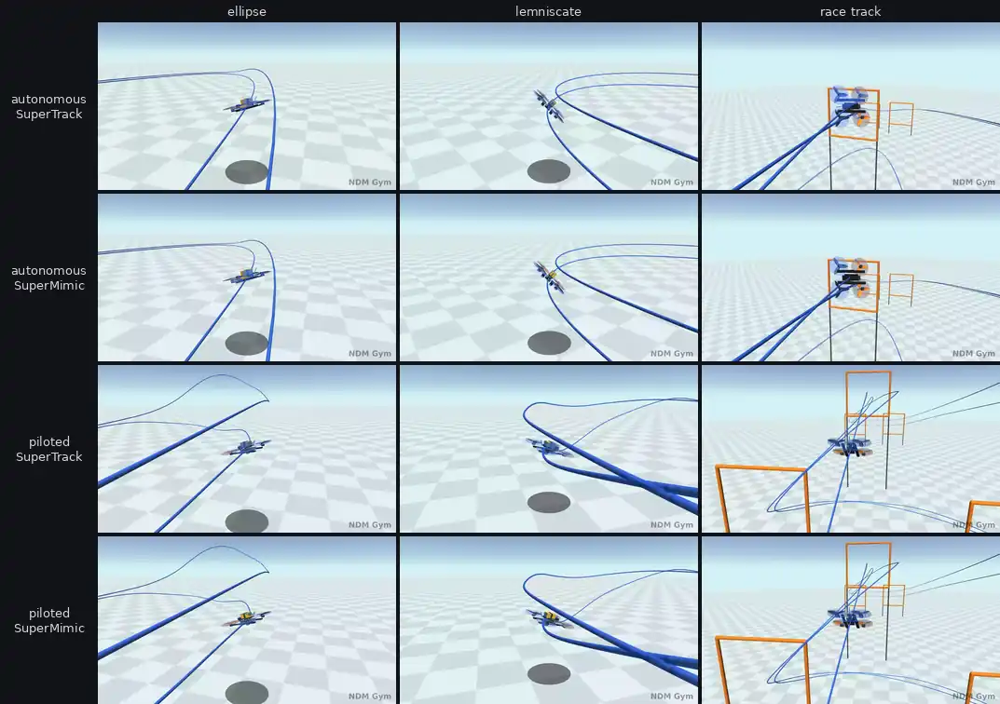
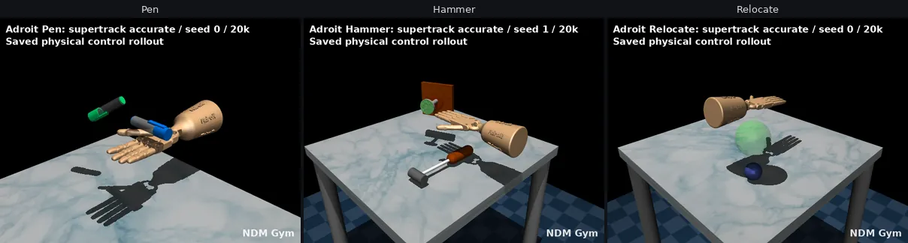
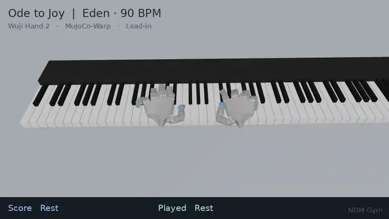
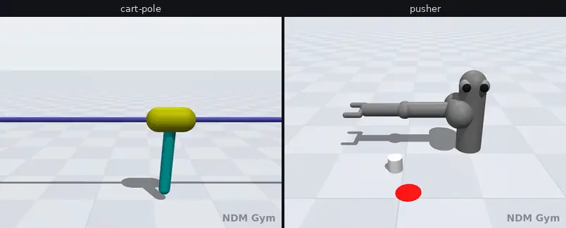

<div align="center">
<h1>NDM Gym</h1>

<a href="LICENSE"></a>

<a href="https://github.com/isaac-sim/IsaacLab"></a>
<a href="https://github.com/google-deepmind/mujoco_warp"></a>
<a href="https://huggingface.co/frankzydou/ndm-gym"></a>
<a href="https://frank-zy-dou.github.io/ndm-gym/"></a>

**Neural Dynamics Modeling Gym**: neural world models for controlling physical agents.

<a href="#-results">Results</a> · <a href="#key-findings">Key findings</a> · <a href="#-installation">Installation</a> · <a href="#-getting-started">Getting started</a> ·
<a href="https://frank-zy-dou.github.io/ndm-gym/">Documentation</a> · <a href="#-citation">Citation</a>
</div>

NDM Gym trains controllers of physical agents through neural dynamics models (NDMs): world models learned from a
simulator's transitions. The policy learns by backpropagation through the NDM's imagined rollouts. Batched on a GPU, an
NDM also steps faster than the physics it learned, so NDMs serve as simulators too ([speed](#-speed)).

The algorithms share one pipeline within each task:

- **Unitree G1** (29 DoF; Isaac Lab 3 with MuJoCo-Warp): LAFAN1 motion tracking, two G1s on a two-person clip, HDMI's
  human-object interaction.
- **Muscles:** MuscleVAE's muscle-actuated character (Newton with MuJoCo-Warp).
- **Hands:** hand-object tracking with the XHand, the Allegro hand and the Inspire hand (MuJoCo-Warp).
- **Quadrotor:** a racing quadrotor tracking flown trajectories, autonomous and piloted (MuJoCo-Warp).
- **Adroit hand:** Door, Pen, Hammer and Relocate tracking of DAPG demonstrations, with each task's native actuators
  (MuJoCo CPU physics and CUDA learning).
- **Quadruped:** a Unitree Go2 tracking a Labrador's motion capture, one clip or all 65 (MuJoCo-Warp).
- **Piano:** two floating Wuji Hand 2 hands playing Eden's *Ode to Joy* on 88 passive keys, with no fingering given
  (MuJoCo-Warp).
- **Manipulation:** one or two Franka Pandas tracking robomimic's human demonstrations of Lift, Square and Transport, the
  objects with them (MuJoCo-Warp).

World models also stand in for the physics inside planners: RoboKit's sampling MPC (G1 box carrying, G1 climbing, Go2
jumping) and mbrl-lib's CEM controller (PETS' cart-pole and pusher) score their candidates on a world model of the task's
MuJoCo model.

<p align="center"></p>
<p align="center"><i>SuperTrack on four LAFAN1 clips, two G1s, the muscles' walk and run, a racing quadrotor, the Wuji piano, three hands and four Adroit tasks (half speed), and robomimic's Lift and Square (1.5x); SuperMimic on robomimic's Transport (4x).<br>Four HDMI tasks trained in the world model (1.5x speed); RoboKit and mbrl-lib (half speed) planning on SuperTrack's world model.</i></p>
<p align="center"><sub>Renders of LAFAN1 (© 2018 Ubisoft Entertainment; CC BY-NC-ND 4.0), MuscleVAE, InterHuman (CC BY-NC-SA 4.0), SPIDER's hand retargets, HDMI and RoboKit (with an OMOMO clip), for non-commercial illustration only, and of Race Against the Machine's flights (CC BY 4.0), DAPG's door, pen, hammer and relocate demonstrations in Gymnasium-Robotics' scenes and Eden's <i>Ode to Joy</i> on RoboPianist's keyboard (Apache-2.0) with Wuji Technology's hands (MIT), and of robomimic's demonstrations (MIT) in robosuite 1.5.0's scenes (MIT); not covered by this repository's MIT license (<a href="NOTICE">see NOTICE</a>).</sub></p>

<details>
<summary>The teaser's runs and errors</summary>

| block | runs | tracking error, speed-up |
|---|---|---|
| LAFAN1 tracking | SuperTrack's configuration from the tuning rounds, MLP world model, seed 2, 3 h checkpoint: dance1_subject2, fight1_subject2, fallAndGetUp2_subject2 and sprint1_subject2, 6 s of each clip's window in its section | |
| Two G1s, muscles | SuperTrack's selected configuration on each task, MLP world model; MuscleVAE's walk and run | two G1s 13.2 mm (MPJPE, root-relative, over the window shown); the walk 24.9 mm (MPJPE, root frame, over its episodes) |
| Hand-object | SuperTrack's runs in its section's grid ([which](benchmarks/xhand_tracking/results.md#the-readmes-animations)): the XHand on the spray bottle and the apple, the Allegro hand on the spray bottle, the Inspire hand on the apple; half speed, last frames held | |
| Human-object interaction | carry_box_over_shoulder, open_foldchair-sit, roll_ball-hand and topple_wood_board_and_cross: one policy per task, trained in the world model and run in the simulator (evaluation seed 1), at 1.5 times the speed | |
| RoboKit planning | G1 box carrying, G1 climbing and Go2 jumping, planned on SuperTrack's world model and executed on MuJoCo Warp; the references in blue | planning 3.0x, 1.8x and 2.1x faster than on MuJoCo Warp |
| mbrl-lib planning | its CEM controller planning on SuperTrack's acceleration model, each plan executed in MuJoCo: the cart-pole (planner seed 10) and the pusher (seed 17), recorded again on a CPU in fp32 with the A100 runs' fits; half speed | returns 175.96 and -65.89 (175.77 and -62.53 in the A100 runs) |
| Racing quadrotor | `quadrotor-supertrack-accurate`, seed 0, 6,000 iterations, trained on an A100 40GB SXM4; from the unperturbed start, the chase camera at 1.25 m, in real time | position 1.98, 2.75 and 3.06 mm (the configuration's mean of seeds 0-2 on A100 40GB SXM4 GPUs, over 256 perturbed starts) |
| Adroit door | `--method supertrack --residual-scale 0.2 --door-latch-offset 0.3` (the door and latch started up to 0.3 rad open), training seed 0, 20,000 iterations on an A100 40GB SXM4: its evaluation's nominal start (door and latch closed, the hand unperturbed), in a brighter scene; half speed, its last frame held | that start: return 9.022, the door opened; the configuration: the door open on 99.3 % of 256 starts, return 8.165 ± 0.054 (seeds 0-2, A100 40GB) |
| Adroit pen, hammer, relocate | SuperTrack's runs at 20,000 iterations in 2,048 worlds on an L40S: pen seed 0, hammer seed 1, relocate seed 0, each the lowest tracking error of its task's six runs; the nominal episode at half speed (the hammer from 1 s), last frames held | normalized tracking RMSE 0.049, 0.022 and 0.048; 251, 256 and 256 of 256 native final successes |
| Wuji piano | `supertrack --horizon 3 --st-reg 0.01`, training seed 0, 20 rounds on an A100 40GB SXM4: its replay's nominal start, the song's first 6 s (the episode's 1-7 s), in a light scene, in real time | that start: Eden F1 0.921, 19 of 19 notes; the configuration: Eden F1 0.903 ± 0.015 on 256 starts (seeds 0-2, A100 40GB) |
| Manipulation | per task the run with the lowest object error among both algorithms' runs whose own unperturbed rollout passes the success test and the motion check, each stopped by the benchmark's rule on an A100 40GB SXM4: `robomimic-supertrack` Lift seed 11 and Square seed 10, `robomimic-supermimic` Transport seed 10; from the unperturbed start, Lift in real time, Square at 1.5 times the speed, Transport at four times over 12-36 s of its demonstration | object 0.25, 0.91 and 3.13 mm at a success of 100, 100 and 98.0 % (each run's 256 perturbed starts) |

</details>

## ⚡ Speed

<p align="center"></p>
<p align="center"><sub>Bars: time per step on the same task, the baseline's at full width, at 4,096 parallel worlds (the Adroit door's: 16,384); the planners' rows: planning time. Made by <code>tools/make_speedup_chart.py</code>.</sub></p>

**Why a world model steps faster than a rigid-body solver** (the G1 at 4,096 worlds on one A100 40GB SXM4,
[results](benchmarks/steel/results.md)):

- A world model's step is one network pass over the batch. The network is 80 % of its kernel time, and the step takes
  0.28 and 0.29 ms (SuperTrack's and SuperMimic's MLP world models).
- A solver's step is the robot's dynamics and contacts. [Steel](https://www.skild.ai/blogs/steel) (Skild AI), at its
  fastest setting that passes the accuracy criteria, spends 47.5 % of its kernel time on articulation dynamics, 25.9 % on
  collision and 20.3 % on contact rows: 4.68 ms a step.
- So the world models step 16.9x and 16.1x faster than Steel there, and 42.4x and 40.2x faster than MuJoCo Warp in Isaac
  Lab. After 32 steps their body errors are 19.6 and 22.8 mm, Steel's 30.2 mm, against the task's simulator, which the world
  models learned from.

<details>
<summary>The chart's rows</summary>

| rows | measure | GPU |
|---|---|---|
| NDM simulation: HDMI's scenes ([details](benchmarks/ndm_speed/results.md)), two G1s ([details](benchmarks/g1_boxing/results.md#speed)); the RigidFormer on HDMI's scenes | time per step at 4,096 worlds (two G1s: 4,096 pairs), the MLP world model's bf16 copy and the RigidFormer with fused Triton blocks; HDMI's scenes: the median of three tasks | HDMI's scenes: one H100; two G1s: one A100 80GB |
| NDM simulation: the G1 on LAFAN1's replay windows, against Steel ([details](benchmarks/steel/results.md)) | control steps per second at 4,096 worlds: SuperTrack's acceleration MLP (`lafan1-supertrack-accurate`) and SuperMimic's semi-implicit MLP (`lafan1-supermimic-accurate`) as bf16 copies with the fused step, 14.80 M and 14.06 M, against Steel's fastest setting that passes the accuracy criteria, 0.875 M (16.9x, 16.1x); MuJoCo Warp in Isaac Lab 0.349 M (42.4x, 40.2x). On four GPUs 89.2 M and 87.1 M, Steel's 4.13 M. The network is 80 % of the world model's kernel time; articulation dynamics and collision are 73 % of Steel's | one A100 40GB SXM4 (four for the four-GPU numbers) |
| NDM simulation: the Adroit door ([details](benchmarks/adroit_door/results_a100.md#the-world-model-as-the-simulator)) | world-steps per second at 16,384 worlds: SuperTrack's acceleration model as a bf16 copy, 27.62 M against MuJoCo Warp's 0.396 M (69.7x); SuperMimic's increment model 27.14 M against 0.422 M (64.3x); 1,629x / 1,600x the contributed native MuJoCo collector on eight CPU cores (16,962 world-steps/s). The bf16 step is 64 % / 66 % matrix products, the rest compiled elementwise kernels | one A100 40GB SXM4 |
| NDM simulation: the racing quadrotor ([details](benchmarks/quadrotor_racing_tracking/results_a100.md#the-world-model-as-the-simulator)) | world-steps per second at 4,096 worlds, the fused step in fp32 (TF32 products) with the network as one kernel: SuperTrack's acceleration model 74.3 M against MuJoCo Warp's 3.26 M (22.8x); SuperMimic's increment model 73.7 M against 3.27 M (22.6x); with the network compiled layer by layer 19.6x / 19.0x. The network is 85 % of the step | one A100 40GB SXM4 |
| NDM simulation: the Wuji piano ([details](benchmarks/wuji_piano/results_a100.md#the-world-model-as-the-simulator)) | world-steps per second at 4,096 worlds: the horizon-3 SuperTrack run's `PianoDynamics` with its networks in bf16 (compiled, one CUDA graph), 46.24 M against MuJoCo Warp's 30,213 for a control step of the full scene (1,530x; the four seed-0 models, both algorithms at both horizons, 1,523-1,530x). The model steps the policy's 192-number observed state; its due-key error is 0.15 / 0.19 / 0.26 of a key's travel at 1 / 3 / 10 steps, the horizon-3 SuperMimic model's 0.16 / 0.19 / 0.32 | one A100 40GB SXM4 |
| NDM simulation: robomimic's Transport ([details](benchmarks/robomimic_manipulation_tracking/results.md#the-world-model-as-the-simulator)) | world-steps per second at 4,096 worlds, not engineered: the world models of the configurations' seed-0 runs without the smoothness term (the same network) as bf16 copies (compiled, one CUDA graph), SuperTrack's acceleration model 11.63 M against MuJoCo Warp's 15,196 for a control step of the training's scene (765x), SuperMimic's increment model 11.06 M against 14,614 (757x); Lift 256x / 256x and Square 725x / 736x | one A100 40GB SXM4 |
| the G1's forward step and the gradient of a 32-step rollout ([details](benchmarks/ndm_speed/results.md)) | SuperTrack's MLP world model against NablaEngine, MuJoCo Warp with the adjoint of its pull request #1535 and MJX, each in its faster setting | one A100 40GB |
| RoboKit planning ([details](benchmarks/robokit_ndm/results.md)) | the example's whole planning time at the planner's own worlds on the acceleration and on the increment model, the median over twenty plans (planner seeds 0-9, twice; the acceleration model's G1 box carrying over ten, seeds 0-9 once); the simulation step's speedup beside the task | one A100 40GB SXM4 |
| mbrl-lib planning ([details](benchmarks/mbrl_lib/results.md)) | the planner's time per executed step on the acceleration and on the increment model, timed in one session, the median over three planner seeds; the step's speedup at 4,096 worlds beside the task | one A100 80GB SXM4 |

The Adroit door: MuJoCo Warp without no-slip and without multi-contact or native CCD, which it refuses with this model's
margins; the CPU collector and the world models' training data keep no-slip.

</details>

## 🏆 Leaderboard

For each task, the fastest and the most accurate configuration in this repository (LAFAN1: by pose error and by return);
each task's section has its settings table and its results. Hands: apple / spray bottle / can; the target is a success
of 0.99 with the object within 10 mm. Quadrotor: ellipse / lemniscate / race track; the target is a success of 0.99 with
the position within 20 mm. Adroit Pen, Hammer
and Relocate: native final success and normalized tracking RMSE over 256 starts, from contributed runs on an L40S, not
re-verified on an A100. Manipulation: Lift / Square / Transport; the target is the hand task's, a success of 0.99
(robosuite's test at the last frame, a tracking proxy) with the object within 10 mm. Commands:
[Recommended settings](#-recommended-settings), [Results](#-results).

| Task | Goal | Configuration | Result |
|---|---|---|---|
| **[LAFAN1 tracking](#lafan1-motion-tracking)**, 40 clips, MLP world model | 🚀 fastest, one GPU | `lafan1-supertrack-fast` and `lafan1-supermimic-fast` ([BlinkMimic's recipe](#blinkmimics-options), both with the lean options) | return 0.82 after **4.13 ± 0.18** and **3.52 ± 0.30 min**, MPJPE-local there **22.4 ± 0.7** and **27.0 ± 1.0 mm**, on an A100 40GB SXM4 (seeds 0-2) |
|  | 🎯 lowest pose error | `lafan1-supertrack-accurate`, 3 h on an A100 40GB SXM4 | MPJPE-local **10.8 ± 0.0 mm**, joint angle **2.07 ± 0.03°**, return 0.898 ± 0.002 (seeds 7-9); `lafan1-supermimic-accurate` **16.7 ± 0.1 mm**, **2.96 ± 0.02°** |
|  | 📈 highest return | `lafan1-supermimic-accurate`, 3 h on an A100 40GB SXM4 | return **0.915 ± 0.005**, MPJPE-local 16.7 ± 0.1 mm (seeds 7-9); `lafan1-supertrack-accurate` **0.898 ± 0.002** |
| **LAFAN1 tracking**, 40 clips, MLP world model, four GPUs | 🚀 fastest | `lafan1-supertrack-fast-4gpu` and `lafan1-supermimic-fast-4gpu` ([XMimic](docs/algorithms/xmimic.md)'s layout AWL: actor, world model, policy and probe sweeps on a GPU each; the kinematics as fused kernels) | return 0.82 after **1.47 ± 0.05** and **1.42 ± 0.09 min**, MPJPE-local there **21.9 ± 0.5** and **26.9 ± 0.4 mm**, on four A100 40GB SXM4 (seeds 3-5); XMimic's own code, run here on the same GPUs with its evaluator: 1.81 ± 0.13 min (not ranked) |
| **LAFAN1 tracking**, RigidFormer world model | 🎯 lowest pose error | `lafan1-supertrack-rf-accurate` (the small RigidFormer: one token per anatomical joint, width 128, 2 blocks), 3 h on an A100 40GB SXM4 | MPJPE-local **11.9 ± 0.3 mm**, joint angle **2.14 ± 0.03°**, return 0.886 ± 0.003 (seeds 7-9); `lafan1-supermimic-rf-accurate` **18.1 ± 0.5 mm**, **3.30 ± 0.11°** |
|  | 📈 highest return | `lafan1-supermimic-rf-accurate`, 3 h on an A100 40GB SXM4 | return **0.892 ± 0.004**, MPJPE-local 18.1 ± 0.5 mm (seeds 7-9); `lafan1-supertrack-rf-accurate` **0.886 ± 0.003**, level within the seeds' spread |
| **[Two G1s](#two-g1s-one-two-person-clip)**, one two-person clip | 🚀 fastest, one GPU | `two-g1-supertrack` and `two-g1-supermimic` (each algorithm's [fused kernels](#two-g1s-one-two-person-clip) and a halved policy batch) | return 0.88 after **3.48 ± 0.49** and **2.70 ± 0.27 min**, root-relative MPJPE there **16.8 ± 0.9** and **20.5 ± 0.4 mm**, on an A100 40GB SXM4 (MLP world model, seeds 0-3) |
|  | 🚀 fastest, three GPUs | `two-g1-supertrack-3gpu` and `two-g1-supermimic-3gpu` (the same with layout AWL: actor, world model and policy on a GPU each) | return 0.88 after **1.63 ± 0.15** and **1.48 ± 0.16 min**, level within the seeds' spread; root-relative MPJPE there **16.1 ± 0.3** and **20.6 ± 0.5 mm**, on three A100 40GB SXM4 (seeds 0-2) |
|  | 🎯 lowest pose error (root-relative) | `two-g1-supertrack` | root-relative MPJPE **14.1 ± 0.2 mm** (MLP world model, seeds 0-2, 9,396 iterations) |
|  | 📈 highest return | `two-g1-supermimic` | return **0.9055 ± 0.0011** (MLP world model, seeds 0-2, 9,396 iterations) |
| **[Hand-object tracking](#hand-object-tracking)**, Inspire hand, three clips | 🚀 fastest, one GPU | `hand-supertrack-fast` with the [speed options](#hand-object-tracking), without the target-rate penalty | **1.0 / 0.8 / 2.0 min**, every run, mean 1.30 min (an A100 40GB, seeds 0-2; `hand-supermimic-fast --lr 2e-4` 2.19 min) |
|  | 🚀 fastest, three GPUs | `hand-supertrack-fast` with the speed options and `--layout AWL`, without the target-rate penalty | **0.6 / 0.6 / 0.9 min**, every run, mean 0.70 min (three A100 40GB, seeds 0-2; `hand-supermimic-fast --lr 2e-4` 1.46 min) |
|  | 🎯 most accurate, smooth targets | `hand-supertrack-fast --st_imag_noise 0.1 --target_rate_w 12.5 --st_cost_mean --noise_free_frac 0.25 --iterations 20000` | object position **2.5 / 1.4 / 2.8 mm** at a success of 99.9-100 % (seeds 20-22, A100 40GB); `hand-supermimic-accurate` with [HOI's optimizer options](benchmarks/xhand_tracking/results.md#the-allegro-hand-and-the-inspire-hand-with-the-target-rate-penalty) and `--target_rate_w 12.5 --noise_free_frac 0.25` **4.9 / 2.9 / 3.6 mm** at 100 % |
| **Hand-object tracking**, Allegro hand, three clips | 🚀 fastest, one GPU | `hand-supertrack-fast --st_fail_w 5` and `hand-supermimic-fast` with the speed options, without the target-rate penalty, level | **1.1 / 0.8 / 3.9** and **1.0 / 3.7 / 1.1 min**, every run, both a mean of 1.96 min (an A100 40GB, seeds 0-2) |
|  | 🚀 fastest, three GPUs | `hand-supertrack-fast --st_fail_w 5` with the speed options and `--layout AWL`, without the target-rate penalty | **0.7 / 0.7 / 2.7 min**, 8 of 9 runs, mean 1.40 min (three A100 40GB, seeds 0-2; `hand-supermimic-fast` 1.44 min, 7 of 9) |
|  | 🎯 most accurate, smooth targets | `hand-supertrack-fast --st_fail_w 5 --target_rate_w 4 --st_cost_mean --iterations 20000` | object position **2.6 / 1.5 / 2.6 mm** at a success of 99.6-100 % (seeds 0-2 and 17-19, A100 40GB); `hand-supermimic-fast --action_noise 0.2 --target_rate_w 4 --iterations 20000` **3.7 / 3.3 / 3.7 mm** at 99.7-100 % |
| **Hand-object tracking**, XHand, three clips, smooth targets (`--target_rate_w 4`) | 🚀 fastest, one GPU | `hand-supermimic-fast --wm_batches 2` with the [speed options](#hand-object-tracking) | **0.8 / 0.8 / 1.0 min**, every run, mean 0.86 min, object 3.5 mm (an A100 40GB, seeds 0-2); `hand-supertrack-fast --st_cost_mean` mean 0.93 min with the lower object error, 2.5 mm |
|  | 🚀 fastest, three GPUs | `hand-supertrack-fast --st_cost_mean` with the speed options and `--layout AWL` | **0.5 / 0.6 / 0.8 min**, every run, mean 0.62 min, object 2.2 mm (three A100 40GB, seeds 0-2); `hand-supermimic-fast --wm_batches 2` 0.69 min, 3.4 mm |
|  | 🎯 most accurate | `hand-supertrack-fast --st_cost_mean --iterations 20000` | object position **2.9 / 1.6 / 2.3 mm** at a success of 100 % (seeds 0-2, A100 40GB); `hand-supermimic-fast --action_noise 0.2 --iterations 20000` **3.6 / 2.2 / 3.8 mm** |
| **[Quadrotor trajectory tracking](#quadrotor-trajectory-tracking)**, a racing quadrotor, three tracks | ⏱ time to the target, not engineered | `quadrotor-supertrack-fast` | **0.38 / 0.32 / 0.36 min** on the autonomous flights, every run (an A100 40GB SXM4, mean of seeds 0-2); `quadrotor-supermimic-fast` **0.71 / 0.69 / 0.67 min** |
|  | 🎯 most accurate | `quadrotor-supertrack-accurate` | position **3.06 / 1.89 / 1.98 mm** on the autonomous flights, **1.11 / 0.99 / 2.75 mm** on the piloted ones, at a success of 100 % (seeds 0-2, A100 40GB SXM4); `quadrotor-supermimic-accurate` **5.71 / 3.95 / 4.08 mm** and **4.48 / 4.00 / 6.63 mm** |
| **[Adroit Door tracking](#adroit-door-tracking)**, door and latch started up to 0.3 rad open | 🎯 most accurate | `train_door_full --door-latch-offset 0.3` with `--method supertrack --residual-scale 0.2` and with `--method supermimic`, openings level | the door open on **99.3 ± 0.8 %** and **99.5 ± 0.9 %** of 256 starts (the demonstration's controls: 65.2 %); return **8.165 ± 0.054** and **7.927 ± 0.066**, door RMSE 0.1403 ± 0.0054 and 0.1320 ± 0.0060 rad (seeds 0-2, A100 40GB) |
|  | ⏱ time to the target, not engineered | `train_door_full --method supermimic --door-latch-offset 0.3` | 99 % of the starts open after **13.1 ± 7.9 min**, the runs ending at 99.5 % open (seeds 0-2, A100 40GB); `--method supertrack --lr 8e-4` **35.5 ± 13.6 min**, ending at 91.1 %; both in the contributed implementation |
| **[Adroit Pen, Hammer and Relocate tracking](#adroit-pen-hammer-and-relocate-tracking)**, one demonstration each; contributed runs on an L40S, not re-verified on an A100 | 🎯 most accurate, Pen | `train_adroit --method supertrack` | native final success **96.7 ± 1.2 %**, normalized tracking RMSE **0.0519 ± 0.0043**; `--method supermimic` **79.4 ± 28.5 %**, **0.2380 ± 0.1386**; the demonstration's controls alone 58.6 %, 0.4024 (seeds 0-2, L40S) |
|  | 🎯 most accurate, Hammer | `train_adroit --method supertrack` | **100.0 ± 0.0 %**, **0.0485 ± 0.0231**; `--method supermimic --nail-tracking-std .001` **73.0 ± 45.0 %**, **0.0762 ± 0.0155**; the demonstration's controls alone 51.2 %, 0.0389 (seeds 0-2, L40S) |
|  | 🎯 most accurate, Relocate | `train_adroit --method supertrack` | **100.0 ± 0.0 %**, **0.0508 ± 0.0027**; `--method supermimic` **100.0 ± 0.0 %**, **0.2059 ± 0.0255**; the demonstration's controls alone 100.0 %, 0.0316 (seeds 0-2, L40S) |
| **[Wuji Hand piano](#wuji-hand-piano-playing)**, two hands, Eden's *Ode to Joy* | 🎯 most accurate | `run.sh supertrack --horizon 3 --st-reg 0.01` | Eden F1 **0.903 ± 0.015** on 256 held-out starts, SuperMimic's `--horizon 3 --gamma 0.95 --bptt-decay 0.95` **0.833 ± 0.079** (seeds 0-2, A100 40GB); in an earlier set of finals with the same configurations, seeds and GPU type, 0.804 ± 0.140 and 0.708 ± 0.115, with SuperTrack's horizon-8 configuration the most accurate (0.888 ± 0.092) |
| **[Manipulation demonstration tracking](#manipulation-demonstration-tracking)**, one or two Pandas, robomimic's Lift / Square / Transport | ⏱ time to the target, not engineered | `robomimic-supertrack` | **1.03 / 2.12 / 15.76 min** on Lift / Square / Transport, every run, at an object error of 0.58 / 5.02 / 3.75 mm there (seeds 10-12, A100 40GB SXM4; `robomimic-supermimic` 1.11 / 4.53 min at 2.68 / 5.34 mm, Transport not reached) |
|  | 🎯 most accurate | `robomimic-supertrack` | object position **0.26 / 1.48 / 4.24 mm** at a success of 100 / 100 / 99.9 % (seeds 10-12, A100 40GB SXM4; `robomimic-supermimic` 1.01 / 2.55 / 4.50 mm at 100 / 100 / 89.2 %) |
| **[Muscles](#muscle-actuated-character)**, MuscleVAE's character | 🎯 most accurate | `muscles-supertrack-rf` (the body-token RigidFormer, width 128, 2 blocks), 3 h on an A100 40GB PCIe | MPJPE **34.9 ± 0.7 mm** in the root frame, episodes ended 0.0004 ± 0.0008 (seeds 1-3); `muscles-supermimic-rf` **60.2 ± 2.0 mm** (heading frame: 35.1 ± 0.7 and 38.5 ± 3.4 mm), with the lower joint error, 8.7 ± 0.4 against 10.1 ± 0.3 deg; with the MLP, `muscles-supertrack` 38.1 ± 1.0 mm and `muscles-supermimic` 65.6 ± 8.1 mm, joint error 10.6 ± 1.1 and 9.7 ± 0.4 deg (four tuning rounds to the RigidFormer's nine) |
|  | 🚀 fastest | not compared yet | |
| **[NDM in RoboKit's planner](#ndms-in-robokits-planner)**, G1 box carrying / climbing, Go2 jumping, one A100 40GB | ⏱ planning time, not engineered | SuperTrack's acceleration model and SuperMimic's increment model, MLPs as bf16 copies, level | planning **3.0x / 1.8x / 2.1x** and **3.0x / 1.8x / 2.2x** faster than on MuJoCo Warp (9 → 3 / 3, 7 → 4 / 4, 65 → 31 / 30 s); **20 of 20** plans pass on each task for each, MuJoCo Warp's 10 of 10 ([results](benchmarks/robokit_ndm/results.md)) |
| **[NDM in mbrl-lib's planner](#ndms-in-mbrl-libs-planner)**, PETS' cart-pole / pusher, one A100 80GB | ⏱ planning time, not engineered | SuperTrack's acceleration model and SuperMimic's increment model, MLPs as bf16 copies, level | planning **20.8x / 9.9x** and **20.9x / 10.5x** faster than on MuJoCo Warp (0.314 → 0.0151 / 0.0150 s, 0.300 → 0.0303 / 0.0286 s a step), 103.8x / 31.3x and 104.3x / 33.2x faster than mbrl-lib's CPU pool; 30 of 30 / 28 of 30 plans at the bar for each ([results](benchmarks/mbrl_lib/results.md)) |
| **[NDM as the simulator](#adroit-door-tracking)**, the Adroit door, 16,384 worlds on an A100 40GB SXM4 | 🚀 fastest | SuperTrack's acceleration model and SuperMimic's increment model, MLPs as bf16 copies, level | **27.62 M** and **27.14 M world-steps/s**, 69.7x and 64.3x MuJoCo Warp, which was timed beside each model on that model's states (0.396 M and 0.422 M), 1,629x and 1,600x the contributed collector on eight CPU cores; at 4,096 worlds 20.85 M and 21.55 M ([results](benchmarks/adroit_door/results_a100.md#the-world-model-as-the-simulator)) |
| **[NDM as the simulator](#quadrotor-trajectory-tracking)**, the racing quadrotor, 4,096 worlds on an A100 40GB SXM4 | ⏱ throughput, not engineered | SuperTrack's acceleration model and SuperMimic's increment model, MLPs, the fused step in fp32, the network as one kernel | **74.3 M** and **73.7 M world-steps/s**, 22.8x and 22.6x MuJoCo Warp's 3.26 M / 3.27 M; 34.2x / 34.1x at 1,024 worlds, 11.5x at 65,536 ([results](benchmarks/quadrotor_racing_tracking/results_a100.md#the-world-model-as-the-simulator)) |
| **[NDM as the simulator](#wuji-hand-piano-playing)**, the Wuji piano, 4,096 worlds on an A100 40GB SXM4 | ⏱ throughput, not engineered | the task's `PianoDynamics`, its networks in bf16 (both algorithms' models within 1 %) | **46.2 M world-steps/s**, 1,530x MuJoCo Warp's 30,213 for a control step of the full scene; the model steps only the policy's 192-number observed state, a due key's depth off by 0.15 / 0.19 / 0.26 of its travel at 1 / 3 / 10 steps (SuperTrack's horizon-3 model; SuperMimic's 0.16 / 0.19 / 0.32; the lowest of the four seed-0 models, SuperMimic's horizon-8 one, 0.09 / 0.10 / 0.13) ([results](benchmarks/wuji_piano/results_a100.md#the-world-model-as-the-simulator)) |
| **[NDM as the simulator](#manipulation-demonstration-tracking)**, robomimic's Transport, 4,096 worlds on an A100 40GB SXM4 | ⏱ throughput, not engineered | SuperTrack's acceleration model and SuperMimic's increment model, MLPs as bf16 copies | **11.63 M** and **11.06 M world-steps/s**, 765x and 757x MuJoCo Warp's 15,196 and 14,614 for a control step of the scene (25 physics steps); Lift 256x / 256x, Square 725x / 736x ([results](benchmarks/robomimic_manipulation_tracking/results.md#the-world-model-as-the-simulator)) |
| **[NDM as the simulator](#ndms-against-steel-the-g1)**, the G1 on LAFAN1's replay windows, 4,096 worlds on an A100 40GB SXM4 | 🚀 fastest | SuperTrack's acceleration model and SuperMimic's semi-implicit model (`lafan1-supertrack-accurate`, `lafan1-supermimic-accurate`), MLPs as bf16 copies with the fused step | **14.80 M** and **14.06 M control steps/s**, 16.9x and 16.1x Steel's fastest setting that passes the accuracy criteria (0.875 M), 42.4x and 40.2x MuJoCo Warp in Isaac Lab (0.349 M); body error after 32 steps 19.6 and 22.8 mm, Steel's 30.2 mm; on four GPUs 89.2 M and 87.1 M, Steel's 4.13 M ([results](benchmarks/steel/results.md)) |
| **[NDM as the simulator](#ndms-as-simulators-hdmis-scenes)**, HDMI's move_suitcase, 4096 worlds on an H100 | ⏱ throughput, not engineered | the MLP world model (acceleration parameterization) as a bf16 copy | **16.28 M env-steps/s**, 45.9x the physics engine's 0.35 M; RigidFormer 2.30 M, 6.5x; the increment parameterization was not timed ([results](benchmarks/ndm_speed/results.md)) |

[NablaMimic](docs/algorithms/nablamimic.md) (∇Mimic) trains through a differentiable simulator, without a world model.
Its authors' code, unmodified, with its own evaluation (seeds 0-2), first reaches return 0.82 after 14.48 ± 4.31 min
with its published configuration on an A100 80GB SXM4, and after 18.48 ± 1.72 min with a reduced-memory one on an A100
40GB SXM4. Not ranked with the table: the evaluators differ ([details](#training-speed)).

## 🧭 Recommended settings

Each training task's best settings, as measured here, are named configurations (on the hands with options beside them);
both methods are on offer for every task.

- `ndm-train --config NAME` runs one; `train_hand`, `train_muscles`, `train_quadrotor`, `train_quadruped` and `train_robomimic` take
  `--config` too;
  `train_door_full` and `train_adroit` take the options as given in their rows.
- Options given beside it take precedence.
- `--config list` prints the names with what each measured.

| Task | Goal | SuperTrack | SuperMimic |
|---|---|---|---|
| **LAFAN1**, MLP world model | lowest pose error, highest return | `lafan1-supertrack-accurate`: MPJPE-local 10.8 mm, joint angle 2.07°, return 0.898 (3 h, A100 40GB SXM4, seeds 7-9) | `lafan1-supermimic-accurate`: 16.7 mm, 2.96°, return 0.915 (the same) |
| | fastest, one GPU | `lafan1-supertrack-fast`: return 0.82 in 4.13 min, MPJPE-local there 22.4 mm (A100 40GB SXM4) | `lafan1-supermimic-fast`: 3.52 min, 27.0 mm |
| | fastest, four GPUs | `lafan1-supertrack-fast-4gpu`: 1.47 min, 21.9 mm (four A100 40GB SXM4) | `lafan1-supermimic-fast-4gpu`: 1.42 min, 26.9 mm |
| **LAFAN1**, RigidFormer | lowest pose error, highest return | `lafan1-supertrack-rf-accurate`: MPJPE-local 11.9 mm, joint angle 2.14°, return 0.886 (3 h, A100 40GB SXM4, seeds 7-9) | `lafan1-supermimic-rf-accurate`: 18.1 mm, 3.30°, return 0.892 (the same) |
| **Two G1s**, MLP world model (add `--motion_dir`) | lowest pose error, highest return | `two-g1-supertrack`: MPJPE 46.2 / 14.1 mm, return 0.8925 (seeds 0-2, 9,396 iterations) | `two-g1-supermimic`: 45.3 / 16.0 mm, return 0.9055 (the same) |
| | fastest, one GPU | `two-g1-supertrack`: return 0.88 in 3.48 ± 0.49 min, root-relative MPJPE there 16.8 mm (seeds 0-3, A100 40GB SXM4) | `two-g1-supermimic`: 2.70 ± 0.27 min, 20.5 mm |
| | fastest, three GPUs (`--layout AWL`) | `two-g1-supertrack-3gpu`: 1.63 ± 0.15 min, 16.1 mm (seeds 0-2, three A100 40GB SXM4) | `two-g1-supermimic-3gpu`: 1.48 ± 0.16 min, 20.6 mm |
| **Two G1s**, RigidFormer | | `two-g1-supertrack-rf`: 0.894 ± 0.002, 47.2 / 14.7 mm (0.5 h, 4,373 iterations) | `two-g1-supermimic-rf`: 0.904 ± 0.001, 45.8 / 17.0 mm (0.5 h, 5,718 iterations) |
| **Inspire hand** (`train_hand`, add `--clip`) | most accurate, smooth targets | `hand-supertrack-fast --st_imag_noise 0.1 --target_rate_w 12.5 --st_cost_mean --noise_free_frac 0.25 --iterations 20000`: object 2.5 / 1.4 / 2.8 mm | `hand-supermimic-accurate --pi_opt muon --wm_opt muon --pi_ema 0.995 --pi_lr_mult 2 --lr_decay_ret 0.95 --lr_decay_by 1400 --lr_decay_len 300 --target_rate_w 12.5 --noise_free_frac 0.25`: 4.9 / 2.9 / 3.6 mm |
| | fastest, one GPU, with the speed options, without the target-rate penalty | `hand-supertrack-fast`: the target in 1.0 / 0.8 / 2.0 min (9 of 9 runs, mean 1.30) | `hand-supermimic-fast --lr 2e-4`: 1.0 / 0.8 / 4.0 min (8 of 9, mean 2.19) |
| | fastest, three GPUs (`--layout AWL`), with the speed options, without the target-rate penalty | `hand-supertrack-fast`: the target in 0.6 / 0.6 / 0.9 min (9 of 9 runs, mean 0.70) | `hand-supermimic-fast --lr 2e-4`: 1.0 / 0.6 / 1.0 min (7 of 9, mean 1.46) |
| **Allegro hand** (`train_hand`, add `--clip`) | most accurate, smooth targets | `hand-supertrack-fast --st_fail_w 5 --target_rate_w 4 --st_cost_mean --iterations 20000`: object 2.6 / 1.5 / 2.6 mm | `hand-supermimic-fast --action_noise 0.2 --target_rate_w 4 --iterations 20000`: 3.7 / 3.3 / 3.7 mm |
| | fastest, one GPU, with the speed options, without the target-rate penalty | `hand-supertrack-fast --st_fail_w 5`: the target in 1.1 / 0.8 / 3.9 min (9 of 9 runs, mean 1.96) | `hand-supermimic-fast`: 1.0 / 3.7 / 1.1 min (9 of 9, mean 1.96) |
| | fastest, three GPUs (`--layout AWL`), with the speed options, without the target-rate penalty | `hand-supertrack-fast --st_fail_w 5`: the target in 0.7 / 0.7 / 2.7 min (8 of 9 runs, mean 1.40) | `hand-supermimic-fast`: 0.7 / 0.9 / 0.8 min (7 of 9, mean 1.44) |
| **XHand**, smooth targets (`train_hand`, add `--clip`) | most accurate | `hand-supertrack-fast --target_rate_w 4 --st_cost_mean --iterations 20000`: object 2.9 / 1.6 / 2.3 mm | `hand-supermimic-fast --action_noise 0.2 --target_rate_w 4 --iterations 20000`: 3.6 / 2.2 / 3.8 mm |
| | fastest, one GPU, with the speed options | `hand-supertrack-fast --target_rate_w 4 --st_cost_mean --st_no_imag_r`: the target in 0.7 / 0.8 / 1.3 min (mean 0.93, 18.4 it/s), object 2.5 mm | `hand-supermimic-fast --wm_batches 2 --target_rate_w 4`: 0.8 / 0.8 / 1.0 min (mean 0.86, 19.5 it/s), 3.5 mm |
| | fastest, three GPUs (`--layout AWL`), with the speed options | `hand-supertrack-fast --target_rate_w 4 --st_cost_mean --st_no_imag_r`: the target in 0.5 / 0.6 / 0.8 min (mean 0.62, 39.4 it/s), object 2.2 mm | `hand-supermimic-fast --wm_batches 2 --target_rate_w 4`: 0.6 / 0.7 / 0.8 min (mean 0.69, 30.4 it/s), 3.4 mm |
| **Muscles**, MLP world model (`train_muscles`) | | `muscles-supertrack`: MPJPE 38.1 mm | `muscles-supermimic`: 65.6 mm |
| **Muscles**, RigidFormer | | `muscles-supertrack-rf`: MPJPE 34.9 mm | `muscles-supermimic-rf`: 60.2 mm |
| **Quadrotor** (`train_quadrotor`, add `--flight`) | most accurate | `quadrotor-supertrack-accurate`: position 3.06 / 1.89 / 1.98 mm (A100 40GB SXM4) | `quadrotor-supermimic-accurate`: 5.71 / 3.95 / 4.08 mm |
| | time to the target, not engineered | `quadrotor-supertrack-fast`: the target in 0.38 / 0.32 / 0.36 min (A100 40GB SXM4) | `quadrotor-supermimic-fast`: 0.71 / 0.69 / 0.67 min |
| **Adroit door**, door and latch up to 0.3 rad open (`train_door_full --door-latch-offset 0.3`) | most accurate | `--method supertrack --residual-scale 0.2`: opened 99.3 %, return 8.165 | `--method supermimic`: 99.5 %, 7.927 |
| | time to the target, not engineered | `--method supertrack --lr 8e-4`: 99 % open in 35.5 min, the runs ending at 91.1 % | `--method supermimic`: 13.1 min, ending at 99.5 % |
| **Adroit Pen, Hammer, Relocate** (`train_adroit`; contributed runs on an L40S, not re-verified on an A100) | most accurate, Pen | `--method supertrack`: native final success 96.7 %, normalized tracking RMSE 0.0519 | `--method supermimic`: 79.4 %, 0.2380 |
| | most accurate, Hammer | `--method supertrack`: 100.0 %, 0.0485 | `--method supermimic --nail-tracking-std .001`: 73.0 %, 0.0762 |
| | most accurate, Relocate | `--method supertrack`: 100.0 %, 0.0508 | `--method supermimic`: 100.0 %, 0.2059 |
| **Manipulation**, smooth targets, one demonstration (`train_robomimic`, add `--task`) | most accurate, and time to the target | `robomimic-supertrack`: object 0.26 / 1.48 / 4.24 mm at a success of 100 / 100 / 99.9 % (Lift / Square / Transport); the target in 1.03 / 2.12 / 15.76 min (A100 40GB SXM4) | `robomimic-supermimic`: 1.01 / 2.55 / 4.50 mm at 100 / 100 / 89.2 %; 1.11 / 4.53 min, Transport not reached |
| **Wuji piano** (`benchmarks/wuji_piano/run.sh`) | most accurate, horizon 3 | `supertrack --horizon 3 --st-reg 0.01`: Eden F1 0.903 (A100 40GB) | `supermimic --horizon 3 --gamma 0.95 --bptt-decay 0.95`: 0.833 |
| | horizon 8 | `supertrack --horizon 8 --st-imag-noise 0.1 --st-reg 0.01`: 0.801 | `supermimic --horizon 8 --gamma 0.95 --bptt-decay 0.95 --critic-epochs 10`: 0.820 |

What the experiments showed (details under [Ablations](#-ablations) and [Training speed](#training-speed)):

| | more accurate or robust (LAFAN1) | shorter time to return 0.82 |
|---|---|---|
| **SuperTrack** | the failure penalty with the balance weights, the task penalties and the world-space root terms: return 0.53 → 0.83, MPJPE 96 → 20 mm | a failure-penalty weight of 1 instead of 5, a world-model learning rate of 2e-3, a policy batch of 2048, the goal table |
| **SuperMimic** | narrower reward kernels (×0.7): lower MPJPE; simulator action noise 0.3 and imagination kicks: fewer clips failed under pushes; without the critic, all 40 clips fail | imagination kicks of 0.15, a policy average of 0.99, a world-model learning rate of 1.5e-3, a foot-contact reward of 0.15, the goal table, one policy update of half the batch, the goals encoded once per rollout with the lean options |
| **Both** | offline, world models without LayerNorm: 16-17 % lower open-loop error | BlinkMimic's recipe (Muon, the policy average, the learning-rate ramp) and the systems options (CUDA-graphed collection and updates; on a CPU, the default updates bit for bit) |

## 🔥 News

- **[2026-11] Tasks:** [human-object interaction](#human-object-interaction-hdmis-tasks) (HDMI's 13 tasks, policies on
  12), a [muscle-actuated character](#muscle-actuated-character) (MuscleVAE's), [two G1s](#two-g1s-one-two-person-clip)
  on a two-person clip ([three training seeds](benchmarks/g1_boxing/results.md#training-seeds-0-2)),
  [hand-object tracking](#hand-object-tracking) on the XHand, the Allegro hand and the Inspire hand (with smooth position
  targets, the finger motion checked against the reference; the Allegro hand's and the Inspire hand's time rows without them),
  [quadrotor trajectory tracking](#quadrotor-trajectory-tracking) on Race Against the Machine's flights, autonomous and piloted,
  [Adroit Door tracking](#adroit-door-tracking) and
  [Adroit Pen, Hammer and Relocate tracking](#adroit-pen-hammer-and-relocate-tracking), each from one of DAPG's demonstrations,
  [quadruped motion tracking](#quadruped-motion-tracking): a Go2 on the Labrador motion capture of Lifelike agility and play,
  [Wuji Hand piano playing](#wuji-hand-piano-playing): two hands play Eden's *Ode to Joy* with no fingering given,
  [manipulation demonstration tracking](#manipulation-demonstration-tracking): Panda arms on robomimic's human demonstrations
  (with smooth position targets, the arms' motion checked against the demonstrations).
- **[2026-11] World models:** the small RigidFormer's configurations on LAFAN1, SuperTrack-RF and SuperMimic-RF on seeds
  7-9 ([results](#-results)), with its read-out's and input features' kernels; a body-token RigidFormer on the muscle-actuated
  character, its most accurate configuration ([results](#muscle-actuated-character)); world models of MuJoCo models in
  generalized coordinates (`ndm_gym/worldmodels/mjcf.py`).
- **[2026-11] NDMs as simulators:** [throughput against physics](benchmarks/ndm_speed/results.md); SuperTrack's MLP world
  model of the G1 [against differentiable simulators](benchmarks/ndm_speed/results.md#differentiable-simulators-and-the-g1-world-models),
  its forward step 3.5-116x and its rollout gradient 2.4-183x faster (1,024-16,384 worlds, A100 40GB); the G1's world
  models [against Steel](#ndms-against-steel-the-g1), 16.9x and 16.1x its fastest passing setting at 4,096 worlds on an
  A100 40GB (SuperTrack's and SuperMimic's MLPs).
- **[2026-11] NDMs in planners:** a world model scores the planner's candidates in place of the physics steps. On an
  A100, three of [RoboKit's](#ndms-in-robokits-planner) examples (G1 box carrying, G1 climbing, Go2 jumping) plan
  1.8-3.0x faster than on MuJoCo Warp, every plan passing, and [mbrl-lib's](#ndms-in-mbrl-libs-planner) cart-pole and
  pusher (PETS' settings) 20.8-20.9x and 9.9-10.5x faster, on either world model.
- **[2026-11] Training speed:** what makes training fast, measured and offered as options: a recipe and systems options
  ([BlinkMimic's](#blinkmimics-options)), multi-GPU layouts ([XMimic's](docs/algorithms/xmimic.md)) with four-GPU
  configurations of both algorithms; [time to return 0.82](#training-speed) on one and four GPUs, with
  [NablaMimic](docs/algorithms/nablamimic.md)'s own code timed beside; the hands' [speed options](#hand-object-tracking),
  the target 1.4-2.7x sooner on one GPU and another 1.4-1.9x on three; [two G1s](#two-g1s-one-two-person-clip) with each
  algorithm's fused kernels and a halved policy batch, return 0.88 in 3.48 and 2.70 min on one GPU and 1.63 and 1.48 min on
  three, at root-relative MPJPE 16.8 and 20.5, 16.1 and 20.6 mm (SuperTrack, SuperMimic); the
  [quadrotor's](#quadrotor-trajectory-tracking) configurations on an A100 40GB SXM4, the target in 0.32-0.38 and 0.67-0.71 min,
  position 1.89-3.06 and 3.95-5.71 mm on the autonomous flights (SuperTrack, SuperMimic).
- **[2026-11] Contributed** by [Dechen Gao](https://github.com/gaodechen): the hand-object task with SuperMimic on it;
  the Allegro and the Inspire hand, each read from its scene with no code of its own; by
  [Zhengming Yu](https://github.com/Yzmblog): quadrotor trajectory tracking on Race Against the Machine's flights; by
  [Yifan Kang](https://github.com/YIFANK): Adroit Door, Pen, Hammer and Relocate tracking with SuperTrack and SuperMimic; by
  [Jionghao Wang](https://github.com/shanemankiw): quadruped motion tracking of a Go2 on a Labrador's motion capture; by
  [Anna Mei](https://github.com/annamei1): two Wuji hands playing Eden's *Ode to Joy*; by
  [Jingdong Zhang](https://github.com/Evergreen0929): manipulation demonstration tracking on robomimic's demonstrations.
- **[2026-11] Using it:** a [leaderboard](#-leaderboard), [named configurations](#-recommended-settings) (`--config`),
  trained weights of the G1 / LAFAN1 runs on [Hugging Face](https://huggingface.co/frankzydou/ndm-gym), a library-only
  `pip` installation ([details](docs/installation.md)), a [documentation site](https://frank-zy-dou.github.io/ndm-gym/).
- **[2026-10] First release:** a benchmark covering SuperTrack and SuperMimic on G1 / LAFAN1 ([results](#-results),
  [ablations](benchmarks/g1_lafan1_tracking/ablations.md)), equivalence-tested against an unofficial SuperMimic
  reproduction; the [RigidFormer](https://frank-zy-dou.github.io/projects/RigidFormer/) world-model backbone
  (`--wm_backbone rigidformer`). SuperMimic's authors have since released their code:
  [HybridRobotics/supermimic](https://github.com/HybridRobotics/supermimic).

## ✨ Features

- **Algorithms:** SuperTrack, SuperMimic ([official code](https://github.com/HybridRobotics/supermimic)) and BlinkMimic's recipe (`--algo blinkmimic`), with each change
  available separately; XMimic's multi-GPU layouts and learner changes as options (`--layout`,
  [details](docs/algorithms/xmimic.md)).
- **World models:** acceleration (SuperTrack) and increment (SuperMimic) models, each with an MLP or a
  [RigidFormer](docs/rigidformer_backbone.md) backbone, and BlinkMimic's semi-implicit MLP; world models of MuJoCo models
  in generalized coordinates (`ndm_gym/worldmodels/mjcf.py`).
- **Tasks:** motion tracking on LAFAN1 (G1); two G1s in one scene tracking a two-person clip; HDMI's 13 human-object
  interaction tasks (G1, contact forces predicted by the world model); MuscleVAE's character with 284 Hill-type muscles and
  fatigue; a floating XHand, Allegro hand or Inspire hand tracking human hand-object demonstrations; a racing quadrotor tracking
  flown trajectories of up to 21.7 m/s; the Adroit hand opening a door, turning a pen, hammering a nail and relocating a ball, each from one demonstration; a Unitree Go2 tracking a Labrador's walks, runs, jumps and play; two
  Wuji hands playing Eden's *Ode to Joy* with no fingering given; one or two Panda arms tracking robomimic's
  human demonstrations of lifting, nut assembly and a two-arm hand-over; RoboKit's G1 box carrying,
  G1 climbing and Go2 jumping, and PETS' cart-pole and
  pusher, planned on world models.
- **NDMs as simulators:** throughput and open-loop accuracy against physics on HDMI's scenes, with fused Triton inference
  kernels; the G1's step and rollout gradient against differentiable simulators ([results](benchmarks/ndm_speed/results.md));
  the G1's world models against Steel and MuJoCo Warp, on one and four GPUs ([results](benchmarks/steel/results.md));
  world models inside RoboKit's and mbrl-lib's planners ([RoboKit](benchmarks/robokit_ndm/results.md),
  [mbrl-lib](benchmarks/mbrl_lib/results.md)).
- **Evaluation:** tracking errors on every clip, push robustness, held-out clips (`--clips`), side-by-side videos and an
  offline world-model benchmark.
- **Benchmarks:** on LAFAN1, tuning rounds with one budget and rule for both algorithms, and confidence intervals
  ([details](benchmarks/g1_lafan1_tracking/results.md#how-the-numbers-were-obtained)).

| | MLP world model (default) | RigidFormer world model |
|---|---|---|
| **SuperTrack** | `--algo supertrack` | **SuperTrack-RF**: `--algo supertrack --wm_backbone rigidformer` |
| **SuperMimic** | `--algo supermimic` | **SuperMimic-RF**: `--algo supermimic --wm_backbone rigidformer` |
| world-model parameters | 8.75 M (SuperTrack), 8.82 M (SuperMimic) | 0.88 M |

**How the methods relate.** All three backpropagate through the world model's imagined rollouts; the objectives differ:

- **SuperTrack:** supervised L1 tracking; no reward, no critic.
- **SuperMimic:** the imagined reward, with a critic beyond the horizon.
- **BlinkMimic** (`--algo blinkmimic`): SuperMimic's objective with InstantTrack's and its own training changes
  ([details](docs/blinkmimic.md)).

## 🔧 Installation

Linux with an NVIDIA GPU.

```bash
git clone --recursive https://github.com/Frank-ZY-Dou/ndm-gym.git && cd ndm-gym
bash scripts/setup.sh                 # Isaac Lab 3 and locked dependencies into ~/ndm_gym/venv, motions and G1 into data/
source ~/ndm_gym/venv/bin/activate    # ndm-train and ndm-eval on PATH
```

The library alone (world models, policies, algorithms; no simulator, no training):
`pip install "ndm_gym @ git+https://github.com/Frank-ZY-Dou/ndm-gym"` ([details](docs/installation.md)).

## 🚀 Getting Started

```bash
# train (scripts/run_train.sh adds a memory cap, CPU pinning and a GPU lock)
ndm-train --config lafan1-supertrack-accurate --log_dir logs/st    # 3 h; --config list: every named configuration
ndm-train --config lafan1-supermimic-accurate --log_dir logs/sm

# evaluate every checkpoint as it is written; push robustness of one checkpoint
ndm-eval --run_dir logs/st --watch
ndm-eval --run_dir logs/st --ckpt logs/st/ckpt_012000.pt --push_mag 0 1 2 --out_json push.json

# compare: curves, then side-by-side videos of recorded evaluations
python tools/plot.py logs/st logs/sm --labels SuperTrack SuperMimic --out compare.png
ndm-eval --run_dir logs/st --ckpt <ckpt> --record st.npz      # and the same for sm.npz
MUJOCO_GL=egl python tools/compare_videos.py st.npz sm.npz --labels SuperTrack SuperMimic --out videos/

# world models offline: a training and a test set from one policy, then a fit
python -m ndm_gym.wmbench.collect --ckpt logs/st/ckpt_006000.pt --out wm_train.pt --seed 0
python -m ndm_gym.wmbench.collect --ckpt logs/st/ckpt_006000.pt --out wm_test.pt --seed 1
python -m ndm_gym.wmbench.fit --algo supertrack --train wm_train.pt --test st=wm_test.pt --out wm_st.csv
```

<details>
<summary><b>Two G1s, one two-person clip</b></summary>

```bash
# InterHuman's clip retargeted to two G1s (see the tool's docstring; HoloMotion's HoloRetarget and a licensed SMPL model)
python tools/convert_interhuman.py --pkl <InterHuman>/motions/1566.pkl --smpl_model <SMPL_NEUTRAL.pkl> \
    --robot_mjcf data/g1_description/g1_29dof.xml --out data/interhuman/interhuman_1566.npz

ndm-train --algo supertrack --st_fail_w 5 --st_balance_w 4 --motions interhuman --paired \
    --motion_dir data/interhuman/interhuman_1566.npz --max_hours 3 --log_dir logs/box_st
ndm-train --algo supermimic --reward_std_scale 0.7 --action_noise 0.3 --imag_start_perturb 0.3 --motions interhuman --paired \
    --motion_dir data/interhuman/interhuman_1566.npz --max_hours 3 --log_dir logs/box_sm
ndm-eval --run_dir logs/box_st --ckpt <ckpt> --motions interhuman --paired --motion_dir data/interhuman/interhuman_1566.npz --record box.npz
MUJOCO_GL=egl python tools/render.py box.npz box.mp4 --pair --seconds 11

# throughput of the two-robot scene: physics, and a RigidFormer checkpoint's world model with its inference path
python -m ndm_gym.wmbench.speed_pair --pair data/interhuman/interhuman_1566.npz --mode physics --num_envs 4096 --out speed.csv
python -m ndm_gym.wmbench.speed_pair --pair data/interhuman/interhuman_1566.npz --mode ndm --wm_ckpt <ckpt> \
    --inference_copy amp --fused --rf_kernels whole --num_envs 4096 --out speed.csv
```

</details>

<details>
<summary><b>Human-object interaction (HDMI's tasks)</b></summary>

```bash
bash tools/download_hdmi.sh && python tools/convert_hdmi.py    # HDMI's clips and objects into data/hdmi/ (not redistributed)
MUJOCO_GL=egl python tools/render_hoi.py suitcase.mp4 --task move_suitcase    # a reference clip in HDMI's look; --states: a recorded rollout

# one task (13 in ndm_gym/tasks/hdmi_tasks.py); HDMI's PPO teacher as the model-free baseline
python -m ndm_gym.train_hoi --task move_suitcase --algo supertrack --st_fail_w 5 --st_contact_force --max_hours 3 --log_dir logs/hoi_st
python -m ndm_gym.train_hoi --task move_suitcase --algo supermimic --action_noise 0.3 --max_hours 3 --log_dir logs/hoi_sm
python -m ndm_gym.train_ppo_hoi --task move_suitcase --max_hours 3 --log_dir logs/hoi_ppo
python -m ndm_gym.evaluate_hoi --run_dir logs/hoi_st      # every checkpoint; --ckpt for one

# the NDM as a simulator: transitions, an offline fit with its open-loop errors, throughput against physics
python -m ndm_gym.wmbench.collect_hoi --task move_suitcase --seed 0 --out hoi_s0.pt
python -m ndm_gym.wmbench.collect_hoi --task move_suitcase --seed 1 --out hoi_s1.pt
python -m ndm_gym.wmbench.fit_hoi --task move_suitcase --kind accel --backbone rigidformer --train hoi_s0.pt --test held=hoi_s1.pt --out fit.csv
python -m ndm_gym.wmbench.speed_hoi --task move_suitcase --mode physics --num_envs 4096 --out speed.csv
python -m ndm_gym.wmbench.speed_hoi --task move_suitcase --mode ndm --backbone mlp --kind accel --compile reduce-overhead \
    --inference_copy bf16 --fused --num_envs 4096 --out speed.csv      # the MLP's bf16 copy
python -m ndm_gym.wmbench.speed_hoi --task move_suitcase --mode ndm --backbone rigidformer --kind accel --compile reduce-overhead \
    --inference_copy amp --rf_attention token --fused --rf_kernels blocks --num_envs 4096 --out speed.csv   # the RigidFormer, fused blocks
```

</details>

<details>
<summary><b>MuscleVAE</b></summary>

```bash
bash tools/download_musclevae.sh && python tools/convert_musclevae.py   # character, muscles, motions (not redistributed)
bash tools/download_mass_meshes.sh                                      # MASS's bone meshes, for rendering

# their released tracking policy in our simulator (Newton, 120 Hz, muscle forces every substep), then a render in their look
bash tools/download_musclevae_pretrained.sh
python tools/replay_musclevae.py --out_dir replay
MUJOCO_GL=egl python tools/render_musclevae.py walk.mp4 --states replay/states_lafan_walk_0.npz --ref

# SuperTrack and SuperMimic on the character: the commands are under Results. Evaluation of a checkpoint
python tools/evaluate_muscles.py --ckpt logs/<run>/last.pt

# transitions for a muscle NDM, and the simulator's throughput
python -m ndm_gym.wmbench.collect_muscles --out mvae/data
python -m ndm_gym.wmbench.speed_muscles --mode physics --ball_joints euler --joint_damping ode --out speed_muscles.csv
```

</details>

<details>
<summary><b>Hand-object tracking</b></summary>

```bash
pip install -e '.[hand]'                               # MuJoCo-Warp
python tools/download_hand_clips.py                    # benchmark clips into data/spider

# one clip: train (SuperTrack, then SuperMimic), evaluate beside the reference targets, render the rollout over the reference
CLIP=data/spider/processed/hrdexdb_24f/xhand/right/apple-0/0
python -m ndm_gym.train_hand --clip $CLIP --algo supertrack --lr 4e-4 --st_fail_w 2 --st_imag_noise 0.2 --st_task_weights \
       --log_dir logs/apple_st
python -m ndm_gym.train_hand --clip $CLIP --log_dir logs/apple_sm
python -m ndm_gym.evaluate_hand --ckpt logs/apple_st/last.pt --out logs/apple_st/evaluation
python tools/render_hand.py --clip $CLIP --rollout logs/apple_st/evaluation/rollout.npz --out apple_st.mp4

# a task and seed of the benchmark (benchmarks/xhand_tracking/tasks.json): SuperTrack, then SuperMimic's defaults
benchmarks/xhand_tracking/run.sh apple 0 data/spider logs/xhand_st --algo supertrack --lr 4e-4 --st_fail_w 2 --st_imag_noise 0.2 --st_task_weights
benchmarks/xhand_tracking/run.sh apple 0 data/spider logs/xhand_sm
# another hand of the task list (allegro, inspire): each algorithm's time configuration on the Allegro hand, without the target-rate penalty
ROBOT=allegro benchmarks/xhand_tracking/run.sh apple 0 data/spider logs/allegro_st --config hand-supertrack-fast --st_fail_w 5
ROBOT=allegro benchmarks/xhand_tracking/run.sh apple 0 data/spider logs/allegro_sm --config hand-supermimic-fast
```

</details>

<details>
<summary><b>Wuji Hand piano playing</b></summary>

```bash
pip install -e '.[hand,contacts,render]'               # MuJoCo-Warp; the render extra for the video
python benchmarks/wuji_piano/download_assets.py          # the Wuji hands and the keyboard at pinned revisions into data/wuji_piano

# seeds 0-2 of each algorithm (benchmarks/wuji_piano/run.sh passes the trainer's options), then replay seed 0 and render it
benchmarks/wuji_piano/run.sh supertrack logs/piano_st --horizon 3 --st-reg 0.01
benchmarks/wuji_piano/run.sh supermimic logs/piano_sm --horizon 3 --gamma 0.95 --bptt-decay 0.95
benchmarks/wuji_piano/run.sh replay logs/piano_replay logs/piano_st/seed0/last.pt --eval-starts 32
HANDS=data/wuji_piano/wuji-description-c2cd7f8d1ef8b6dc8cb907c17daa5a88b4442d95/hand2/hand2_beta2/body/mjcf
MUJOCO_GL=egl python benchmarks/wuji_piano/render_fur_elise.py --song ode_to_joy --background light --hand-dir $HANDS \
       --keyboard data/wuji_piano/keyboard/piano.xml --rollout logs/piano_replay/seed0/rollout.npz --out piano.mp4
```

</details>

<details>
<summary><b>Quadrotor trajectory tracking</b></summary>

```bash
pip install -e '.[hand]'                               # MuJoCo-Warp
python tools/download_drone_racing.py --set both       # Race Against the Machine's 18 autonomous and 18 piloted flights into data/drone_racing

# one flight: train (SuperTrack, then SuperMimic), evaluate beside the reference's command flown open loop, render
python -m ndm_gym.train_quadrotor --flight flight-01a-ellipse --config quadrotor-supertrack-accurate --log_dir logs/ellipse_st
python -m ndm_gym.train_quadrotor --flight flight-01a-ellipse --config quadrotor-supermimic-accurate --log_dir logs/ellipse_sm
python -m ndm_gym.evaluate_quadrotor --ckpt logs/ellipse_st/last.pt --out logs/ellipse_st/evaluation
MUJOCO_GL=egl python tools/render_quadrotor.py --rollout logs/ellipse_st/evaluation/rollout_flight-01a-ellipse.npz --out ellipse_st.mp4

# a task and seed of the benchmark (benchmarks/quadrotor_racing_tracking/tasks.json: ellipse, lemniscate, race_track, all)
benchmarks/quadrotor_racing_tracking/run.sh ellipse 0 logs/quad_st --config quadrotor-supertrack-accurate
# the time to the target: a fast configuration, then its checkpoints in order, the target held for 500 iterations
benchmarks/quadrotor_racing_tracking/run.sh ellipse 0 logs/quad_st_fast --config quadrotor-supertrack-fast
benchmarks/quadrotor_racing_tracking/time_to.sh logs/quad_st_fast/ellipse/seed_0 1500 500
```

</details>

<details>
<summary><b>Quadruped motion tracking</b></summary>

```bash
pip install -e '.[hand]'                             # MuJoCo-Warp
tools/download_lifelike.sh                           # the Labrador's motion capture and the Go2, at pinned commits, into data/
git clone https://github.com/Houserz/supermimic-quadruped data/third_party/supermimic-quadruped
git -C data/third_party/supermimic-quadruped checkout 46a81c2
python tools/convert_lifelike.py --quadmotion data/third_party/supermimic-quadruped/src   # 65 clips into data/lifelike_go2

# all clips: train (SuperTrack, then SuperMimic), evaluate beside the reference's targets with pushes, render a clip
python -m ndm_gym.train_quadruped --config go2-supertrack --log_dir logs/go2_st
python -m ndm_gym.train_quadruped --config go2-supermimic --log_dir logs/go2_sm
python -m ndm_gym.evaluate_quadruped --ckpt logs/go2_st/last.pt --out logs/go2_st/evaluation --push 1 2 --save_rollout
MUJOCO_GL=egl python tools/render_quadruped.py --rollout logs/go2_st/evaluation/rollout.npz --clip dog_play_002_0 --out play.webp

# a task and seed of the benchmark (benchmarks/go2_lifelike_tracking/tasks.json: all, walk, run, play)
benchmarks/go2_lifelike_tracking/run.sh all 0 logs/go2_st --config go2-supertrack
```

</details>

<details>
<summary><b>Manipulation demonstration tracking</b></summary>

```bash
pip install -e '.[hand]'                             # MuJoCo-Warp, h5py
python tools/download_robomimic.py                   # robomimic's demonstrations and robosuite 1.5.0's assets, pinned and checked

# one demonstration: train (SuperTrack, then SuperMimic), the stop checkpoint by the benchmark's rule, evaluated from
# perturbed starts beside the reference's targets, rendered
python -m ndm_gym.train_robomimic --config robomimic-supertrack --task square --log_dir logs/square_st
python -m ndm_gym.train_robomimic --config robomimic-supermimic --task square --log_dir logs/square_sm
python benchmarks/robomimic_manipulation_tracking/stop_rule.py logs/square_st     # its stop_ckpt in logs/square_st/stop.json
python -m ndm_gym.evaluate_robomimic --ckpt logs/square_st/ckpt_<stop>.pt --out logs/square_st/eval
MUJOCO_GL=egl python tools/render_robomimic.py --rollout logs/square_st/eval/rollout_0.npz --out square.webp --title SuperTrack

# the benchmark's runs (three tasks, both algorithms, seeds 10-12)
benchmarks/robomimic_manipulation_tracking/run_formal.sh
```

</details>

## 📊 Results

SuperTrack and SuperMimic share each task's simulator, data, networks and evaluation.

- **Selection:** LAFAN1's tuning rounds gave both algorithms the same budget and rule (12 runs each); its named
  configurations come from its rounds for speed. Where the two algorithms' rounds, options or trials differ, these
  sections say so: [training speed](#training-speed), [two G1s](#two-g1s-one-two-person-clip),
  [muscles](#muscle-actuated-character), [quadrotor](#quadrotor-trajectory-tracking), [Adroit door](#adroit-door-tracking),
  [Adroit pen, hammer and relocate](#adroit-pen-hammer-and-relocate-tracking), [Wuji piano](#wuji-hand-piano-playing),
  [NDMs as simulators](#ndms-as-simulators-hdmis-scenes), [RoboKit](#ndms-in-robokits-planner) and
  [mbrl-lib](#ndms-in-mbrl-libs-planner). The [fastest configurations](#training-speed) come from rounds of single
  changes.
- **SuperMimic** here is this library's re-implementation, written before its
  [official code](https://github.com/HybridRobotics/supermimic) was released; its numbers may differ from the authors' code.
- **World models:** MLP for tracking and training speed, apart from the RigidFormer's tracking results on LAFAN1, the two
  G1s and the muscles.
- **Not reported here:** tracking on HDMI's human-object interaction tasks and on the Go2, and the RigidFormer's time to a
  target return.
- **Return:** the evaluation's undiscounted reward sum over its maximum. ↑: higher is better; ↓: lower is better.

Each task below opens with its settings table and a one-line conclusion; the results follow.

### LAFAN1 motion tracking

One policy on the G1 tracks all 40 LAFAN1 clips, retargeted to the robot; training and evaluation use all 40.

| goal | configuration | result |
|---|---|---|
| lowest pose error | `--config lafan1-supertrack-accurate` | MPJPE-local 10.8 ± 0.0 mm, joint angle 2.07 ± 0.03°, return 0.898 ± 0.002 (3 h, A100 40GB SXM4, seeds 7-9); `lafan1-supermimic-accurate` 16.7 ± 0.1 mm, 2.96 ± 0.02° |
| highest return | `--config lafan1-supermimic-accurate` | return 0.915 ± 0.005, MPJPE-local 16.7 ± 0.1 mm (3 h, A100 40GB SXM4, seeds 7-9); `lafan1-supertrack-accurate` 0.898 ± 0.002 |
| lowest pose error, RigidFormer world model | `--config lafan1-supertrack-rf-accurate` | MPJPE-local 11.9 ± 0.3 mm, joint angle 2.14 ± 0.03°, return 0.886 ± 0.003 (3 h, A100 40GB SXM4, seeds 7-9); `lafan1-supermimic-rf-accurate` 18.1 ± 0.5 mm, 3.30 ± 0.11° |
| highest return, RigidFormer world model | `--config lafan1-supermimic-rf-accurate` | return 0.892 ± 0.004, MPJPE-local 18.1 ± 0.5 mm (3 h, A100 40GB SXM4, seeds 7-9); `lafan1-supertrack-rf-accurate` 0.886 ± 0.003, level within the seeds' spread |
| fewest failed clips under pushes, RigidFormer world model | `--config lafan1-supermimic-rf-accurate` | 2.0 / 11.3 of 40 clips under 1 / 2 m/s pushes (3 h, A100 40GB SXM4, seeds 7-9); `lafan1-supertrack-rf-accurate` 2.0 / 14.0 |
| fastest, one GPU | `--config lafan1-supertrack-fast` or `--config lafan1-supermimic-fast` | return 0.82 after 4.13 ± 0.18 and 3.52 ± 0.30 min on an A100 40GB SXM4, MPJPE-local there 22.4 ± 0.7 and 27.0 ± 1.0 mm (seeds 0-2) |
| fastest, four GPUs | `--config lafan1-supertrack-fast-4gpu` or `--config lafan1-supermimic-fast-4gpu`, with four GPUs visible | return 0.82 after 1.47 ± 0.05 and 1.42 ± 0.09 min on four A100 40GB SXM4, MPJPE-local there 21.9 ± 0.5 and 26.9 ± 0.4 mm (seeds 3-5) |

**In short:** SuperTrack has the lower pose error (10.8 against 16.7 mm) and SuperMimic the higher return (0.915 against
0.898), both with the MLP. With the RigidFormer the order of the pose errors is the same (11.9 against 18.1 mm) and the
returns are level (0.886 and 0.892); in the same 3 h it runs 57 and 37 % of the MLP's iterations and scores below it (the
table below). For speed, the fast configurations: 4.13 and 3.52 min on one GPU, 1.47 and 1.42 min on four; where return
0.82 is first reached, SuperTrack's MPJPE-local is lower (22.4 against 27.0 mm on one GPU, 21.9 against 26.9 mm on four).

<!-- videos:begin -->
<p align="center"></p>
<p align="center"><i>SuperTrack: MLP, the tuning rounds' configuration, seed 2; RigidFormer, every speed option, seed 8 (12,677 iterations).<br>3 h checkpoints on an A100; one clip per motion category, its 10 s with the most motion. Blue ghost: the reference.</i></p>
<!-- videos:end -->
<p align="center"><sub>Renders of LAFAN1 motions (© 2018 Ubisoft Entertainment; CC BY-NC-ND 4.0; <a href="https://github.com/ubisoft/ubisoft-laforge-animation-dataset">https://github.com/ubisoft/ubisoft-laforge-animation-dataset</a>), retargeted to the G1 (LAFAN1 Retargeting Dataset), resampled, cut to 10 s and rendered. For non-commercial illustration only; not covered by this repository's MIT license (see <a href="NOTICE">NOTICE</a>).</sub></p>

The most accurate configurations with the MLP world model: seeds 7-9, 3 h on one A100 40GB SXM4 each. Each is its algorithm's configuration for the
time to return 0.82 (SuperMimic's MLP with action noise 0.1), trained 3 h with the learning rate's cosine over the 3 h
([how they were chosen](benchmarks/g1_lafan1_tracking/results.md#the-most-accurate-configurations)). Welch 95% intervals of
the difference, bold where they exclude 0.

| MLP world model | SuperTrack | SuperMimic | SuperTrack - SuperMimic |
|---|---|---|---|
| normalized return | 0.898 ± 0.002 | 0.915 ± 0.005 | **-0.017 [-0.028, -0.006]** |
| failed clips (of 40) | 0.0 ± 0.0 | 0.0 ± 0.0 | 0.0 |
| MPJPE, root-relative (mm) | 10.8 ± 0.0 | 16.7 ± 0.1 | **-5.9 [-6.2, -5.6]** |
| joint-angle error (deg) | 2.07 ± 0.03 | 2.96 ± 0.02 | **-0.89 [-0.95, -0.84]** |
| failed clips under root pushes of 1 m/s every 2 s | 2.0 ± 0.0 | 2.3 ± 0.6 | -0.3 [-1.8, 1.1] |
| failed clips under root pushes of 2 m/s every 2 s | 15.7 ± 3.5 | 11.7 ± 0.6 | +4.0 [-4.4, 12.4] |
| iterations in 3 h | 63,200-63,393 | 66,837-67,208 | |

Checkpoints of these runs: [Hugging Face](https://huggingface.co/frankzydou/ndm-gym) (`g1_lafan1_tracking/supertrack-mlp-accurate/`,
`supermimic-mlp-accurate/`; non-commercial use, as LAFAN1).

The table below: the configurations selected by the tuning rounds (SuperMimic's with action noise 0.3), seeds 1-3, 3 h
on one A100 without the speed options; mean ± std over seeds, each seed the average of three standard evaluations (push
rows: one push test). H100 results and diagnostics:
[`results.md`](benchmarks/g1_lafan1_tracking/results.md). Checkpoints: [Hugging Face](https://huggingface.co/frankzydou/ndm-gym)
(`g1_lafan1_tracking/`; non-commercial use, as LAFAN1).

<!-- results:begin -->
| | SuperTrack | SuperMimic |
|---|---|---|
| normalized return | 0.832 ± 0.009 | 0.824 ± 0.013 |
| failed clips (of 40) | 0.9 ± 0.8 | 1.2 ± 1.2 |
| MPJPE, root-relative (mm) | 20.0 ± 0.7 | 28.4 ± 0.5 |
| joint-angle error (deg) | 2.32 ± 0.06 | 4.89 ± 0.03 |
| root-orientation error (rad) | 0.059 ± 0.003 | 0.051 ± 0.004 |
| body-velocity error (m/s) | 0.224 ± 0.006 | 0.203 ± 0.003 |
| failed clips under root pushes of 1 m/s every 2 s | 7.7 ± 2.3 | 1.7 ± 0.6 |
| failed clips under root pushes of 2 m/s every 2 s | 24.7 ± 1.2 | 9.3 ± 1.2 |
| iterations in 3 h | 12,670 | 13,540 |
<!-- results:end -->

RigidFormer: the small RigidFormer's configurations, 3 h each on one A100 40GB SXM4, seeds 7-9, beside the MLP's
([how they were chosen](benchmarks/g1_lafan1_tracking/results.md#the-rigidformers-most-accurate-configurations)).

| 3 h, seeds 7-9 | SuperTrack, MLP | SuperMimic, MLP | SuperTrack-RF | SuperMimic-RF |
|---|---|---|---|---|
| normalized return | 0.898 ± 0.002 | 0.915 ± 0.005 | 0.886 ± 0.003 | 0.892 ± 0.004 |
| failed clips (of 40) | 0.0 ± 0.0 | 0.0 ± 0.0 | 0.0 ± 0.0 | 0.0 ± 0.0 |
| MPJPE, root-relative (mm) | 10.8 ± 0.0 | 16.7 ± 0.1 | 11.9 ± 0.3 | 18.1 ± 0.5 |
| joint-angle error (deg) | 2.07 ± 0.03 | 2.96 ± 0.02 | 2.14 ± 0.03 | 3.30 ± 0.11 |
| failed clips under root pushes of 1 m/s every 2 s | 2.0 ± 0.0 | 2.3 ± 0.6 | 2.0 ± 1.0 | 2.0 ± 0.0 |
| failed clips under root pushes of 2 m/s every 2 s | 15.7 ± 3.5 | 11.7 ± 0.6 | 14.0 ± 1.0 | 11.3 ± 0.6 |
| iterations in 3 h | 63,200-63,393 | 66,837-67,208 | 35,998-36,157 | 24,594-24,660 |

RigidFormer minus MLP: return -0.012 [-0.018, -0.006] (SuperTrack) and -0.022 [-0.033, -0.012] (SuperMimic), MPJPE +1.1 mm
[+0.5, +1.7] and +1.4 mm [+0.1, +2.7] (Welch 95% intervals); failed clips and pushes level. SuperTrack-RF minus SuperMimic-RF:
return -0.006 [-0.015, +0.002], MPJPE -6.2 mm [-7.4, -5.1], 2 m/s pushes +2.7 clips [+0.6, +4.7].

```bash
# the most accurate configurations: each fastest configuration (Training speed, below) trained 3 h with the learning
# rate's cosine over the 3 h; SuperMimic's MLP with action noise 0.1 in place of 0.3 (with 0.3 its return falls late)
H3="--max_hours 3 --iterations 1000000 --ckpt_every 2000 --lr_decay_hours 3"
ndm-train --config lafan1-supertrack-fast $H3                      # --config lafan1-supertrack-accurate, about 63,310 iterations in 3 h
ndm-train --config lafan1-supermimic-fast --action_noise 0.1 $H3   # --config lafan1-supermimic-accurate, about 67,030
# the RigidFormer world model: the small RigidFormer's configurations, 3 h with the cosine over the 3 h (ndm-train --config list prints them)
ndm-train --config lafan1-supertrack-rf-accurate                  # about 36,060 iterations in 3 h
ndm-train --config lafan1-supermimic-rf-accurate                  # about 24,620
```

### Training speed

Minutes to return 0.82 on LAFAN1: each algorithm's fastest configuration, MLP world model, BlinkMimic's recipe and
systems options, one run at a time on A100 40GB SXM4 GPUs, seeds 0-2 on one GPU and 3-5 on four
([per seed and phase](benchmarks/g1_lafan1_tracking/results.md#training-speed)).

- **Clock:** from iteration 50, after compilation and graph capture, to the first checkpoint whose four evaluations on
  all 40 clips average 0.82.
- **Evaluation:** every checkpoint, one per 100 iterations, after training.

| minutes to return 0.82 (MPJPE-local there) | SuperTrack | SuperMimic |
|---|---|---|
| one GPU (`lafan1-*-fast`) | 4.13 ± 0.18 (22.4 ± 0.7 mm) | 3.52 ± 0.30 (27.0 ± 1.0 mm) |
| four GPUs (`lafan1-*-fast-4gpu`) | 1.47 ± 0.05 (21.9 ± 0.5 mm) | 1.42 ± 0.09 (26.9 ± 0.4 mm) |

- **Error at that point:** SuperTrack's MPJPE-local is lower on one and on four GPUs (22.4 against 27.0 mm, 21.9 against
  26.9 mm); the times to 0.82 are level within the seeds' spread on both (one GPU: +0.61 [-0.01, 1.24] min, Welch 95 %).

- **One GPU:** an iteration runs collection, the world-model updates and the policy update one after another, so it
  takes their sum: 124.4 ms (SuperTrack) and 116.3 ms (SuperMimic).
- **Adopting an option that keeps the computation:** every run with it is faster per iteration than every run without,
  by more than the two arms' standard deviations together, over iterations 200-1000 and over 1000-1500.
- **Options on one GPU:** both configurations run with the lean options (`$LEAN` below). SuperTrack's took them by that
  rule in the one-GPU block of the table, which timed it with and without them beside SuperMimic's: 2.9 and 18.0 ms faster,
  against 0.2 and 6.2 ms; its time to 0.82 was level (4.13 ± 0.18 against 3.96 ± 0.03 min). In an earlier session (seeds 0-2) its iteration took
  124.5 instead of 127.4 ms with them and its time to 0.82 was 4.04 ± 0.30 against 4.30 ± 0.01 min; SuperMimic's time
  went from 4.22 ± 0.42 to 3.43 ± 0.18 min, that arm also adding the goals encoded once
  ([both blocks](benchmarks/g1_lafan1_tracking/results.md#training-speed)).
- **Four GPUs:** the three run at once on separate GPUs, each on the others' results of the previous iteration, so an
  iteration takes about as long as the slowest, the policy update: 51.0 and 51.6 ms. The forward kinematics run as two
  fused kernels there (`--fk_fused`), which meets the rule for both algorithms (0.4-0.9 ms off every iteration). On one GPU
  it meets it over iterations 200-1000 and not over 1000-1500, where the probe sweeps spread the seeds' times, so the
  one-GPU configurations do without it.

```bash
RECIPE="--pi_ema 0.995 --lr 4e-4 --wm_batches 5 --wm_mirror 0.5 --pi_opt muon --wm_opt muon --wm_only_iters 0 --pi_batch 2048 \
        --pi_lr_mult 4 --lr_decay_ret 0.75 --lr_decay_len 300 --lr_decay_by 1400 --wm_hidden 1024 1024 1024"   # BlinkMimic's recipe
RESETS="--fail_reset 0.3 --bin_fix --eprobe_share 0.15 --eprobe_graph --eprobe_async 20 --eprobe_start 1000 --eprobe_every 125 \
        --eprobe_decay 0.7"   # its failure-focused and evaluation-guided resets
SYSTEMS="--fused_adam --elementwise_3x3 --combo_kernels --compile_eager --no_sync --update_graphs --graph_early --collect_graph \
         --reset_masked --ckpt_light"   # --fused_adam and --elementwise_3x3 change results, --combo_kernels and --compile_eager by rounding
LEAN="--eprobe_lean --imag_hoist --wm_presample --muon_batched --gc_freeze"   # leaner probe sweeps and the learner's options
TIMED="--iterations 6000 --ckpt_every 100"   # a checkpoint every 100 iterations
ndm-train --algo supertrack --st_fail_w 1 --st_balance_w 2 $RECIPE --st_quad_w 0.5 --wm_lr 2e-3 --goal_table --pi_encode_once \
          $RESETS $SYSTEMS $TIMED $LEAN --log_dir logs/st_fast                # --config lafan1-supertrack-fast
ndm-train --algo supermimic --reward_std_scale 0.7 --action_noise 0.3 --imag_start_perturb 0.15 $RECIPE --pi_ema 0.99 \
          --pi_batch 1024 --pi_lr_mult 2 --pi_updates 1 --wm_lr 1.5e-3 --goal_table --contact_reward 0.15 --ref_contact_fix \
          --sm_residual --wm_structured $RESETS $SYSTEMS $TIMED --pi_encode_once $LEAN --log_dir logs/sm_fast   # --config lafan1-supermimic-fast
ndm-eval --run_dir logs/st_fast --group 18 --repeats 4 --graph   # after training, every checkpoint; the same for logs/sm_fast
# four GPUs, layout AWL and the fused kinematics (four GPUs visible): --config lafan1-supertrack-fast-4gpu, --config lafan1-supermimic-fast-4gpu
```

**Training through an exact simulator.** [NablaMimic](https://github.com/sailab-ai/NablaMimic) (∇Mimic) backpropagates
through a differentiable simulator, without a world model. Its authors' code, run unmodified and scored by its own
evaluation (seeds 0-2; minutes from update 50), first reaches return 0.82 after:

- 14.48 ± 4.31 min with its published configuration, on an A100 80GB SXM4;
- 18.48 ± 1.72 min with a reduced-memory configuration, on an A100 40GB SXM4, which the published one does not fit.

Its authors report 8 min on an RTX PRO 6000. On the A100 40GB SXM4 it needs about as many updates as this library's recipe (`--algo blinkmimic`; 1,500-1,750 against
1,400-1,600), but an update through the exact simulator takes 0.72 s, one through the world model 0.16 s
([why](docs/algorithms/nablamimic.md#4-its-evaluation-beside-this-librarys)). These numbers stand beside the table and
are not ranked with it: the evaluators, their simulators and the checkpoint intervals differ
([details](benchmarks/g1_lafan1_tracking/results.md#nablamimics-own-code-timed), [running it](docs/algorithms/nablamimic.md)).

<details>
<summary><b>What changed the time</b></summary>

Single changes, one run each (seed 0), each against the configuration it was tried on: compare times within a row
only. ✅ shorter · ❌ longer · ➖ level. The RTX 3090 rows are development runs.

| | | change | GPU | minutes to return 0.82 |
|---|---|---|---|---|
| ✅ | SuperTrack | lower failure-penalty weight, 5 → 3 → 2 → 1 | RTX 3090 | -7% (5 → 3), 9.71 → 8.53 (3 → 2), 8.54 → 7.94 (2 → 1, with the quadratic term; 8.53 → 9.05 without it) |
| ➖ | SuperTrack | quadratic error term (`--st_quad_w 0.5`) | RTX 3090 | 8.53 → 8.54 |
| ✅ | SuperTrack | policy batch 4096 instead of 2048, in the first round (2048 again later, below) | A100 40GB | 10.44 → 8.14, to return 0.83 (the base an earlier development run) |
| ✅ | SuperTrack | balance weight 2 instead of 4 | A100 40GB SXM4 | 6.88 → 6.07 |
| ✅ | SuperTrack | world-model learning rate 1.6e-3 instead of the policy's 4e-4 | RTX 3090 | 7.94 → 7.43 |
| ✅ | SuperTrack | policy batch 2048 instead of 4096 | RTX 3090 | 7.94 → 7.59 |
| ❌ | SuperTrack | 2 or 3 policy updates per iteration | RTX 3090 | 9.71 → 11.95 and 14.14 |
| ❌ | SuperTrack | 3 world-model batches instead of 5; evaluation-guided reset sweeps every 250 iterations instead of 125 | RTX 3090 | 7.94 → 9.19; 7.94 → 8.88 |
| ❌ | SuperTrack | policy average 0.99 instead of 0.995 | A100 40GB SXM4 | 6.07 → 6.48 |
| ❌ | SuperTrack | imagination kicks of 0.15, its configuration having none | RTX 3090 | 8.53 → 10.87 |
| ✅ | SuperTrack | world-model learning rate 2.4e-3 instead of 1.6e-3 | A100 40GB PCIe | 4.97 → 4.24 |
| ✅ | SuperTrack | `--goal_table --pi_encode_once` with policy batch 2048 | A100 40GB PCIe | 4.24 → 4.05 |
| ✅ | SuperTrack | world-model learning rate 2e-3 instead of 2.4e-3 | A100 40GB PCIe | 4.05 → 3.69 |
| ❌ | SuperTrack | world-model learning rate 3e-3; policy learning rate 5e-4 | A100 40GB PCIe | 4.24 → 4.94; 4.24 → 5.05 |
| ❌ | SuperTrack | world-model learning rate 2.5e-3; 1.5e-3; policy batch 1024 | A100 40GB PCIe | 4.05 → 4.80; 3.69 → above 4.61 (both) |
| ✅ | SuperMimic | policy learning-rate multiplier 2 instead of 4 | A100 40GB SXM4 | 5.14 → 4.72 |
| ✅ | SuperMimic | imagination kicks of 0.15 instead of 0.3 | A100 40GB SXM4 | 4.72 → 4.31 |
| ❌ | SuperMimic | imagination kicks of 0.5 instead of 0.3; of 0.1 or 0.2 instead of 0.15 | A100 40GB SXM4; RTX 3090; A100 80GB | 4.72 → 5.14; 5.81 → 6.36; 4.18 → 4.93 |
| ➖ | SuperMimic | simulator action noise 0.5 instead of 0.3 | A100 40GB SXM4 | 4.72 → 4.74 |
| ❌ | SuperMimic | simulator action noise 0.2, 0.25 or 0.35 instead of 0.3 | A100 40GB SXM4; RTX 3090; RTX 3090 | 4.72 → 5.18; 5.81 → 6.32; 5.22 → 5.76 |
| ✅ | SuperMimic | policy average 0.99 instead of 0.995 | RTX 3090 | 7.13 → 6.18 |
| ✅ | SuperMimic | in the same round, not kept (the policy average was shorter): imagination kicks of 0.05 instead of 0.15; reward kernels ×0.6 instead of ×0.7 | RTX 3090 | 7.13 → 6.68; 7.13 → 6.64 |
| ❌ | SuperMimic | policy average 0.98 instead of 0.99; reward kernels ×0.6 instead of ×0.7 on the later configuration | RTX 3090 | 6.18 → 6.69; 5.22 → 6.35 |
| ➖ | SuperMimic | reward kernels ×0.8 instead of ×0.7 | A100 80GB | 4.18 → 4.18 |
| ✅ | SuperMimic | 2 policy updates of half the batch | RTX 3090 | 6.18 → 5.81 |
| ❌ | SuperMimic | 2 or 3 policy updates of the full batch | RTX 3090 | 6.18 → 8.21 and 9.28 |
| ✅ | SuperMimic | foot-contact reward 0.15 instead of 0.25 | RTX 3090 | 5.81 → 5.22 |
| ✅ | SuperMimic | world-model learning rate 1.6e-3 instead of 4e-4 | A100 80GB | 4.18 → 3.73 |
| ✅ | SuperMimic | `--goal_table` | A100 40GB PCIe | 4.34 → 3.80 |
| ✅ | SuperMimic | 1 policy update instead of 2 (half the policy samples) | A100 40GB PCIe | 3.80 → 3.69 |
| ➖ | SuperMimic | world-model learning rate 1.5e-3, policy learning rate 5e-4; world-model learning rate 2.5e-3 with 2 policy updates | A100 40GB PCIe | 3.69 → 3.62, 3.63; 3.80 → 3.81 |
| ❌ | SuperMimic | no world-model mirroring | A100 40GB PCIe | 3.69 → 4.25 |
| ❌ | SuperMimic | policy learning-rate multiplier 3; policy learning rate 5e-4; world-model learning rate 1e-3; policy batch 512 | A100 40GB PCIe | 3.62 → 4.03; 4.39; 4.51; above 4.69 |

Of the options both algorithms take, the rounds varied the simulator's action noise for SuperMimic only (four values;
SuperTrack's runs all kept 0.1), imagination kicks in five values for SuperMimic and one for SuperTrack, and the policy
average in two values and one.

</details>

**Across GPUs.** The iteration's steps (collection, world-model updates, policy update, probe sweeps) run side by side on
several GPUs (`--layout AL | AWL`, `--eprobe_gpu`; [XMimic](docs/algorithms/xmimic.md)'s layouts): 87 ms per iteration
instead of 161. With BlinkMimic's recipe, seeds 0-2, A100 40GB SXM4
([results](benchmarks/g1_lafan1_tracking/results.md#multi-gpu-layouts-and-the-learners-restructuring-timed)):

| GPUs | minutes to return 0.82 |
|---|---|
| one | 4.48 ± 0.37 |
| two | 2.89 ± 0.38 |
| three | 2.41-2.69 |
| four | 2.30-2.57; 2.30 ± 0.22 with a probe sweep every 250 iterations |

The layouts take 1.3-2.3 times the GPU-minutes. On one GPU, what carries over from XMimic's restructured learner is the
goal encoder run once per policy update, 6.6 % off an iteration.

XMimic's own code (JAX, unmodified, its evaluator; minutes from iteration 50) on the same GPUs, not ranked with this
library's times ([why it is fast](docs/algorithms/xmimic.md)):

- return 0.82 after 1.81 ± 0.13 min on four GPUs and 3.53 ± 0.15 min on one;
- its own target (no failed clip, three checkpoints in a row) after 2.44 ± 0.25 min on four, and 4.62 and 4.01 min on one
  (seeds 0 and 2; seed 1 not within its 6.2 min budget).

### Two G1s, one two-person clip

Two G1s in one scene, with robot-robot contacts, track the two sides of an InterHuman boxing clip (CC BY-NC-SA 4.0, not
redistributed). One policy controls both.

| goal | configuration | result |
|---|---|---|
| lowest pose error (root-relative) | `--config two-g1-supertrack` | root-relative MPJPE 14.1 ± 0.2 mm (MLP world model, seeds 0-2, 9,396 iterations) |
| highest return | `--config two-g1-supermimic` | return 0.9055 ± 0.0011 (MLP world model, seeds 0-2, 9,396 iterations) |
| fastest, one GPU | `--config two-g1-supertrack`, `--config two-g1-supermimic` | return 0.88 after 3.48 ± 0.49 and 2.70 ± 0.27 min; there MPJPE 80.0 / 16.8 and 96.3 / 20.5 mm, global / root-relative (MLP world model, seeds 0-3, A100 40GB SXM4) |
| fastest, three GPUs | `--config two-g1-supertrack-3gpu`, `--config two-g1-supermimic-3gpu` | return 0.88 after 1.63 ± 0.15 and 1.48 ± 0.16 min, level; there MPJPE 79.9 / 16.1 and 76.4 / 20.6 mm, global / root-relative (seeds 0-2, three A100 40GB SXM4) |

Add `--motion_dir`; GPUs below.

**In short:** SuperTrack minimizes the pose errors directly and SuperMimic maximizes the return directly; each leads on
the measure it optimizes (root-relative MPJPE 14.1 against 16.0 mm, return 0.9055 against 0.8925), and the global MPJPE is
level (46.2 against 45.3 mm). Both reach return 0.88 in about the same iterations, SuperTrack with the lower root-relative
MPJPE there (16.8 against 20.5 mm on one GPU, 16.1 against 20.6 mm on three). On one GPU SuperMimic gets there sooner (2.70
against 3.48 min): its policy update, the longest step, takes 38 against 51 ms. On three GPUs the times are level (1.63 and
1.48 min): each device's work takes about 52 ms for both ([details](benchmarks/g1_boxing/results.md#time-to-return-088)).

<p align="center"></p>
<p align="center"><i>SuperTrack, MLP world model, on InterHuman clip 1566: seed 0's best checkpoint (iteration 7,000); blue ghosts: the references.<br>MPJPE in this recorded evaluation: 37.6 mm in the world frame, 14.2 mm root-relative.</i><br><sub>Render of InterHuman clip 1566 (CC BY-NC-SA 4.0), retargeted to the G1; shared under that license, not the MIT license (see <a href="NOTICE">NOTICE</a>).</sub></p>

- **Selection:** with the MLP, two rounds with equal run counts, from LAFAN1's tuning-round selections (SuperMimic's
  with action noise 0.3; its later 3 h configuration on LAFAN1, with 0.1, was not run on the clip). The small RigidFormer
  (SuperTrack-RF, SuperMimic-RF) in six further rounds of two runs per algorithm, from the first round's selections,
  SuperTrack-RF's with LAFAN1's SuperTrack-RF balance weight of 2 in place of the clip's 4; then three training seeds.
- **The RigidFormer pair's budget:** both train 0.5 h, in which SuperTrack-RF runs 4,373 iterations and SuperMimic-RF
  5,718: SuperMimic-RF's configuration has two world-model batches per iteration, SuperTrack-RF's five. Two batches were
  tried for SuperMimic-RF only, three for both ([each round's runs](benchmarks/g1_boxing/results.md#training-seeds-0-2)).
- **Table:** mean ± standard deviation over training seeds 0-2 of each run's best checkpoint, evaluated five times. The accuracy
  rows were measured with the policy batches of 4,096 and 2,048 and before the two configurations took the goal encoded once
  (`--goal_table --pi_encode_once`) and their fused and compiled kernels, which compute the same values up to float rounding.
  With the halved batches (2,048 and 1,024) the return at 9,396 iterations is within the seeds' spread: 0.8929 and 0.9053.
- **Speed:** SuperTrack's world-model loss runs as fused kernels (`--st_wm_fused`); SuperMimic's critic and normalizers are
  compiled and its critic step fused (`--critic_compile --compile_norms --critic_fused`). The kernels compute the same values up
  to float rounding in a shorter iteration. Each policy batch is also halved: a shorter policy update, more iterations to 0.88
  ([why each is faster](benchmarks/g1_boxing/results.md#time-to-return-088)).
- **GPUs and budgets:** with the MLP both train 9,396 iterations: SuperTrack's seed 0 on an A100 80GB (0.5 h), its seeds 1
  and 2 on an A100 40GB SXM4, SuperMimic's seeds 0-2 on an A100 40GB SXM4 (for 0.3 h, 6,264 iterations: return 0.9042).
  The RigidFormer's seed 0 on an A100 80GB for 0.5 h, seeds 1 and 2 on an A100 40GB SXM4 to seed 0's iteration counts
  ([details](benchmarks/g1_boxing/results.md)).

| | SuperTrack | SuperMimic |
|---|---|---|
| pair success, every evaluation | 5 / 5 | 5 / 5 |
| normalized return, MLP world model | 0.8925 ± 0.0011 | 0.9055 ± 0.0011 |
| normalized return, RigidFormer | 0.8938 ± 0.0016 | 0.9038 ± 0.0010 |
| MPJPE, global / root-relative (mm), MLP world model | 46.2 ± 7.5 / 14.1 ± 0.2 | 45.3 ± 3.3 / 16.0 ± 0.7 |
| MPJPE, global / root-relative (mm), RigidFormer | 47.2 ± 5.2 / 14.7 ± 0.2 | 45.8 ± 2.5 / 17.0 ± 0.7 |
| training to return 0.88 (min), MLP world model, one GPU (seeds 0-3) / three GPUs (seeds 0-2) | 3.48 ± 0.49 / 1.63 ± 0.15 | 2.70 ± 0.27 / 1.48 ± 0.16 |
| MPJPE there, global / root-relative (mm), one GPU; three GPUs | 80.0 ± 9.5 / 16.8 ± 0.9; 79.9 ± 6.4 / 16.1 ± 0.3 | 96.3 ± 1.5 / 20.5 ± 0.4; 76.4 ± 12.7 / 20.6 ± 0.5 |

With the MLP, SuperTrack minus SuperMimic (Welch 95% intervals): return -0.0129 [-0.0154, -0.0105], global MPJPE +0.8
[-15.0, +16.7] mm, root-relative MPJPE -2.0 [-3.4, -0.5] mm. To return 0.88 on one GPU: +0.78 [0.05, 1.51] min, root-relative
MPJPE there -3.7 [-5.0, -2.4] mm; on three GPUs: +0.15 [-0.20, 0.51] min, -4.5 [-5.6, -3.5] mm.

```bash
CLIP="--motions interhuman --paired --motion_dir data/interhuman/interhuman_1566.npz"   # tools/convert_interhuman.py, under Getting started
# $RECIPE and $SYSTEMS as under Training speed
ndm-train --algo supertrack --st_fail_w 5 --st_balance_w 4 --st_com $RECIPE --goal_table --pi_encode_once $SYSTEMS $CLIP --st_wm_fused \
          --iterations 9396 --ckpt_every 1000 --log_dir logs/box_st                                       # --config two-g1-supertrack
ndm-train --algo supermimic --reward_std_scale 0.7 --action_noise 0.3 --imag_start_perturb 0.3 $RECIPE --pi_batch 1024 --pi_lr_mult 2 \
          --contact_reward 0.25 --ref_contact_fix --sm_residual --wm_structured --goal_table --pi_encode_once $SYSTEMS $CLIP \
          --critic_compile --compile_norms --critic_fused --iterations 9396 --ckpt_every 1000 --log_dir logs/box_sm   # --config two-g1-supermimic
# three GPUs: the same with --layout AWL (CUDA_VISIBLE_DEVICES of three GPUs), --config two-g1-supertrack-3gpu or two-g1-supermimic-3gpu
# SuperTrack-RF and SuperMimic-RF: the named configurations (their options: ndm_gym/configs.py)
ndm-train --config two-g1-supertrack-rf --motion_dir data/interhuman/interhuman_1566.npz --log_dir logs/box_st_rf
ndm-train --config two-g1-supermimic-rf --motion_dir data/interhuman/interhuman_1566.npz --log_dir logs/box_sm_rf
```

At 4096 pairs on one A100 80GB the physics runs 0.31 M robot-steps per second; on their inference paths SuperTrack's MLP
runs 8.4 M (27.0x) and LAFAN1's SuperTrack-RF network (RF-S, not the small one of `two-g1-*-rf`) 1.9 M (6.0x).

### Muscle-actuated character

MuscleVAE's character with 284 Hill-type muscles and fatigue tracks three clips on the Newton simulator. MuscleVAE's
files and weights of policies trained on them are not redistributed.

| goal | configuration | result |
|---|---|---|
| most accurate | `--config muscles-supertrack-rf` (`train_muscles`) | MPJPE 34.9 ± 0.7 mm in the root frame, episodes ended 0.0004 ± 0.0008 |
| most accurate, MLP world model | `--config muscles-supertrack` | MPJPE 38.1 ± 1.0 mm, episodes ended 0.011 ± 0.005 |
| fastest | not compared yet | |

Seeds 1-3, at most 3 h on an A100 40GB PCIe.

**In short:** `muscles-supertrack-rf` for position tracking (`muscles-supertrack` with the MLP); `muscles-supermimic`
and `muscles-supermimic-rf` have the lower joint error (9.7 and 8.7 deg against 10.6 and 10.1).

<p align="center"></p>
<p align="center"><i>SuperTrack (MLP world model) on MuscleVAE's walk and run: seed 1, iteration 26,000, its best seed; muscles red by activation.<br>The reference in blue. Root-frame MPJPE over the clips' episodes: 24.9 mm (walk), 46.6 mm (run).</i></p>
<p align="center"><sub>Renders of MuscleVAE's walk and run clips (LAFAN1 motions, © 2018 Ubisoft Entertainment; CC BY-NC-ND 4.0), for non-commercial illustration only; not covered by this repository's MIT license (see <a href="NOTICE">NOTICE</a>).</sub></p>

- **Selection:** four rounds of 1 h runs with the MLP, ranked by one rule; the selected configurations train with seeds
  1-3 for up to 3 h, stopping when the error stops falling.
- **What differs:** SuperTrack's muscle targets are offsets about the reference action, SuperMimic's are about the
  T-pose. SuperMimic's option for offsets about the reference pose (`--sm_residual`, part of its LAFAN1 MLP and two-G1
  configurations) is not implemented by `train_muscles` and was not tried here. The rounds varied the simulator's action
  noise for SuperMimic only (0.1 beside its 0.3).
- **Evaluation:** the best checkpoint with at most 10% of episodes ended, with a seed it did not train with
  ([details](benchmarks/musclevae/results.md)).

| | SuperTrack | SuperMimic |
|---|---|---|
| MPJPE, root frame (mm) | 38.1 ± 1.0 | 65.6 ± 8.1 |
| MPJPE, heading frame (mm) | 38.5 ± 1.1 | 45.7 ± 2.5 |
| episodes ended (share) | 0.011 ± 0.005 | 0.053 ± 0.014 |
| joint error (deg) | 10.6 ± 1.1 | 9.7 ± 0.4 |

How the table's configurations were reached ([tuning history](benchmarks/musclevae/results.md#tuning)):

- The second round's selections reached 74.2 ± 33.7 mm (SuperTrack) and 68.0 ± 3.5 mm (SuperMimic) in 3 h runs, with
  the default updates.
- The third round, defined after those SuperTrack runs had ended and while SuperMimic's were ending, added the systems
  options for both and selected `--wm_lr 1.6e-3` for SuperTrack.
- The fourth round selects `--wm_lr 2.5e-3` for both (at 1 h, 37.2 and 57.0 mm, against 37.6 and 60.5 mm); the table
  reports its 3 h runs.
- SuperMimic's best checkpoints come early (iterations 6,000-8,000): later ones reach 56-68 mm with 13-46% of episodes
  ended, which the rule excludes.

```bash
MUSCLE_RECIPE="--pi_ema 0.995 --lr 4e-4 --pi_opt muon --wm_opt muon --wm_only_iters 0 --pi_batch 2048 --lr_decay_len 300 \
               --lr_decay_by 1400 --wm_hidden 1024 1024 1024"   # BlinkMimic's recipe, the parts muscle training implements
MUSCLE_SYS="--no_sync --fused_adam --update_graphs --graph_early --collect_graph --reset_masked --ckpt_light"   # --fused_adam changes results
python -m ndm_gym.train_muscles --algo supertrack --st_fail_w 5 --st_balance_w 4 $MUSCLE_RECIPE $MUSCLE_SYS --wm_batches 8 --pi_lr_mult 4 \
       --wm_lr 2.5e-3 --iterations 1000000 --last_every_min 10 --max_hours 3 --ckpt_every 2000 --seed 1 --log_dir logs/mus_st_s1    # seeds 1-3
python -m ndm_gym.train_muscles --algo supermimic --reward_std_scale 0.5 --action_noise 0.3 --imag_start_perturb 0.3 $MUSCLE_RECIPE \
       $MUSCLE_SYS --wm_batches 5 --pi_lr_mult 2 --wm_lr 2.5e-3 --iterations 1000000 --last_every_min 10 --max_hours 3 --ckpt_every 2000 \
       --seed 1 --log_dir logs/mus_sm_s1
```

RigidFormer: a token per body, width 128, 2 blocks, 4 heads, from nine rounds of 1 h runs ranked by the same rule; seeds 1-3, up to 3 h
([details and tuning history](benchmarks/musclevae/results.md#rigidformer-world-model)).

| | SuperTrack-RF | SuperMimic-RF |
|---|---|---|
| MPJPE, root frame (mm) | 34.9 ± 0.7 | 60.2 ± 2.0 |
| MPJPE, heading frame (mm) | 35.1 ± 0.7 | 38.5 ± 3.4 |
| episodes ended (share) | 0.0004 ± 0.0008 | 0.009 ± 0.014 |
| joint error (deg) | 10.1 ± 0.3 | 8.7 ± 0.4 |

With the RigidFormer, root-frame MPJPE is 3.2 mm lower for SuperTrack (RigidFormer minus MLP, Welch 95% interval
[-5.2, -1.2]) and 5.4 mm lower for SuperMimic ([-24.1, 13.3], which includes 0). The RigidFormer runs trained to the 3 h
cap, the MLP runs stopped by their progress rule after 0.9-2.0 h, and the RigidFormer had nine tuning rounds to the MLP's
four ([details](benchmarks/musclevae/results.md#the-rigidformer-against-the-mlp)).

```bash
MUSCLE_RF="--pi_ema 0.995 --lr 4e-4 --pi_opt muon --wm_only_iters 0 --pi_batch 2048 --lr_decay_len 300 --lr_decay_by 1400 --wm_backbone rigidformer \
           --rf_muscle_tokens body --rf_dim 128 --rf_layers 2 --rf_heads 4 --rf_registers 9 --rf_fused_train --rf_fused_features"   # the recipe, the RigidFormer in place of its --wm_hidden
# $MUSCLE_SYS as above; Muon on the world model (--wm_opt muon) is SuperTrack-RF's selection, SuperMimic-RF's keeps Adam
python -m ndm_gym.train_muscles --algo supertrack --st_fail_w 5 --st_balance_w 4 $MUSCLE_RF --wm_opt muon $MUSCLE_SYS --wm_batches 5 --pi_lr_mult 4 \
       --wm_lr 5e-3 --max_hours 3 --ckpt_every 2000 --seed 1 --log_dir logs/mus_st_rf_s1    # seeds 1-3
python -m ndm_gym.train_muscles --algo supermimic --reward_std_scale 0.5 --action_noise 0.3 --imag_start_perturb 0.3 $MUSCLE_RF \
       $MUSCLE_SYS --wm_batches 8 --pi_lr_mult 2 --wm_lr 5e-3 --max_hours 3 --ckpt_every 2000 --seed 1 --log_dir logs/mus_sm_rf_s1
```

### Hand-object tracking

A floating hand tracks human grasp-and-lift demonstrations on MuJoCo-Warp: the XHand, the Allegro hand and the Inspire
hand, each on an apple, a spray bottle and a can. The reference is [SPIDER](https://github.com/facebookresearch/spider)'s
kinematic retarget of the captured hand and of the object's pose. Contributed by
[Dechen Gao](https://github.com/gaodechen) ([#2](https://github.com/Frank-ZY-Dou/ndm-gym/pull/2),
[#6](https://github.com/Frank-ZY-Dou/ndm-gym/pull/6), [#15](https://github.com/Frank-ZY-Dou/ndm-gym/pull/15)): the task with SuperMimic, three hands and eight tasks, one of them with two hands.

Five more tasks, one with two hands at once: the mustard bottle and the mug on the three hands, stir beaker and pour tube
(OakInk2's `hold` of a tube) on the XHand, making tea with two of each hand ([the task lists](docs/tasks/hand.md)).
`run.sh` takes an algorithm's arguments for a hand and a task from
[`settings.json`](benchmarks/xhand_tracking/settings.json) with `ALGO`:

```bash
python tools/download_hand_clips.py --tasks benchmarks/xhand_tracking/two_hand_tasks.json
ALGO=supertrack ROBOT=inspire TASKS=benchmarks/xhand_tracking/two_hand_tasks.json benchmarks/xhand_tracking/run.sh tea 0   # <task id> <seed>
ALGO=supermimic ROBOT=inspire TASKS=benchmarks/xhand_tracking/two_hand_tasks.json benchmarks/xhand_tracking/run.sh tea 0
```

| hand | goal | configuration (`train_hand`, add `--clip`) | result: apple / spray bottle / can |
|---|---|---|---|
| Inspire | most accurate, smooth targets | `--config hand-supertrack-fast --st_imag_noise 0.1 --target_rate_w 12.5 --st_cost_mean --noise_free_frac 0.25 --iterations 20000` | object 2.5 / 1.4 / 2.8 mm at 99.9-100 %; `hand-supermimic-accurate` with [HOI's optimizer options](benchmarks/xhand_tracking/results.md#the-allegro-hand-and-the-inspire-hand-with-the-target-rate-penalty), `--target_rate_w 12.5 --noise_free_frac 0.25`, 4.9 / 2.9 / 3.6 mm at 100 % |
| | fastest, one GPU, without the target-rate penalty | `--config hand-supertrack-fast` with the speed options | 1.0 / 0.8 / 2.0 min, every run |
| | fastest, three GPUs, without the target-rate penalty | `--config hand-supertrack-fast` with the speed options and `--layout AWL` | 0.6 / 0.6 / 0.9 min, every run |
| Allegro | most accurate, smooth targets | `--config hand-supertrack-fast --st_fail_w 5 --target_rate_w 4 --st_cost_mean --iterations 20000` | object 2.6 / 1.5 / 2.6 mm at 99.6-100 %; `hand-supermimic-fast --action_noise 0.2 --target_rate_w 4 --iterations 20000` 3.7 / 3.3 / 3.7 mm at 99.7-100 % |
| | fastest, one GPU, without the target-rate penalty | `--config hand-supertrack-fast --st_fail_w 5` and `--config hand-supermimic-fast`, each with the speed options, level | 1.1 / 0.8 / 3.9 and 1.0 / 3.7 / 1.1 min, every run, both a mean of 1.96 min |
| | fastest, three GPUs, without the target-rate penalty | `--config hand-supertrack-fast --st_fail_w 5` with the speed options and `--layout AWL` | 0.7 / 0.7 / 2.7 min, 8 of 9 runs, mean 1.40 min; `hand-supermimic-fast` 0.7 / 0.9 / 0.8 min, 7 of 9, mean 1.44 min |
| XHand, smooth targets | most accurate | `--config hand-supertrack-fast --target_rate_w 4 --st_cost_mean --iterations 20000` | object 2.9 / 1.6 / 2.3 mm at 100 %; `hand-supermimic-fast --action_noise 0.2 --target_rate_w 4 --iterations 20000` 3.6 / 2.2 / 3.8 mm |
| | fastest, one GPU | `--config hand-supermimic-fast --wm_batches 2 --target_rate_w 4` with the speed options | 0.8 / 0.8 / 1.0 min, every run, mean 0.86 min, object 3.5 mm; `hand-supertrack-fast --st_cost_mean --target_rate_w 4` mean 0.93 min with the lower object error, 2.5 mm |
| | fastest, three GPUs | `--config hand-supertrack-fast --st_cost_mean --target_rate_w 4` with the speed options and `--layout AWL` | 0.5 / 0.6 / 0.8 min, every run, mean 0.62 min, object 2.2 mm; `hand-supermimic-fast --wm_batches 2 --target_rate_w 4` mean 0.69 min, 3.4 mm |

Means over the training seeds (the XHand and every time row 0-2, the Allegro hand's most accurate row 0-2 and 17-19, the Inspire
hand's 20-22) on A100 40GB GPUs, each timed run alone on its GPU or its three GPUs. Object: position error over 256 perturbed
starts once converged, at the first checkpoint from 6,000 iterations on (every 1,000) with a success of at least 0.99 and an
object error less than 3 % better than 2,000 iterations earlier, both read on 64 other starts, at most 20,000 iterations (the
runs' stops: [results](benchmarks/xhand_tracking/results.md)). Time: minutes to a success of 0.99 with the object within 10 mm,
with the speed options and a warm compile cache (a configuration's first run on a machine compiles for about 3 minutes more):
`--compile_updates --elementwise_3x3 --combo_kernels --wm_palm_fk --compile_collect --autotune_gemm`, SuperMimic also
`--sm_reuse_input`, the XHand's SuperTrack also `--st_no_imag_r`; the XHand's time rows give the object error at 6,000
iterations. The table's configuration has the lower mean over its runs. The most accurate rows and the XHand's time rows
train with smooth targets (below); the Allegro hand's and the Inspire hand's time rows train without them. Per phase and every
run: [results](benchmarks/xhand_tracking/results.md).

**In short:** SuperTrack's configurations have the lower object error on all three hands. The fingertip error is lower
with SuperTrack on four of the nine pairs of hand and clip and with SuperMimic on five; its mean rises with the penalty for
both algorithms on every hand (the smooth-targets table below). With the speed options, the lower mean time to the target
over the nine runs is SuperTrack's on the Inspire hand; on the Allegro hand the two are level (1.96 min each on one GPU, 1.40
and 1.44 on three), both hands without the penalty; on the XHand, with it, it is SuperMimic's on one GPU (0.86 against 0.93
min) and SuperTrack's on three (0.62 against 0.69 min).

<p align="center"></p>
<p align="center"><i>Three hands on the apple, the spray bottle and the can, with SuperTrack and with SuperMimic, trained with smooth targets (half speed, the reference in blue).<br>From the unperturbed start, a tile holding its last frame; the Inspire hand's can has no animation (<a href="benchmarks/xhand_tracking/results.md#the-readmes-animations">which runs, and why</a>).</i></p>
<p align="center"><sub>Renders of policies tracking SPIDER's retargets of HRDexDB, OakInk and DexYCB demonstrations, with their object meshes and SPIDER's models of the XHand, the Allegro hand and the Inspire hand, for non-commercial illustration only; not covered by this repository's MIT license (see <a href="NOTICE">NOTICE</a>).</sub></p>

**Smooth targets.** A policy's action is an offset about the next reference pose. Nothing in SuperTrack's loss, and only a
weak term in SuperMimic's reward (0.05 times the actions' mean squared change), tied one step's offset to the next, so the
fingers' position targets could jump back and forth at every control step. The target-rate penalty (`--target_rate_w`) charges
each step's change of the policy's offsets, each joint's over its tracking kernel's width, squared: a jump costs, following the
reference does not. SuperTrack's loss takes the cost as its mean over the imagined window (`--st_cost_mean`), the scale of its
tracking terms, so that it weighs against them as in the reward. The weight is 4 on the XHand and on the Allegro hand and 12.5 on
the Inspire hand, whose reference moves its joints least per step (0.0075 rad against 0.0133 and 0.0135). On the Inspire hand a
quarter of the worlds collects without the exploration noise (`--noise_free_frac 0.25`), so that the states the policy reaches
without it are in the replay and among the imagined rollouts' starts.

| hand | | share of finger-joint velocity power above 5 Hz (reference), without → with | object error, without → with | fingertips, without → with |
|---|---|---|---|---|
| XHand | SuperTrack | 35.0 → 3.2 % (2.4) | 2.01 → 2.27 mm | 5.39 → 6.28 mm |
| | SuperMimic | 37.3 → 1.4 % (2.4) | 3.21 → 3.20 mm | 6.00 → 6.42 mm |
| Allegro | SuperTrack | 30.5 → 3.8 % (2.3) | 2.09 → 2.24 mm | 7.13 → 7.90 mm |
| | SuperMimic | 28.3 → 3.6 % (2.3) | 4.68 → 3.57 mm | 7.96 → 8.38 mm |
| Inspire | SuperTrack | 43.0 → 2.4 % (3.1) | 1.91 → 2.23 mm | 6.16 → 8.37 mm |
| | SuperMimic | 36.1 → 3.1 % (3.1) | 4.13 → 3.80 mm | 6.30 → 7.73 mm |

The share is the mean of the finger joints' shares (without: seed 0 of each clip; with: all the row's runs). Without: the
same configuration without the penalty (the Inspire hand's also without the noise-free worlds), nine runs, seeds 0-2, stopped
by the same rule. Every row of the table, and the XHand's time rows, pass the motion check: the finger joints' share, their jerk and the targets' change per step at
most 2, 1.5 and 2 times the reference's (`tools/hand_motion_check.py`; on the Allegro and the Inspire hand the share weighted
by the joints' power as well,
[results](benchmarks/xhand_tracking/results.md#the-allegro-hand-and-the-inspire-hand-with-the-target-rate-penalty)).

- **Hands:** the XHand; with the same code, the Allegro hand (16 finger joints, four fingers) and the Inspire hand
  (12 finger joints), from SPIDER's retargets to them, read from their scenes (`ndm_gym/robots/hands.py`)
  ([task](docs/tasks/hand.md)).
- **Runs:** 2,048 worlds on one A100 40GB, until converged for accuracy and 6,000 iterations for time; the checkpoint at the stop
  (the last one of the timed runs) plays 256 rollouts of the whole clip from perturbed starts.
- **XHand:** SuperTrack with `--lr 4e-4 --st_fail_w 2 --st_imag_noise 0.2 --st_task_weights`, SuperMimic with its
  defaults, each chosen from its own tuning runs by the same rule ([results](benchmarks/xhand_tracking/results.md)). With
  smooth targets, each algorithm's configuration with the lowest object error among its candidates, the same rule for
  both, and the penalty ([with the penalty](benchmarks/xhand_tracking/results.md#the-xhand-with-the-target-rate-penalty)).
- **Allegro and Inspire:** each algorithm trained its two XHand configurations (fast and accurate) and the changes that a
  screen of four single changes of its own chose by the same rules ([more hands](benchmarks/xhand_tracking/results.md#more-hands));
  with smooth targets, each algorithm's configuration with the lowest object error among its candidates
  ([which](benchmarks/xhand_tracking/results.md#the-allegro-hand-and-the-inspire-hand-with-the-target-rate-penalty)), the same rule for
  both, and the penalty (the Inspire hand's also with `--noise_free_frac 0.25`).

| hand, smooth targets | mean ± SD over the training seeds | apple | spray bottle | can |
|---|---|---|---|---|
| **XHand** (seeds 0-2) | success ↑, SuperTrack / SuperMimic | 100.0 / 100.0 % | 100.0 / 100.0 % | 100.0 / 100.0 % |
| | object position ↓, reference targets | 20.0 mm | 198.3 mm | 113.3 mm |
| | object position ↓, SuperTrack | 2.9 ± 0.0 mm | 1.6 ± 0.0 mm | 2.3 ± 0.1 mm |
| | object position ↓, SuperMimic | 3.6 ± 0.2 mm | 2.2 ± 0.1 mm | 3.8 ± 0.2 mm |
| | fingertips ↓, reference targets | 26.6 mm | 29.7 mm | 32.6 mm |
| | fingertips ↓, SuperTrack | 5.2 ± 0.4 mm | 6.0 ± 0.1 mm | 7.7 ± 1.0 mm |
| | fingertips ↓, SuperMimic | 6.3 ± 0.6 mm | 5.8 ± 0.1 mm | 7.2 ± 0.4 mm |
| **Allegro** (seeds 0-2 and 17-19) | success ↑, SuperTrack / SuperMimic | 100.0 / 100.0 % | 100.0 / 99.9 % | 99.6 / 99.7 % |
| | object position ↓, reference targets | 98.0 mm | 134.5 mm | 175.3 mm |
| | object position ↓, SuperTrack | 2.6 ± 0.1 mm | 1.5 ± 0.0 mm | 2.6 ± 0.4 mm |
| | object position ↓, SuperMimic | 3.7 ± 0.2 mm | 3.3 ± 0.3 mm | 3.7 ± 0.6 mm |
| | fingertips ↓, reference targets | 20.2 mm | 19.6 mm | 21.5 mm |
| | fingertips ↓, SuperTrack | 6.7 ± 0.3 mm | 9.4 ± 0.4 mm | 7.6 ± 0.3 mm |
| | fingertips ↓, SuperMimic | 9.0 ± 1.7 mm | 7.7 ± 0.2 mm | 8.4 ± 0.3 mm |
| **Inspire** (seeds 20-22) | success ↑, SuperTrack / SuperMimic | 100.0 / 100.0 % | 100.0 / 100.0 % | 99.9 / 100.0 % |
| | object position ↓, reference targets | 97.1 mm | 29.9 mm | 161.4 mm |
| | object position ↓, SuperTrack | 2.5 ± 0.0 mm | 1.4 ± 0.0 mm | 2.8 ± 0.2 mm |
| | object position ↓, SuperMimic | 4.9 ± 0.5 mm | 2.9 ± 0.4 mm | 3.6 ± 0.1 mm |
| | fingertips ↓, reference targets | 13.9 mm | 17.2 mm | 18.2 mm |
| | fingertips ↓, SuperTrack | 8.7 ± 0.6 mm | 6.0 ± 0.0 mm | 10.4 ± 0.9 mm |
| | fingertips ↓, SuperMimic | 10.8 ± 2.1 mm | 5.7 ± 0.4 mm | 6.7 ± 1.1 mm |

- **Reference targets:** the same rollouts with the reference's joint positions as the position targets.
- **XHand:** SuperTrack `hand-supertrack-fast --target_rate_w 4 --st_cost_mean --iterations 20000`, SuperMimic
  `hand-supermimic-fast --action_noise 0.2 --target_rate_w 4 --iterations 20000`, each run at its stop checkpoint.
- **Allegro:** SuperTrack `hand-supertrack-fast --st_fail_w 5 --target_rate_w 4 --st_cost_mean --iterations 20000`, SuperMimic
  `hand-supermimic-fast --action_noise 0.2 --target_rate_w 4 --iterations 20000`, each run at its stop checkpoint.
- **Inspire:** SuperTrack `hand-supertrack-fast --st_imag_noise 0.1 --target_rate_w 12.5 --st_cost_mean --noise_free_frac 0.25
  --iterations 20000`, SuperMimic `hand-supermimic-accurate --pi_opt muon --wm_opt muon --pi_ema 0.995 --pi_lr_mult 2 --lr_decay_ret 0.95 --lr_decay_by 1400 --lr_decay_len 300 --target_rate_w 12.5 --noise_free_frac 0.25`,
  each run at its stop checkpoint.

**Why the speed options are fast.** About 90 % of an iteration is the GPU work of two update graphs, the world model's
and the policy's. Outside their matrix products, that time is the number of kernels, not their arithmetic. The speed
options:

- compile the updates' remaining eager parts and the collection step into fewer fused kernels (the collection's 1,130
  kernels become 347), and launch small independent kernels together;
- time cuBLAS against compiled matrix products per shape and keep the faster;
- give the world model the palm's kinematics alone, the only part of them it reads.

Results are equal up to rounding; each option is off by default ([options](docs/tasks/hand.md#systems-options)). Per
iteration on the Allegro hand's apple, without the penalty (one A100 40GB, ms):

| phase | SuperTrack | SuperTrack, speed options | SuperMimic | SuperMimic, speed options |
|---|---|---|---|---|
| collection | 9.0 | 7.8 | 10.8 | 8.3 |
| world model's updates | 42.7 | 24.7 | 42.9 | 25.2 |
| policy's update (SuperMimic's with the critic's) | 41.2 | 24.8 | 61.8 | 33.9 |
| iterations/s | 10.6 | 17.2 | 8.6 | 14.7 |

On the three hands, without the penalty, the mean time to the target drops 1.4-2.7x, the iterations/s rise 1.6-1.7x. Times and
iterations per second of every run: [with the speed options](benchmarks/xhand_tracking/results.md#training-time-with-the-speed-options),
before them for the [XHand](benchmarks/xhand_tracking/results.md#training-time) and the
[Allegro and Inspire hand](benchmarks/xhand_tracking/results.md#time-to-the-target-6000-iterations).

**Three GPUs** (`--layout AWL`): the collection with the simulator, the world model's updates and the policy's update
run at once, each on its own GPU and on the others' results of the previous iteration. An iteration then takes about as
long as its slowest step instead of their sum. Per phase on the Allegro hand's apple, without the penalty, three A100 40GB
(ms, the phases timed one after another):

| phase | SuperTrack | SuperMimic |
|---|---|---|
| collection | 12.3 | 13.2 |
| world model's updates | 24.9 | 26.8 |
| policy's update (SuperMimic's with the critic's) | 24.6 | 33.3 |
| exchange between the GPUs | 1.5 | 1.4 |
| iterations/s, the steps at once | 39.6 | 29.6 |

Without the penalty, the iterations/s rise 2.1-2.2x (SuperTrack) and 1.9x (SuperMimic) over one GPU; the mean time to the target
drops another 1.4-1.9x. Reading the previous iteration's results changes the training: the object error moves by -0.05 to +0.12 mm
(SuperTrack) and +0.09 to +1.19 mm (SuperMimic); runs at the target, SuperTrack / SuperMimic: Inspire 9 / 7, Allegro 8 / 7,
XHand 9 / 9 of 9 ([every run](benchmarks/xhand_tracking/results.md#training-time-on-three-gpus)).

```bash
HAND_SYSTEMS="--fused_adam --reset_masked --no_sync --compile_eager --collect_graph --update_graphs"
CLIP=data/spider/processed/hrdexdb_24f/xhand/right/apple-0/0
python -m ndm_gym.train_hand --clip $CLIP --algo supertrack --lr 4e-4 --st_fail_w 2 --st_imag_noise 0.2 --st_task_weights \
       $HAND_SYSTEMS --seed 0 --log_dir logs/xhand_tracking/apple_st_s0      # seeds 0-2
python -m ndm_gym.train_hand --clip $CLIP $HAND_SYSTEMS --seed 0 --log_dir logs/xhand_tracking/apple_sm_s0   # seeds 0-2
# the XHand with smooth targets, each algorithm's most accurate configuration; the reported runs stopped once converged,
# at 6,000-11,000 iterations (each run's on the results page; --iterations that many stops there)
python -m ndm_gym.train_hand --config hand-supertrack-fast --target_rate_w 4 --st_cost_mean --iterations 20000 --clip $CLIP \
       --seed 0 --log_dir logs/xhand_smooth/apple_st_s0   # seeds 0-2
python -m ndm_gym.train_hand --config hand-supermimic-fast --action_noise 0.2 --target_rate_w 4 --iterations 20000 --clip $CLIP \
       --seed 0 --log_dir logs/xhand_smooth/apple_sm_s0   # seeds 0-2
# the motion check of a run: its evaluation with the targets, then the measures against the reference
python -m ndm_gym.evaluate_hand --ckpt logs/xhand_smooth/apple_st_s0/last.pt --out logs/xhand_smooth/apple_st_s0/evaluation --save_targets
python tools/hand_motion_check.py st=logs/xhand_smooth/apple_st_s0/evaluation
# the Allegro hand: the clip's path chooses the hand; each algorithm's most accurate configuration on it (the Inspire hand's: the table above);
# the reported runs stopped once converged, at 6,000-20,000 iterations (each run's on the results page; --iterations that many stops there)
CLIP=data/spider/processed/hrdexdb_24f/allegro/right/apple-0/0
python -m ndm_gym.train_hand --config hand-supertrack-fast --st_fail_w 5 --target_rate_w 4 --st_cost_mean --iterations 20000 --clip $CLIP \
       --seed 0 --log_dir logs/allegro/apple_st_s0   # seeds 0-2 and 17-19
python -m ndm_gym.train_hand --config hand-supermimic-fast --action_noise 0.2 --target_rate_w 4 --iterations 20000 --clip $CLIP \
       --seed 0 --log_dir logs/allegro/apple_sm_s0   # seeds 0-2 and 17-19
# the fastest configurations: a fast configuration with the speed options (SuperMimic also --sm_reuse_input; the XHand's
# SuperTrack rows also --st_no_imag_r, with smooth targets: hand-supertrack-fast --st_cost_mean --target_rate_w 4 --st_no_imag_r
# and hand-supermimic-fast --wm_batches 2 --target_rate_w 4 --sm_reuse_input); the Allegro hand's here are without the penalty
HAND_SPEED="--compile_updates --elementwise_3x3 --combo_kernels --wm_palm_fk --compile_collect --autotune_gemm"
python -m ndm_gym.train_hand --config hand-supertrack-fast --st_fail_w 5 $HAND_SPEED --clip $CLIP --seed 0 \
       --log_dir logs/allegro/apple_st_fast_s0   # seeds 0-2
python -m ndm_gym.train_hand --config hand-supermimic-fast $HAND_SPEED --sm_reuse_input --clip $CLIP --seed 0 \
       --log_dir logs/allegro/apple_sm_fast_s0   # seeds 0-2
# three GPUs visible: the same with --layout AWL
```

### Quadrotor trajectory tracking

A racing quadrotor tracks the motion-captured flights of
[Race Against the Machine](https://github.com/tii-racing/drone-racing-dataset) on MuJoCo-Warp: one rigid body of 870 g
commanded by a collective thrust and body rates at 100 Hz, an underactuated flying base without contacts, on the dataset's
ellipse, lemniscate and seven-gate race track, each flown by its controller (the autonomous flights) and by human pilots
(the piloted flights). Contributed by [Zhengming Yu](https://github.com/Yzmblog)
([#7](https://github.com/Frank-ZY-Dou/ndm-gym/pull/7)).

| goal | configuration (`train_quadrotor`, add `--flight`) | result: ellipse / lemniscate / race track |
|---|---|---|
| most accurate | `--config quadrotor-supertrack-accurate` | position 3.06 / 1.89 / 1.98 mm on the autonomous flights, 1.11 / 0.99 / 2.75 mm on the piloted ones and 2.31 mm with one policy on all 18 autonomous flights, at a success of 100 % (seeds 0-2, A100 40GB SXM4); `quadrotor-supermimic-accurate` 5.71 / 3.95 / 4.08 mm, 4.48 / 4.00 / 6.63 mm and 4.94 mm |
| time to the target, not engineered | `--config quadrotor-supertrack-fast` | 0.38 / 0.32 / 0.36 min to a success of 0.99 within 20 mm, held for 500 iterations, every run (seeds 0-2, A100 40GB SXM4); `quadrotor-supermimic-fast` 0.71 / 0.69 / 0.67 min |

Position: the error at the last of 6,000 iterations (13.1 to 18.1 min), over 256 perturbed starts of the whole flight.
Time: the trainer's own clock at the first checkpoint (every 50 iterations, 64 perturbed starts) from which the target holds
for 500 iterations, with warm compile caches.

**In short:** SuperTrack's configurations have the lower position error on all seven tasks and the shorter time to the
target on all three flights; SuperMimic's have the lower rotation error on all seven (1.31 to 3.17 against 1.37 to 3.33 deg).

<p align="center"></p>
<p align="center"><i>The three flights, autonomous and piloted (on the race track a professional pilot's, at 9 g), with SuperTrack and SuperMimic; seed 0, real time.<br>The flown reference in blue, the gates where the motion capture placed them, the drone's trail in orange (<a href="docs/tasks/quadrotor.md">single animations</a>).</i></p>
<p align="center"><sub>Renders of policies tracking flights of Race Against the Machine (TII Racing; CC BY 4.0), with a model of its drone written from the paper's specification (see <a href="NOTICE">NOTICE</a>).</sub></p>

- **Why the imagined window matters:** a body rate moves the position only through the attitude and then the
  acceleration, so a correction pays off only some time later. Within the hand task's 16 steps (0.16 s here) it costs more
  rotation and velocity error than it gains: SuperTrack, which has no critic to count what follows its window, does not
  learn the task (no rollout succeeds), while SuperMimic's critic counts it and it learns (14.5 to 16.1 mm). The fast
  configurations imagine 64 steps (0.64 s), the most accurate ones 100 (1 s): at the end of 6,000 iterations 100 steps
  lower SuperTrack's error from 2.57 to 2.51 mm and SuperMimic's from 5.66 to 5.05 mm (nine runs each), at about 1.4 times
  the training time.
- **Why no policy average when time counts:** `--pi_ema 0.995` evaluates an average of the policy's weights that trails
  the trained policy by about 200 updates, so the target is met that much later: SuperTrack holds it from iteration 650-800
  with the average and from 450-500 without (0.93 against 0.48 min, nine runs each); SuperMimic with it first meets it 200
  to 250 iterations later (seed 0). At the end of 6,000 iterations it costs nothing (the two policies within 0.01 mm on
  average), and the most accurate configurations keep it.
- **Muon:** for SuperMimic it keeps the target once met: 0 of 9 runs lose it, against 5 of 9 with Adam (held from 0.86
  against 1.55 min). SuperTrack's time changes little with Adam in Muon's place (0.87 against 0.91 min, seed 0). Muon also
  lowers both algorithms' error at the end of 6,000 iterations (seed 0).
- **Why smaller batches when time counts:** an iteration is mostly the policy update through the imagined window, whose
  cost grows with the policy's batch. With batches of 1,024 SuperTrack runs 19.4 instead of 10.4 iterations/s, and
  SuperMimic with a policy batch of 2,048 10.9 instead of 7.8, each needing about as many iterations to the target
  ([each option](benchmarks/quadrotor_racing_tracking/results.md#what-each-option-does)).
- **Selection:** both algorithms were tried with the same changes (for accuracy also two options of each algorithm's own)
  and chosen by the same rule: first on seed 0, then on seeds 0-2 of the three autonomous flights. The reported runs are
  those seeds' runs. The piloted flights and all 18 flights run the chosen configurations as they are.
- **Runs:** 2,048 worlds on one A100 40GB SXM4 per run; the last checkpoint plays 256 rollouts of the whole flight from
  perturbed starts, a rollout succeeding if the position stays within 1 m of the reference. Every rollout of every run
  succeeds; the reference's feedforward command alone, open loop, leaves the reference by 1 m after 1.3 to 1.6 s
  ([results](benchmarks/quadrotor_racing_tracking/results.md#the-named-configurations-on-an-a100-40gb-sxm4),
  [task](docs/tasks/quadrotor.md)).
- **All flights, and the pilots':** one policy on all 18 autonomous flights tracks them to 2.31 ± 0.00 mm (SuperTrack)
  and 4.94 ± 0.12 mm (SuperMimic). The pilots' flights, 8 to 14 laps with a line of their own on every one (the race
  track a professional's at up to 19.3 m/s and 9 g), are tracked with the same configurations; the policy of the 18
  autonomous flights flies them without a termination, zero-shot, at 4.7 / 4.1 / 18.1 mm (SuperTrack) and 11.0 / 10.9 /
  35.7 mm (SuperMimic) ([the tables](benchmarks/quadrotor_racing_tracking/results.md#the-most-accurate-configurations)).
- **The world model as the simulator:** at 4,096 worlds on one A100 40GB SXM4, the fused step in fp32 with the network as
  one kernel runs SuperTrack's acceleration model at 74.3 M world-steps/s, 22.8x MuJoCo Warp, and SuperMimic's increment model
  at 73.7 M, 22.6x; 34.2x / 34.1x at 1,024 worlds and 11.5x at 65,536. The kernel keeps each layer's activations on the chip;
  run layer by layer, at 65,536 worlds they outgrow the GPU's 40 MB L2 cache (6.8x)
  ([results](benchmarks/quadrotor_racing_tracking/results_a100.md#the-world-model-as-the-simulator)).

| | ellipse | lemniscate | race track |
|---|---|---|---|
| seeds | 0, 1, 2 | 0, 1, 2 | 0, 1, 2 |
| top speed, length | 21.7 m/s, 17.3 s | 10.0 m/s, 26.3 s | 21.2 m/s, 41.5 s |
| success ↑, SuperTrack / SuperMimic | 100.0 / 100.0 % | 100.0 / 100.0 % | 100.0 / 100.0 % |
| reference's command, open loop | in the air for 1.5 s | 1.5 s | 1.5 s |
| position ↓, SuperTrack | 3.06 ± 0.01 mm | 1.89 ± 0.01 mm | 1.98 ± 0.01 mm |
| position ↓, SuperMimic | 5.71 ± 0.15 mm | 3.95 ± 0.09 mm | 4.08 ± 0.05 mm |
| rotation ↓, SuperTrack / SuperMimic | 2.10 / 1.94 deg | 3.25 / 3.17 deg | 1.37 / 1.31 deg |
| time to a success of 0.99 within 20 mm, held ↓, SuperTrack / SuperMimic | 0.38 / 0.71 min | 0.32 / 0.69 min | 0.36 / 0.67 min |
| **piloted flight**: top speed, length | 8.3 m/s, 102.1 s | 8.3 m/s, 103.6 s | 19.3 m/s, 42.0 s |
| success ↑, SuperTrack / SuperMimic | 100.0 / 100.0 % | 100.0 / 100.0 % | 100.0 / 100.0 % |
| position ↓, SuperTrack | 1.11 ± 0.01 mm | 0.99 ± 0.00 mm | 2.75 ± 0.03 mm |
| position ↓, SuperMimic | 4.48 ± 0.04 mm | 4.00 ± 0.05 mm | 6.63 ± 0.06 mm |
| rotation ↓, SuperTrack / SuperMimic | 2.77 / 2.62 deg | 2.40 / 2.28 deg | 3.33 / 3.00 deg |
| position ↓, the autonomous flights' policy, zero-shot, SuperTrack / SuperMimic | 4.74 / 11.05 mm | 4.08 / 10.85 mm | 18.09 / 35.73 mm |

Position and rotation: the most accurate configurations; time: the fast ones. Reference's command, open loop: the same
rollouts with the reference's feedforward thrust and body rates and no policy.

```bash
python -m ndm_gym.train_quadrotor --flight flight-01a-ellipse --config quadrotor-supertrack-accurate --seed 0 --log_dir logs/quad/ellipse_st_s0  # seeds 0-2
python -m ndm_gym.train_quadrotor --flight flight-01a-ellipse --config quadrotor-supermimic-accurate --seed 0 --log_dir logs/quad/ellipse_sm_s0  # seeds 0-2
# the time to the target: a fast configuration, then its checkpoints in order, the target held for 500 iterations
python -m ndm_gym.train_quadrotor --flight flight-01a-ellipse --config quadrotor-supertrack-fast --seed 0 --log_dir logs/quad/ellipse_st_fast_s0
benchmarks/quadrotor_racing_tracking/time_to.sh logs/quad/ellipse_st_fast_s0 1500 500
```

### Adroit Door tracking

The 28-actuator Adroit hand opens a door by tracking one demonstration: clip 23 of
[DAPG](https://github.com/aravindr93/hand_dapg)'s door task, replayed in MuJoCo, with the scene and hand of
[Gymnasium-Robotics](https://github.com/Farama-Foundation/Gymnasium-Robotics). The door and its latch are passive, and the
policy adds a bounded correction to the demonstration's own control at each step. Physics runs in MuJoCo on eight CPU
cores, learning on the GPU. Two settings: the demonstration's start, and the door and latch started up to 0.3 rad open
(`--door-latch-offset 0.3`). Contributed by [Yifan Kang](https://github.com/YIFANK)
([#3](https://github.com/Frank-ZY-Dou/ndm-gym/pull/3)).

| goal | configuration (`python -m ndm_gym.train_door_full`) | result |
|---|---|---|
| most accurate, door and latch up to 0.3 rad open | `--method supertrack --residual-scale 0.2 --door-latch-offset 0.3` and `--method supermimic --door-latch-offset 0.3`, openings level | the door open on 99.3 ± 0.8 % and 99.5 ± 0.9 % of 256 starts, return 8.165 ± 0.054 and 7.927 ± 0.066; the demonstration's controls alone 65.2 %, 6.102 (seeds 0-2, A100 40GB) |
| time to the target, not engineered | `--method supermimic --door-latch-offset 0.3` | 99 % of the starts open after 13.1 ± 7.9 min of training, the runs ending at 99.5 % open; `--method supertrack --lr 8e-4` 35.5 ± 13.6 min, ending at 91.1 % (seeds 0-2, A100 40GB; both in the contributed implementation) |
| most accurate, the demonstration's start | `--method supertrack` | return 9.018 ± 0.013, every start open; `--method supermimic` 8.934 ± 0.044, every start open; the demonstration's controls 9.035 (seeds 0-2, A100 40GB) |

Opening: the door open at the end of the clip; 256 starts, one nominal and 255 with the hand perturbed (and, with the
offset, the door and latch raised by up to 0.3 rad each); 20,000 iterations. With the door and latch started open the two
opening rates are within their seeds' spread; SuperTrack's configuration has the higher return and the lower hand error
(0.0730 against 0.0783 rad), SuperMimic's the lower door error (0.1320 against 0.1403 rad).

**In short:** from the demonstration's start its controls already open every start, and training leaves the tracking
a little below them (return 9.018 and 8.934 against 9.035); with the door and latch started open, a learned correction
opens 99 % of the starts against 65 % (SuperTrack 99.3 %, return 8.165; SuperMimic 99.5 %, return 7.927; 99 % open after
35.5 min with SuperTrack's `--lr 8e-4` and 13.1 min with SuperMimic, not engineered).

<p align="center"></p>
<p align="center"><i>SuperTrack from the demonstration's start, seed 0, at the clip's speed.</i></p>
<p align="center"><sub>The demonstration from DAPG; the scene and hand from Gymnasium-Robotics 1.3.1 (see <a href="NOTICE">NOTICE</a>).</sub></p>

- **Why a correction on the demonstration's control:** the policy starts from controls that already open the door, so
  learning only has to fix what perturbed starts break. With the door started open, SuperTrack's correction scaled by
  0.2 instead of 0.1 opened 99.8 % of the starts in its screen instead of 87.3 %; the same change lowered SuperMimic's
  from 99.0 % to 82.2 % ([the screen](benchmarks/adroit_door/results_a100.md#the-settings-screen)).
- **Why the time is not engineered:** the contributed trainer collects with MuJoCo on the CPU (about 0.1 s an iteration)
  and learns in eager fp32 (0.24-0.33 s); the times are that implementation's.
- **Why the world model simulates faster:** one batched network step stands in for five physics steps with contacts; in
  bf16 it is mostly matrix products (64 % / 66 % of the step for SuperTrack's / SuperMimic's model), the rest compiled
  elementwise kernels. At 16,384 worlds on one A100 40GB SXM4, SuperTrack's acceleration model steps 27.62 M world-steps
  per second, 69.7x MuJoCo Warp's 0.396 M and 1,629x the contributed native collector on eight CPU cores (16,962);
  SuperMimic's increment model 27.14 M (64.3x against 0.422 M; 1,600x). The two are level: at 4,096 worlds SuperMimic's
  steps 21.55 M and SuperTrack's 20.85 M, and MuJoCo Warp was timed beside each on that model's own states. The bf16
  copies stay within 2.5 % of fp32 in open-loop error (the door at 16 steps: 0.0058 / 0.0055 rad)
  ([details](benchmarks/adroit_door/results_a100.md#the-world-model-as-the-simulator)). MuJoCo Warp runs without no-slip
  and without multi-contact or native CCD, which it refuses with this model's margins; the CPU collector and the world
  models' training data keep no-slip.

All seeds and the screen of each algorithm's settings: [results](benchmarks/adroit_door/results_a100.md); the
contributed study on an L40S: [full results](benchmarks/adroit_door/full_results_v1.md); preparation and commands:
[task guide](docs/tasks/adroit_door.md).

### Adroit Pen, Hammer and Relocate tracking

The Adroit hand turns a pen, hammers a nail and relocates a ball (24, 26 and 30 actuators), each by tracking one of
[DAPG](https://github.com/aravindr93/hand_dapg)'s demonstrations (pen clip 1, hammer clip 3, relocate clip 0) replayed
in MuJoCo, with the scenes and hand of [Gymnasium-Robotics](https://github.com/Farama-Foundation/Gymnasium-Robotics).
The objects and the nail are passive, and the policy adds a bounded correction to the demonstration's own control at
each step, as on the [door](#adroit-door-tracking). Physics runs in MuJoCo on eight CPU cores, learning on the GPU.
Contributed by [Yifan Kang](https://github.com/YIFANK) ([#11](https://github.com/Frank-ZY-Dou/ndm-gym/pull/11)).

| task | goal | configuration (`python -m ndm_gym.train_adroit`) | result: native final success, normalized tracking RMSE |
|---|---|---|---|
| Pen | most accurate | `--method supertrack` | 96.7 ± 1.2 %, 0.0519 ± 0.0043; `--method supermimic` 79.4 ± 28.5 %, 0.2380 ± 0.1386 (seeds 0-2, L40S) |
| Hammer | most accurate | `--method supertrack` | 100.0 ± 0.0 %, 0.0485 ± 0.0231; `--method supermimic --nail-tracking-std .001` 73.0 ± 45.0 %, 0.0762 ± 0.0155 (seeds 0-2, L40S) |
| Relocate | most accurate | `--method supertrack` | 100.0 ± 0.0 %, 0.0508 ± 0.0027; `--method supermimic` 100.0 ± 0.0 %, 0.2059 ± 0.0255 (seeds 0-2, L40S) |

Contributed runs on one L40S each, not re-verified on an A100: 20,000 iterations in 2,048 worlds, the last checkpoint on
256 starts (one nominal, 255 with the hand perturbed), mean ± standard deviation of the three seeds' means. Success:
Gymnasium-Robotics' own success test at the clip's last frame. RMSE: the tracking error in units of the reward kernels'
default widths. Most accurate: the higher success, then the lower RMSE. SuperMimic's Hammer runs train with
`--nail-tracking-std .001`, a 1 mm reward kernel on the nail in place of the default 10 mm; every other run uses the
trainer's defaults. No time row: only the last checkpoint is evaluated, so the runs give no time to a target.

**In short:** `--method supertrack` on all three tasks: the lower mean tracking error on each and the higher success on
Pen and Hammer. On Relocate every start succeeds with either, and with the demonstration's controls alone, which track
closest there (0.0316).

<p align="center"></p>
<p align="center"><i>SuperTrack on the pen (seed 0), the hammer (seed 1) and the relocation (seed 0) at 20,000 iterations, from the nominal start, at the clips' speed.<br>Per task the run with the lowest tracking error of its six; a shorter clip holds its last frame.</i></p>
<p align="center"><sub>DAPG references and native Gymnasium-Robotics 1.3.1 scenes/assets; see <a href="NOTICE">NOTICE</a>.</sub></p>

| | Pen | Hammer | Relocate |
|---|---|---|---|
| native final success ↑, the demonstration's controls alone | 58.6 % | 51.2 % | 100.0 % |
| native final success ↑, SuperTrack | 96.7 ± 1.2 % | 100.0 ± 0.0 % | 100.0 ± 0.0 % |
| native final success ↑, SuperMimic | 79.4 ± 28.5 % | 73.0 ± 45.0 % | 100.0 ± 0.0 % |
| native final success by training seed (0, 1, 2), SuperTrack | 98.0, 95.7, 96.5 % | 100, 100, 100 % | 100, 100, 100 % |
| native final success by training seed (0, 1, 2), SuperMimic | 99.6, 46.9, 91.8 % | 21.1, 100, 98.0 % | 100, 100, 100 % |
| normalized tracking RMSE ↓, the demonstration's controls alone | 0.4024 | 0.0389 | 0.0316 |
| normalized tracking RMSE ↓, SuperTrack | 0.0519 ± 0.0043 | 0.0485 ± 0.0231 | 0.0508 ± 0.0027 |
| normalized tracking RMSE ↓, SuperMimic | 0.2380 ± 0.1386 | 0.0762 ± 0.0155 | 0.2059 ± 0.0255 |

- **One demonstration per task:** these are online tracking results on a single reference, not D4RL offline-RL scores.
- **Hammer's nail:** SuperMimic's runs, trained with the 1 mm kernel, have the lower nail error, 0.206 ± 0.044 against
  0.332 ± 0.037 mm; the other physical errors are lower for SuperTrack on all three tasks
  ([physical errors](benchmarks/adroit_suite/v2/results.md#physical-tracking-errors)).
- **The kernel's width** was screened for SuperMimic only: 10, 1 and 0.5 mm at 6,000 iterations on a development seed
  gave 6.6 %, 100 % and 43.0 % success at a normalized tracking RMSE of 0.0698, 0.0978 and 0.1476
  ([the screen](benchmarks/adroit_suite/v2/README.md)). SuperTrack's runs keep 10 mm; the option would change its
  objective too, its term weights being the reciprocals of the widths.
- **Training time:** 93.7–154.9 minutes per seed for the 20,000 iterations, on one L40S and eight physical CPU cores.

See [all seeds, physical errors and limitations](benchmarks/adroit_suite/v2/results.md), [the precision experiment](benchmarks/adroit_suite/v2/README.md), [checks](benchmarks/adroit_suite/v2/contributing_checks.md), and the [reproduction guide](docs/tasks/adroit_suite.md).

### Wuji Hand piano playing

Two floating Wuji Hand 2 hands play Eden's *Ode to Joy*, the melody and a held bass (19 notes, an 11.5 s episode with a
one-second lead-in), on 88 passive keys in MuJoCo Warp: 52 independent wrist and finger controls at 20 Hz, the score's
next half second as the goal, no fingering given. Both algorithms train through the task's own world model,
`PianoDynamics`: a polynomial fit of the fingertip geometry and hand-set contact constants find the keys a fingertip can
press, and two residual networks correct the actuators' motion and the keys' depths. Contributed by
[Anna Mei](https://github.com/annamei1) ([#9](https://github.com/Frank-ZY-Dou/ndm-gym/pull/9)).

| goal | configuration (`benchmarks/wuji_piano/run.sh`) | result |
|---|---|---|
| most accurate | `supertrack --horizon 3 --st-reg 0.01` | Eden F1 0.903 ± 0.015 on 256 held-out starts, 18.5 of 19 notes reached (seeds 0-2, A100 40GB); `supermimic --horizon 3 --gamma 0.95 --bptt-decay 0.95` 0.833 ± 0.079, 17.4 of 19 |

**In short:** after the same settings screen and at the same budget, SuperTrack at horizon 3 is the most accurate, Eden F1
0.903 ± 0.015 against SuperMimic's 0.833 ± 0.079 there. At horizon 8 SuperMimic's mean is the higher, 0.820 ± 0.135
against 0.801 ± 0.027. At both horizons SuperTrack's seeds lie closer together and its runs take less time (not
engineered); an earlier set of finals differs on the order at horizon 8 and on the seeds' spread (below).

<p align="center"></p>
<p align="center"><i>SuperTrack at horizon 3, seed 0, from the nominal start: 19 of 19 notes, F1 0.921. Green: a correct press;<br>blue: a due key up; red: an extra press.</i></p>
<p align="center"><sub>The Wuji Hand 2 models are Wuji Technology's (MIT), the keyboard RoboPianist's through Eden's assets (Apache-2.0), the score Eden's (see <a href="THIRD_PARTY_NOTICES.md#wuji-hand-piano">notices</a>).</sub></p>

- **Runs:** 20 rounds of 32 worlds × 160 control steps (102,400 transitions) per seed, each run alone on one A100 40GB
  SXM4. The last checkpoint plays the whole song from 256 starts: one nominal, 255 with every control perturbed by up to
  0.20 of its scale. A run takes 7.2 and 7.7 min for SuperTrack (horizons 3 and 8) and 8.7 and 10.4 min for SuperMimic,
  at the F1 above, in the contributed implementation, not engineered for speed
  ([every seed](benchmarks/wuji_piano/results_a100.md), [the contributed study](benchmarks/wuji_piano/README.md#results)).
- **Two sets of finals:** training on the GPU does not repeat bit for bit. An earlier set with the same configurations,
  seeds, starts and GPU type gave 0.804 ± 0.140 and 0.708 ± 0.115 at horizon 3 and 0.888 ± 0.092 and 0.815 ± 0.024 at
  horizon 8 (SuperTrack, SuperMimic): SuperTrack's mean the higher at both horizons, its horizon-8 configuration the
  most accurate, SuperMimic's seeds the closer together ([both sets](benchmarks/wuji_piano/results_a100.md#results)).
- **Selection:** each algorithm got the same screen from its starting configuration: the horizon (3 or 8) and three of
  its own settings, 16 configurations at one seed, then per horizon the two best and the starting configuration at two
  more ([the screen](benchmarks/wuji_piano/results_a100.md#the-settings-screen)). SuperMimic needed a discount of 0.95 in
  place of 0.99. A step's reward is at most 1, so a return is at most 100 at 0.99 and 20 at 0.95. In the starting
  configuration (0.99, horizon 3) the critic's estimates passed that bound on all three seeds (validation F1 0.17); at
  0.95 they stayed within it in every run (0.82 with the gradient decay 0.95).
- **What the screen did not vary:** the settings both algorithms share (the weights of the loss's and the reward's
  terms, the learning rates and their schedule, the update counts, the world model's constants) come from the
  contributed study, where a pilot run of SuperTrack preceded its runs and SuperMimic's followed them; SuperMimic took them
  with the library's default discount and critic. Of the screened settings, the gradient decay, which `ndm-train` offers
  to both algorithms, is SuperMimic's alone in this trainer and is in both of its selections; the reach term's weight,
  part of both objectives, was varied for SuperTrack only and not selected.
- **As the simulator:** at 4,096 worlds the world model steps 46.2 M world-steps/s with its networks in bf16, 1,530 times
  MuJoCo Warp's 30,213 for a control step (10 physics steps of the full scene). It steps only the policy's observed state,
  192 numbers: a due key's predicted depth is off by 0.15 / 0.19 / 0.26 of its travel after 1 / 3 / 10 steps with
  SuperTrack's horizon-3 model, 0.16 / 0.19 / 0.32 with SuperMimic's, and least with SuperMimic's horizon-8 model, 0.09 /
  0.10 / 0.13
  ([speed and errors](benchmarks/wuji_piano/results_a100.md#the-world-model-as-the-simulator)).

```bash
benchmarks/wuji_piano/run.sh supertrack logs/piano_st --horizon 3 --st-reg 0.01                        # seeds 0-2
benchmarks/wuji_piano/run.sh supermimic logs/piano_sm --horizon 3 --gamma 0.95 --bptt-decay 0.95
```

### Quadruped motion tracking

A Unitree Go2 tracks the motion capture of a Labrador retriever from
[Lifelike agility and play](https://github.com/Tencent-RoboticsX/lifelike-agility-and-play) on MuJoCo-Warp: 12 joint
position servos at 50 Hz, a floating base with four feet, flight phases and turns. The reference is a kinematic retarget
(supermimic-quadruped's `quadmotion`) that no physics shaped, so the policy has to find the contacts. Contributed by
[Jionghao Wang](https://github.com/shanemankiw) ([#4](https://github.com/Frank-ZY-Dou/ndm-gym/pull/4),
[#14](https://github.com/Frank-ZY-Dou/ndm-gym/pull/14)).

Tracking results on this task are not reported here.

```bash
benchmarks/go2_lifelike_tracking/run.sh all 0 logs/go2_st --config go2-supertrack        # seeds 0-2; go2-supermimic
benchmarks/go2_lifelike_tracking/run.sh walk 0 logs/go2_st --config go2-supertrack-clip  # walk, run, play; go2-supermimic-clip
```

### Manipulation demonstration tracking

One Franka Panda (two for Transport) tracks a proficient human's teleoperated demonstration from
[robomimic](https://github.com/ARISE-Initiative/robomimic) (Mandlekar et al., CoRL 2021) on MuJoCo-Warp, in the scene the
demonstration was recorded in (robosuite 1.5.0): the arms' joints, the grippers and the objects, whose trajectories are the
demonstration's own. The arms' torque actuators become joint position servos within their torque limits; contact-rich
grasps with millimetre clearances, and two arms handing a hammer over. Contributed by
[Jingdong Zhang](https://github.com/Evergreen0929) ([#10](https://github.com/Frank-ZY-Dou/ndm-gym/pull/10)).

| goal | configuration (`train_robomimic`, add `--task`) | result: Lift / Square / Transport |
|---|---|---|
| most accurate | `--config robomimic-supertrack` | object position 0.26 / 1.48 / 4.24 mm at a success of 100 / 100 / 99.9 % (seeds 10-12, A100 40GB SXM4) |
| time to the target, not engineered | `--config robomimic-supertrack` | 1.03 / 2.12 / 15.76 min to a success of 0.99 within 10 mm, every run, at an object error of 0.58 / 5.02 / 3.75 mm there (seeds 10-12, A100 40GB SXM4) |

**In short:** SuperTrack's configuration has the lower object error on all three tasks (SuperMimic's: 1.01 / 2.55 / 4.50 mm)
and reaches the target sooner on Lift and Square (SuperMimic's: 1.11 / 4.53 min). On Transport, success 99.9 ± 0.2 and
89.2 ± 15.7 %, object error 4.24 and 4.50 mm, episodes ended 0.1 and 9.9 %; SuperTrack's runs reach the target, SuperMimic's do
not.

<p align="center"></p>
<p align="center"><i>Lift, Square and Transport (4x speed): per case the run with the lowest object error among those that pass the motion check (below), from the unperturbed start.<br>The demonstration's arms and objects are the translucent blue ghost (<a href="docs/tasks/robomimic.md">the task</a>).</i></p>
<p align="center"><sub>Renders of policies tracking robomimic's demonstrations (MIT) in robosuite 1.5.0's scenes (MIT); see <a href="NOTICE">NOTICE</a>.</sub></p>

**Smooth targets.** A policy's action is an offset about the demonstration's joint position at the next frame. Nothing in
SuperTrack's loss, and only a weak term in SuperMimic's reward (0.05 times the actions' mean squared change), tied one
step's offset to the next, so the servos' position targets could jump back and forth at every 50 ms step. Without the
term the arms' jerk was 1.8 to 10.9 times the demonstration's (seeds 3, 4 and 6, both algorithms on the three tasks) and
their share of velocity power above 5 Hz 2 to 84 times. The target-rate penalty (`--target_rate_w 64`, in both
configurations) charges each step's change of the policy's targets, each actuator's over its tracking kernel's width,
squared: a jump costs, following the demonstration does not. With it the jerk is 0.38 to 1.30 times the demonstration's,
the share 0.04 to 0.98 times and the targets' change per step 1.10 to 1.25 times
([each row](benchmarks/robomimic_manipulation_tracking/results.md#smooth-motion)). Transport's success, 59.6 ± 42.3 and
34.4 ± 44.9 % without the term (SuperTrack / SuperMimic, seeds 3, 4 and 6), is 99.9 ± 0.2 and 89.2 ± 15.7 % with it.
Every row passes the motion check: the arms' jerk at most 1.5 times, their share above 5 Hz (power over power) at most 2
times and the targets' change at most 2 times the demonstration's, no arm joint at a limit that the demonstration does
not reach, a held object's slip at most 1 mm per step more than in the demonstration.

- **Runs:** demonstration 0 of each task, 2,048 worlds, the solver at 20 iterations; each run stops by one rule for both
  algorithms (the object error flat within 3 % over 1,000 iterations, the success held or flat; a cap of 6,000), and its
  stop checkpoint plays 256 rollouts of the whole demonstration from perturbed starts. A rollout succeeds if it never
  terminates and passes robosuite's success test at the demonstration's last frame
  ([results](benchmarks/robomimic_manipulation_tracking/results.md), [task](docs/tasks/robomimic.md)).
- **Configurations:** each algorithm's from five candidates with the same kinds of change from the hand task's accurate
  presets and one weight of the smoothness term, all chosen by the same rules on other seeds: SuperTrack's preset with
  imagination noise 0, SuperMimic's with `--bptt_decay 0.95`
  ([how](benchmarks/robomimic_manipulation_tracking/results.md#configurations)).
- **Evaluation:** MuJoCo-Warp's contact order is not deterministic; two evaluations of one checkpoint differ by about 4
  points of success on Transport.
- **The world model as the simulator:** one network evaluation stands in for the 25 physics steps of the control step it
  predicts, each with its collision detection and constraint solve. At 4,096 worlds on one A100 40GB SXM4 the bf16 copies
  run 11.63 M (SuperTrack's acceleration model) and 11.06 M (SuperMimic's increment model) world-steps per second on
  Transport, 765 and 757 times MuJoCo-Warp's control step; Lift 256x / 256x, Square 725x / 736x; not engineered
  ([every count](benchmarks/robomimic_manipulation_tracking/results.md#the-world-model-as-the-simulator)).

| | Lift | Square | Transport |
|---|---|---|---|
| seeds | 10, 11, 12 | 10, 11, 12 | 10, 11, 12 |
| success ↑, SuperTrack / SuperMimic | 100 / 100 % | 100 / 100 % | 99.9 / 89.2 % |
| reference's targets, open loop: success | 0 % | 5.9 % | 0 % |
| object position ↓, SuperTrack / SuperMimic | 0.26 / 1.01 mm | 1.48 / 2.55 mm | 4.24 / 4.50 mm |
| episodes ended ↓, SuperTrack / SuperMimic | 0 / 0 % | 0 / 0 % | 0.1 / 9.9 % |
| training to the stop, SuperTrack / SuperMimic | 7.0 / 9.1 min | 15.6 / 20.0 min | 16.2 / 27.9 min |
| to the target ↓ (object error there), SuperTrack / SuperMimic | 1.03 / 1.11 min (0.58 / 2.68 mm) | 2.12 / 4.53 min (5.02 / 5.34 mm) | 15.76 min / not reached (3.75 mm) |

Every seed (10 / 11 / 12): Lift and Square, 100 % in every run of both; Transport, SuperTrack 100 / 100 / 99.6 % and SuperMimic
98.0 / 98.4 / 71.1 % (its seed 12 ended 26.6 % of its rollouts early).

### BlinkMimic's options

`--algo blinkmimic` applies BlinkMimic's released recipe (`PRESET[main]`; [options](docs/blinkmimic.md)): training
changes (Muon, the policy average, the learning-rate ramp, failure-focused and evaluation-guided resets) and the systems
options below, each also an option of its own. On the same A100 40GB:

- BlinkMimic's own code reaches return 0.834 at iteration 1,500 (seed 0, its evaluator), at 175 ms per iteration
  between its evaluation-guided reset sweeps.
- `--algo blinkmimic` first reached 0.82 at iterations 1,500 / 1,500 / 1,400 and 0.83 at 1,600 / 1,600 / 1,700
  (seeds 0 / 1 / 2) in a first check, and 0.82 at 1,400 / 1,500 / 1,600 in the timed runs
  ([results](benchmarks/g1_lafan1_tracking/results.md#multi-gpu-layouts-and-the-learners-restructuring-timed)), at 161 ms per
  iteration.

The systems options (`--no_sync --update_graphs --graph_early --collect_graph --reset_masked --ckpt_light`) cut the
host's work per iteration: no host-device synchronization in the update loop, the updates and the collection step
replayed as CUDA graphs, light periodic checkpoints written by a background thread. They change the wall-clock and the
random stream:

- On a CPU in eager mode, with fused Adam on both sides, their updates equal the default ones bit for bit on the same
  random numbers (`tests/test_systems.py`, `test_muscle_systems.py`).
- On a GPU, the collection graphs play the same episodes within the simulator's run-to-run differences (also
  `test_paired_systems.py`).

Time per iteration on one A100 40GB, before and with them, MLP world models (LAFAN1 and the two G1s: LAFAN1's
selections; muscles: the starting configurations, before the character's tuning):

| training loop | before (ms) | systems options (ms) |
|---|---|---|
| LAFAN1, SuperTrack | 304 | 272 |
| LAFAN1, SuperMimic | 327 | 296 |
| muscles, SuperTrack | 457 | 344 |
| muscles, SuperMimic | 621 | 395 |
| two G1s, SuperTrack | 418 | 306 |

Before: LAFAN1 and the two G1s already used CUDA graphs for updates (`--wm_cudagraphs --pi_cudagraphs`, SuperMimic also
`--critic_cudagraphs`); muscle training had no such options.

### Human-object interaction (HDMI's tasks)

The G1 tracks HDMI's 13 human-object interaction tasks; the world model also predicts the contact forces. Tracking
results on these tasks are not reported here.

<p align="center"></p>
<p align="center"><i>One policy per task on twelve of HDMI's thirteen tasks, trained in the world model and run in the simulator (evaluation seed 1). Each episode runs to the end of its clip; 8 s of it are shown.</i></p>
<p align="center"><sub>Renders of policies tracking HDMI's reference motions, with the robot and object models of HDMI's release (its repository has no license), for non-commercial illustration only; not covered by this repository's MIT license (<a href="NOTICE">see NOTICE</a>).</sub></p>

### NDMs as simulators (HDMI's scenes)

An NDM steps HDMI's scenes in place of the physics engine: the robot, the object and the contact forces, one 20 ms
control step at a time.

| goal | configuration | result |
|---|---|---|
| throughput, not engineered | the MLP world model (acceleration parameterization) as a bf16 copy | 16.28 M env-steps/s on move_suitcase, 45.9x physics (4096 environments, one H100 80GB); the increment parameterization was not timed |
| most accurate | the RigidFormer, either parameterization (one fit each, level within fit noise) | open-loop errors lower than the MLP's on all 13 tasks: keypoints after 8 steps, the object after 32 (median ratios 0.90 and 0.76 with accelerations, 0.86 and 0.81 with increments) |

**In short:** the MLP's bf16 copy for throughput; the RigidFormer for open-loop accuracy, at 2.30 M env-steps/s (6.5x
physics) with fused Triton blocks.

One H100 80GB, 4096 environments, million env-steps per second, the ratio to physics in parentheses
([details](benchmarks/ndm_speed/results.md)):

| task | physics | MLP | RigidFormer |
|---|---|---|---|
| move_suitcase | 0.35 | 16.28 (45.9x) | 2.30 (6.5x) |
| open_door-feet | 0.44 | 16.47 (37.1x) | 2.31 (5.2x) |
| truman | 0.36 | 16.21 (45.3x) | 2.30 (6.4x) |

### NDMs against Steel (the G1)

A world model steps the G1 in place of a rigid-body solver: [Steel](https://www.skild.ai/blogs/steel) (Skild AI's GPU solver
in Newton) and MuJoCo Warp, on replay windows of LAFAN1 tracking (32 control steps of 20 ms from recorded states).
Steel's fastest passing setting is the cheapest that passes accuracy criteria set by Steel's own most exact setting and the
recording ([criteria](benchmarks/steel/results.md#setup)).

| goal | configuration | result |
|---|---|---|
| fastest | SuperTrack's acceleration model and SuperMimic's semi-implicit model (`lafan1-supertrack-accurate`, `lafan1-supermimic-accurate`), MLPs as bf16 copies with the fused step | 14.80 M and 14.06 M control steps/s at 4,096 worlds, 16.9x and 16.1x Steel's fastest passing setting, 42.4x and 40.2x MuJoCo Warp in Isaac Lab; peaks 28.16 M and 27.95 M at 524,288 worlds; 89.2 M and 87.1 M on four GPUs (A100 40GB SXM4, medians of three runs) |

**In short:** at 4,096 worlds on one A100, the MLP world models step the G1 16-17x faster than Steel's fastest passing
setting and 40-42x faster than MuJoCo Warp. Their step is one network pass; Steel's is mostly articulation dynamics and
collision.

One A100 40GB SXM4, 4,096 worlds, control steps per second (median of three runs), and the body position error after 32
steps against the task's simulator, which the world models learned from ([details](benchmarks/steel/results.md)):

| row | control steps/s | body error |
|---|---|---|
| `lafan1-supertrack-accurate`'s world model, bf16 copy with the fused step | 14.80 M | 19.6 mm |
| `lafan1-supermimic-accurate`'s world model, bf16 copy with the fused step | 14.06 M | 22.8 mm |
| Steel, fastest passing setting (4 substeps, 1 iteration, its speed options) | 0.875 M | 30.2 mm |
| Steel at the task's physics (4 substeps, 12 iterations) | 0.191 M | 24.9 mm |
| MuJoCo Warp 3.17 in Newton, on Steel's model | 0.357 M | 0.20 mm |
| MuJoCo Warp 3.15 in Isaac Lab 3, the task's simulator | 0.349 M | the reference |

### NDMs in RoboKit's planner

[RoboKit](https://github.com/openrobokit/robokit)'s sampling MPC plans on the world model of the example's MuJoCo model,
and each plan executes on MuJoCo Warp. Planning time is the simulator's steps plus the planner's own share (2 s, 2 s and
9 s with a simulator whose step does nothing), so a 3.2-10.0x faster step plans 1.8-3.0x faster.

| goal | configuration | result |
|---|---|---|
| planning time, not engineered | SuperTrack's acceleration model and SuperMimic's increment model, MLPs as bf16 copies, level | planning 3.0x / 1.8x / 2.1x and 3.0x / 1.8x / 2.2x faster than on MuJoCo Warp; 20 of 20 plans pass on each task for each |

G1 box carrying / G1 climbing / Go2 jumping; one A100 40GB SXM4, the median over the planner's seeds 0-9 run twice, one fit
of each world model per task (fit seed 0). SuperTrack's model on G1 box carrying was timed over seeds 0-9 once, in a
session of its own; its 20 plans were counted in two earlier runs ([details](benchmarks/robokit_ndm/results.md)).

**In short:** on either world model the three examples plan 1.8-3.0x faster than on MuJoCo Warp, and every plan passes the
example's own check; the two are level (their planning times within 1 s).

<p align="center"></p>
<p align="center"><sub>In translucent blue, the example's reference: the motion the G1 tracks and the box's, and Go2's foot targets. G1 box carrying tracks an OMOMO clip: for non-commercial illustration only (<a href="NOTICE">see NOTICE</a>).</sub></p>

| task | simulation step, SuperTrack's / SuperMimic's model | planning time, SuperTrack's / SuperMimic's model | plans that pass, SuperTrack's / SuperMimic's model |
|---|---|---|---|
| G1 box carrying | 1.81 → 0.18 / 0.21 ms (10.0x / 8.7x) | 9 → 3 / 3 s (3.0x / 3.0x) | 20 of 20 / 20 of 20 (MuJoCo Warp 10 of 10) |
| G1 climbing | 1.32 → 0.35 / 0.28 ms (3.8x / 4.8x) | 7 → 4 / 4 s (1.8x / 1.8x) | 20 of 20 / 20 of 20 (MuJoCo Warp 10 of 10) |
| Go2 jumping | 0.69 / 0.68 → 0.21 / 0.21 ms (3.2x / 3.3x) | 65 → 31 / 30 s (2.1x / 2.2x) | 20 of 20 / 20 of 20 (MuJoCo Warp 10 of 10) |

### NDMs in mbrl-lib's planner

A sampling planner scores hundreds of candidates at every step. On a simulator, each candidate's control step runs its
physics steps, each with collision detection and a constraint solver. On a world model it is one network evaluation for
all candidates at once, whose cost grows slowly with their number. At one world only that evaluation's latency is left,
and a CPU core is as fast or faster. Here [mbrl-lib](https://github.com/facebookresearch/mbrl-lib)'s CEM controller plans
PETS' cart-pole and pusher on the world model of each task's MuJoCo model.

| goal | configuration | result |
|---|---|---|
| planning time, not engineered | SuperTrack's acceleration model and SuperMimic's increment model, MLPs as bf16 copies, level | 20.8x / 9.9x and 20.9x / 10.5x faster than on MuJoCo Warp, 103.8x / 31.3x and 104.3x / 33.2x faster than the CPU pool; 30 of 30 / 28 of 30 plans at the bar for each |

Cart-pole / pusher; one A100 80GB SXM4, the median over planner seeds 0-2, both world models timed in one session
([results](benchmarks/mbrl_lib/results.md)).

**In short:** either world model; the two are level (their steps within 1.2 %, the pusher's planning times within one
model's run-to-run spread).

<p align="center"></p>
<p align="center"><i>mbrl-lib's CEM controller planning on a world model, each plan executed in MuJoCo, at half speed; the pusher's goal in red.<br>One episode per task (planner seeds 10 and 17), recorded on a CPU.</i></p>
<p align="center"><sub>Renders of mbrl-lib's cartpole.xml and pusher.xml (MIT) in this library's look (<a href="NOTICE">see NOTICE</a>).</sub></p>

- **Controller:** mbrl-lib's true-dynamics controller (CEM, `mbrl/diagnostics/control_env.py`, at PETS' settings),
  unmodified, scores its candidates on the world model instead of its pool of CPU processes; each plan executes on CPU
  MuJoCo. These are results of its controller, not of PETS, whose models are learned ensembles.
- **World models:** MLPs fitted by the same rule on the same recordings; the pusher's fitted again after one round of four
  plans on each model's own first fit. Their steps share one code path and differ in the last operation: an acceleration
  integrated, an increment applied.
- **What differs:** the fitting recipe (the stop rule, the pusher's contact inputs and its round) was developed on
  SuperTrack's acceleration model and applied to SuperMimic's increment model unchanged. The acceleration model also has
  an option of its own, `--accel_mean_velocity`: its position advances with the mean velocity of the step's physics
  steps. The increment model has no counterpart.
- **Measure:** seconds per executed step.

| task | CPU MuJoCo, 16 processes | MuJoCo Warp | SuperTrack's model | SuperMimic's model | plans at the bar |
|---|---|---|---|---|---|
| cart-pole | 1.566 s | 0.314 s | **0.0151 s** (103.8x / 20.8x) | **0.0150 s** (104.3x / 20.9x) | 30 of 30 each |
| pusher | 0.950 s | 0.300 s | **0.0303 s** (31.3x / 9.9x) | **0.0286 s** (33.2x / 10.5x) | 28 of 30 each |

- In brackets: the speed-up over CPU MuJoCo / MuJoCo Warp.
- **Plans at the bar:** three fits per model, planner seeds 10-19, each plan at least the simulators' lowest return less
  5 % of their mean's size.
- **The pusher's planning time,** each episode's median: SuperTrack's 30.2-30.4 ms, SuperMimic's 28.4-31.7 ms a step. The
  slow plans are in mbrl-lib's CEM work on the CPU, not in the world models.
- **The step alone** at 4,096 worlds is 17.7x (cart-pole) and 8.7x / 8.8x (pusher) faster than MuJoCo Warp's; at one
  world it is no faster than one CPU process.

### Key findings

Each task's results are in its section; these are the factors behind them.

1. **SuperTrack's additions** to the paper's objective (failure penalty, balance weights, task penalties, world-space
   root terms) raise LAFAN1's return from 0.53 to 0.83 and lower MPJPE from 96 to 20 mm.
2. **SuperMimic's tuned changes and critic:** without its three tuned changes (reward kernels narrowed ×0.7, action
   noise 0.3 instead of 0.1, imagination kicks), it fails 4.3 / 11.0 more clips under the pushes; without the critic,
   all 40 clips fail at 3 h.
3. **Where the differences come from** (LAFAN1, the tuning rounds' configurations, SuperTrack / SuperMimic: MPJPE 20.0 /
   28.4 mm; failed clips under 1 m/s pushes 7.7 / 1.7, under 2 m/s 24.7 / 9.3):
   - with SuperTrack's offsets about the reference pose, SuperMimic's MPJPE is 25.0 mm;
   - without imagination kicks (random root-velocity changes at the starts of imagined rollouts), SuperMimic fails
     6.0 / 18.7 clips under the pushes;
   - SuperMimic's action noise and kicks change SuperTrack's push failures by -3.3 / -6.7 clips (not significant) and
     raise its MPJPE by 2.7 mm.
4. **Action noise and the late drop** (H100): with action noise 0.3, SuperMimic's evaluations drop after about 20k
   iterations (return 0.074 at 3 h), and its late checkpoints track only with that noise on
   ([diagnostic](benchmarks/g1_lafan1_tracking/results.md#supermimics-late-drop-diagnostic)). With the paper's 0.1 they
   do not drop (0.854 at 3 h; [details](benchmarks/g1_lafan1_tracking/results.md#noise-check-supermimic-with-action-noise-01)).
   In 3 h runs of SuperMimic's fast configuration on the A100, all four with 0.3 dropped late and none of four with 0.1 (a
   development screen of the noise), so its 3 h configuration takes 0.1: return 0.915 in about 67,030 iterations, no late drop
   ([details](benchmarks/g1_lafan1_tracking/results.md#the-most-accurate-configurations)).
   Return 0.82 after 1.25 h (SuperTrack) and 1.48 h (SuperMimic); the paper reports 1.2 h with its own configuration.
5. **Semi-implicit world models:** SuperTrack's acceleration model (Fussell et al. 2021, §3.4;
   [`accel.py`](ndm_gym/worldmodels/accel.py)) and [BlinkMimic](https://github.com/fuyichen0725/blinkmimic)'s predict
   velocity changes and integrate the positions; SuperMimic's predicts the position changes directly
   ([`increment.py`](ndm_gym/worldmodels/increment.py)). With its learned position corrections at zero, a step of
   BlinkMimic's model equals one of SuperTrack's with 4 substeps ([details](docs/blinkmimic.md#2-how-the-methods-relate)).
6. **RigidFormer** (a tenth of the parameters): lower open-loop error offline, level online at equal iterations; in 3 h the
   small RigidFormer's configurations run 57 % (SuperTrack-RF) and 37 % (SuperMimic-RF) of the MLP's iterations
   ([results](benchmarks/g1_lafan1_tracking/results.md)).
   - Offline, at a learning rate of 4e-4 picked on the benchmark's test sets: 7-16% lower open-loop error in
     distribution, 11-21% out of it; at the shared default 2e-4, -4% / -11% (SuperTrack's model) and +8% / +0%
     (SuperMimic's).
   - Online, tuned as the MLP was (the RigidFormer after 12 tuning runs, the MLP after 12): no significant difference at
     equal iterations. Its final configurations of that time (the RigidFormer after 21 and 19 tuning runs, SuperTrack-RF's
     and SuperMimic-RF's, the MLP after 12): return 0.832 / 0.804, MPJPE 21.0 / 33.1 mm.
   - The small RigidFormer's configurations, from the rounds for the time to return 0.82 and then 3 h with the cosine:
     return 0.886 / 0.892, MPJPE 11.9 / 18.1 mm in about 36,060 / 24,620 iterations, the MLP's 0.898 / 0.915 and 10.8 / 16.7
     mm in about 63,310 / 67,030 (seeds 7-9, 3 h on an A100 40GB SXM4;
     [details](benchmarks/g1_lafan1_tracking/results.md#the-rigidformers-most-accurate-configurations)).
   - In 3 h with the same speed options the MLP runs about 3x more iterations than the earlier RigidFormer configurations;
     the MLP's 3 h configurations of that time:
     return 0.857 (SuperTrack) and 0.872 (SuperMimic, action noise 0.1 with `--sm_residual`; with 0.3 its MLP drops late,
     0.137 at about 33k iterations).
   - Before its tuning: no significant difference in 9 of 10 dynamics shifts, and not more sample-efficient by the rule
     (SuperTrack-RF fewer failed clips at iteration 6,000 only); held-out clips: none for SuperTrack-RF, a return 0.005
     lower [-0.009, -0.000] for SuperMimic-RF's final configuration.
7. **BlinkMimic's recipe as options:** `--algo blinkmimic` first reaches return 0.82 at iterations 1,400-1,600 (seeds
   0-2, two sets of runs); BlinkMimic's own code reaches 0.834 at iteration 1,500 (seed 0, its evaluator), on the same A100
   40GB ([details](#blinkmimics-options)).
8. **The systems options on the muscles:** on SuperMimic's selection at `--wm_lr 4e-4` they cut the time per iteration
   by about 45%. At 4,000 iterations its errors were higher with them in all three seeds, not significantly (p >= 0.19);
   at 3 h its MPJPE is 63.6 ± 4.1 mm with them, 68.0 ± 3.5 mm without
   ([details](benchmarks/musclevae/results.md#the-systems-options)).
9. **The imagined window on the quadrotor:** a body rate moves the position only through the attitude and the acceleration,
   so SuperTrack, without a critic, needs a window of 0.64 s (64 steps at 100 Hz): with the hand task's 0.16 s no rollout
   succeeds, while SuperMimic's critic carries it (12.6 to 16.9 mm on an H200) and 64 steps make it 2.4 to 3.3 times more
   accurate. A window of 1 s (100 steps) lowers both algorithms' error further; the most accurate configurations take it.
   The updates' time is in the number of small operations of an imagined step: the goal's frames in one batch of
   operations, computed once per step, take SuperMimic's policy update from 45 to 32 ms
   ([details](benchmarks/quadrotor_racing_tracking/results.md)).

## 🔬 Ablations

<!-- ablations:begin -->
✅ helps · ⚖️ trade-off · ❌ hurts · ➖ no clear effect. All numbers, and the preliminary single-seed runs: [`ablations.md`](benchmarks/g1_lafan1_tracking/ablations.md).

- **Policy rows:** the leave-one-out study, seeds 1-3, 3 h.
- **RigidFormer rows:** the tuned configurations at equal iterations (seeds 1-3; the RigidFormer after 12 tuning runs, the MLP after 12), and the final ones at 3 h against the MLP's of that time with the same speed options (seeds 7-9; the RigidFormer after 21 and 19 tuning runs, SuperTrack-RF's and SuperMimic-RF's, the MLP after 12).
- In these rows an effect counts when its Welch 95% interval excludes 0 (return, failed clips, MPJPE, failed clips under 1 and 2 m/s pushes).
- **World-model rows:** the open-loop 32-step error of offline fits, three per variant (bold: significant).

| | | factor | effect |
|---|---|---|---|
| ✅ | SuperTrack | failure penalty and balance weights together | higher return, fewer failed clips, fewer failed clips under 1 and 2 m/s pushes |
| ✅ | SuperTrack | task penalties (action rate, joint limits) | higher return, fewer failed clips, fewer failed clips under 1 and 2 m/s pushes |
| ✅ | SuperTrack | world-space root terms | higher return, lower MPJPE |
| ✅ | SuperTrack | the four additions to the paper's objective together | higher return, fewer failed clips, lower MPJPE, fewer failed clips under 1 and 2 m/s pushes |
| ⚖️ | SuperTrack | failure penalty | fewer failed clips, higher MPJPE, fewer failed clips under 1 and 2 m/s pushes |
| ❌ | SuperTrack | imagination noise on the offsets | more failed clips at 2 m/s pushes |
| ❌ | SuperTrack | SuperMimic's action noise and imagination kicks | higher MPJPE |
| ❌ | SuperTrack | RigidFormer world model, final configuration (SuperTrack-RF), at 3 h, where the MLP runs 2.8x the iterations | lower return, higher MPJPE, more failed clips at 2 m/s pushes |
| ➖ | SuperTrack | balance weights | none beyond seed noise |
| ➖ | SuperTrack | RigidFormer world model, tuned (SuperTrack-RF), at equal iterations | none beyond seed noise |
| ✅ | SuperMimic | narrower reward kernels (×0.7) | lower MPJPE, fewer failed clips at 1 m/s pushes |
| ✅ | SuperMimic | simulator action noise 0.3 instead of 0.1 | fewer failed clips at 1 m/s pushes |
| ✅ | SuperMimic | imagination kicks | fewer failed clips under 1 and 2 m/s pushes |
| ✅ | SuperMimic | the critic | higher return, fewer failed clips, fewer failed clips under 1 and 2 m/s pushes |
| ✅ | SuperMimic | the tuned changes together (against the configuration without them) | fewer failed clips under 1 and 2 m/s pushes |
| ✅ | SuperMimic | offsets about the reference pose (SuperTrack's actions) | lower MPJPE |
| ✅ | SuperMimic | RigidFormer world model, final configuration (SuperMimic-RF), at 3 h, where the MLP runs 3.1x the iterations and its evaluations drop late | higher return, fewer failed clips, fewer failed clips under 1 and 2 m/s pushes |
| ➖ | SuperMimic | RigidFormer world model, tuned (SuperMimic-RF), at equal iterations | none beyond seed noise |
| ✅ | World model, offline | more training data | open-loop error **-22%** in distribution, **-19%** out of it |
| ✅ | World model, offline | no LayerNorm (both world models) | open-loop error **-17 to -16%** in distribution, **-14%** out of it |
| ✅ | World model, offline | RigidFormer backbone at the default learning rate, SuperTrack's model | open-loop error -4% in distribution, **-11%** out of it |
| ✅ | World model, offline | RigidFormer backbone (lr 4e-4, as trained online), SuperTrack's model (SuperTrack-RF) | open-loop error **-16%** in distribution, **-21%** out of it |
| ✅ | World model, offline | RigidFormer backbone (lr 4e-4, as trained online), SuperMimic's model (SuperMimic-RF) | open-loop error **-7%** in distribution, **-11%** out of it |
| ❌ | World model, offline | L2 loss; pre-failure windows (both world models) | open-loop error **+6 to +8%** in distribution, **+5 to +7%** out of it |
| ➖ | World model, offline | RigidFormer backbone at the default learning rate, SuperMimic's model | open-loop error +8% in distribution, +0% out of it |
| ➖ | World model, offline | training data from a noisier policy (both world models; the three fits differ widely) | open-loop error -16 to +2% in distribution, -17 to -2% out of it |
| ➖ | World model, offline | error-prioritized windows; input noise; 4 integration substeps; GELU / ELU / Mish instead of SiLU | open-loop error -3 to +2% in distribution, -3 to +2% out of it |
<!-- ablations:end -->

## 📚 Documentation

The documentation site: [frank-zy-dou.github.io/ndm-gym](https://frank-zy-dou.github.io/ndm-gym/).

| | |
|---|---|
| [`docs/index.md`](docs/index.md) | guides and the API reference, a MkDocs site (`make docs`): [installation](docs/installation.md), [quickstart](docs/quickstart.md), [tasks](docs/tasks.md), [world models](docs/world_models.md), [algorithms](docs/algorithms.md) |
| [`benchmarks/g1_lafan1_tracking/`](benchmarks/g1_lafan1_tracking/) | the benchmark covering SuperTrack and SuperMimic: results and ablations |
| [`benchmarks/g1_boxing/`](benchmarks/g1_boxing/) | two G1s tracking a two-person clip: tracking and speed |
| [`benchmarks/musclevae/results.md`](benchmarks/musclevae/results.md) | the muscle-actuated character: setup, tuning and results |
| [`benchmarks/ndm_speed/`](benchmarks/ndm_speed/) | NDMs as simulators: throughput and accuracy against physics on HDMI's scenes; the G1 against differentiable simulators |
| [`benchmarks/steel/results.md`](benchmarks/steel/results.md) | the G1's world models against Steel and MuJoCo Warp: throughput on one and four GPUs, per-phase time, errors |
| [`benchmarks/xhand_tracking/`](benchmarks/xhand_tracking/) | hand-object tracking on the XHand, the Allegro hand and the Inspire hand: tasks and results |
| [`benchmarks/quadrotor_racing_tracking/`](benchmarks/quadrotor_racing_tracking/) | a racing quadrotor on Race Against the Machine's flights: tasks and results |
| [`benchmarks/robokit_ndm/`](benchmarks/robokit_ndm/results.md) | RoboKit's planner on a world model: setup, step and planning times, commands |
| [`benchmarks/mbrl_lib/`](benchmarks/mbrl_lib/results.md) | mbrl-lib's planner on a world model: returns, fits, planning and step times, commands |
| [`benchmarks/adroit_suite/`](benchmarks/adroit_suite/) | native Adroit Pen, Hammer and Relocate: full-budget three-seed tracking study and controls |
| [`docs/rigidformer_backbone.md`](docs/rigidformer_backbone.md) | RigidFormer world-model backbone: design, speed, validation |
| [`docs/blinkmimic.md`](docs/blinkmimic.md) | BlinkMimic: its relation to SuperTrack and SuperMimic, its changes as options |
| [`docs/algorithms/xmimic.md`](docs/algorithms/xmimic.md) | XMimic: why it is fast, what carries over to this library (measured), and its techniques as options |
| [`docs/algorithms/nablamimic.md`](docs/algorithms/nablamimic.md) | NablaMimic: running its code, its evaluation beside this library's |
| [`docs/hoi_design.md`](docs/hoi_design.md), [`docs/hdmi_task_spec.md`](docs/hdmi_task_spec.md) | human-object interaction: design, and HDMI's task as implemented, with references into HDMI's code |
| [`docs/musclevae_design.md`](docs/musclevae_design.md) | MuscleVAE: simulator, muscle model, policy port, validation |
| [`docs/coverage.md`](docs/coverage.md) | everything the library covers, one line each with its link |

<details>
<summary><b>Repository layout</b></summary>

| Path | What |
|---|---|
| `ndm_gym/core/` | rotations, differentiable articulation FK, MLPs, running normalizers, Muon |
| `ndm_gym/robots/` | Unitree G1 29-DoF spec (`g1.py`); MuscleVAE's character and muscles (`musclevae_char.py`, `muscles.py`); dexterous hands on a floating palm (`hands.py`); objects (`objects.py`); a racing quadrotor (`quadrotor.py`); robomimic's scenes (`robomimic_scenes.py`) |
| `ndm_gym/motion/` | motion library (50 Hz goals) and loaders (`sources/lafan1.py`, `hoi.py`, `musclevae.py`, `interhuman.py`, `spider.py`, `drone_racing.py`, `robomimic.py`) |
| `ndm_gym/sim/` | Isaac Lab 3 + MuJoCo-Warp tracking simulator, one or two G1s (`rigid/isaaclab_mjwarp.py`); HDMI's scenes (`rigid/hdmi_sim.py`); MuscleVAE on Newton (`rigid/muscle_sim.py`); a hand and an object on MuJoCo-Warp (`rigid/hand_sim.py`); a quadrotor on MuJoCo-Warp (`rigid/quadrotor_sim.py`); robomimic's scenes on MuJoCo-Warp (`rigid/robomimic_sim.py`); Isaac Lab's launcher; RoboKit's simulator on a world model and its recordings (`robokit_ndm.py`, `robokit_rec.py`); mbrl-lib's environments on a world model (`mbrl_envs.py`, `mbrl_ndm.py`) |
| `ndm_gym/tasks/` | `tracking.py` (SuperMimic's setup), `contact.py`; `hdmi.py`, `hdmi_tasks.py` (HDMI's 13 tasks); `muscle_tracking.py`; `hand_tracking.py`; `quadrotor_tracking.py`; `robomimic_tracking.py` |
| `ndm_gym/worldmodels/` | `accel.py` (SuperTrack), `increment.py` (SuperMimic), `semi_implicit.py` (BlinkMimic), `rigidformer.py` (backbone), `hoi.py`, `muscle.py`, `hand.py`, `quadrotor.py`, `mjcf.py` (MuJoCo models in generalized coordinates); inference copies (`g1_infer.py`) |
| `ndm_gym/kernels/` | fused Triton kernels: RigidFormer blocks (inference, training), muscle geometry |
| `ndm_gym/policies/` | tracking policy and critic; HOI, muscle, hand and quadrotor policies; MuscleVAE's released policy (`musclevae_pretrained.py`) |
| `ndm_gym/algos/` | `common.py` (world-model fitting, imagination starts), `supertrack.py`, `supermimic.py`, `blinkmimic.py`, `eprobe.py`, `xmimic.py`, `layouts.py`, `hoi_algos.py`, `muscle_algos.py`, `hand_algos.py`, `quadrotor_algos.py`, `robomimic_algos.py`, `ppo_hoi.py` |
| `ndm_gym/wmbench/` | offline world-model benchmark; NDM throughput against physics (`speed_hoi.py`, `speed_muscles.py`, `speed_pair.py`, `speed_quadrotor.py`); RoboKit's and mbrl-lib's recordings, fits, timing and plans (`collect_robokit.py`, `fit_mjcf.py`, `speed_mjcf.py`, `plan_robokit.py`, `collect_mbrl.py`, `plan_mbrl.py`, `speed_mbrl.py`) |
| `ndm_gym/train.py`, `ndm_gym/evaluate.py` | `ndm-train`, `ndm-eval`; `train_hoi.py`, `train_ppo_hoi.py`, `evaluate_hoi.py`; `train_muscles.py`; `train_hand.py`, `evaluate_hand.py`; `train_quadrotor.py`, `evaluate_quadrotor.py`; `train_robomimic.py`, `evaluate_robomimic.py` |
| `scripts/`, `tools/` | install and launch scripts; rendering, plots, ablation tables, diagnostics |
| `benchmarks/` | studies run with the library: results, ablations, speed |
| `docs/` | guides, the API reference and the design documents (`mkdocs.yml`) |
| `tests/` | equivalence tests against the upstream code, component tests |
| `third_party/supermimic` | upstream checkout (submodule) for the equivalence tests |

</details>

## 🧪 Development

```bash
python -m pytest tests          # CPU; the equivalence tests compare against third_party/supermimic
```

## 🤝 Contributors

Pull requests from outside contributors, each merged with its runs and results:

- [Dechen Gao](https://github.com/gaodechen): the hand-object task with SuperMimic on it, and the Allegro and the Inspire
  hand ([#2](https://github.com/Frank-ZY-Dou/ndm-gym/pull/2), [#6](https://github.com/Frank-ZY-Dou/ndm-gym/pull/6)).
- [Zhengming Yu](https://github.com/Yzmblog): quadrotor trajectory tracking on Race Against the Machine's flights
  ([#7](https://github.com/Frank-ZY-Dou/ndm-gym/pull/7)).
- [Yifan Kang](https://github.com/YIFANK): native Adroit Door tracking with SuperTrack and SuperMimic
  ([#3](https://github.com/Frank-ZY-Dou/ndm-gym/pull/3)); native Adroit Pen, Hammer and Relocate tracking
  ([#11](https://github.com/Frank-ZY-Dou/ndm-gym/pull/11)).
- [Anna Mei](https://github.com/annamei1): two Wuji Hand 2 hands playing Eden's *Ode to Joy* on MuJoCo-Warp, with
  SuperTrack and SuperMimic ([#9](https://github.com/Frank-ZY-Dou/ndm-gym/pull/9)).
- [Jionghao Wang](https://github.com/shanemankiw): quadruped motion tracking: a Unitree Go2 on the Lifelike Labrador motion
  capture ([#4](https://github.com/Frank-ZY-Dou/ndm-gym/pull/4), [#14](https://github.com/Frank-ZY-Dou/ndm-gym/pull/14)).
- [Jingdong Zhang](https://github.com/Evergreen0929): manipulation demonstration tracking, Panda arms on robomimic's Lift,
  Square and Transport ([#10](https://github.com/Frank-ZY-Dou/ndm-gym/pull/10)).

## 📄 Papers and repositories

Everything the library covers (methods, simulators, data, robot models, tools), one line each with its link:
[`docs/coverage.md`](docs/coverage.md).

Implemented:
- **SuperTrack:** L. Fussell, K. Bergamin, D. Holden. *SuperTrack: Motion Tracking for Physically Simulated Characters
  using Supervised Learning.* ACM Transactions on Graphics 40(6), 2021. [DOI](https://doi.org/10.1145/3478513.3480527)
- **SuperMimic:** Q. Liao, Y. Shao, J. Long, K. Zakka, R. Horowitz, P. Abbeel, K. Sreenath. *SuperMimic: Scaling
  Humanoid Whole-Body Control with One Differentiable World Model.* CoRL 2026. [arXiv:2610.28480](https://arxiv.org/abs/2610.28480) ·
  [code](https://github.com/HybridRobotics/supermimic) · [project page](https://supermimic.github.io)
- **BlinkMimic** (code, no paper): F. Chen. *BlinkMimic: Whole-Body Motion Tracking for the Unitree G1 in Minutes on One
  GPU.* 2026. [code](https://github.com/fuyichen0725/blinkmimic) · built on InstantTrack
  ([code](https://github.com/Huy-Quang-Dao/instantTrack))
- **XMimic** (the options of [`docs/algorithms/xmimic.md`](docs/algorithms/xmimic.md)): N. Bohlinger, J. Peters. *XMimic and XSoma:
  Learning Humanoid Motion Tracking and Locomotion in Under a Minute.* 2026.
  [paper](https://nico-bohlinger.github.io/papers/2026_xmimic_xsoma.pdf) · [code](https://github.com/nico-bohlinger/xmimic)
- **RigidFormer:** Z. Dou, M. Guo, H. Wu, D. Roble, T. Stuyck, W. Matusik. *RigidFormer: Learning Rigid Dynamics using
  Transformers.* arXiv preprint, 2026. [arXiv:2605.09196](https://arxiv.org/abs/2605.09196) ·
  [project page](https://frank-zy-dou.github.io/projects/RigidFormer/)
- **HDMI** (the human-object interaction tasks): H. Weng, Y. Li, N. Sobanbabu, Z. Wang, Z. Luo, T. He, D. Ramanan,
  G. Shi. *HDMI: Learning Interactive Humanoid Whole-Body Control from Human Videos.* arXiv preprint, 2025.
  [arXiv:2509.16757](https://arxiv.org/abs/2509.16757) · [code](https://github.com/LeCAR-Lab/HDMI)
- **MuscleVAE** (the muscle-actuated character): Y. Feng, X. Xu, L. Liu. *MuscleVAE: Model-Based Controllers of
  Muscle-Actuated Characters.* SIGGRAPH Asia 2023 Conference Papers. [DOI](https://doi.org/10.1145/3610548.3618137) ·
  [arXiv:2312.07340](https://arxiv.org/abs/2312.07340) · [code](https://github.com/wangchek/MuscleVAE_)
- **DiffMimic** (the demonstration replay of `--st_ref_replay`): J. Ren, C. Yu, S. Chen, X. Ma, L. Pan, Z. Liu. *DiffMimic:
  Efficient Motion Mimicking with Differentiable Physics.* ICLR 2023. [arXiv:2304.03274](https://arxiv.org/abs/2304.03274)

Data:
- **LAFAN1** (motions and the held-out split, subject 5): F. G. Harvey, M. Yurick, D. Nowrouzezahrai, C. Pal. *Robust
  Motion In-betweening.* SIGGRAPH 2020. [DOI](https://doi.org/10.1145/3386569.3392480)
- **LAFAN1 Retargeting Dataset** (LAFAN1 on the G1, and the G1's URDF that `tools/download_data.sh` fetches):
  [Hugging Face](https://huggingface.co/datasets/lvhaidong/LAFAN1_Retargeting_Dataset)
- **InterHuman** (the two-person clip): H. Liang, W. Zhang, W. Li, J. Yu, L. Xu. *InterGen: Diffusion-based
  Multi-human Motion Generation under Complex Interactions.* International Journal of Computer Vision, 2024.
  [DOI](https://doi.org/10.1007/s11263-024-02042-6) · [data](https://github.com/tr3e/InterGen)
- **SMPL** (the body model of InterHuman's clips, read by `tools/convert_interhuman.py` from the user's licensed copy):
  M. Loper, N. Mahmood, J. Romero, G. Pons-Moll, M. J. Black. *SMPL: A Skinned Multi-Person Linear Model.* ACM
  Transactions on Graphics 34(6), 2015. [DOI](https://doi.org/10.1145/2816795.2818013)
- **OMOMO** (the clip of RoboKit's G1 box carrying, as InterMimic processed it): J. Li, J. Wu, C. K. Liu. *Object Motion
  Guided Human Motion Synthesis.* ACM Transactions on Graphics 42(6), 2023. [DOI](https://doi.org/10.1145/3618333) ·
  [code](https://github.com/lijiaman/omomo_release)
- **InterMimic:** S. Xu, H. Y. Ling, Y.-X. Wang, L.-Y. Gui. *InterMimic: Towards Universal Whole-Body Control for
  Physics-Based Human-Object Interactions.* CVPR 2025. [arXiv:2502.20390](https://arxiv.org/abs/2502.20390) ·
  [project page](https://sirui-xu.github.io/InterMimic/)
- **OmniRetarget** (the motion of RoboKit's G1 climbing): L. Yang, X. Huang, Z. Wu, A. Kanazawa, P. Abbeel,
  C. Sferrazza, C. K. Liu, R. Duan, G. Shi. *OmniRetarget: Interaction-Preserving Data Generation for Humanoid
  Whole-Body Loco-Manipulation and Scene Interaction.* arXiv preprint, 2025.
  [arXiv:2509.26633](https://arxiv.org/abs/2509.26633) · [Holosoma](https://github.com/amazon-far/holosoma)
- **SPIDER** (the hands' clips and its models of the XHand, the Allegro hand and the Inspire hand; the G1 scene of RoboKit's G1 examples): C. Pan et al. *SPIDER: Scalable
  Physics-Informed Dexterous Retargeting.* arXiv preprint, 2025. [arXiv:2511.09484](https://arxiv.org/abs/2511.09484) ·
  [code](https://github.com/facebookresearch/spider) · [data](https://huggingface.co/datasets/retarget/retarget_full) ·
  [examples](https://huggingface.co/datasets/retarget/retarget_example)
- **Race Against the Machine** (the quadrotor's flights and its specification): M. Bosello, D. Aguiari, Y. Keuter,
  E. Pallotta, S. Kiade, G. Caminati, F. Pinzarrone, J. Halepota, J. Panerati, G. Pau. *Race Against the Machine: a
  Fully-annotated, Open-design Dataset of Autonomous and Piloted High-speed Flight.* IEEE Robotics and Automation Letters
  9(4), 2024. [DOI](https://doi.org/10.1109/LRA.2024.3371288) · [arXiv:2311.02667](https://arxiv.org/abs/2311.02667) ·
  [data](https://github.com/tii-racing/drone-racing-dataset)
- **On Your Own** (the professional pilot's race-track flights, released with it in the data's v3.0.0): M. Bosello,
  F. Pinzarrone, S. Kiade, D. Aguiari, Y. Keuter, A. AlShehhi, G. Caminati, K. L. Wong, K. S. Chou, J. Halepota,
  F. Alneyadi, J. Panerati, G. Pau. *On Your Own: Pro-Level Autonomous Drone Racing in Uninstrumented Arenas.* IEEE
  Robotics and Automation Letters 11(3), 2026. [DOI](https://doi.org/10.1109/LRA.2026.3653405) ·
  [data v3.0.0](https://github.com/tii-racing/drone-racing-dataset/releases/tag/v3.0.0)
- **Lifelike agility and play** (the Labrador's motion capture of quadruped tracking): L. Han, Q. Zhu, J. Sheng, C. Zhang,
  T. Li, Y. Zhang, H. Zhang, Y. Liu, C. Zhou, R. Zhao, J. Li, Y. Zhang, R. Wang, W. Chi, X. Li, Y. Zhu, L. Xiang, X. Teng,
  Z. Zhang. *Lifelike Agility and Play in Quadrupedal Robots using Reinforcement Learning and Generative Pre-trained
  Models.* Nature Machine Intelligence 6, 787-798, 2024. [DOI](https://doi.org/10.1038/s42256-024-00861-3) ·
  [arXiv:2308.15143](https://arxiv.org/abs/2308.15143) · [code and data](https://github.com/Tencent-RoboticsX/lifelike-agility-and-play)
- **robomimic** (the manipulation demonstrations): A. Mandlekar, D. Xu, J. Wong, S. Nasiriany, C. Wang, R. Kulkarni,
  L. Fei-Fei, S. Savarese, Y. Zhu, R. Martín-Martín. *What Matters in Learning from Offline Human Demonstrations for Robot
  Manipulation.* CoRL 2021. [arXiv:2108.03298](https://arxiv.org/abs/2108.03298) ·
  [code](https://github.com/ARISE-Initiative/robomimic) · [data](https://huggingface.co/datasets/robomimic/robomimic_datasets)
- **robosuite** (the scenes of robomimic's demonstrations, their assets and success tests): Y. Zhu, J. Wong, A. Mandlekar,
  R. Martín-Martín, A. Joshi, K. Lin, A. Maddukuri, S. Nasiriany, Y. Zhu. *robosuite: A Modular Simulation Framework and
  Benchmark for Robot Learning.* arXiv preprint, 2020. [arXiv:2009.12293](https://arxiv.org/abs/2009.12293) ·
  [code](https://github.com/ARISE-Initiative/robosuite) (v1.5.0)
- **HRDexDB**, **OakInk** and **DexYCB** (the demonstrations SPIDER retargets for the hands' clips): J. Lim, T. Ha, S. Cha,
  K. Cho, M. Choi, S. Jeon, J. Kim, B. Kim, H. Joo. *HRDexDB: A 4D Dexterous Grasping Dataset Across Human and Multiple
  Robot Embodiments.* arXiv preprint, 2026. [arXiv:2604.14944](https://arxiv.org/abs/2604.14944) · L. Yang, K. Li,
  X. Zhan, F. Wu, A. Xu, L. Liu, C. Lu. *OakInk: A Large-scale Knowledge Repository for Understanding Hand-Object
  Interaction.* CVPR 2022. [arXiv:2203.15709](https://arxiv.org/abs/2203.15709) · Y.-W. Chao et al. *DexYCB: A
  Benchmark for Capturing Hand Grasping of Objects.* CVPR 2021. [arXiv:2104.04631](https://arxiv.org/abs/2104.04631)
- **OakInk2** and **GigaHands** (the demonstrations SPIDER retargets for stir beaker, pour tube and making tea): X. Zhan,
  L. Yang, Y. Zhao, K. Mao, H. Xu, Z. Lin, K. Li, C. Lu. *OAKINK2: A Dataset of Bimanual Hands-Object Manipulation in
  Complex Task Completion.* CVPR 2024. [arXiv:2403.19417](https://arxiv.org/abs/2403.19417) ·
  [data](https://oakink.net/v2) (CC BY-SA 4.0) · R. Fu, D. Zhang, A. Jiang, W. Fu, A. Funk, D. Ritchie, S. Sridhar.
  *GigaHands: A Massive Annotated Dataset of Bimanual Hand Activities.* CVPR 2025.
  [arXiv:2412.04244](https://arxiv.org/abs/2412.04244) · [data](https://github.com/brown-ivl/gigahands) (CC BY-NC 4.0)
- **MASS** (MuscleVAE's skeleton and the bone meshes of our renders): S. Lee, M. Park, K. Lee, J. Lee. *Scalable
  Muscle-Actuated Human Simulation and Control.* ACM Transactions on Graphics 38(4), 2019.
  [DOI](https://doi.org/10.1145/3306346.3322972) · [code](https://github.com/lsw9021/MASS)
- **DAPG** (the Adroit door, pen, hammer and relocate demonstrations): A. Rajeswaran, V. Kumar, A. Gupta, G. Vezzani, J. Schulman, E. Todorov,
  S. Levine. *Learning Complex Dexterous Manipulation with Deep Reinforcement Learning and Demonstrations.* RSS 2018.
  [arXiv:1709.10087](https://arxiv.org/abs/1709.10087) · [code and demonstrations](https://github.com/aravindr93/hand_dapg)
- **Eden** (the piano task: its *Ode to Joy* arrangement, framewise scoring and keyboard assets): Eden Authors. *Eden:
  One Task Definition from Simulation to Real Robots.* 2026. [code](https://github.com/embodied-ai-nexus/Eden) ·
  [assets](https://huggingface.co/datasets/Kashu7100/eden_assets)

Robot models:
- **Unitree G1:** Unitree Robotics. [unitree_ros](https://github.com/unitreerobotics/unitree_ros) (`robots/g1_description`,
  BSD-3-Clause)
- **MuJoCo Menagerie** (the Go2 of RoboKit's Go2 jumping and of quadruped tracking): K. Zakka, Y. Tassa, MuJoCo Menagerie Contributors. *MuJoCo
  Menagerie: A collection of high-quality simulation models for MuJoCo.* 2022.
  [code](https://github.com/google-deepmind/mujoco_menagerie)
- **unitree_mujoco** (the Go2's joint damping of quadruped tracking): Unitree Robotics.
  [code](https://github.com/unitreerobotics/unitree_mujoco)
- **mjlab** (the G1 of the differentiable-simulator comparison, as NablaEngine bundles it): K. Zakka, Q. Liao, B. Yi,
  L. Le Lay, K. Sreenath, P. Abbeel. *mjlab: A Lightweight Framework for GPU-Accelerated Robot Learning.* arXiv preprint,
  2026. [arXiv:2601.22074](https://arxiv.org/abs/2601.22074) · [code](https://github.com/mujocolab/mjlab)
- **RoboPianist** (the keyboard model, through Eden's assets): K. Zakka, P. Wu, L. Smith, N. Gileadi, T. Howell, X. B. Peng,
  S. Singh, Y. Tassa, P. Florence, A. Zeng, P. Abbeel. *RoboPianist: Dexterous Piano Playing with Deep Reinforcement
  Learning.* CoRL 2023. [paper](https://proceedings.mlr.press/v229/zakka23a.html) · [code](https://github.com/google-research/robopianist)
- **Wuji Hand 2** (the piano task's hand models, beta2): Wuji Technology. [code](https://github.com/wuji-technology/wuji-description)
- **Gymnasium-Robotics** (the Adroit hand and its door, pen, hammer and relocate scenes): R. de Lazcano, K. Andreas, J. J. Tai, S. R. Lee,
  J. Terry. *Gymnasium Robotics.* 2024. [code](https://github.com/Farama-Foundation/Gymnasium-Robotics) ·
  [documentation](https://robotics.farama.org/)

Simulation and planning:
- **Isaac Lab:** M. Mittal et al. *Isaac Lab: A GPU-Accelerated Simulation Framework for Multi-Modal Robot Learning.*
  arXiv preprint, 2025. [arXiv:2511.04831](https://arxiv.org/abs/2511.04831)
- **MuJoCo:** E. Todorov, T. Erez, Y. Tassa. *MuJoCo: A physics engine for model-based control.* IROS 2012.
  [DOI](https://doi.org/10.1109/IROS.2012.6386109) · [code](https://github.com/google-deepmind/mujoco), with
  [MJX](https://mujoco.readthedocs.io/en/stable/mjx.html)
- **MuJoCo Warp** (Google DeepMind and NVIDIA): [code](https://github.com/google-deepmind/mujoco_warp); the adjoint of its
  pull request [#1535](https://github.com/google-deepmind/mujoco_warp/pull/1535) (*hybrid analytic differentiability*) in
  the differentiable-simulator comparison
- **Newton:** The Newton Contributors. *Newton: GPU-accelerated physics simulation for robotics and simulation research.*
  2025. [code](https://github.com/newton-physics/newton)
- **Steel** (timed beside the G1's world models): Skild AI. *Steel: Scaling Simulation Across Robots, Tasks, and Worlds.*
  2026. [post](https://www.skild.ai/blogs/steel) · [code](https://github.com/skild-ai/newton) (Skild AI's Newton fork,
  run at `baffc2a`) · [documentation](https://github.com/skild-ai/steel)
- **∇Mimic** and its simulator **NablaEngine** (the differentiable-simulator comparison; ∇Mimic's own code timed on
  LAFAN1): W. Lu, Y. Chen. *∇Mimic: Ultra-Efficient Humanoid Control with Differentiable Simulation.* arXiv preprint, 2026.
  [arXiv:2610.41654](https://arxiv.org/abs/2610.41654) · [code](https://github.com/sailab-ai/NablaMimic) ·
  [NablaEngine](https://github.com/sailab-ai/NablaEngine)
- **Genesis** (timed by NablaEngine's own kit in the differentiable-simulator comparison): Genesis Authors. *Genesis: A
  Generative and Universal Physics Engine for Robotics and Beyond.* 2024. [code](https://github.com/Genesis-Embodied-AI/genesis-world)
- **RoboKit** (the planner and examples of "NDMs in RoboKit's planner"): J. Ye, X. Peng, C. Mc Gartoll, C. Jing, L. Wei,
  J. Chen, X. Zou, X. Wang. *RoboKit: Accelerating Parallel Differentiable Optimization for Robot Learning.* CoRL 2026.
  [code](https://github.com/openrobokit/robokit) · [docs](https://openrobokit.com/docs/robokit/overview/)
- **mbrl-lib** (the controller and tasks of "NDMs in mbrl-lib's planner"): L. Pineda, B. Amos, A. Zhang, N. O. Lambert,
  R. Calandra. *MBRL-Lib: A Modular Library for Model-based Reinforcement Learning.* arXiv preprint, 2021.
  [arXiv:2104.10159](https://arxiv.org/abs/2104.10159) · [code](https://github.com/facebookresearch/mbrl-lib)
- **PETS** (the planner's settings of the cart-pole and the pusher): K. Chua, R. Calandra, R. McAllister, S. Levine. *Deep
  Reinforcement Learning in a Handful of Trials using Probabilistic Dynamics Models.* NeurIPS 2018.
  [arXiv:1805.12114](https://arxiv.org/abs/1805.12114)

Tools:
- **HoloMotion** (its HoloRetarget retargets InterHuman's clip to two G1s): M. Chen et al. *HoloMotion-1 Technical
  Report.* arXiv preprint, 2026. [arXiv:2605.15336](https://arxiv.org/abs/2605.15336) ·
  [code](https://github.com/HorizonRobotics/HoloMotion)
- **supermimic_vibed** (the code this library started from): C. Zhang. An unofficial SuperMimic reproduction, 2026.
  [code](https://github.com/zita-ch/supermimic_vibed)
- **supermimic-quadruped** (its `quadmotion` retargets the Labrador's motion capture to the Go2, run from the user's
  checkout): Y. Liu, Houserz. SuperMimic on quadruped robots, 2026. [code](https://github.com/Houserz/supermimic-quadruped)

## 📝 Citation

```bibtex
@misc{ndmgym2026,
  title        = {NDM Gym: Neural Dynamics Modeling Gym},
  author       = {{NDM Gym Contributors}},
  year         = {2026},
  howpublished = {\url{https://github.com/Frank-ZY-Dou/ndm-gym}}
}
```

## 📜 License and Acknowledgments

MIT ([`LICENSE`](LICENSE)).

- **Code:** started from [zita-ch/supermimic_vibed](https://github.com/zita-ch/supermimic_vibed) @ `ee0608f` (MIT,
  Chong Zhang), an unofficial SuperMimic reproduction written before
  [SuperMimic's official code](https://github.com/HybridRobotics/supermimic) (Apache-2.0) was released. BlinkMimic's
  options are ported from [BlinkMimic](https://github.com/fuyichen0725/blinkmimic) (MIT, Fuyi Chen), derived from
  [InstantTrack](https://github.com/Huy-Quang-Dao/instantTrack) (MIT, Huy-Quang-Dao); their notices are in the ported
  files and [`THIRD_PARTY_NOTICES.md`](THIRD_PARTY_NOTICES.md).
- **Simulators:** Isaac Lab (BSD-3-Clause), Newton, Steel (Skild AI's Newton fork) and MuJoCo Warp (Apache-2.0) are used
  unmodified.
- **LAFAN1:** the motions (Ubisoft La Forge, CC BY-NC-ND 4.0) and their G1 retargets (Hugging Face
  [lvhaidong/LAFAN1_Retargeting_Dataset](https://huggingface.co/datasets/lvhaidong/LAFAN1_Retargeting_Dataset)), which
  stay under that license, are downloaded by `tools/download_data.sh` and not redistributed.
- **The G1:** its description (URDF, meshes) is BSD-3-Clause (Unitree).
- **HDMI and MuscleVAE** have no license: their files are downloaded at pinned commits by `tools/download_hdmi.sh` and
  `tools/download_musclevae*.sh`, used locally and never committed, and nothing of their code is copied (the task and
  the policy are re-implemented from their papers and documented behavior). The animations of MuscleVAE's character and
  of HDMI's tasks are renders of their clips and models (see [NOTICE](NOTICE)).
- **MASS's bone meshes** (Apache-2.0) are downloaded by `tools/download_mass_meshes.sh`.
- **SPIDER's hand clips** (Hugging Face `retarget/retarget_full` at a pinned revision, Apache-2.0 there; their source
  datasets' and assets' own terms apply) are downloaded by `tools/download_hand_clips.py` and not redistributed.
- **RoboKit and mbrl-lib** (MIT) run from their own checkouts, patched at run time; `ndm_gym/sim/mbrl_envs.py` ports a few
  functions of mbrl-lib, Gymnasium (MIT) and dm_control (Apache-2.0) to batched torch ([`THIRD_PARTY_NOTICES.md`](THIRD_PARTY_NOTICES.md)).
- **InterHuman** (CC BY-NC-SA 4.0) is not redistributed; `tools/convert_interhuman.py` calls HoloMotion's HoloRetarget
  (Apache-2.0) from the user's own installation.
- **Race Against the Machine** (TII Racing, CC BY 4.0): the flights (release v3.0.0, with On Your Own's piloted ones)
  are downloaded, checked and converted by `tools/download_drone_racing.py` and not redistributed; the quadrotor's model
  is written here from the paper's specification.
- **DAPG's demonstrations and Gymnasium-Robotics' Adroit scene** (Apache-2.0 and MIT): obtained by the user, prepared by
  `tools/replay_adroit_door.py` and `tools/prepare_adroit_door.py`, and not redistributed (see [NOTICE](NOTICE)).
