<div align="center">
<h1>NDM Gym</h1>

<a href="LICENSE"></a>

<a href="https://github.com/isaac-sim/IsaacLab"></a>
<a href="https://github.com/google-deepmind/mujoco_warp"></a>
<a href="https://huggingface.co/frankzydou/ndm-gym"></a>
<a href="https://frank-zy-dou.github.io/ndm-gym/"></a>

**Neural Dynamics Modeling Gym**: neural world models for physics-based humanoid control.

<a href="#-results">Results</a> · <a href="#key-findings">Key findings</a> · <a href="#-installation">Installation</a> · <a href="#-getting-started">Getting started</a> ·
<a href="https://frank-zy-dou.github.io/ndm-gym/">Documentation</a> · <a href="#-citation">Citation</a>
</div>

NDM Gym trains humanoid controllers through neural world models. Algorithms share one pipeline within each task: LAFAN1 motion
tracking, two G1s on a two-person clip, HDMI's human-object interaction (Isaac Lab 3 with MuJoCo-Warp, the Unitree G1 with 29 DoF),
MuscleVAE's muscle-actuated character (Newton with MuJoCo-Warp) and hand-object tracking with the XHand (MuJoCo-Warp). The neural
dynamics models (NDMs) also serve as simulators.

<p align="center">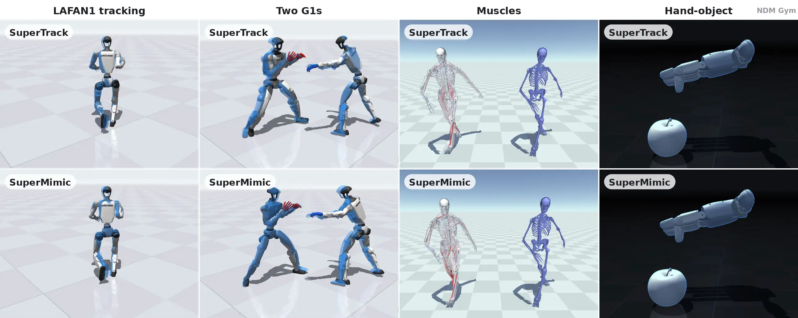</p>
<p align="center"><i>SuperTrack's selected configuration on each task, MLP world model. Tracking error over the window shown: LAFAN1 15.3 mm and two G1s 13.2 mm (MPJPE, root-relative), muscles 24.3 mm over the walk clip (MPJPE, root frame), hand-object 1.2 mm (the apple's position; half speed, last frame held).</i></p>
<p align="center"><sub>Renders of motions from LAFAN1 (© 2018 Ubisoft Entertainment; CC BY-NC-ND 4.0), InterHuman (CC BY-NC-SA 4.0) and MuscleVAE (LAFAN1's, on its character), and of SPIDER's retarget of an HRDexDB grasp, for non-commercial illustration only; not covered by this repository's MIT license (<a href="NOTICE">see NOTICE</a>).</sub></p>

## 🔥 News

- **[2026-11]** Hand-object tracking on the XHand: human grasp-and-lift clips with SuperTrack and SuperMimic
  ([below](#hand-object-tracking)); the task and SuperMimic on it contributed by [Dechen Gao](https://github.com/gaodechen).
- **[2026-11]** MuscleVAE's muscle-actuated character: SuperTrack and SuperMimic results and commands, with MLP and RigidFormer
  world models ([below](#muscle-actuated-character)).
- **[2026-11]** [BlinkMimic](https://github.com/fuyichen0725/blinkmimic)'s recipe (`--algo blinkmimic`), validated against its
  code, and systems options for LAFAN1, two-G1 and muscle training ([details](#blinkmimics-options));
  [training time to return 0.82 on LAFAN1](#training-speed). Library-only `pip` installation ([details](docs/installation.md)).
- **[2026-11]** Trained weights on [Hugging Face](https://huggingface.co/frankzydou/ndm-gym): the G1 / LAFAN1 runs behind the [results](#-results).
- **[2026-11]** HDMI's 13 human-object interaction tasks (HDMI's PPO teacher as the model-free baseline), MuscleVAE's
  muscle-actuated character, NDMs as simulators ([throughput](benchmarks/ndm_speed/results.md)), RigidFormer inference
  kernels, and two G1s tracking a two-person clip in one scene ([results](benchmarks/g1_boxing/results.md)).
- **[2026-11]** RigidFormer's final configurations and training speed options: SuperTrack-RF and SuperMimic-RF on fresh seeds ([results](#-results)).
- **[2026-10]** A benchmark covering SuperTrack and SuperMimic on G1 / LAFAN1: [results](#-results) and [ablations](benchmarks/g1_lafan1_tracking/ablations.md).
- **[2026-10]** [RigidFormer](https://frank-zy-dou.github.io/projects/RigidFormer/) world-model backbone (`--wm_backbone rigidformer`).
- **[2026-10]** First release, equivalence-tested against an unofficial SuperMimic reproduction. SuperMimic's authors have since released
  their code: [HybridRobotics/supermimic](https://github.com/HybridRobotics/supermimic).

## ✨ Features

- **Algorithms:** SuperTrack, SuperMimic ([official code](https://github.com/HybridRobotics/supermimic)) and BlinkMimic's recipe (`--algo blinkmimic`), with each change
  available separately.
- **World models:** acceleration (SuperTrack) and increment (SuperMimic) models, each with an MLP or a
  [RigidFormer](docs/rigidformer_backbone.md) backbone.
- **Tasks:** motion tracking on LAFAN1 (G1); two G1s in one scene tracking a two-person clip; HDMI's 13 human-object
  interaction tasks (G1, contact forces predicted by the world model); MuscleVAE's character with 284 Hill-type muscles and
  fatigue; a floating XHand tracking human hand-object demonstrations.
- **NDMs as simulators:** throughput and open-loop accuracy against physics, with fused Triton inference kernels
  ([results](benchmarks/ndm_speed/results.md)).
- **Evaluation:** tracking errors on every clip, push robustness, held-out clips (`--clips`), side-by-side videos and an
  offline world-model benchmark.
- **Benchmarks:** configurations selected in rounds under one rule, confidence intervals on LAFAN1
  ([details](benchmarks/g1_lafan1_tracking/results.md#how-the-numbers-were-obtained)).

| | MLP world model (default) | RigidFormer world model |
|---|---|---|
| **SuperTrack** | `--algo supertrack` | **SuperTrack-RF**: `--algo supertrack --wm_backbone rigidformer` |
| **SuperMimic** | `--algo supermimic` | **SuperMimic-RF**: `--algo supermimic --wm_backbone rigidformer` |
| world-model parameters | 8.75 M (SuperTrack), 8.82 M (SuperMimic) | 0.88 M |

**How the methods relate.** SuperTrack trains the policy by supervised L1 tracking through the world model, with no reward and no critic. SuperMimic
backpropagates the imagined reward through the world model, with a critic beyond the horizon. BlinkMimic (`--algo blinkmimic`) is SuperMimic's objective
with InstantTrack's and its own training changes ([details](docs/blinkmimic.md)).

## 🔧 Installation

Linux with an NVIDIA GPU.

```bash
git clone --recursive https://github.com/Frank-ZY-Dou/ndm-gym.git && cd ndm-gym
bash scripts/setup.sh                 # Isaac Lab 3 and locked dependencies into ~/ndm_gym/venv, motions and G1 into data/
source ~/ndm_gym/venv/bin/activate    # ndm-train and ndm-eval on PATH
```

The library alone (world models, policies, algorithms; no simulator, no training):
`pip install "ndm_gym @ git+https://github.com/Frank-ZY-Dou/ndm-gym"` ([details](docs/installation.md)).

## 🚀 Getting Started

```bash
# train (scripts/run_train.sh adds a memory cap, CPU pinning and a GPU lock)
ndm-train --algo supertrack --st_fail_w 5 --st_balance_w 4 --max_hours 3 --log_dir logs/st
ndm-train --algo supermimic --reward_std_scale 0.7 --action_noise 0.3 --imag_start_perturb 0.3 --max_hours 3 --log_dir logs/sm

# evaluate every checkpoint as it is written; push robustness of one checkpoint
ndm-eval --run_dir logs/st --watch
ndm-eval --run_dir logs/st --ckpt logs/st/ckpt_012000.pt --push_mag 0 1 2 --out_json push.json

# compare: curves, then side-by-side videos of recorded evaluations
python tools/plot.py logs/st logs/sm --labels SuperTrack SuperMimic --out compare.png
ndm-eval --run_dir logs/st --ckpt <ckpt> --record st.npz      # and the same for sm.npz
MUJOCO_GL=egl python tools/compare_videos.py st.npz sm.npz --labels SuperTrack SuperMimic --out videos/

# world models offline: a training and a test set from one policy, then a fit
python -m ndm_gym.wmbench.collect --ckpt logs/st/ckpt_006000.pt --out wm_train.pt --seed 0
python -m ndm_gym.wmbench.collect --ckpt logs/st/ckpt_006000.pt --out wm_test.pt --seed 1
python -m ndm_gym.wmbench.fit --algo supertrack --train wm_train.pt --test st=wm_test.pt --out wm_st.csv
```

<details>
<summary><b>Two G1s, one two-person clip</b></summary>

```bash
# InterHuman's clip retargeted to two G1s (see the tool's docstring; HoloMotion's HoloRetarget and a licensed SMPL model)
python tools/convert_interhuman.py --pkl <InterHuman>/motions/1566.pkl --smpl_model <SMPL_NEUTRAL.pkl> \
    --robot_mjcf data/g1_description/g1_29dof.xml --out data/interhuman/interhuman_1566.npz

ndm-train --algo supertrack --st_fail_w 5 --st_balance_w 4 --motions interhuman --paired \
    --motion_dir data/interhuman/interhuman_1566.npz --max_hours 3 --log_dir logs/box_st
ndm-train --algo supermimic --reward_std_scale 0.7 --action_noise 0.3 --imag_start_perturb 0.3 --motions interhuman --paired \
    --motion_dir data/interhuman/interhuman_1566.npz --max_hours 3 --log_dir logs/box_sm
ndm-eval --run_dir logs/box_st --ckpt <ckpt> --motions interhuman --paired --motion_dir data/interhuman/interhuman_1566.npz --record box.npz
MUJOCO_GL=egl python tools/render.py box.npz box.mp4 --pair --seconds 11

# throughput of the two-robot scene: physics, and a RigidFormer checkpoint's world model with its inference path
python -m ndm_gym.wmbench.speed_pair --pair data/interhuman/interhuman_1566.npz --mode physics --num_envs 4096 --out speed.csv
python -m ndm_gym.wmbench.speed_pair --pair data/interhuman/interhuman_1566.npz --mode ndm --wm_ckpt <ckpt> \
    --inference_copy amp --fused --rf_kernels whole --num_envs 4096 --out speed.csv
```

</details>

<details>
<summary><b>Human-object interaction (HDMI's tasks)</b></summary>

```bash
bash tools/download_hdmi.sh && python tools/convert_hdmi.py    # HDMI's clips and objects into data/hdmi/ (not redistributed)
MUJOCO_GL=egl python tools/render_hoi.py suitcase.mp4 --task move_suitcase    # a reference clip in HDMI's look; --states: a recorded rollout

# one task (13 in ndm_gym/tasks/hdmi_tasks.py); HDMI's PPO teacher as the model-free baseline
python -m ndm_gym.train_hoi --task move_suitcase --algo supertrack --st_fail_w 5 --st_contact_force --max_hours 3 --log_dir logs/hoi_st
python -m ndm_gym.train_hoi --task move_suitcase --algo supermimic --action_noise 0.3 --max_hours 3 --log_dir logs/hoi_sm
python -m ndm_gym.train_ppo_hoi --task move_suitcase --max_hours 3 --log_dir logs/hoi_ppo
python -m ndm_gym.evaluate_hoi --run_dir logs/hoi_st      # every checkpoint; --ckpt for one

# the NDM as a simulator: transitions, an offline fit with its open-loop errors, throughput against physics
python -m ndm_gym.wmbench.collect_hoi --task move_suitcase --seed 0 --out hoi_s0.pt
python -m ndm_gym.wmbench.collect_hoi --task move_suitcase --seed 1 --out hoi_s1.pt
python -m ndm_gym.wmbench.fit_hoi --task move_suitcase --kind accel --backbone rigidformer --train hoi_s0.pt --test held=hoi_s1.pt --out fit.csv
python -m ndm_gym.wmbench.speed_hoi --task move_suitcase --mode physics --num_envs 4096 --out speed.csv
python -m ndm_gym.wmbench.speed_hoi --task move_suitcase --mode ndm --backbone rigidformer --compile reduce-overhead --num_envs 4096 --out speed.csv
```

</details>

<details>
<summary><b>MuscleVAE</b></summary>

```bash
bash tools/download_musclevae.sh && python tools/convert_musclevae.py   # character, muscles, motions (not redistributed)
bash tools/download_mass_meshes.sh                                      # MASS's bone meshes, for rendering

# their released tracking policy in our simulator (Newton, 120 Hz, muscle forces every substep), then a render in their look
bash tools/download_musclevae_pretrained.sh
python tools/replay_musclevae.py --out_dir replay
MUJOCO_GL=egl python tools/render_musclevae.py walk.mp4 --states replay/states_lafan_walk_0.npz --ref

# SuperTrack and SuperMimic on the character: the commands are under Results. Evaluation of a checkpoint
python tools/evaluate_muscles.py --ckpt logs/<run>/last.pt

# transitions for a muscle NDM, and the simulator's throughput
python -m ndm_gym.wmbench.collect_muscles --out mvae/data
python -m ndm_gym.wmbench.speed_muscles --mode physics --ball_joints euler --joint_damping ode --out speed_muscles.csv
```

</details>

<details>
<summary><b>Hand-object tracking</b></summary>

```bash
pip install -e '.[hand]'                               # MuJoCo-Warp
python tools/download_hand_clips.py                    # benchmark clips into data/spider

# one clip: train (SuperTrack, then SuperMimic), evaluate beside the reference targets, render the rollout over the reference
CLIP=data/spider/processed/hrdexdb_24f/xhand/right/apple-0/0
python -m ndm_gym.train_hand --clip $CLIP --algo supertrack --lr 4e-4 --st_fail_w 2 --st_imag_noise 0.2 --st_task_weights \
       --log_dir logs/apple_st
python -m ndm_gym.train_hand --clip $CLIP --log_dir logs/apple_sm
python -m ndm_gym.evaluate_hand --ckpt logs/apple_st/last.pt --out logs/apple_st/evaluation
python tools/render_hand.py --clip $CLIP --rollout logs/apple_st/evaluation/rollout.npz --out apple_st.mp4

# a task and seed of the benchmark (benchmarks/xhand_tracking/tasks.json): SuperTrack, then SuperMimic's defaults
benchmarks/xhand_tracking/run.sh apple 0 data/spider logs/xhand_st --algo supertrack --lr 4e-4 --st_fail_w 2 --st_imag_noise 0.2 --st_task_weights
benchmarks/xhand_tracking/run.sh apple 0 data/spider logs/xhand_sm
```

</details>

## 📊 Results

SuperTrack and SuperMimic share each task's simulator, data, networks and evaluation. Configurations are selected in rounds
with equal budgets and one rule; the [fastest configurations](#training-speed) use rounds of single changes.
SuperMimic here is this library's re-implementation, written before its [official code](https://github.com/HybridRobotics/supermimic) was released, so its
numbers may differ from the authors' code.
Tracking and training-speed results use MLP world models, apart from the RigidFormer tracking results on LAFAN1 and the muscles. Not reported here: tracking on
HDMI's human-object interaction tasks, tracking with the RigidFormer on the two G1s, and the RigidFormer's time to a target
return. Return is the evaluation's undiscounted reward sum over its maximum. ↑: higher is better; ↓: lower is better.

<table>
<thead>
<tr><th>Task</th><th>Measure</th><th>SuperTrack</th><th>SuperMimic</th></tr>
</thead>
<tbody>
<tr><td rowspan="3"><b>LAFAN1 tracking</b><br><sub>MLP world model, 40 clips</sub></td><td>return ↑, 3 h<br><sub>A100 40GB, seeds 1-3</sub></td><td>0.832 ± 0.009</td><td>0.824 ± 0.013</td></tr>
<tr><td>MPJPE, root-relative ↓, 3 h</td><td>20.0 ± 0.7 mm</td><td>28.4 ± 0.5 mm</td></tr>
<tr><td>training to return 0.82 ↓<br><sub>fastest configurations, seeds 0-5; H100 / A100 40GB SXM4 / A100 40GB PCIe</sub></td><td>2.54 / 4.19 / 4.37 min</td><td>2.68 / 4.38 / 3.98 min</td></tr>
<tr><td rowspan="3"><b>Two G1s</b><br><sub>a two-person clip, MLP world model<br>A100 80GB, seed 0</sub></td><td>return ↑, best checkpoint<br><sub>runs of 0.5 h and 0.3 h</sub></td><td>0.893</td><td>0.905</td></tr>
<tr><td>MPJPE, global / root-relative ↓</td><td>39 / 14.2 mm</td><td>40 / 16.4 mm</td></tr>
<tr><td>training to return 0.88 ↓</td><td>0.11 h</td><td>0.10 h</td></tr>
<tr><td rowspan="4"><b>Muscles</b><br><sub>MuscleVAE's character, MLP world model<br>A100 40GB, seeds 1-3</sub></td><td>MPJPE, root frame ↓, best checkpoint within 3 h</td><td>38.1 ± 1.0 mm</td><td>65.6 ± 8.1 mm</td></tr>
<tr><td>MPJPE, heading frame ↓</td><td>38.5 ± 1.1 mm</td><td>45.7 ± 2.5 mm</td></tr>
<tr><td>episodes ended ↓</td><td>0.011 ± 0.005</td><td>0.053 ± 0.014</td></tr>
<tr><td>joint error ↓</td><td>10.6 ± 1.1°</td><td>9.7 ± 0.4°</td></tr>
<tr><td rowspan="3"><b>Hand-object tracking</b><br><sub>XHand: apple / spray bottle / can, MLP world model<br>A100 40GB, seeds 0-2</sub></td><td>success ↑, 256 perturbed starts</td><td>100.0 / 100.0 / 99.9 %</td><td>100.0 / 100.0 / 100.0 %</td></tr>
<tr><td>object position ↓</td><td>2.4 ± 0.0 / 1.6 ± 0.1 / 2.3 ± 0.3 mm</td><td>3.5 ± 0.1 / 2.9 ± 0.4 / 3.2 ± 0.1 mm</td></tr>
<tr><td>fingertips ↓</td><td>4.8 ± 0.1 / 5.8 ± 0.1 / 6.4 ± 0.2 mm</td><td>6.8 ± 1.7 / 6.6 ± 0.7 / 6.6 ± 0.6 mm</td></tr>
</tbody>
</table>

### LAFAN1 motion tracking

<!-- videos:begin -->
<table>
<tr>
<td>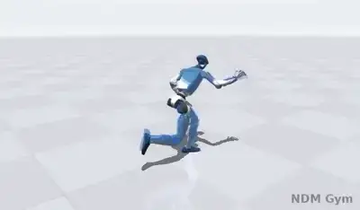</td>
<td>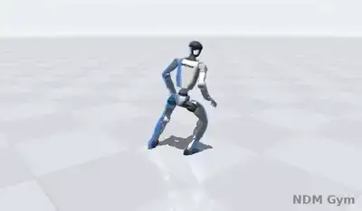</td>
</tr>
<tr>
<td>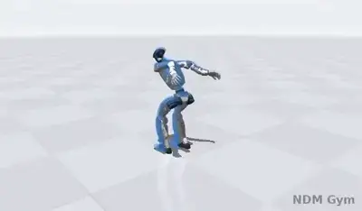</td>
<td>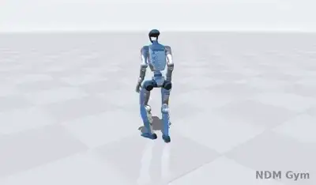</td>
</tr>
<tr>
<td>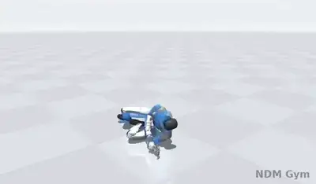</td>
<td>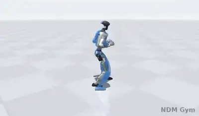</td>
</tr>
</table>
<p align="center"><i>SuperTrack's selected configuration, seed 2, 3 h checkpoint on an A100. One clip per motion category, its 10 s with the most motion. Blue ghost: the reference.</i></p>
<!-- videos:end -->
<p align="center"><sub>Renders of LAFAN1 motions (© 2018 Ubisoft Entertainment; CC BY-NC-ND 4.0; <a href="https://github.com/ubisoft/ubisoft-laforge-animation-dataset">https://github.com/ubisoft/ubisoft-laforge-animation-dataset</a>), retargeted to the G1 (LAFAN1 Retargeting Dataset), resampled, cut to 10 s and rendered. For non-commercial illustration only; not covered by this repository's MIT license (see <a href="NOTICE">NOTICE</a>).</sub></p>

Training and evaluation use all 40 LAFAN1 clips retargeted to the G1. Selected configurations, seeds 1-3, 3 h on one A100.
Cells show mean ± std over seeds; each seed averages three standard evaluations (push rows use one push test). H100
results and diagnostics are in [`results.md`](benchmarks/g1_lafan1_tracking/results.md); the checkpoints are on
[Hugging Face](https://huggingface.co/frankzydou/ndm-gym) (`g1_lafan1_tracking/`; non-commercial use, as LAFAN1).

<!-- results:begin -->
| | SuperTrack | SuperMimic |
|---|---|---|
| normalized return | 0.832 ± 0.009 | 0.824 ± 0.013 |
| failed clips (of 40) | 0.9 ± 0.8 | 1.2 ± 1.2 |
| MPJPE, root-relative (mm) | 20.0 ± 0.7 | 28.4 ± 0.5 |
| joint-angle error (deg) | 2.32 ± 0.06 | 4.89 ± 0.03 |
| root-orientation error (rad) | 0.059 ± 0.003 | 0.051 ± 0.004 |
| body-velocity error (m/s) | 0.224 ± 0.006 | 0.203 ± 0.003 |
| failed clips under root pushes of 1 m/s every 2 s | 7.7 ± 2.3 | 1.7 ± 0.6 |
| failed clips under root pushes of 2 m/s every 2 s | 24.7 ± 1.2 | 9.3 ± 1.2 |
| iterations in 3 h | 12,670 | 13,540 |
<!-- results:end -->

RigidFormer: final configurations with every speed option, fresh seeds 7-9.

| | SuperTrack-RF | SuperMimic-RF |
|---|---|---|
| normalized return | 0.832 ± 0.003 | 0.804 ± 0.007 |
| failed clips (of 40) | 0.4 ± 0.5 | 0.8 ± 0.4 |
| MPJPE, root-relative (mm) | 21.0 ± 1.3 | 33.1 ± 0.5 |
| joint-angle error (deg) | 2.24 ± 0.05 | 6.05 ± 0.62 |
| failed clips under root pushes of 1 m/s every 2 s | 5.3 ± 1.2 | 1.3 ± 0.6 |
| failed clips under root pushes of 2 m/s every 2 s | 24.3 ± 3.1 | 9.0 ± 2.0 |
| iterations in 3 h | 12,676 | 10,710 |

<details>
<summary><b>Videos with the RigidFormer world model</b></summary>

<!-- videos_rf:begin -->
<table>
<tr>
<td>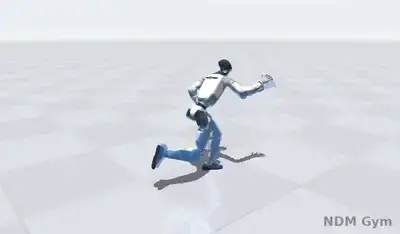</td>
<td>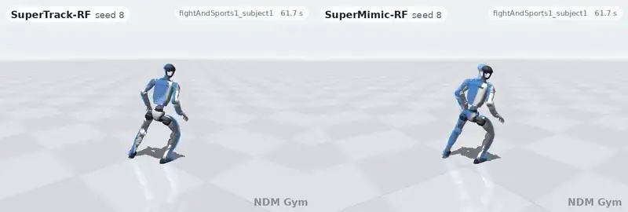</td>
</tr>
<tr>
<td>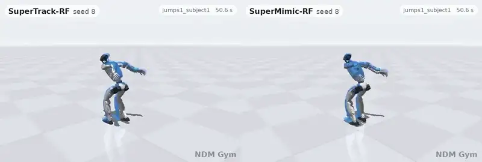</td>
<td>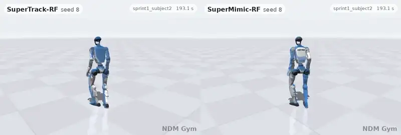</td>
</tr>
<tr>
<td>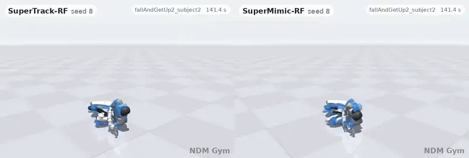</td>
<td>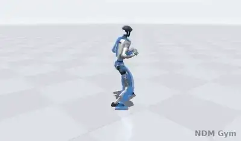</td>
</tr>
</table>
<p align="center"><i>SuperTrack-RF, the final configuration with every speed option, seed 8, 3 h checkpoint (12,677 iterations) on an A100. Same clips and windows.</i></p>
<!-- videos_rf:end -->
<p align="center"><sub>Renders of LAFAN1 motions (© 2018 Ubisoft Entertainment; CC BY-NC-ND 4.0; <a href="https://github.com/ubisoft/ubisoft-laforge-animation-dataset">https://github.com/ubisoft/ubisoft-laforge-animation-dataset</a>), retargeted to the G1 (LAFAN1 Retargeting Dataset), resampled, cut to 10 s and rendered. For non-commercial illustration only; not covered by this repository's MIT license (see <a href="NOTICE">NOTICE</a>).</sub></p>

</details>

```bash
# selected configurations, MLP world model
ndm-train --algo supertrack --st_fail_w 5 --st_balance_w 4 --max_hours 3
ndm-train --algo supermimic --reward_std_scale 0.7 --action_noise 0.3 --imag_start_perturb 0.3 --max_hours 3
# RigidFormer world model, with every speed option (they leave the algorithms unchanged)
SPEED="--wm_cudagraphs --pi_cudagraphs --fused_adam --elementwise_3x3 --combo_kernels --compile_eager \
       --rf_fused_train --rf_bptt_keep_blocks --rf_fit_keep_ops"
ndm-train --algo supertrack --wm_backbone rigidformer --wm_lr 4e-4 --st_fail_w 5 --st_balance_w 2 --wm_batches 5 $SPEED --max_hours 3
ndm-train --algo supermimic --wm_backbone rigidformer --wm_lr 4e-4 --reward_std_scale 0.7 --action_noise 0.3 --imag_start_perturb 0.4 \
          --wm_batches 7 $SPEED --critic_cudagraphs --max_hours 3
```

### Training speed

Time to return 0.82 on LAFAN1 with BlinkMimic's recipe and systems options: each algorithm's fastest configuration, MLP
world model, seeds 0-5. Time counts from iteration 50, after compilation and graph capture, to the first checkpoint whose four evaluations on
all 40 clips average 0.82; a second GPU evaluates every checkpoint, one per 100 iterations ([per seed](benchmarks/g1_lafan1_tracking/results.md#training-speed)).

| minutes to return 0.82 | SuperTrack | SuperMimic |
|---|---|---|
| H100 | 2.54 ± 0.11 | 2.68 ± 0.19 |
| A100 40GB SXM4 | 4.19 ± 0.16 | 4.38 ± 0.57 |
| A100 40GB PCIe | 4.37 ± 0.35 | 3.98 ± 0.22 |

```bash
RECIPE="--pi_ema 0.995 --lr 4e-4 --wm_batches 5 --wm_mirror 0.5 --pi_opt muon --wm_opt muon --wm_only_iters 0 --pi_batch 2048 \
        --pi_lr_mult 4 --lr_decay_ret 0.75 --lr_decay_len 300 --lr_decay_by 1400 --wm_hidden 1024 1024 1024"   # BlinkMimic's recipe
RESETS="--fail_reset 0.3 --bin_fix --eprobe_share 0.15 --eprobe_graph --eprobe_async 20 --eprobe_start 1000 --eprobe_every 125 \
        --eprobe_decay 0.7"   # its failure-focused and evaluation-guided resets
SYSTEMS="--fused_adam --elementwise_3x3 --combo_kernels --compile_eager --no_sync --update_graphs --graph_early --collect_graph \
         --reset_masked --ckpt_light"   # the same computations up to rounding, another random stream
ndm-train --algo supertrack --st_fail_w 1 --st_balance_w 2 $RECIPE --st_quad_w 0.5 --wm_lr 2e-3 --goal_table --pi_encode_once \
          $RESETS $SYSTEMS --iterations 6000 --ckpt_every 100 --log_dir logs/st_fast
ndm-train --algo supermimic --reward_std_scale 0.7 --action_noise 0.3 --imag_start_perturb 0.15 $RECIPE --pi_ema 0.99 \
          --pi_batch 1024 --pi_lr_mult 2 --pi_updates 1 --wm_lr 1.5e-3 --goal_table --contact_reward 0.15 --ref_contact_fix \
          --sm_residual --wm_structured $RESETS $SYSTEMS --iterations 6000 --ckpt_every 100 --log_dir logs/sm_fast
ndm-eval --run_dir logs/st_fast --watch --group 18 --repeats 4 --graph   # on a second GPU; the same for logs/sm_fast
```

<details>
<summary><b>What changed the time</b></summary>

A selection of the single changes, one run each (seed 0), each against the configuration it was tried on; compare times within a row
only. ✅ shorter · ❌ longer · ➖ level. For each algorithm, the rows above its first GPU mark ran on an RTX 3090, a marked row and those below it on
the marked GPU.

| | | change | minutes to return 0.82 |
|---|---|---|---|
| ✅ | SuperTrack | lower failure-penalty weight, 5 → 3 → 2 → 1 | -7% (5 → 3), 9.71 → 8.53 (3 → 2), 8.54 → 7.94 (2 → 1) |
| ✅ | SuperTrack | world-model learning rate 1.6e-3 instead of the policy's 4e-4 | 7.94 → 7.43 |
| ✅ | SuperTrack | policy batch 2048 instead of 4096 | 7.94 → 7.59 |
| ❌ | SuperTrack | 2 or 3 policy updates per iteration | 9.71 → 11.95 and 14.14 |
| ❌ | SuperTrack | 3 world-model batches instead of 5; evaluation-guided reset sweeps every 250 iterations instead of 125 | 7.94 → 9.19; 7.94 → 8.88 |
| ✅ | SuperTrack | world-model learning rate 2.4e-3 instead of 1.6e-3 (A100 40GB PCIe) | 4.97 → 4.24 |
| ✅ | SuperTrack | `--goal_table --pi_encode_once` with policy batch 2048 | 4.24 → 4.05 |
| ✅ | SuperTrack | world-model learning rate 2e-3 instead of 2.4e-3 | 4.05 → 3.69 |
| ❌ | SuperTrack | world-model learning rate 3e-3; policy learning rate 5e-4 | 4.24 → 4.94; 4.24 → 5.05 |
| ❌ | SuperTrack | world-model learning rate 2.5e-3; 1.5e-3; policy batch 1024 | 4.05 → 4.80; 3.69 → above 4.61 (both) |
| ✅ | SuperMimic | 2 policy updates of half the batch | 6.18 → 5.81 |
| ✅ | SuperMimic | foot-contact reward 0.15 instead of 0.25 | 5.81 → 5.22 |
| ✅ | SuperMimic | world-model learning rate 1.6e-3 instead of 4e-4 (A100 80GB) | 4.18 → 3.73 |
| ❌ | SuperMimic | 2 or 3 policy updates of the full batch | 6.18 → 8.21 and 9.28 |
| ✅ | SuperMimic | `--goal_table` (A100 40GB PCIe) | 4.34 → 3.80 |
| ✅ | SuperMimic | 1 policy update instead of 2 (half the policy samples) | 3.80 → 3.69 |
| ➖ | SuperMimic | world-model learning rate 1.5e-3, policy learning rate 5e-4; world-model learning rate 2.5e-3 with 2 policy updates | 3.69 → 3.62, 3.63; 3.80 → 3.81 |
| ❌ | SuperMimic | no world-model mirroring | 3.69 → 4.25 |
| ❌ | SuperMimic | policy learning-rate multiplier 3; policy learning rate 5e-4; world-model learning rate 1e-3; policy batch 512 | 3.62 → 4.03; 4.39; 4.51; above 4.69 |

</details>

### Two G1s, one two-person clip

Two G1s in one scene, with robot-robot contacts, track the two sides of an InterHuman boxing clip (CC BY-NC-SA 4.0, not
redistributed). One policy controls both. Configurations come from two rounds with equal run counts. The table shows five
evaluations of each selected run's best checkpoint on an A100 80GB; SuperTrack's run trained 0.5 h, SuperMimic's 0.3 h
([details](benchmarks/g1_boxing/results.md)).

<p align="center">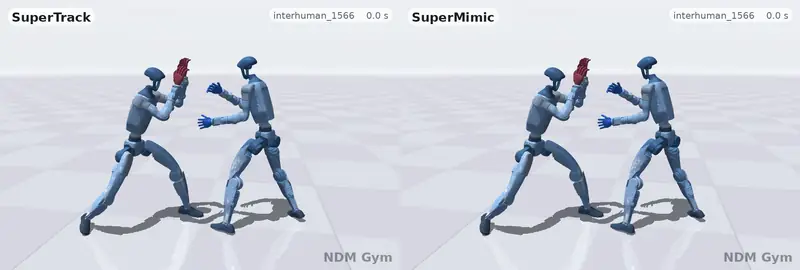</p>
<p align="center"><i>SuperTrack's selected run on InterHuman clip 1566: its best checkpoint (iteration 7,000), MLP world model; blue ghosts: the references. MPJPE in this recorded evaluation: 37.6 mm in the world frame, 14.2 mm root-relative (the table: the mean of five others).</i><br><sub>Render of InterHuman clip 1566 (CC BY-NC-SA 4.0), retargeted to the G1; shared under that license, not the MIT license (see <a href="NOTICE">NOTICE</a>).</sub></p>

| | SuperTrack | SuperMimic |
|---|---|---|
| pair success | 5 / 5 | 5 / 5 |
| normalized return | 0.893 | 0.905 |
| MPJPE, global (mm) | 39 | 40 |
| MPJPE, root-relative (mm) | 14.2 | 16.4 |
| training to return 0.88 (h) | 0.11 | 0.10 |
| best checkpoint, of the run's iterations | 7,000 of 9,396 (0.5 h) | 6,264 of 6,264 (0.3 h) |

```bash
CLIP="--motions interhuman --paired --motion_dir data/interhuman/interhuman_1566.npz"   # tools/convert_interhuman.py, under Getting started
# $RECIPE and $SYSTEMS as under Training speed
ndm-train --algo supertrack --st_fail_w 5 --st_balance_w 4 --st_com $RECIPE --pi_batch 4096 $SYSTEMS $CLIP --max_hours 0.5 --ckpt_every 1000 --log_dir logs/box_st
ndm-train --algo supermimic --reward_std_scale 0.7 --action_noise 0.3 --imag_start_perturb 0.3 $RECIPE --pi_lr_mult 2 --contact_reward 0.25 \
          --ref_contact_fix --sm_residual --wm_structured $SYSTEMS $CLIP --max_hours 0.3 --ckpt_every 1000 --log_dir logs/box_sm
```

At 4096 pairs the physics runs 0.31 M robot-steps per second; with their inference paths the MLP runs 8.4 M (27.0x) and
the RigidFormer 1.9 M (6.0x).

### Muscle-actuated character

MuscleVAE's character with 284 Hill-type muscles and fatigue, three clips, Newton simulator, MLP world model.
Configurations come from four rounds of 1 h runs, ranked by one rule. Selected configurations train with seeds 1-3 for up to
3 h, stopping when error stops falling. The best checkpoint with at most 10% of episodes ended is evaluated with a seed it
did not train with ([details](benchmarks/musclevae/results.md)). MuscleVAE's files and weights of policies trained on them
are not redistributed.

<p align="center">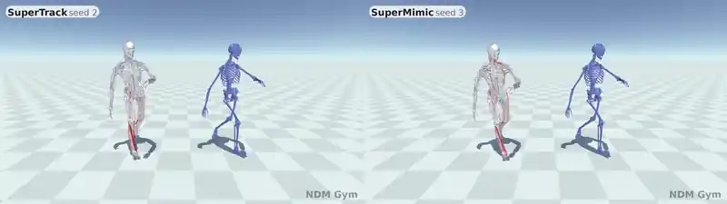<br>
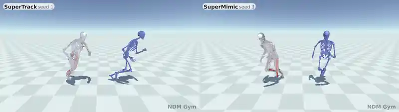</p>
<p align="center"><i>SuperTrack on MuscleVAE's walk and run: its best seed of the 3 h runs (seed 1, iteration 26,000), muscles red by activation, the reference in blue. Root-frame MPJPE over the clips' episodes: 24.9 mm (walk) and 46.6 mm (run).</i></p>
<p align="center"><sub>Renders of MuscleVAE's walk and run clips (LAFAN1 motions, © 2018 Ubisoft Entertainment; CC BY-NC-ND 4.0), for non-commercial illustration only; not covered by this repository's MIT license (see <a href="NOTICE">NOTICE</a>).</sub></p>

| | SuperTrack | SuperMimic |
|---|---|---|
| MPJPE, root frame (mm) | 38.1 ± 1.0 | 65.6 ± 8.1 |
| MPJPE, heading frame (mm) | 38.5 ± 1.1 | 45.7 ± 2.5 |
| episodes ended (share) | 0.011 ± 0.005 | 0.053 ± 0.014 |
| joint error (deg) | 10.6 ± 1.1 | 9.7 ± 0.4 |

Before the third round, the second round's selections reached 74.2 ± 33.7 mm (SuperTrack; seeds 38.6, 105.4, 78.6) and 68.0 ± 3.5 mm (SuperMimic)
in the same 3 h runs, with the default updates. The third round, declared after those SuperTrack runs had ended and while SuperMimic's were ending,
added the systems options for both and selected `--wm_lr 1.6e-3` for SuperTrack ([tuning history](benchmarks/musclevae/results.md#tuning)). The fourth round selects
`--wm_lr 2.5e-3` for both (at 1 h, 37.2 and 57.0 mm, against 37.6 and 60.5 mm), and the table reports its 3 h runs; at 3 h the third round's selections reached 36.4 ± 1.9 and
63.6 ± 4.1 mm. SuperMimic's best checkpoints come early (iterations 6,000-8,000): later ones reach 56-68 mm with 13-46% of episodes ended, which the rule excludes.

```bash
MUSCLE_RECIPE="--pi_ema 0.995 --lr 4e-4 --pi_opt muon --wm_opt muon --wm_only_iters 0 --pi_batch 2048 --lr_decay_len 300 \
               --lr_decay_by 1400 --wm_hidden 1024 1024 1024"   # BlinkMimic's recipe, the parts muscle training implements
MUSCLE_SYS="--no_sync --fused_adam --update_graphs --graph_early --collect_graph --reset_masked --ckpt_light"   # the same computations up to rounding, another random stream
python -m ndm_gym.train_muscles --algo supertrack --st_fail_w 5 --st_balance_w 4 $MUSCLE_RECIPE $MUSCLE_SYS --wm_batches 8 --pi_lr_mult 4 \
       --wm_lr 2.5e-3 --max_hours 3 --ckpt_every 2000 --seed 1 --log_dir logs/mus_st_s1    # seeds 1-3
python -m ndm_gym.train_muscles --algo supermimic --reward_std_scale 0.5 --action_noise 0.3 --imag_start_perturb 0.3 $MUSCLE_RECIPE \
       $MUSCLE_SYS --wm_batches 5 --pi_lr_mult 2 --wm_lr 2.5e-3 --max_hours 3 --ckpt_every 2000 --seed 1 --log_dir logs/mus_sm_s1
```

RigidFormer: a token per body, width 128, 2 blocks, 4 heads, from nine rounds of 1 h runs ranked by the same rule; seeds 1-3, up to 3 h
([details and tuning history](benchmarks/musclevae/results.md#rigidformer-world-model)).

| | SuperTrack-RF | SuperMimic-RF |
|---|---|---|
| MPJPE, root frame (mm) | 34.9 ± 0.7 | 60.2 ± 2.0 |
| MPJPE, heading frame (mm) | 35.1 ± 0.7 | 38.5 ± 3.4 |
| episodes ended (share) | 0.000 ± 0.001 | 0.009 ± 0.014 |
| joint error (deg) | 10.1 ± 0.3 | 8.7 ± 0.4 |

These tables do not compare the world models at equal effort: the RigidFormer had nine rounds of tuning, the MLP four. The RigidFormer's six runs all reached
the 3 h limit, at 9,105-12,033 iterations, five of them with their last checkpoint as the best; the MLP's six stopped by the rule before 3 h, at 14,450-32,500
iterations. SuperMimic-RF's root-frame and heading-frame MPJPE differ by 21.7 mm, SuperTrack-RF's by 0.2 mm; selection uses the root frame.

```bash
MUSCLE_RF="--pi_ema 0.995 --lr 4e-4 --pi_opt muon --wm_only_iters 0 --pi_batch 2048 --lr_decay_len 300 --lr_decay_by 1400 --wm_backbone rigidformer \
           --rf_muscle_tokens body --rf_dim 128 --rf_layers 2 --rf_heads 4 --rf_registers 9 --rf_fused_train --rf_fused_features"   # the recipe, the RigidFormer in place of its --wm_hidden
# $MUSCLE_SYS as above; Muon on the world model (--wm_opt muon) is SuperTrack-RF's selection, SuperMimic-RF's keeps Adam
python -m ndm_gym.train_muscles --algo supertrack --st_fail_w 5 --st_balance_w 4 $MUSCLE_RF --wm_opt muon $MUSCLE_SYS --wm_batches 5 --pi_lr_mult 4 \
       --wm_lr 5e-3 --max_hours 3 --ckpt_every 2000 --seed 1 --log_dir logs/mus_st_rf_s1    # seeds 1-3
python -m ndm_gym.train_muscles --algo supermimic --reward_std_scale 0.5 --action_noise 0.3 --imag_start_perturb 0.3 $MUSCLE_RF \
       $MUSCLE_SYS --wm_batches 8 --pi_lr_mult 2 --wm_lr 5e-3 --max_hours 3 --ckpt_every 2000 --seed 1 --log_dir logs/mus_sm_rf_s1
```

### Hand-object tracking

<p align="center">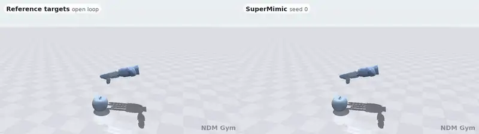<br>
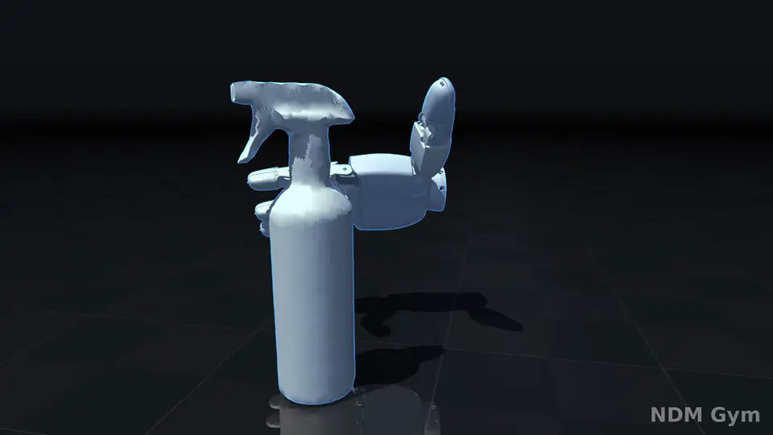<br>
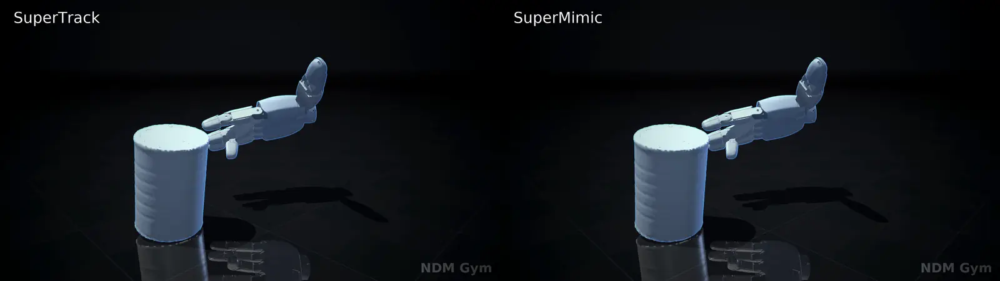</p>
<p align="center"><i>SuperTrack on the apple, the spray bottle and the can: the last checkpoints of seed 0 from the unperturbed start, at half speed, with the kinematic reference drawn over them in blue. Object error over the clip: 1.2, 1.1 and 2.0 mm.</i></p>
<p align="center"><sub>Renders of policies tracking SPIDER's retargets of HRDexDB, OakInk and DexYCB demonstrations, with their object meshes and the XHand's model, for non-commercial illustration only; not covered by this repository's MIT license (see <a href="NOTICE">NOTICE</a>).</sub></p>

A floating XHand tracks human grasp-and-lift demonstrations on MuJoCo-Warp. The reference is
[SPIDER](https://github.com/facebookresearch/spider)'s kinematic retarget of the captured hand and of the object's pose.
Each run trains 20,000 iterations in 2,048 worlds on one A100 40GB, and its last checkpoint plays 256 rollouts of the
whole clip from perturbed starts. SuperTrack runs with `--lr 4e-4 --st_fail_w 2 --st_imag_noise 0.2 --st_task_weights`,
SuperMimic with its defaults; each was chosen from its own tuning runs by the same rule
([results](benchmarks/xhand_tracking/results.md), [task](docs/tasks/hand.md)). On one A100 40GB a run trains at 11.6-12.0 (SuperTrack) and 9.4-9.7 iterations/s (SuperMimic) and reaches a
success of 0.99 with the object within 10 mm in 0.9-8.4 (one run on the can ends at 0.988) and 2.7-8.3 minutes; with
HOI's optimizer options (Muon, the policy average, the learning-rate ramp; SuperMimic with HDMI's settings at γ 0.99),
in 0.9-3.2 and 1.0-1.7 minutes ([training time](benchmarks/xhand_tracking/results.md#training-time)).

| | apple | spray bottle | can |
|---|---|---|---|
| seeds | 0, 1, 2 | 0, 1, 2 | 0, 1, 2 |
| success ↑, SuperTrack / SuperMimic | 100.0 / 100.0 % | 100.0 / 100.0 % | 99.9 / 100.0 % |
| object position ↓, reference targets | 20.0 mm | 198.3 mm | 113.3 mm |
| object position ↓, SuperTrack | 2.4 ± 0.0 mm | 1.6 ± 0.1 mm | 2.3 ± 0.3 mm |
| object position ↓, SuperMimic | 3.5 ± 0.1 mm | 2.9 ± 0.4 mm | 3.2 ± 0.1 mm |
| fingertips ↓, reference targets | 26.6 mm | 29.7 mm | 32.6 mm |
| fingertips ↓, SuperTrack | 4.8 ± 0.1 mm | 5.8 ± 0.1 mm | 6.4 ± 0.2 mm |
| fingertips ↓, SuperMimic | 6.8 ± 1.7 mm | 6.6 ± 0.7 mm | 6.6 ± 0.6 mm |

Reference targets: the same rollouts with the reference's joint positions as the position targets.

```bash
HAND_SYSTEMS="--fused_adam --reset_masked --no_sync --compile_eager --collect_graph --update_graphs"
python -m ndm_gym.train_hand --clip $CLIP --algo supertrack --lr 4e-4 --st_fail_w 2 --st_imag_noise 0.2 --st_task_weights \
       $HAND_SYSTEMS --seed 0 --log_dir logs/xhand_tracking/apple_st_s0      # seeds 0-2
python -m ndm_gym.train_hand --clip $CLIP $HAND_SYSTEMS --seed 0 --log_dir logs/xhand_tracking/apple_sm_s0   # seeds 0-2
```

### BlinkMimic's options

`--algo blinkmimic` applies BlinkMimic's released recipe (`PRESET[main]`); see [options](docs/blinkmimic.md). On the same
A100 40GB, BlinkMimic's own code reaches return 0.834 at iteration 1,500 (seed 0, its evaluator) at 175 ms per iteration between
its evaluation-guided reset sweeps; `--algo blinkmimic` first reaches 0.82 at iterations 1,500 / 1,500 / 1,400 and 0.83 at 1,600 / 1,600 / 1,700 (seeds
0 / 1 / 2) at 161 ms per iteration.

The systems options (`--no_sync --update_graphs --graph_early --collect_graph --reset_masked --ckpt_light`) change the wall-clock and the random
stream. On a CPU in eager mode, with fused Adam on both sides, their updates equal the default ones bit for bit on the same random numbers
(`tests/test_systems.py`, `test_muscle_systems.py`); on a GPU, the collection graphs play the same episodes within the simulator's run-to-run
differences (also `test_paired_systems.py`). Training time per iteration on one A100 40GB, before and with them, MLP world models (LAFAN1 and the two
G1s: LAFAN1's selections; muscles: the starting configurations, before the character's tuning):

| training loop | before (ms) | systems options (ms) |
|---|---|---|
| LAFAN1, SuperTrack | 304 | 272 |
| LAFAN1, SuperMimic | 327 | 296 |
| muscles, SuperTrack | 457 | 344 |
| muscles, SuperMimic | 621 | 395 |
| two G1s, SuperTrack | 418 | 306 |

Before: LAFAN1 and the two G1s already used CUDA graphs for updates (`--wm_cudagraphs --pi_cudagraphs`, SuperMimic also
`--critic_cudagraphs`); muscle training had no such options.

### NDMs as simulators (HDMI's scenes)

One H100 80GB, 4096 environments, million env-steps per second (in parentheses, the ratio to physics). The MLP runs as
a bf16 copy, the RigidFormer with fused Triton blocks ([details](benchmarks/ndm_speed/results.md)).

| task | physics | MLP | RigidFormer |
|---|---|---|---|
| move_suitcase | 0.35 | 16.28 (45.9x) | 2.30 (6.5x) |
| open_door-feet | 0.44 | 16.47 (37.1x) | 2.31 (5.2x) |
| truman | 0.36 | 16.21 (45.3x) | 2.30 (6.4x) |

With the acceleration parameterization, the RigidFormer's open-loop errors are lower than the MLP's on all 13 tasks for
keypoints after 8 steps and for the object after 32 (median ratios 0.90 and 0.76).

### Key findings

1. **LAFAN1** (SuperTrack / SuperMimic): return 0.832 / 0.824, failed clips 0.9 / 1.2 of 40, MPJPE 20.0 /
   28.4 mm, failed clips under 1 m/s pushes 7.7 / 1.7 and under 2 m/s pushes 24.7 / 9.3.
2. **Where the differences come from:** with SuperTrack's offsets about the reference pose, SuperMimic's MPJPE is 25.0 mm;
   without imagination kicks (random root-velocity changes at the starts of imagined rollouts), SuperMimic fails 6.0 / 18.7
   clips under the pushes. SuperMimic's action noise and kicks change
   SuperTrack's push failures by -3.3 / -6.7 clips (not significant) and raise its MPJPE by 2.7 mm.
3. **SuperTrack's additions** to the paper's objective (failure penalty, balance weights, task penalties, world-space root
   terms) raise return from 0.53 to 0.83 and lower MPJPE from 96 to 20 mm.
4. **SuperMimic's tuned changes and critic:** without its three tuned changes (reward kernels narrowed ×0.7, action noise 0.3
   instead of 0.1, imagination kicks), it fails 4.3 / 11.0 more clips under the pushes; without the critic, all 40 clips fail at
   3 h.
5. **RigidFormer** (a tenth of the parameters): offline, at a learning rate of 4e-4 picked on the benchmark's test sets, 7-16%
   lower open-loop error in distribution and 11-21% out of it; at the shared default 2e-4, -4% / -11% (SuperTrack's model) and
   +8% / +0% (SuperMimic's). Online, SuperTrack-RF / SuperMimic-RF: return 0.832 / 0.804, MPJPE 21.0 / 33.1 mm. Tuned online as the
   MLP was, it shows no significant difference at equal iterations. In 3 h with the same speed options the MLP runs about 3x
   more iterations: SuperTrack's return is 0.861 with the MLP; SuperMimic's MLP drops late (0.137 at about 33k iterations).
   Under dynamics shifts 9 of 10 conditions show no significant difference; sample efficiency shows none either; on held-out clips
   SuperTrack-RF shows none, and SuperMimic-RF's final configuration a return 0.005 lower [-0.009, -0.000]
   ([results](benchmarks/g1_lafan1_tracking/results.md)).
6. **H100:** return 0.82 after 1.25 h (SuperTrack) and 1.48 h (SuperMimic); the paper reports 1.2 h with its own configuration.
   With action noise 0.3, SuperMimic's evaluations drop after about 20k iterations (return 0.074 at 3 h); with the paper's 0.1
   they do not (0.854 at 3 h) ([details](benchmarks/g1_lafan1_tracking/results.md#noise-check-supermimic-with-action-noise-01)).
7. **Training speed**, MLP world model, each algorithm's fastest configuration, seeds 0-5: return 0.82 in 2.54 / 2.68 min (SuperTrack / SuperMimic) on an
   H100, 4.19 / 4.38 min on an A100 40GB SXM4 and 4.37 / 3.98 min on an A100 40GB PCIe ([Training speed](#training-speed)).
8. **Semi-implicit world models:** SuperTrack's acceleration world model (Fussell et al. 2021, §3.4;
   [`accel.py`](ndm_gym/worldmodels/accel.py)) predicts velocity changes and integrates the positions, and so does
   [BlinkMimic](https://github.com/fuyichen0725/blinkmimic)'s; SuperMimic's predicts the position changes directly
   ([`increment.py`](ndm_gym/worldmodels/increment.py)). With its learned position corrections at zero, a step of BlinkMimic's model
   equals one of SuperTrack's with 4 substeps ([details](docs/blinkmimic.md#2-how-the-methods-relate)).
9. **BlinkMimic's recipe as options:** `--algo blinkmimic` first reaches return 0.82 at iterations 1,500 / 1,500 / 1,400 (seeds 0 /
   1 / 2); BlinkMimic's own code reaches 0.834 at iteration 1,500 (seed 0, its evaluator), on the same A100 40GB
   ([details](#blinkmimics-options)).
10. **Two G1s** (SuperTrack / SuperMimic, seed 0, best checkpoint of runs of 0.5 / 0.3 h): return 0.893 / 0.905, MPJPE 39 / 40 mm
    global and 14.2 / 16.4 mm root-relative, return 0.88 after 0.11 / 0.10 h of training ([details](benchmarks/g1_boxing/results.md)).
11. **Muscles**, MLP world model (seeds 1-3, up to 3 h): MPJPE 38.1 ± 1.0 (SuperTrack) and 65.6 ± 8.1 mm (SuperMimic) in the root frame, 38.5 ± 1.1 and
    45.7 ± 2.5 mm in the heading frame; episodes ended 0.011 and 0.053, joint error 10.6 ± 1.1 and 9.7 ± 0.4 deg. On SuperMimic's selection
    at `--wm_lr 4e-4`, BlinkMimic's systems options cut the time per iteration by about 45%. At 4,000 iterations its errors were higher with
    them in all three seeds, not significantly (p >= 0.19); at 3 h its MPJPE is 63.6 ± 4.1 mm with them, 68.0 ± 3.5 mm without
    ([details](benchmarks/musclevae/results.md#the-systems-options)).
12. **Hand-object tracking** on the XHand (seeds 0-2, 20,000 iterations on an A100 40GB): at a success of 99.9-100 % on
    the apple, the spray bottle and the can, the object's error is 2.4 / 1.6 / 2.3 mm (SuperTrack) and 3.5 / 2.9 / 3.2 mm
    (SuperMimic), the fingertips' 4.8 / 5.8 / 6.4 and 6.8 / 6.6 / 6.6 mm. A success of 0.99 with the object within 10 mm
    takes 0.9-3.2 and 1.0-1.7 min of training with HOI's optimizer options
    ([details](benchmarks/xhand_tracking/results.md)).

## 🔬 Ablations

<!-- ablations:begin -->
✅ helps · ⚖️ trade-off · ❌ hurts · ➖ no clear effect. Policy rows: leave-one-out study, seeds 1-3, 3 h; RigidFormer rows: the tuned configurations at equal iterations (seeds 1-3) and the final ones at 3 h against the MLP with the same speed options (seeds 7-9). An effect counts when its Welch 95% interval excludes 0 (return, failed clips, MPJPE, failed clips under 1 and 2 m/s pushes). World-model rows: open-loop 32-step error of offline fits, three per variant (bold: significant). Preliminary single-seed runs and all numbers: [`ablations.md`](benchmarks/g1_lafan1_tracking/ablations.md).

| | | factor | effect |
|---|---|---|---|
| ✅ | SuperTrack | failure penalty and balance weights together | higher return, fewer failed clips, fewer failed clips under 1 and 2 m/s pushes |
| ✅ | SuperTrack | task penalties (action rate, joint limits) | higher return, fewer failed clips, fewer failed clips under 1 and 2 m/s pushes |
| ✅ | SuperTrack | world-space root terms | higher return, lower MPJPE |
| ✅ | SuperTrack | the four additions to the paper's objective together | higher return, fewer failed clips, lower MPJPE, fewer failed clips under 1 and 2 m/s pushes |
| ⚖️ | SuperTrack | failure penalty | fewer failed clips, higher MPJPE, fewer failed clips under 1 and 2 m/s pushes |
| ❌ | SuperTrack | imagination noise on the offsets | more failed clips at 2 m/s pushes |
| ❌ | SuperTrack | SuperMimic's action noise and imagination kicks | higher MPJPE |
| ❌ | SuperTrack | RigidFormer world model, final configuration (SuperTrack-RF), at 3 h, where the MLP runs 2.8x the iterations | lower return, higher MPJPE, more failed clips at 2 m/s pushes |
| ➖ | SuperTrack | balance weights | none beyond seed noise |
| ➖ | SuperTrack | RigidFormer world model, tuned (SuperTrack-RF), at equal iterations | none beyond seed noise |
| ✅ | SuperMimic | narrower reward kernels (×0.7) | lower MPJPE, fewer failed clips at 1 m/s pushes |
| ✅ | SuperMimic | simulator action noise 0.3 instead of 0.1 | fewer failed clips at 1 m/s pushes |
| ✅ | SuperMimic | imagination kicks | fewer failed clips under 1 and 2 m/s pushes |
| ✅ | SuperMimic | the critic | higher return, fewer failed clips, fewer failed clips under 1 and 2 m/s pushes |
| ✅ | SuperMimic | the tuned changes together (against the configuration without them) | fewer failed clips under 1 and 2 m/s pushes |
| ✅ | SuperMimic | offsets about the reference pose (SuperTrack's actions) | lower MPJPE |
| ✅ | SuperMimic | RigidFormer world model, final configuration (SuperMimic-RF), at 3 h, where the MLP runs 3.1x the iterations and its evaluations drop late | higher return, fewer failed clips, fewer failed clips under 1 and 2 m/s pushes |
| ➖ | SuperMimic | RigidFormer world model, tuned (SuperMimic-RF), at equal iterations | none beyond seed noise |
| ✅ | World model, offline | more training data | open-loop error **-22%** in distribution, **-19%** out of it |
| ✅ | World model, offline | no LayerNorm (both world models) | open-loop error **-17 to -16%** in distribution, **-14%** out of it |
| ✅ | World model, offline | RigidFormer backbone at the default learning rate, SuperTrack's model | open-loop error -4% in distribution, **-11%** out of it |
| ✅ | World model, offline | RigidFormer backbone (lr 4e-4, as trained online), SuperTrack's model (SuperTrack-RF) | open-loop error **-16%** in distribution, **-21%** out of it |
| ✅ | World model, offline | RigidFormer backbone (lr 4e-4, as trained online), SuperMimic's model (SuperMimic-RF) | open-loop error **-7%** in distribution, **-11%** out of it |
| ❌ | World model, offline | L2 loss; pre-failure windows (both world models) | open-loop error **+6 to +8%** in distribution, **+5 to +7%** out of it |
| ➖ | World model, offline | RigidFormer backbone at the default learning rate, SuperMimic's model | open-loop error +8% in distribution, +0% out of it |
| ➖ | World model, offline | training data from a noisier policy (both world models; the three fits differ widely) | open-loop error -16 to +2% in distribution, -17 to -2% out of it |
| ➖ | World model, offline | error-prioritized windows; input noise; 4 integration substeps; GELU / ELU / Mish instead of SiLU | open-loop error -3 to +2% in distribution, -3 to +2% out of it |
<!-- ablations:end -->

## 📚 Documentation

The documentation site: [frank-zy-dou.github.io/ndm-gym](https://frank-zy-dou.github.io/ndm-gym/).

| | |
|---|---|
| [`docs/index.md`](docs/index.md) | guides and the API reference, a MkDocs site (`make docs`): [installation](docs/installation.md), [quickstart](docs/quickstart.md), [tasks](docs/tasks.md), [world models](docs/world_models.md), [algorithms](docs/algorithms.md) |
| [`benchmarks/g1_lafan1_tracking/`](benchmarks/g1_lafan1_tracking/) | the benchmark covering SuperTrack and SuperMimic: results and ablations |
| [`benchmarks/g1_boxing/`](benchmarks/g1_boxing/) | two G1s tracking a two-person clip: tracking and speed |
| [`benchmarks/musclevae/results.md`](benchmarks/musclevae/results.md) | the muscle-actuated character: setup, tuning and results |
| [`benchmarks/ndm_speed/`](benchmarks/ndm_speed/) | NDMs as simulators: throughput and accuracy against physics |
| [`benchmarks/xhand_tracking/`](benchmarks/xhand_tracking/) | hand-object tracking on the XHand: tasks and results |
| [`docs/rigidformer_backbone.md`](docs/rigidformer_backbone.md) | RigidFormer world-model backbone: design, speed, validation |
| [`docs/blinkmimic.md`](docs/blinkmimic.md) | BlinkMimic: its relation to SuperTrack and SuperMimic, its changes as options |
| [`docs/hoi_design.md`](docs/hoi_design.md), [`docs/hdmi_task_spec.md`](docs/hdmi_task_spec.md) | human-object interaction: design, and HDMI's task as implemented, with references into HDMI's code |
| [`docs/musclevae_design.md`](docs/musclevae_design.md) | MuscleVAE: simulator, muscle model, policy port, validation |

<details>
<summary><b>Repository layout</b></summary>

| Path | What |
|---|---|
| `ndm_gym/core/` | rotations, differentiable articulation FK, MLPs, running normalizers, Muon |
| `ndm_gym/robots/` | Unitree G1 29-DoF spec (`g1.py`); MuscleVAE's character and muscles (`musclevae_char.py`, `muscles.py`); XHand (`xhand.py`) |
| `ndm_gym/motion/` | motion library (50 Hz goals) and loaders (`sources/lafan1.py`, `hoi.py`, `musclevae.py`, `interhuman.py`, `spider.py`) |
| `ndm_gym/sim/` | Isaac Lab 3 + MuJoCo-Warp tracking simulator, one or two G1s (`rigid/isaaclab_mjwarp.py`); HDMI's scenes (`rigid/hdmi_sim.py`); MuscleVAE on Newton (`rigid/muscle_sim.py`); a hand and an object on MuJoCo-Warp (`rigid/hand_sim.py`); Isaac Lab's launcher |
| `ndm_gym/tasks/` | `tracking.py` (SuperMimic's setup), `contact.py`; `hdmi.py`, `hdmi_tasks.py` (HDMI's 13 tasks); `muscle_tracking.py`; `hand_tracking.py` |
| `ndm_gym/worldmodels/` | `accel.py` (SuperTrack), `increment.py` (SuperMimic), `semi_implicit.py` (BlinkMimic), `rigidformer.py` (backbone), `hoi.py`, `muscle.py`, `hand.py`; inference copies (`g1_infer.py`) |
| `ndm_gym/kernels/` | fused Triton kernels: RigidFormer blocks (inference, training), muscle geometry |
| `ndm_gym/policies/` | tracking policy and critic; HOI, muscle and hand policies; MuscleVAE's released policy (`musclevae_pretrained.py`) |
| `ndm_gym/algos/` | `common.py` (world-model fitting, imagination starts), `supertrack.py`, `supermimic.py`, `blinkmimic.py`, `eprobe.py`, `hoi_algos.py`, `muscle_algos.py`, `hand_algos.py`, `ppo_hoi.py` |
| `ndm_gym/wmbench/` | offline world-model benchmark; NDM throughput against physics (`speed_hoi.py`, `speed_muscles.py`, `speed_pair.py`) |
| `ndm_gym/train.py`, `ndm_gym/evaluate.py` | `ndm-train`, `ndm-eval`; `train_hoi.py`, `train_ppo_hoi.py`, `evaluate_hoi.py`; `train_muscles.py`; `train_hand.py`, `evaluate_hand.py` |
| `scripts/`, `tools/` | install and launch scripts; rendering, plots, ablation tables, diagnostics |
| `benchmarks/` | studies run with the library: results, ablations, speed |
| `docs/` | guides, the API reference and the design documents (`mkdocs.yml`) |
| `tests/` | equivalence tests against the upstream code, component tests |
| `third_party/supermimic` | upstream checkout (submodule) for the equivalence tests |

</details>

## 🧪 Development

```bash
python -m pytest tests          # CPU; the equivalence tests compare against third_party/supermimic
```

## 📄 Papers

Implemented:
- **SuperTrack:** L. Fussell, K. Bergamin, D. Holden. *SuperTrack: Motion Tracking for Physically Simulated Characters
  using Supervised Learning.* ACM Transactions on Graphics 40(6), 2021. [DOI](https://doi.org/10.1145/3478513.3480527)
- **SuperMimic:** Q. Liao, Y. Shao, J. Long, K. Zakka, R. Horowitz, P. Abbeel, K. Sreenath. *SuperMimic: Scaling
  Humanoid Whole-Body Control with One Differentiable World Model.* CoRL 2026. [arXiv:2610.28480](https://arxiv.org/abs/2610.28480) ·
  [code](https://github.com/HybridRobotics/supermimic) · [project page](https://supermimic.github.io)
- **BlinkMimic** (code, no paper): F. Chen. *BlinkMimic: Whole-Body Motion Tracking for the Unitree G1 in Minutes on One
  GPU.* 2026. [code](https://github.com/fuyichen0725/blinkmimic) · built on InstantTrack
  ([code](https://github.com/Huy-Quang-Dao/instantTrack))
- **RigidFormer:** Z. Dou, M. Guo, H. Wu, D. Roble, T. Stuyck, W. Matusik. *RigidFormer: Learning Rigid Dynamics using
  Transformers.* arXiv preprint, 2026. [arXiv:2605.09196](https://arxiv.org/abs/2605.09196) ·
  [project page](https://frank-zy-dou.github.io/projects/RigidFormer/)
- **HDMI** (the human-object interaction tasks): H. Weng, Y. Li, N. Sobanbabu, Z. Wang, Z. Luo, T. He, D. Ramanan,
  G. Shi. *HDMI: Learning Interactive Humanoid Whole-Body Control from Human Videos.* arXiv preprint, 2025.
  [arXiv:2509.16757](https://arxiv.org/abs/2509.16757) · [code](https://github.com/LeCAR-Lab/HDMI)
- **MuscleVAE** (the muscle-actuated character): Y. Feng, X. Xu, L. Liu. *MuscleVAE: Model-Based Controllers of
  Muscle-Actuated Characters.* SIGGRAPH Asia 2023 Conference Papers. [DOI](https://doi.org/10.1145/3610548.3618137) ·
  [arXiv:2312.07340](https://arxiv.org/abs/2312.07340) · [code](https://github.com/wangchek/MuscleVAE_)

Data:
- **InterHuman** (the two-person clip): H. Liang, W. Zhang, W. Li, J. Yu, L. Xu. *InterGen: Diffusion-based Multi-human Motion Generation under
  Complex Interactions.* International Journal of Computer Vision, 2024. [DOI](https://doi.org/10.1007/s11263-024-02042-6) · [data](https://github.com/tr3e/InterGen)
- **LAFAN1** (motions and the held-out split, subject 5): F. G. Harvey, M. Yurick, D. Nowrouzezahrai, C. Pal. *Robust
  Motion In-betweening.* SIGGRAPH 2020. [DOI](https://doi.org/10.1145/3386569.3392480)
- **MASS** (MuscleVAE's skeleton and the bone meshes of our renders): S. Lee, M. Park, K. Lee, J. Lee. *Scalable
  Muscle-Actuated Human Simulation and Control.* ACM Transactions on Graphics 38(4), 2019.
  [DOI](https://doi.org/10.1145/3306346.3322972)

Simulation:
- **Isaac Lab:** M. Mittal et al. *Isaac Lab: A GPU-Accelerated Simulation Framework for Multi-Modal Robot Learning.*
  arXiv preprint, 2025. [arXiv:2511.04831](https://arxiv.org/abs/2511.04831)
- **MuJoCo:** E. Todorov, T. Erez, Y. Tassa. *MuJoCo: A physics engine for model-based control.* IROS 2012.
  [DOI](https://doi.org/10.1109/IROS.2012.6386109)

## 📝 Citation

```bibtex
@misc{ndmgym2026,
  title        = {NDM Gym: Neural Dynamics Modeling Gym},
  author       = {{NDM Gym Contributors}},
  year         = {2026},
  howpublished = {\url{https://github.com/Frank-ZY-Dou/ndm-gym}}
}
```

## 📜 License and Acknowledgments

MIT ([`LICENSE`](LICENSE)). The code started from [zita-ch/supermimic_vibed](https://github.com/zita-ch/supermimic_vibed)
@ `ee0608f` (MIT, Chong Zhang), an unofficial SuperMimic reproduction written before
[SuperMimic's official code](https://github.com/HybridRobotics/supermimic) (Apache-2.0) was released. BlinkMimic's options
are ported from [BlinkMimic](https://github.com/fuyichen0725/blinkmimic) (MIT, Fuyi Chen), derived from
[InstantTrack](https://github.com/Huy-Quang-Dao/instantTrack) (MIT, Huy-Quang-Dao); their notices are in the ported files
and [`THIRD_PARTY_NOTICES.md`](THIRD_PARTY_NOTICES.md). Isaac Lab
(BSD-3-Clause), Newton and MuJoCo Warp (Apache-2.0) are used unmodified. LAFAN1 motions (Ubisoft La Forge,
CC BY-NC-ND 4.0) and their G1 retargets (Hugging Face
[lvhaidong/LAFAN1_Retargeting_Dataset](https://huggingface.co/datasets/lvhaidong/LAFAN1_Retargeting_Dataset)), which
stay under that license, are downloaded by `tools/download_data.sh` and not redistributed. The G1 description (URDF,
meshes) is BSD-3-Clause (Unitree). HDMI and MuscleVAE have no license: their files are downloaded at pinned commits by
`tools/download_hdmi.sh` and `tools/download_musclevae*.sh`, used locally and never committed, and nothing of their code
is copied (the task and the policy are re-implemented from their papers and documented behavior). The animations of MuscleVAE's character are renders
of its clips (see [NOTICE](NOTICE)). MASS's bone meshes
(Apache-2.0) are downloaded by `tools/download_mass_meshes.sh`. InterHuman (CC BY-NC-SA 4.0) is not redistributed;
`tools/convert_interhuman.py` calls HoloMotion's HoloRetarget (Apache-2.0) from the user's own installation.
