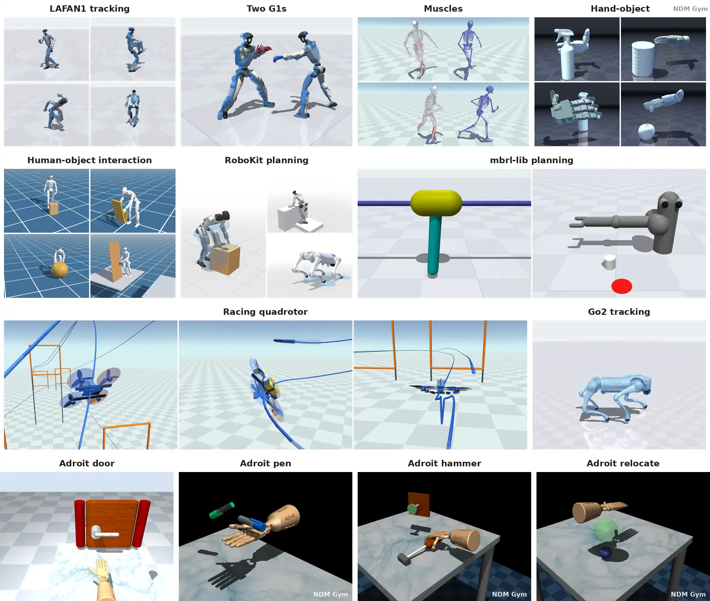
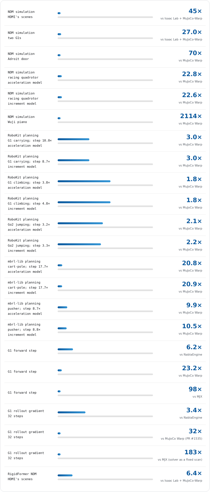
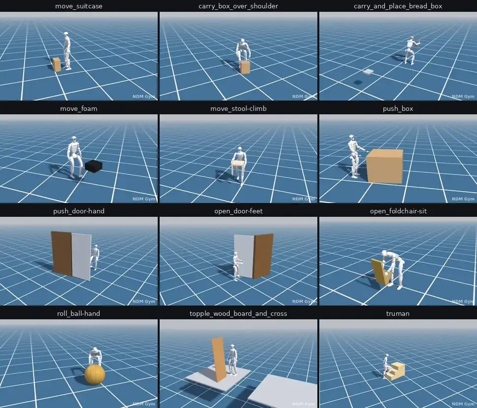
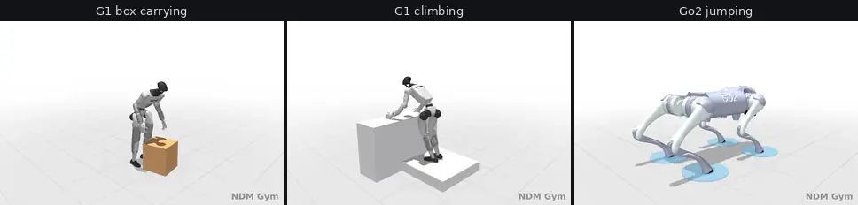

<div align="center">
<h1>NDM Gym</h1>

<a href="LICENSE"></a>

<a href="https://github.com/isaac-sim/IsaacLab"></a>
<a href="https://github.com/google-deepmind/mujoco_warp"></a>
<a href="https://huggingface.co/frankzydou/ndm-gym"></a>
<a href="https://frank-zy-dou.github.io/ndm-gym/"></a>

**Neural Dynamics Modeling Gym**: neural world models for controlling physical agents.

<a href="#-results">Results</a> · <a href="#key-findings">Key findings</a> · <a href="#-installation">Installation</a> · <a href="#-getting-started">Getting started</a> ·
<a href="https://frank-zy-dou.github.io/ndm-gym/">Documentation</a> · <a href="#-citation">Citation</a>
</div>

NDM Gym trains controllers of physical agents through neural dynamics models (NDMs): world models learned from a
simulator's transitions. The policy learns by backpropagation through the NDM's imagined rollouts. Batched on a GPU, an
NDM also steps faster than the physics it learned, so NDMs serve as simulators too ([speed](#-speed)).

The algorithms share one pipeline within each task:

- **Unitree G1** (29 DoF; Isaac Lab 3 with MuJoCo-Warp): LAFAN1 motion tracking, two G1s on a two-person clip, HDMI's
  human-object interaction.
- **Muscles:** MuscleVAE's muscle-actuated character (Newton with MuJoCo-Warp).
- **Hands:** hand-object tracking with the XHand, the Allegro hand and the Inspire hand (MuJoCo-Warp).

<p align="center"></p>
<p align="center"><i>SuperTrack on four LAFAN1 clips, two G1s, the muscles' walk and run, and three hands with their objects (half speed).<br>Four HDMI tasks trained in the world model (1.5x speed); RoboKit's three examples, planned on a world model.</i></p>
<p align="center"><sub>Renders of LAFAN1 (© 2018 Ubisoft Entertainment; CC BY-NC-ND 4.0), MuscleVAE, InterHuman (CC BY-NC-SA 4.0), SPIDER's hand retargets, HDMI and RoboKit (with an OMOMO clip), for non-commercial illustration only; not covered by this repository's MIT license (<a href="NOTICE">see NOTICE</a>).</sub></p>

<details>
<summary>The teaser's runs and errors</summary>

| block | runs | tracking error, speed-up |
|---|---|---|
| LAFAN1 tracking | SuperTrack's selected configuration, MLP world model, seed 2, 3 h checkpoint: dance1_subject2, fight1_subject2, fallAndGetUp2_subject2 and sprint1_subject2, 6 s of each clip's window in its section | |
| Two G1s, muscles | SuperTrack's selected configuration on each task, MLP world model; MuscleVAE's walk and run | over the window shown: two G1s 13.2 mm (MPJPE, root-relative), the walk 24.3 mm (MPJPE, root frame) |
| Hand-object | SuperTrack's runs in its section's grid ([which](benchmarks/xhand_tracking/results.md#the-readmes-animations)): the XHand on the spray bottle and the apple, the Allegro hand on the spray bottle, the Inspire hand on the can; half speed, last frames held | |
| Human-object interaction | carry_box_over_shoulder, open_foldchair-sit, roll_ball-hand and topple_wood_board_and_cross: one policy per task, trained in the world model and run in the simulator (evaluation seed 1), at 1.5 times the speed | |
| RoboKit planning | G1 box carrying, G1 climbing and Go2 jumping, planned on SuperTrack's world model and executed on MuJoCo Warp; the references in blue | planning 3.0x, 1.8x and 2.1x faster than on MuJoCo Warp |

</details>

## ⚡ Speed

<p align="center"></p>
<p align="center"><sub>Bars: time per step on the same task, the baseline's at full width, at 4,096 parallel worlds; RoboKit's rows: planning time. Made by <code>tools/make_speedup_chart.py</code>.</sub></p>

<details>
<summary>The chart's rows</summary>

| rows | measure | GPU |
|---|---|---|
| NDM simulation: HDMI's scenes, two G1s ([details](benchmarks/ndm_speed/results.md)) | time per step at 4,096 worlds; HDMI's scenes: the median of three tasks | HDMI's scenes: one H100; two G1s: one A100 80GB |
| the G1's forward step and the gradient of a 32-step rollout ([details](benchmarks/ndm_speed/results.md)) | the MLP world model against NablaEngine, MuJoCo Warp with the adjoint of its pull request #1535 and MJX, each in its faster setting | one A100 40GB |
| RoboKit planning ([details](benchmarks/robokit_ndm/results.md)) | the example's whole planning time at the planner's own worlds, the median over five planner seeds; the simulation step's speedup beside the task | one A100 40GB SXM4 |

</details>

## 🏆 Leaderboard

For each task, the fastest and the most accurate configuration in this repository; each task's section has its settings
table and both algorithms' results. Hands: apple / spray bottle / can; the target is a success of 0.99 with the object
within 10 mm. Commands: [Recommended settings](#-recommended-settings), [Results](#-results).

| Task | Goal | Configuration | Result |
|---|---|---|---|
| **[LAFAN1 tracking](#lafan1-motion-tracking)**, 40 clips, MLP world model | 🚀 fastest | `lafan1-supertrack-fast` and `lafan1-supermimic-fast` ([BlinkMimic's recipe](#blinkmimics-options)), level within the seeds' spread | return 0.82 after **2.54 ± 0.11** and **2.68 ± 0.19 min** on an H100; 4.19 ± 0.16 and 4.38 ± 0.57 min on an A100 40GB SXM4 (seeds 0-5) |
|  | 🎯 most accurate | `lafan1-supertrack-accurate`, 3 h with the speed options on an A100 40GB | return **0.861 ± 0.003**, MPJPE **14.5 ± 0.2 mm** (seeds 7-9) |
| **LAFAN1 tracking**, 40 clips, MLP world model, four GPUs | ⏱ time to the target, not engineered | `--algo blinkmimic --layout AWL --eprobe_gpu 3`, a probe sweep every 250 iterations ([XMimic](docs/algorithms/xmimic.md)'s layout: actor, world model, policy and probe sweeps on a GPU each) | return 0.82 after **2.30 ± 0.22 min** on four A100 40GB SXM4, against 4.48 ± 0.37 min on one (seeds 0-2); XMimic's own code, run here on the same GPUs with its evaluator: 1.81 ± 0.13 min on four, 3.53 ± 0.15 min on one (not ranked) |
| **LAFAN1 tracking**, RigidFormer world model | 🎯 most accurate | `lafan1-supertrack-rf-accurate`, 3 h on an A100 40GB | return **0.832 ± 0.003**, MPJPE **21.0 ± 1.3 mm** (seeds 7-9) |
| **[Two G1s](#two-g1s-one-two-person-clip)**, one two-person clip | ⏱ time to the target, not engineered (seed 0) | `two-g1-supermimic` | return 0.88 after **0.10 h** on an A100 80GB (seed 0) |
|  | 🎯 most accurate | `two-g1-supermimic` by return, `two-g1-supertrack` by root-relative MPJPE | return **0.904 ± 0.001**; MPJPE **14.1 mm** root-relative (MLP world model, seeds 0-2) |
| **[Hand-object tracking](#hand-object-tracking)**, XHand, three clips | ⏱ time to the target, not engineered | `hand-supermimic-fast` | **1.3 / 1.6 / 1.6 min**, every run (an A100 40GB, mean of seeds 0-2) |
|  | 🎯 most accurate | `hand-supertrack-accurate` | object position **2.4 / 1.6 / 2.3 mm** at a success of 99.9-100 % (seeds 0-2, A100 40GB) |
| **Hand-object tracking**, Allegro hand, three clips | ⏱ time to the target, not engineered | `hand-supertrack-fast --st_fail_w 5` | **1.6 / 1.3 / 8.8 min**, every run (an A100 40GB, mean of seeds 0-2) |
|  | 🎯 most accurate | `hand-supertrack-fast --st_fail_w 5 --iterations 20000` | object position **2.6 / 1.3 / 2.0 mm** at a success of 99.7-100 % (seeds 0-2, A100 40GB) |
| **Hand-object tracking**, Inspire hand, three clips | ⏱ time to the target, not engineered | `hand-supertrack-fast` | **2.4 / 1.5 / 3.1 min**, every run (an A100 40GB, mean of seeds 0-2) |
|  | 🎯 most accurate | `hand-supertrack-fast --st_imag_noise 0.1 --iterations 20000` | object position **2.4 / 1.3 / 2.0 mm** at a success of 99.7-100 % (seeds 0-2, A100 40GB) |
| **[Muscles](#muscle-actuated-character)**, MuscleVAE's character | 🎯 most accurate | `muscles-supertrack-rf` (the body-token RigidFormer, width 128, 2 blocks), 3 h on an A100 40GB PCIe | MPJPE **34.9 ± 0.7 mm** in the root frame, episodes ended 0.0004 ± 0.0008 (seeds 1-3); with the MLP, `muscles-supertrack` 38.1 ± 1.0 mm |
|  | 🚀 fastest | not compared yet | |
| **[NDM in RoboKit's planner](#ndms-in-robokits-planner)**, G1 box carrying / climbing, Go2 jumping, one A100 40GB | ⏱ planning time, not engineered | SuperTrack's acceleration model, MLP, as a bf16 copy | planning **3.0x / 1.8x / 2.1x** faster than on MuJoCo Warp (9 → 3, 7 → 4, 65 → 31 s), every seed passing as there; SuperMimic's increment model not yet run in the planner, held-out errors 0.643 / 0.619 / 0.0297 against 0.555 / 0.531 / 0.0283 ([results](benchmarks/robokit_ndm/results.md)) |
| **[NDM as the simulator](#ndms-as-simulators-hdmis-scenes)**, HDMI's move_suitcase, 4096 worlds on an H100 | 🚀 fastest | the MLP model's bf16 copy | **16.3 M env-steps/s**, 46 times the physics engine's 0.35 M; RigidFormer 2.30 M, 6.5 times ([results](benchmarks/ndm_speed/results.md)) |

[NablaMimic](docs/algorithms/nablamimic.md) (∇Mimic) trains through a differentiable simulator, without a world model.
Its authors' code, unmodified, with its own evaluation (seeds 0-2), first reaches return 0.82 after 14.48 ± 4.31 min
with its published configuration on an A100 80GB SXM4, and after 18.48 ± 1.72 min with a reduced-memory one on an A100
40GB SXM4. Not ranked with the table: the evaluators differ ([details](#training-speed)).

## 🧭 Recommended settings

Each task's best settings, as measured here, are named configurations; both methods are on offer for every task.

- `ndm-train --config NAME` runs one; `train_hand` and `train_muscles` take `--config` too.
- Options given beside it take precedence.
- `--config list` prints the names with what each measured.

| Task | Goal | SuperTrack | SuperMimic |
|---|---|---|---|
| **LAFAN1**, MLP world model | most accurate | `lafan1-supertrack-accurate`: return 0.861, MPJPE 14.5 mm (3 h with the speed options, A100 40GB) | `lafan1-supermimic-accurate`: 0.824, 28.4 mm (3 h, without them) |
| | fastest | `lafan1-supertrack-fast`: return 0.82 in 4.19 min (A100 40GB SXM4), 2.54 min (H100) | `lafan1-supermimic-fast`: 4.38 and 2.68 min |
| **LAFAN1**, RigidFormer | most accurate | `lafan1-supertrack-rf-accurate`: 0.832, 21.0 mm | `lafan1-supermimic-rf-accurate`: 0.804, 33.1 mm |
| **Two G1s**, MLP world model (add `--motion_dir`) | | `two-g1-supertrack`: return 0.893 ± 0.001, MPJPE 46.2 / 14.1 mm (seeds 0-2) | `two-g1-supermimic`: 0.904 ± 0.001, 47.5 / 16.1 mm |
| **Two G1s**, RigidFormer | | `two-g1-supertrack-rf`: 0.894 ± 0.002, 47.2 / 14.7 mm | `two-g1-supermimic-rf`: 0.904 ± 0.001, 45.8 / 17.0 mm |
| **XHand** (`train_hand`, add `--clip`) | most accurate | `hand-supertrack-accurate`: object 2.4 / 1.6 / 2.3 mm | `hand-supermimic-accurate`: 3.5 / 2.9 / 3.2 mm |
| | fast, not engineered | `hand-supertrack-fast`: success 0.99 in 0.9 / 1.5 / 2.4 min | `hand-supermimic-fast`: 1.3 / 1.6 / 1.6 min |
| **Allegro hand** (`train_hand`, add `--clip`) | most accurate | `hand-supertrack-fast --st_fail_w 5 --iterations 20000`: object 2.6 / 1.3 / 2.0 mm | `hand-supermimic-fast --action_noise 0.2 --iterations 20000`: 3.7 / 11.7 / 3.4 mm |
| | fast, not engineered | `hand-supertrack-fast --st_fail_w 5`: success 0.99 in 1.6 / 1.3 / 8.8 min | `hand-supermimic-fast`: 1.4 / - / 2.7 min |
| **Inspire hand** (`train_hand`, add `--clip`) | most accurate | `hand-supertrack-fast --st_imag_noise 0.1 --iterations 20000`: object 2.4 / 1.3 / 2.0 mm | `hand-supermimic-accurate`: 5.2 / 2.5 / 11.2 mm |
| | fast, not engineered | `hand-supertrack-fast`: success 0.99 in 2.4 / 1.5 / 3.1 min | `hand-supermimic-fast --lr 2e-4`: 2.5 / 2.1 / 4.9 min |
| **Muscles**, MLP world model (`train_muscles`) | | `muscles-supertrack`: MPJPE 38.1 mm | `muscles-supermimic`: 65.6 mm |
| **Muscles**, RigidFormer | | `muscles-supertrack-rf`: MPJPE 34.9 mm | `muscles-supermimic-rf`: 60.2 mm |

What the experiments showed (details under [Ablations](#-ablations) and [Training speed](#training-speed)):

| | more accurate or robust (LAFAN1) | shorter time to return 0.82 |
|---|---|---|
| **SuperTrack** | the failure penalty with the balance weights, the task penalties and the world-space root terms: return 0.53 → 0.83, MPJPE 96 → 20 mm | a failure-penalty weight of 1 instead of 5, a world-model learning rate of 2e-3, a policy batch of 2048, the goal table |
| **SuperMimic** | narrower reward kernels (×0.7): lower MPJPE; simulator action noise 0.3 and imagination kicks: fewer clips failed under pushes; without the critic, all 40 clips fail | a world-model learning rate of 1.5e-3, a foot-contact reward of 0.15, the goal table, one policy update of half the batch |
| **Both** | offline, world models without LayerNorm: 16-17 % lower open-loop error | BlinkMimic's recipe (Muon, the policy average, the learning-rate ramp) and the systems options (CUDA-graphed collection and updates, the default updates bit for bit) |

## 🔥 News

- **[2026-11] Tasks:** [human-object interaction](#human-object-interaction-hdmis-tasks) (HDMI's 13 tasks, policies on
  12), a [muscle-actuated character](#muscle-actuated-character) (MuscleVAE's), [two G1s](benchmarks/g1_boxing/results.md)
  on a two-person clip ([three training seeds](benchmarks/g1_boxing/results.md#training-seeds-0-2)),
  [hand-object tracking](#hand-object-tracking) on the XHand, the Allegro hand and the Inspire hand.
- **[2026-11] World models:** the RigidFormer's final configurations and speed options, SuperTrack-RF and SuperMimic-RF
  on fresh seeds ([results](#-results)), and its inference kernels; world models of MuJoCo models in generalized
  coordinates (`ndm_gym/worldmodels/mjcf.py`).
- **[2026-11] NDMs as simulators:** [throughput against physics](benchmarks/ndm_speed/results.md); the G1's MLP world
  model [against differentiable simulators](benchmarks/ndm_speed/results.md#differentiable-simulators-and-the-g1-world-models),
  its forward step 3.5-116x and its rollout gradient 2.4-183x faster (1,024-16,384 worlds, A100 40GB).
- **[2026-11] NDMs in planners:** a world model scores the planner's candidates in place of the physics steps:
  [RoboKit's](#ndms-in-robokits-planner) examples plan 1.8-3.0x faster than on MuJoCo Warp, on an A100.
- **[2026-11] Training speed:** what makes training fast, measured and offered as options: a recipe and systems options
  ([BlinkMimic's](#blinkmimics-options)), multi-GPU layouts ([XMimic's](docs/algorithms/xmimic.md));
  [time to return 0.82](#training-speed), with [NablaMimic](docs/algorithms/nablamimic.md)'s own code timed beside.
- **[2026-11] Contributed** by [Dechen Gao](https://github.com/gaodechen): the hand-object task with SuperMimic on it;
  the Allegro and the Inspire hand, each read from its scene with no code of its own.
- **[2026-11] Using it:** a [leaderboard](#-leaderboard), [named configurations](#-recommended-settings) (`--config`),
  trained weights of the G1 / LAFAN1 runs on [Hugging Face](https://huggingface.co/frankzydou/ndm-gym), a library-only
  `pip` installation ([details](docs/installation.md)), a [documentation site](https://frank-zy-dou.github.io/ndm-gym/).
- **[2026-10] First release:** a benchmark covering SuperTrack and SuperMimic on G1 / LAFAN1 ([results](#-results),
  [ablations](benchmarks/g1_lafan1_tracking/ablations.md)), equivalence-tested against an unofficial SuperMimic
  reproduction; the [RigidFormer](https://frank-zy-dou.github.io/projects/RigidFormer/) world-model backbone
  (`--wm_backbone rigidformer`). SuperMimic's authors have since released their code:
  [HybridRobotics/supermimic](https://github.com/HybridRobotics/supermimic).

## ✨ Features

- **Algorithms:** SuperTrack, SuperMimic ([official code](https://github.com/HybridRobotics/supermimic)) and BlinkMimic's recipe (`--algo blinkmimic`), with each change
  available separately.
- **World models:** acceleration (SuperTrack) and increment (SuperMimic) models, each with an MLP or a
  [RigidFormer](docs/rigidformer_backbone.md) backbone.
- **Tasks:** motion tracking on LAFAN1 (G1); two G1s in one scene tracking a two-person clip; HDMI's 13 human-object
  interaction tasks (G1, contact forces predicted by the world model); MuscleVAE's character with 284 Hill-type muscles and
  fatigue; a floating XHand, Allegro hand or Inspire hand tracking human hand-object demonstrations.
- **NDMs as simulators:** throughput and open-loop accuracy against physics, with fused Triton inference kernels
  ([results](benchmarks/ndm_speed/results.md)).
- **Evaluation:** tracking errors on every clip, push robustness, held-out clips (`--clips`), side-by-side videos and an
  offline world-model benchmark.
- **Benchmarks:** configurations selected in rounds under one rule, confidence intervals on LAFAN1
  ([details](benchmarks/g1_lafan1_tracking/results.md#how-the-numbers-were-obtained)).

| | MLP world model (default) | RigidFormer world model |
|---|---|---|
| **SuperTrack** | `--algo supertrack` | **SuperTrack-RF**: `--algo supertrack --wm_backbone rigidformer` |
| **SuperMimic** | `--algo supermimic` | **SuperMimic-RF**: `--algo supermimic --wm_backbone rigidformer` |
| world-model parameters | 8.75 M (SuperTrack), 8.82 M (SuperMimic) | 0.88 M |

**How the methods relate.** All three backpropagate through the world model's imagined rollouts; the objectives differ:

- **SuperTrack:** supervised L1 tracking; no reward, no critic.
- **SuperMimic:** the imagined reward, with a critic beyond the horizon.
- **BlinkMimic** (`--algo blinkmimic`): SuperMimic's objective with InstantTrack's and its own training changes
  ([details](docs/blinkmimic.md)).

## 🔧 Installation

Linux with an NVIDIA GPU.

```bash
git clone --recursive https://github.com/Frank-ZY-Dou/ndm-gym.git && cd ndm-gym
bash scripts/setup.sh                 # Isaac Lab 3 and locked dependencies into ~/ndm_gym/venv, motions and G1 into data/
source ~/ndm_gym/venv/bin/activate    # ndm-train and ndm-eval on PATH
```

The library alone (world models, policies, algorithms; no simulator, no training):
`pip install "ndm_gym @ git+https://github.com/Frank-ZY-Dou/ndm-gym"` ([details](docs/installation.md)).

## 🚀 Getting Started

```bash
# train (scripts/run_train.sh adds a memory cap, CPU pinning and a GPU lock)
ndm-train --algo supertrack --st_fail_w 5 --st_balance_w 4 --max_hours 3 --log_dir logs/st
ndm-train --algo supermimic --reward_std_scale 0.7 --action_noise 0.3 --imag_start_perturb 0.3 --max_hours 3 --log_dir logs/sm

# evaluate every checkpoint as it is written; push robustness of one checkpoint
ndm-eval --run_dir logs/st --watch
ndm-eval --run_dir logs/st --ckpt logs/st/ckpt_012000.pt --push_mag 0 1 2 --out_json push.json

# compare: curves, then side-by-side videos of recorded evaluations
python tools/plot.py logs/st logs/sm --labels SuperTrack SuperMimic --out compare.png
ndm-eval --run_dir logs/st --ckpt <ckpt> --record st.npz      # and the same for sm.npz
MUJOCO_GL=egl python tools/compare_videos.py st.npz sm.npz --labels SuperTrack SuperMimic --out videos/

# world models offline: a training and a test set from one policy, then a fit
python -m ndm_gym.wmbench.collect --ckpt logs/st/ckpt_006000.pt --out wm_train.pt --seed 0
python -m ndm_gym.wmbench.collect --ckpt logs/st/ckpt_006000.pt --out wm_test.pt --seed 1
python -m ndm_gym.wmbench.fit --algo supertrack --train wm_train.pt --test st=wm_test.pt --out wm_st.csv
```

<details>
<summary><b>Two G1s, one two-person clip</b></summary>

```bash
# InterHuman's clip retargeted to two G1s (see the tool's docstring; HoloMotion's HoloRetarget and a licensed SMPL model)
python tools/convert_interhuman.py --pkl <InterHuman>/motions/1566.pkl --smpl_model <SMPL_NEUTRAL.pkl> \
    --robot_mjcf data/g1_description/g1_29dof.xml --out data/interhuman/interhuman_1566.npz

ndm-train --algo supertrack --st_fail_w 5 --st_balance_w 4 --motions interhuman --paired \
    --motion_dir data/interhuman/interhuman_1566.npz --max_hours 3 --log_dir logs/box_st
ndm-train --algo supermimic --reward_std_scale 0.7 --action_noise 0.3 --imag_start_perturb 0.3 --motions interhuman --paired \
    --motion_dir data/interhuman/interhuman_1566.npz --max_hours 3 --log_dir logs/box_sm
ndm-eval --run_dir logs/box_st --ckpt <ckpt> --motions interhuman --paired --motion_dir data/interhuman/interhuman_1566.npz --record box.npz
MUJOCO_GL=egl python tools/render.py box.npz box.mp4 --pair --seconds 11

# throughput of the two-robot scene: physics, and a RigidFormer checkpoint's world model with its inference path
python -m ndm_gym.wmbench.speed_pair --pair data/interhuman/interhuman_1566.npz --mode physics --num_envs 4096 --out speed.csv
python -m ndm_gym.wmbench.speed_pair --pair data/interhuman/interhuman_1566.npz --mode ndm --wm_ckpt <ckpt> \
    --inference_copy amp --fused --rf_kernels whole --num_envs 4096 --out speed.csv
```

</details>

<details>
<summary><b>Human-object interaction (HDMI's tasks)</b></summary>

```bash
bash tools/download_hdmi.sh && python tools/convert_hdmi.py    # HDMI's clips and objects into data/hdmi/ (not redistributed)
MUJOCO_GL=egl python tools/render_hoi.py suitcase.mp4 --task move_suitcase    # a reference clip in HDMI's look; --states: a recorded rollout

# one task (13 in ndm_gym/tasks/hdmi_tasks.py); HDMI's PPO teacher as the model-free baseline
python -m ndm_gym.train_hoi --task move_suitcase --algo supertrack --st_fail_w 5 --st_contact_force --max_hours 3 --log_dir logs/hoi_st
python -m ndm_gym.train_hoi --task move_suitcase --algo supermimic --action_noise 0.3 --max_hours 3 --log_dir logs/hoi_sm
python -m ndm_gym.train_ppo_hoi --task move_suitcase --max_hours 3 --log_dir logs/hoi_ppo
python -m ndm_gym.evaluate_hoi --run_dir logs/hoi_st      # every checkpoint; --ckpt for one

# the NDM as a simulator: transitions, an offline fit with its open-loop errors, throughput against physics
python -m ndm_gym.wmbench.collect_hoi --task move_suitcase --seed 0 --out hoi_s0.pt
python -m ndm_gym.wmbench.collect_hoi --task move_suitcase --seed 1 --out hoi_s1.pt
python -m ndm_gym.wmbench.fit_hoi --task move_suitcase --kind accel --backbone rigidformer --train hoi_s0.pt --test held=hoi_s1.pt --out fit.csv
python -m ndm_gym.wmbench.speed_hoi --task move_suitcase --mode physics --num_envs 4096 --out speed.csv
python -m ndm_gym.wmbench.speed_hoi --task move_suitcase --mode ndm --backbone rigidformer --compile reduce-overhead --num_envs 4096 --out speed.csv
```

</details>

<details>
<summary><b>MuscleVAE</b></summary>

```bash
bash tools/download_musclevae.sh && python tools/convert_musclevae.py   # character, muscles, motions (not redistributed)
bash tools/download_mass_meshes.sh                                      # MASS's bone meshes, for rendering

# their released tracking policy in our simulator (Newton, 120 Hz, muscle forces every substep), then a render in their look
bash tools/download_musclevae_pretrained.sh
python tools/replay_musclevae.py --out_dir replay
MUJOCO_GL=egl python tools/render_musclevae.py walk.mp4 --states replay/states_lafan_walk_0.npz --ref

# SuperTrack and SuperMimic on the character: the commands are under Results. Evaluation of a checkpoint
python tools/evaluate_muscles.py --ckpt logs/<run>/last.pt

# transitions for a muscle NDM, and the simulator's throughput
python -m ndm_gym.wmbench.collect_muscles --out mvae/data
python -m ndm_gym.wmbench.speed_muscles --mode physics --ball_joints euler --joint_damping ode --out speed_muscles.csv
```

</details>

<details>
<summary><b>Hand-object tracking</b></summary>

```bash
pip install -e '.[hand]'                               # MuJoCo-Warp
python tools/download_hand_clips.py                    # benchmark clips into data/spider

# one clip: train (SuperTrack, then SuperMimic), evaluate beside the reference targets, render the rollout over the reference
CLIP=data/spider/processed/hrdexdb_24f/xhand/right/apple-0/0
python -m ndm_gym.train_hand --clip $CLIP --algo supertrack --lr 4e-4 --st_fail_w 2 --st_imag_noise 0.2 --st_task_weights \
       --log_dir logs/apple_st
python -m ndm_gym.train_hand --clip $CLIP --log_dir logs/apple_sm
python -m ndm_gym.evaluate_hand --ckpt logs/apple_st/last.pt --out logs/apple_st/evaluation
python tools/render_hand.py --clip $CLIP --rollout logs/apple_st/evaluation/rollout.npz --out apple_st.mp4

# a task and seed of the benchmark (benchmarks/xhand_tracking/tasks.json): SuperTrack, then SuperMimic's defaults
benchmarks/xhand_tracking/run.sh apple 0 data/spider logs/xhand_st --algo supertrack --lr 4e-4 --st_fail_w 2 --st_imag_noise 0.2 --st_task_weights
benchmarks/xhand_tracking/run.sh apple 0 data/spider logs/xhand_sm
# another hand of the task list (allegro, inspire), with the fast configurations
ROBOT=allegro benchmarks/xhand_tracking/run.sh apple 0 data/spider logs/allegro_st --config hand-supertrack-fast
ROBOT=allegro benchmarks/xhand_tracking/run.sh apple 0 data/spider logs/allegro_sm --config hand-supermimic-fast
```

</details>

## 📊 Results

SuperTrack and SuperMimic share each task's simulator, data, networks and evaluation.

- **Selection:** rounds with equal budgets and one rule; the [fastest configurations](#training-speed) come from rounds
  of single changes.
- **SuperMimic** here is this library's re-implementation, written before its
  [official code](https://github.com/HybridRobotics/supermimic) was released; its numbers may differ from the authors' code.
- **World models:** MLP for tracking and training speed, apart from the RigidFormer's tracking results on LAFAN1, the two
  G1s and the muscles.
- **Not reported here:** tracking on HDMI's human-object interaction tasks, and the RigidFormer's time to a target return.
- **Return:** the evaluation's undiscounted reward sum over its maximum. ↑: higher is better; ↓: lower is better.

Each task below opens with its settings table and a one-line conclusion; both algorithms' results follow.

### LAFAN1 motion tracking

One policy on the G1 tracks all 40 LAFAN1 clips, retargeted to the robot; training and evaluation use all 40.

| goal | configuration | result |
|---|---|---|
| most accurate | `--config lafan1-supertrack-accurate` | return 0.861, MPJPE 14.5 mm (3 h with the speed options, A100 40GB, seeds 7-9) |
| most accurate, RigidFormer world model | `--config lafan1-supertrack-rf-accurate` | return 0.832 ± 0.003, MPJPE 21.0 ± 1.3 mm (3 h, A100 40GB, seeds 7-9) |
| fewest failed clips under pushes | `--config lafan1-supermimic-accurate`; with the RigidFormer, `--config lafan1-supermimic-rf-accurate` | 1.7 / 9.3 and 1.3 / 9.0 of 40 clips under 1 / 2 m/s pushes (3 h, A100 40GB; seeds 1-3 and 7-9) |
| fastest | `--config lafan1-supertrack-fast` or `--config lafan1-supermimic-fast`, level within the seeds' spread | return 0.82 after 2.54 ± 0.11 and 2.68 ± 0.19 min on an H100, 4.19 ± 0.16 and 4.38 ± 0.57 min on an A100 40GB SXM4 (seeds 0-5) |

**In short:** `lafan1-supertrack-accurate` for tracking accuracy, `lafan1-supermimic-accurate` (or its RigidFormer
version) for the fewest failed clips under pushes, either fast configuration for speed.

<!-- videos:begin -->
<p align="center"></p>
<p align="center"><i>SuperTrack: MLP, the selected configuration, seed 2; RigidFormer, every speed option, seed 8 (12,677 iterations).<br>3 h checkpoints on an A100; one clip per motion category, its 10 s with the most motion. Blue ghost: the reference.</i></p>
<!-- videos:end -->
<p align="center"><sub>Renders of LAFAN1 motions (© 2018 Ubisoft Entertainment; CC BY-NC-ND 4.0; <a href="https://github.com/ubisoft/ubisoft-laforge-animation-dataset">https://github.com/ubisoft/ubisoft-laforge-animation-dataset</a>), retargeted to the G1 (LAFAN1 Retargeting Dataset), resampled, cut to 10 s and rendered. For non-commercial illustration only; not covered by this repository's MIT license (see <a href="NOTICE">NOTICE</a>).</sub></p>

The table below: the selected configurations, seeds 1-3, 3 h on one A100; mean ± std over seeds, each seed the average
of three standard evaluations (push rows: one push test). H100 results and diagnostics:
[`results.md`](benchmarks/g1_lafan1_tracking/results.md). Checkpoints: [Hugging Face](https://huggingface.co/frankzydou/ndm-gym)
(`g1_lafan1_tracking/`; non-commercial use, as LAFAN1).

<!-- results:begin -->
| | SuperTrack | SuperMimic |
|---|---|---|
| normalized return | 0.832 ± 0.009 | 0.824 ± 0.013 |
| failed clips (of 40) | 0.9 ± 0.8 | 1.2 ± 1.2 |
| MPJPE, root-relative (mm) | 20.0 ± 0.7 | 28.4 ± 0.5 |
| joint-angle error (deg) | 2.32 ± 0.06 | 4.89 ± 0.03 |
| root-orientation error (rad) | 0.059 ± 0.003 | 0.051 ± 0.004 |
| body-velocity error (m/s) | 0.224 ± 0.006 | 0.203 ± 0.003 |
| failed clips under root pushes of 1 m/s every 2 s | 7.7 ± 2.3 | 1.7 ± 0.6 |
| failed clips under root pushes of 2 m/s every 2 s | 24.7 ± 1.2 | 9.3 ± 1.2 |
| iterations in 3 h | 12,670 | 13,540 |
<!-- results:end -->

RigidFormer: final configurations with every speed option, fresh seeds 7-9.

| | SuperTrack-RF | SuperMimic-RF |
|---|---|---|
| normalized return | 0.832 ± 0.003 | 0.804 ± 0.007 |
| failed clips (of 40) | 0.4 ± 0.5 | 0.8 ± 0.4 |
| MPJPE, root-relative (mm) | 21.0 ± 1.3 | 33.1 ± 0.5 |
| joint-angle error (deg) | 2.24 ± 0.05 | 6.05 ± 0.62 |
| failed clips under root pushes of 1 m/s every 2 s | 5.3 ± 1.2 | 1.3 ± 0.6 |
| failed clips under root pushes of 2 m/s every 2 s | 24.3 ± 3.1 | 9.0 ± 2.0 |
| iterations in 3 h | 12,676 | 10,710 |

```bash
SPEED="--wm_cudagraphs --pi_cudagraphs --fused_adam --elementwise_3x3 --combo_kernels --compile_eager"   # the speed options of both world models
RF_SPEED="--rf_fused_train --rf_bptt_keep_blocks --rf_fit_keep_ops"   # the RigidFormer's own
# selected configurations, MLP world model: SuperTrack's with the speed options (about 35,700 iterations in 3 h),
# SuperMimic's without them (with them its return falls late, to 0.137 at about 33,000 iterations)
ndm-train --algo supertrack --st_fail_w 5 --st_balance_w 4 $SPEED --max_hours 3
ndm-train --algo supermimic --reward_std_scale 0.7 --action_noise 0.3 --imag_start_perturb 0.3 --max_hours 3
# RigidFormer world model, with every speed option (they leave the algorithms unchanged)
ndm-train --algo supertrack --wm_backbone rigidformer --wm_lr 4e-4 --st_fail_w 5 --st_balance_w 2 --wm_batches 5 $SPEED $RF_SPEED --max_hours 3
ndm-train --algo supermimic --wm_backbone rigidformer --wm_lr 4e-4 --reward_std_scale 0.7 --action_noise 0.3 --imag_start_perturb 0.4 \
          --wm_batches 7 $SPEED --critic_cudagraphs $RF_SPEED --max_hours 3
```

### Training speed

Minutes to return 0.82 on LAFAN1: each algorithm's fastest configuration, MLP world model, BlinkMimic's recipe and
systems options, seeds 0-5 ([per seed](benchmarks/g1_lafan1_tracking/results.md#training-speed)).

- **Clock:** from iteration 50, after compilation and graph capture, to the first checkpoint whose four evaluations on
  all 40 clips average 0.82.
- **Evaluation:** a second GPU evaluates every checkpoint, one per 100 iterations.

| minutes to return 0.82 | SuperTrack | SuperMimic |
|---|---|---|
| H100 | 2.54 ± 0.11 | 2.68 ± 0.19 |
| A100 40GB SXM4 | 4.19 ± 0.16 | 4.38 ± 0.57 |
| A100 40GB PCIe | 4.37 ± 0.35 | 3.98 ± 0.22 |

```bash
RECIPE="--pi_ema 0.995 --lr 4e-4 --wm_batches 5 --wm_mirror 0.5 --pi_opt muon --wm_opt muon --wm_only_iters 0 --pi_batch 2048 \
        --pi_lr_mult 4 --lr_decay_ret 0.75 --lr_decay_len 300 --lr_decay_by 1400 --wm_hidden 1024 1024 1024"   # BlinkMimic's recipe
RESETS="--fail_reset 0.3 --bin_fix --eprobe_share 0.15 --eprobe_graph --eprobe_async 20 --eprobe_start 1000 --eprobe_every 125 \
        --eprobe_decay 0.7"   # its failure-focused and evaluation-guided resets
SYSTEMS="--fused_adam --elementwise_3x3 --combo_kernels --compile_eager --no_sync --update_graphs --graph_early --collect_graph \
         --reset_masked --ckpt_light"   # --fused_adam and --elementwise_3x3 change results, --combo_kernels and --compile_eager by rounding
TIMED="--iterations 6000 --ckpt_every 100"   # the timed runs' length and checkpoints, each evaluated while training (ndm-eval --watch)
ndm-train --algo supertrack --st_fail_w 1 --st_balance_w 2 $RECIPE --st_quad_w 0.5 --wm_lr 2e-3 --goal_table --pi_encode_once \
          $RESETS $SYSTEMS $TIMED --log_dir logs/st_fast
ndm-train --algo supermimic --reward_std_scale 0.7 --action_noise 0.3 --imag_start_perturb 0.15 $RECIPE --pi_ema 0.99 \
          --pi_batch 1024 --pi_lr_mult 2 --pi_updates 1 --wm_lr 1.5e-3 --goal_table --contact_reward 0.15 --ref_contact_fix \
          --sm_residual --wm_structured $RESETS $SYSTEMS $TIMED --log_dir logs/sm_fast
ndm-eval --run_dir logs/st_fast --watch --group 18 --repeats 4 --graph   # on a second GPU; the same for logs/sm_fast
```

**Training through an exact simulator.** [NablaMimic](https://github.com/sailab-ai/NablaMimic) (∇Mimic) backpropagates
through a differentiable simulator, without a world model. Its authors' code, run unmodified and scored by its own
evaluation (seeds 0-2; minutes from update 50), first reaches return 0.82 after:

- 14.48 ± 4.31 min with its published configuration, on an A100 80GB SXM4;
- 18.48 ± 1.72 min with a reduced-memory configuration, on an A100 40GB SXM4, which the published one does not fit.

Its authors report 8 min on an RTX PRO 6000. On the A100 40GB SXM4 it needs about as many updates as this library's recipe (`--algo blinkmimic`; 1,500-1,750 against
1,400-1,600), but an update through the exact simulator takes 0.72 s, one through the world model 0.16 s
([why](docs/algorithms/nablamimic.md#4-its-evaluation-beside-this-librarys)). These numbers stand beside the table and
are not ranked with it: the evaluators, their simulators and the checkpoint intervals differ
([details](benchmarks/g1_lafan1_tracking/results.md#nablamimics-own-code-timed), [running it](docs/algorithms/nablamimic.md)).

<details>
<summary><b>What changed the time</b></summary>

Single changes, one run each (seed 0), each against the configuration it was tried on: compare times within a row
only. ✅ shorter · ❌ longer · ➖ level. GPU: for each algorithm, the rows above its first GPU mark ran on an RTX 3090,
a marked row and those below it on the marked GPU.

| | | change | minutes to return 0.82 |
|---|---|---|---|
| ✅ | SuperTrack | lower failure-penalty weight, 5 → 3 → 2 → 1 | -7% (5 → 3), 9.71 → 8.53 (3 → 2), 8.54 → 7.94 (2 → 1) |
| ✅ | SuperTrack | world-model learning rate 1.6e-3 instead of the policy's 4e-4 | 7.94 → 7.43 |
| ✅ | SuperTrack | policy batch 2048 instead of 4096 | 7.94 → 7.59 |
| ❌ | SuperTrack | 2 or 3 policy updates per iteration | 9.71 → 11.95 and 14.14 |
| ❌ | SuperTrack | 3 world-model batches instead of 5; evaluation-guided reset sweeps every 250 iterations instead of 125 | 7.94 → 9.19; 7.94 → 8.88 |
| ✅ | SuperTrack | world-model learning rate 2.4e-3 instead of 1.6e-3 (A100 40GB PCIe) | 4.97 → 4.24 |
| ✅ | SuperTrack | `--goal_table --pi_encode_once` with policy batch 2048 | 4.24 → 4.05 |
| ✅ | SuperTrack | world-model learning rate 2e-3 instead of 2.4e-3 | 4.05 → 3.69 |
| ❌ | SuperTrack | world-model learning rate 3e-3; policy learning rate 5e-4 | 4.24 → 4.94; 4.24 → 5.05 |
| ❌ | SuperTrack | world-model learning rate 2.5e-3; 1.5e-3; policy batch 1024 | 4.05 → 4.80; 3.69 → above 4.61 (both) |
| ✅ | SuperMimic | 2 policy updates of half the batch | 6.18 → 5.81 |
| ✅ | SuperMimic | foot-contact reward 0.15 instead of 0.25 | 5.81 → 5.22 |
| ✅ | SuperMimic | world-model learning rate 1.6e-3 instead of 4e-4 (A100 80GB) | 4.18 → 3.73 |
| ❌ | SuperMimic | 2 or 3 policy updates of the full batch | 6.18 → 8.21 and 9.28 |
| ✅ | SuperMimic | `--goal_table` (A100 40GB PCIe) | 4.34 → 3.80 |
| ✅ | SuperMimic | 1 policy update instead of 2 (half the policy samples) | 3.80 → 3.69 |
| ➖ | SuperMimic | world-model learning rate 1.5e-3, policy learning rate 5e-4; world-model learning rate 2.5e-3 with 2 policy updates | 3.69 → 3.62, 3.63; 3.80 → 3.81 |
| ❌ | SuperMimic | no world-model mirroring | 3.69 → 4.25 |
| ❌ | SuperMimic | policy learning-rate multiplier 3; policy learning rate 5e-4; world-model learning rate 1e-3; policy batch 512 | 3.62 → 4.03; 4.39; 4.51; above 4.69 |

</details>

**Across GPUs.** The iteration's steps (collection, world-model updates, policy update, probe sweeps) run side by side on
several GPUs (`--layout AL | AWL`, `--eprobe_gpu`; [XMimic](docs/algorithms/xmimic.md)'s layouts): 87 ms per iteration
instead of 161. With BlinkMimic's recipe, seeds 0-2, A100 40GB SXM4
([results](benchmarks/g1_lafan1_tracking/results.md#multi-gpu-layouts-and-the-learners-restructuring-timed)):

| GPUs | minutes to return 0.82 |
|---|---|
| one | 4.48 ± 0.37 |
| two | 2.89 ± 0.38 |
| three | 2.41-2.69 |
| four | 2.30-2.57; 2.30 ± 0.22 with a probe sweep every 250 iterations |

The layouts take 1.3-2.3 times the GPU-minutes. On one GPU, what carries over from XMimic's restructured learner is the
goal encoder run once per policy update, 6.6 % off an iteration.

XMimic's own code (JAX, unmodified, its evaluator; minutes from iteration 50) on the same GPUs, not ranked with this
library's times ([why it is fast](docs/algorithms/xmimic.md)):

- return 0.82 after 1.81 ± 0.13 min on four GPUs and 3.53 ± 0.15 min on one;
- its own target (no failed clip, three checkpoints in a row) after 2.44 ± 0.25 min on four, and 4.62 and 4.01 min on one
  (seeds 0 and 2; seed 1 not within its 6.2 min budget).

### Two G1s, one two-person clip

Two G1s in one scene, with robot-robot contacts, track the two sides of an InterHuman boxing clip (CC BY-NC-SA 4.0, not
redistributed). One policy controls both.

| goal | configuration | result |
|---|---|---|
| most accurate by return; time to the target, not engineered (seed 0) | `--config two-g1-supermimic` | return 0.904 ± 0.001; return 0.88 after 0.10 h (seed 0, A100 80GB) |
| most accurate by root-relative MPJPE | `--config two-g1-supertrack` | MPJPE 14.1 mm, root-relative |

Add `--motion_dir`; seeds 0-2, GPUs below.

**In short:** `two-g1-supermimic` for return and the time to return 0.88, `two-g1-supertrack` for root-relative MPJPE; the
times come from one seed (0.10 and 0.11 h, not engineered), and global MPJPE is 45.8-47.5 mm in all four configurations.

<p align="center"></p>
<p align="center"><i>SuperTrack's selected run on InterHuman clip 1566 (seed 0): its best checkpoint (iteration 7,000), MLP world model; blue ghosts: the references. MPJPE in this recorded evaluation: 37.6 mm in the world frame, 14.2 mm root-relative.</i><br><sub>Render of InterHuman clip 1566 (CC BY-NC-SA 4.0), retargeted to the G1; shared under that license, not the MIT license (see <a href="NOTICE">NOTICE</a>).</sub></p>

- **Selection:** two rounds with equal run counts, then three training seeds, with the MLP and with a small RigidFormer
  (SuperTrack-RF, SuperMimic-RF).
- **Table:** mean ± standard deviation over training seeds 0-2 of each run's best checkpoint, evaluated five times.
- **GPUs:** seed 0 on an A100 80GB (0.5 h; SuperMimic with the MLP 0.3 h), seeds 1 and 2 on an A100 40GB to seed 0's
  iteration counts ([details](benchmarks/g1_boxing/results.md)).

| | SuperTrack | SuperMimic |
|---|---|---|
| pair success, every evaluation | 5 / 5 | 5 / 5 |
| normalized return, MLP world model | 0.893 ± 0.001 | 0.904 ± 0.001 |
| normalized return, RigidFormer | 0.894 ± 0.002 | 0.904 ± 0.001 |
| MPJPE, global / root-relative (mm), MLP world model | 46.2 ± 7.5 / 14.1 ± 0.2 | 47.5 ± 8.6 / 16.1 ± 0.4 |
| MPJPE, global / root-relative (mm), RigidFormer | 47.2 ± 5.2 / 14.7 ± 0.2 | 45.8 ± 2.5 / 17.0 ± 0.7 |
| training to return 0.88 (h), seed 0, MLP world model | 0.11 | 0.10 |

```bash
CLIP="--motions interhuman --paired --motion_dir data/interhuman/interhuman_1566.npz"   # tools/convert_interhuman.py, under Getting started
# $RECIPE and $SYSTEMS as under Training speed
ndm-train --algo supertrack --st_fail_w 5 --st_balance_w 4 --st_com $RECIPE --pi_batch 4096 $SYSTEMS $CLIP --max_hours 0.5 --ckpt_every 1000 --log_dir logs/box_st
ndm-train --algo supermimic --reward_std_scale 0.7 --action_noise 0.3 --imag_start_perturb 0.3 $RECIPE --pi_lr_mult 2 --contact_reward 0.25 \
          --ref_contact_fix --sm_residual --wm_structured $SYSTEMS $CLIP --max_hours 0.3 --ckpt_every 1000 --log_dir logs/box_sm
# SuperTrack-RF and SuperMimic-RF: the named configurations (their options: ndm_gym/configs.py)
ndm-train --config two-g1-supertrack-rf --motion_dir data/interhuman/interhuman_1566.npz --log_dir logs/box_st_rf
ndm-train --config two-g1-supermimic-rf --motion_dir data/interhuman/interhuman_1566.npz --log_dir logs/box_sm_rf
```

At 4096 pairs the physics runs 0.31 M robot-steps per second; with their inference paths the MLP runs 8.4 M (27.0x) and
the RigidFormer 1.9 M (6.0x).

### Muscle-actuated character

MuscleVAE's character with 284 Hill-type muscles and fatigue tracks three clips on the Newton simulator. MuscleVAE's
files and weights of policies trained on them are not redistributed.

| goal | configuration | result |
|---|---|---|
| most accurate | `--config muscles-supertrack-rf` (`train_muscles`) | MPJPE 34.9 ± 0.7 mm in the root frame, episodes ended 0.0004 ± 0.0008 |
| most accurate, MLP world model | `--config muscles-supertrack` | MPJPE 38.1 ± 1.0 mm, episodes ended 0.011 ± 0.005 |
| fastest | not compared yet | |

Seeds 1-3, at most 3 h on an A100 40GB PCIe.

**In short:** `muscles-supertrack-rf` for position tracking (`muscles-supertrack` with the MLP); `muscles-supermimic`
and `muscles-supermimic-rf` have the lower joint error (9.7 and 8.7 deg against 10.6 and 10.1).

<p align="center"></p>
<p align="center"><i>SuperTrack on MuscleVAE's walk and run: its best seed of the 3 h runs (seed 1, iteration 26,000), muscles red by activation, the reference in blue. Root-frame MPJPE over the clips' episodes: 24.9 mm (walk) and 46.6 mm (run).</i></p>
<p align="center"><sub>Renders of MuscleVAE's walk and run clips (LAFAN1 motions, © 2018 Ubisoft Entertainment; CC BY-NC-ND 4.0), for non-commercial illustration only; not covered by this repository's MIT license (see <a href="NOTICE">NOTICE</a>).</sub></p>

- **Selection:** four rounds of 1 h runs with the MLP, ranked by one rule; the selected configurations train with seeds
  1-3 for up to 3 h, stopping when the error stops falling.
- **Evaluation:** the best checkpoint with at most 10% of episodes ended, with a seed it did not train with
  ([details](benchmarks/musclevae/results.md)).

| | SuperTrack | SuperMimic |
|---|---|---|
| MPJPE, root frame (mm) | 38.1 ± 1.0 | 65.6 ± 8.1 |
| MPJPE, heading frame (mm) | 38.5 ± 1.1 | 45.7 ± 2.5 |
| episodes ended (share) | 0.011 ± 0.005 | 0.053 ± 0.014 |
| joint error (deg) | 10.6 ± 1.1 | 9.7 ± 0.4 |

How the table's configurations were reached ([tuning history](benchmarks/musclevae/results.md#tuning)):

- The second round's selections reached 74.2 ± 33.7 mm (SuperTrack) and 68.0 ± 3.5 mm (SuperMimic) in 3 h runs, with
  the default updates.
- The third round, defined after those SuperTrack runs had ended and while SuperMimic's were ending, added the systems
  options for both and selected `--wm_lr 1.6e-3` for SuperTrack.
- The fourth round selects `--wm_lr 2.5e-3` for both (at 1 h, 37.2 and 57.0 mm, against 37.6 and 60.5 mm); the table
  reports its 3 h runs.
- SuperMimic's best checkpoints come early (iterations 6,000-8,000): later ones reach 56-68 mm with 13-46% of episodes
  ended, which the rule excludes.

```bash
MUSCLE_RECIPE="--pi_ema 0.995 --lr 4e-4 --pi_opt muon --wm_opt muon --wm_only_iters 0 --pi_batch 2048 --lr_decay_len 300 \
               --lr_decay_by 1400 --wm_hidden 1024 1024 1024"   # BlinkMimic's recipe, the parts muscle training implements
MUSCLE_SYS="--no_sync --fused_adam --update_graphs --graph_early --collect_graph --reset_masked --ckpt_light"   # --fused_adam changes results
python -m ndm_gym.train_muscles --algo supertrack --st_fail_w 5 --st_balance_w 4 $MUSCLE_RECIPE $MUSCLE_SYS --wm_batches 8 --pi_lr_mult 4 \
       --wm_lr 2.5e-3 --iterations 1000000 --last_every_min 10 --max_hours 3 --ckpt_every 2000 --seed 1 --log_dir logs/mus_st_s1    # seeds 1-3
python -m ndm_gym.train_muscles --algo supermimic --reward_std_scale 0.5 --action_noise 0.3 --imag_start_perturb 0.3 $MUSCLE_RECIPE \
       $MUSCLE_SYS --wm_batches 5 --pi_lr_mult 2 --wm_lr 2.5e-3 --iterations 1000000 --last_every_min 10 --max_hours 3 --ckpt_every 2000 \
       --seed 1 --log_dir logs/mus_sm_s1
```

RigidFormer: a token per body, width 128, 2 blocks, 4 heads, from nine rounds of 1 h runs ranked by the same rule; seeds 1-3, up to 3 h
([details and tuning history](benchmarks/musclevae/results.md#rigidformer-world-model)).

| | SuperTrack-RF | SuperMimic-RF |
|---|---|---|
| MPJPE, root frame (mm) | 34.9 ± 0.7 | 60.2 ± 2.0 |
| MPJPE, heading frame (mm) | 35.1 ± 0.7 | 38.5 ± 3.4 |
| episodes ended (share) | 0.000 ± 0.001 | 0.009 ± 0.014 |
| joint error (deg) | 10.1 ± 0.3 | 8.7 ± 0.4 |

With the RigidFormer, root-frame MPJPE is 3.2 mm lower for SuperTrack (RigidFormer minus MLP, Welch 95% interval
[-5.2, -1.2]) and 5.4 mm lower for SuperMimic ([-24.1, 13.3], which includes 0). The RigidFormer runs trained to the 3 h
cap, the MLP runs stopped by their progress rule after 0.9-2.0 h, and the RigidFormer had nine tuning rounds to the MLP's
four ([details](benchmarks/musclevae/results.md#the-rigidformer-against-the-mlp)).

```bash
MUSCLE_RF="--pi_ema 0.995 --lr 4e-4 --pi_opt muon --wm_only_iters 0 --pi_batch 2048 --lr_decay_len 300 --lr_decay_by 1400 --wm_backbone rigidformer \
           --rf_muscle_tokens body --rf_dim 128 --rf_layers 2 --rf_heads 4 --rf_registers 9 --rf_fused_train --rf_fused_features"   # the recipe, the RigidFormer in place of its --wm_hidden
# $MUSCLE_SYS as above; Muon on the world model (--wm_opt muon) is SuperTrack-RF's selection, SuperMimic-RF's keeps Adam
python -m ndm_gym.train_muscles --algo supertrack --st_fail_w 5 --st_balance_w 4 $MUSCLE_RF --wm_opt muon $MUSCLE_SYS --wm_batches 5 --pi_lr_mult 4 \
       --wm_lr 5e-3 --max_hours 3 --ckpt_every 2000 --seed 1 --log_dir logs/mus_st_rf_s1    # seeds 1-3
python -m ndm_gym.train_muscles --algo supermimic --reward_std_scale 0.5 --action_noise 0.3 --imag_start_perturb 0.3 $MUSCLE_RF \
       $MUSCLE_SYS --wm_batches 8 --pi_lr_mult 2 --wm_lr 5e-3 --max_hours 3 --ckpt_every 2000 --seed 1 --log_dir logs/mus_sm_rf_s1
```

### Hand-object tracking

A floating hand tracks human grasp-and-lift demonstrations on MuJoCo-Warp: the XHand, the Allegro hand and the Inspire
hand, each on an apple, a spray bottle and a can. The reference is [SPIDER](https://github.com/facebookresearch/spider)'s
kinematic retarget of the captured hand and of the object's pose.

| hand | goal | configuration (`train_hand`, add `--clip`) | result: apple / spray bottle / can |
|---|---|---|---|
| XHand | most accurate | `--config hand-supertrack-accurate` | object 2.4 / 1.6 / 2.3 mm at a success of 99.9-100 % |
| | time to the target, not engineered | `--config hand-supermimic-fast` | 1.3 / 1.6 / 1.6 min, every run |
| Allegro | most accurate | `--config hand-supertrack-fast --st_fail_w 5 --iterations 20000` | object 2.6 / 1.3 / 2.0 mm at 99.7-100 % |
| | time to the target, not engineered | `--config hand-supertrack-fast --st_fail_w 5` | 1.6 / 1.3 / 8.8 min, every run |
| Inspire | most accurate | `--config hand-supertrack-fast --st_imag_noise 0.1 --iterations 20000` | object 2.4 / 1.3 / 2.0 mm at 99.7-100 % |
| | time to the target, not engineered | `--config hand-supertrack-fast` | 2.4 / 1.5 / 3.1 min, every run |

Mean of training seeds 0-2, one A100 40GB per run. Object: position error at the last of 20,000 iterations, over 256
perturbed starts. Time: minutes to a success of 0.99 with the object within 10 mm; the table's configuration has the
lower mean over its nine runs.

**In short:** XHand, `hand-supertrack-accurate` for accuracy and `hand-supermimic-fast` for time
(`hand-supertrack-fast` is sooner on the apple and the spray bottle). Allegro, one configuration for both
(`hand-supermimic-fast` is sooner on the apple and the can, and reaches no target on the spray bottle within 6,000
iterations). Inspire, the two above: lower error and shorter time on every clip.

<p align="center"></p>
<p align="center"><i>Three hands on the apple, the spray bottle and the can, with SuperTrack and with SuperMimic: per hand, algorithm and clip the run with the lowest object error, from the unperturbed start, at half speed; the reference in blue. A tile holds its last frame until the longest clip ends (<a href="benchmarks/xhand_tracking/results.md#the-readmes-animations">which runs</a>).</i></p>
<p align="center"><sub>Renders of policies tracking SPIDER's retargets of HRDexDB, OakInk and DexYCB demonstrations, with their object meshes and SPIDER's models of the XHand, the Allegro hand and the Inspire hand, for non-commercial illustration only; not covered by this repository's MIT license (see <a href="NOTICE">NOTICE</a>).</sub></p>

- **Hands:** the XHand; with the same code, the Allegro hand (16 finger joints, four fingers) and the Inspire hand
  (12 finger joints), from SPIDER's retargets to them, read from their scenes (`ndm_gym/robots/hands.py`)
  ([task](docs/tasks/hand.md)).
- **Runs:** 20,000 iterations in 2,048 worlds on one A100 40GB; the last checkpoint plays 256 rollouts of the whole clip
  from perturbed starts.
- **XHand:** SuperTrack with `--lr 4e-4 --st_fail_w 2 --st_imag_noise 0.2 --st_task_weights`, SuperMimic with its
  defaults, each chosen from its own tuning runs by the same rule ([results](benchmarks/xhand_tracking/results.md)).
- **Allegro and Inspire:** each algorithm trained the XHand's four named configurations and the changes that a screen of
  four single changes of its own chose by the same rules; below, each algorithm's most accurate configuration on each
  hand ([more hands](benchmarks/xhand_tracking/results.md#more-hands)).

| hand | training seeds 0, 1, 2 | apple | spray bottle | can |
|---|---|---|---|---|
| **XHand** | success ↑, SuperTrack / SuperMimic | 100.0 / 100.0 % | 100.0 / 100.0 % | 99.9 / 100.0 % |
| | object position ↓, reference targets | 20.0 mm | 198.3 mm | 113.3 mm |
| | object position ↓, SuperTrack | 2.4 ± 0.0 mm | 1.6 ± 0.1 mm | 2.3 ± 0.3 mm |
| | object position ↓, SuperMimic | 3.5 ± 0.1 mm | 2.9 ± 0.4 mm | 3.2 ± 0.1 mm |
| | fingertips ↓, reference targets | 26.6 mm | 29.7 mm | 32.6 mm |
| | fingertips ↓, SuperTrack | 4.8 ± 0.1 mm | 5.8 ± 0.1 mm | 6.4 ± 0.2 mm |
| | fingertips ↓, SuperMimic | 6.8 ± 1.7 mm | 6.6 ± 0.7 mm | 6.6 ± 0.6 mm |
| **Allegro** | success ↑, SuperTrack / SuperMimic | 100.0 / 100.0 % | 100.0 / 82.7 % | 99.7 / 99.6 % |
| | object position ↓, reference targets | 98.0 mm | 134.5 mm | 175.3 mm |
| | object position ↓, SuperTrack | 2.6 ± 0.1 mm | 1.3 ± 0.0 mm | 2.0 ± 0.7 mm |
| | object position ↓, SuperMimic | 3.7 ± 0.2 mm | 11.7 ± 5.1 mm | 3.4 ± 0.2 mm |
| | fingertips ↓, reference targets | 20.2 mm | 19.6 mm | 21.5 mm |
| | fingertips ↓, SuperTrack | 6.1 ± 0.2 mm | 7.2 ± 0.1 mm | 7.5 ± 0.2 mm |
| | fingertips ↓, SuperMimic | 7.6 ± 0.3 mm | 12.0 ± 0.3 mm | 7.2 ± 0.4 mm |
| **Inspire** | success ↑, SuperTrack / SuperMimic | 99.7 / 99.9 % | 100.0 / 100.0 % | 99.9 / 93.8 % |
| | object position ↓, reference targets | 97.1 mm | 29.9 mm | 161.4 mm |
| | object position ↓, SuperTrack | 2.4 ± 0.1 mm | 1.3 ± 0.0 mm | 2.0 ± 0.5 mm |
| | object position ↓, SuperMimic | 5.2 ± 0.7 mm | 2.5 ± 0.1 mm | 11.2 ± 13.7 mm |
| | fingertips ↓, reference targets | 13.9 mm | 17.2 mm | 18.2 mm |
| | fingertips ↓, SuperTrack | 7.9 ± 0.2 mm | 5.6 ± 0.1 mm | 4.1 ± 0.1 mm |
| | fingertips ↓, SuperMimic | 10.2 ± 1.7 mm | 5.0 ± 0.1 mm | 6.5 ± 1.4 mm |

- **Reference targets:** the same rollouts with the reference's joint positions as the position targets.
- **Allegro:** SuperTrack `hand-supertrack-fast --st_fail_w 5 --iterations 20000`, SuperMimic
  `hand-supermimic-fast --action_noise 0.2 --iterations 20000`.
- **Inspire:** SuperTrack `hand-supertrack-fast --st_imag_noise 0.1 --iterations 20000`, SuperMimic
  `hand-supermimic-accurate`.

The training times are not engineered: the hand trainer has no per-phase time table yet. Times and iterations per
second of every run: [training time](benchmarks/xhand_tracking/results.md#training-time).

```bash
HAND_SYSTEMS="--fused_adam --reset_masked --no_sync --compile_eager --collect_graph --update_graphs"
python -m ndm_gym.train_hand --clip $CLIP --algo supertrack --lr 4e-4 --st_fail_w 2 --st_imag_noise 0.2 --st_task_weights \
       $HAND_SYSTEMS --seed 0 --log_dir logs/xhand_tracking/apple_st_s0      # seeds 0-2
python -m ndm_gym.train_hand --clip $CLIP $HAND_SYSTEMS --seed 0 --log_dir logs/xhand_tracking/apple_sm_s0   # seeds 0-2
# the Allegro hand (or inspire): the clip's path chooses the hand; each algorithm's most accurate configuration on it
CLIP=data/spider/processed/hrdexdb_24f/allegro/right/apple-0/0
python -m ndm_gym.train_hand --config hand-supertrack-fast --st_fail_w 5 --iterations 20000 --clip $CLIP --seed 0 \
       --log_dir logs/allegro/apple_st_s0   # seeds 0-2
python -m ndm_gym.train_hand --config hand-supermimic-fast --action_noise 0.2 --iterations 20000 --clip $CLIP --seed 0 \
       --log_dir logs/allegro/apple_sm_s0   # seeds 0-2
```

### BlinkMimic's options

`--algo blinkmimic` applies BlinkMimic's released recipe (`PRESET[main]`; [options](docs/blinkmimic.md)): training
changes (Muon, the policy average, the learning-rate ramp, failure-focused and evaluation-guided resets) and the systems
options below, each also an option of its own. On the same A100 40GB:

- BlinkMimic's own code reaches return 0.834 at iteration 1,500 (seed 0, its evaluator), at 175 ms per iteration
  between its evaluation-guided reset sweeps.
- `--algo blinkmimic` first reaches 0.82 at iterations 1,500 / 1,500 / 1,400 and 0.83 at 1,600 / 1,600 / 1,700
  (seeds 0 / 1 / 2), at 161 ms per iteration.

The systems options (`--no_sync --update_graphs --graph_early --collect_graph --reset_masked --ckpt_light`) cut the
host's work per iteration: no host-device synchronization in the update loop, the updates and the collection step
replayed as CUDA graphs, light periodic checkpoints written by a background thread. They change the wall-clock and the
random stream:

- On a CPU in eager mode, with fused Adam on both sides, their updates equal the default ones bit for bit on the same
  random numbers (`tests/test_systems.py`, `test_muscle_systems.py`).
- On a GPU, the collection graphs play the same episodes within the simulator's run-to-run differences (also
  `test_paired_systems.py`).

Time per iteration on one A100 40GB, before and with them, MLP world models (LAFAN1 and the two G1s: LAFAN1's
selections; muscles: the starting configurations, before the character's tuning):

| training loop | before (ms) | systems options (ms) |
|---|---|---|
| LAFAN1, SuperTrack | 304 | 272 |
| LAFAN1, SuperMimic | 327 | 296 |
| muscles, SuperTrack | 457 | 344 |
| muscles, SuperMimic | 621 | 395 |
| two G1s, SuperTrack | 418 | 306 |

Before: LAFAN1 and the two G1s already used CUDA graphs for updates (`--wm_cudagraphs --pi_cudagraphs`, SuperMimic also
`--critic_cudagraphs`); muscle training had no such options.

### Human-object interaction (HDMI's tasks)

The G1 tracks HDMI's 13 human-object interaction tasks; the world model also predicts the contact forces. Tracking
results on these tasks are not reported here.

<p align="center"></p>
<p align="center"><i>One policy per task on twelve of HDMI's thirteen tasks, trained in the world model and run in the simulator (evaluation seed 1). Each episode runs to the end of its clip; 8 s of it are shown.</i></p>
<p align="center"><sub>Renders of policies tracking HDMI's reference motions, with the robot and object models of HDMI's release (its repository has no license), for non-commercial illustration only; not covered by this repository's MIT license (<a href="NOTICE">see NOTICE</a>).</sub></p>

### NDMs as simulators (HDMI's scenes)

An NDM steps HDMI's scenes in place of the physics engine: the robot, the object and the contact forces, one 20 ms
control step at a time.

| goal | configuration | result |
|---|---|---|
| fastest | the MLP world model as a bf16 copy | 16.28 M env-steps/s on move_suitcase, 45.9x physics (4096 environments, one H100 80GB) |
| most accurate | the RigidFormer, acceleration parameterization | open-loop errors lower than the MLP's on all 13 tasks: keypoints after 8 steps, the object after 32 (median ratios 0.90 and 0.76) |

**In short:** the MLP's bf16 copy for throughput; the RigidFormer for open-loop accuracy, at 2.30 M env-steps/s (6.5x
physics) with fused Triton blocks.

One H100 80GB, 4096 environments, million env-steps per second, the ratio to physics in parentheses
([details](benchmarks/ndm_speed/results.md)):

| task | physics | MLP | RigidFormer |
|---|---|---|---|
| move_suitcase | 0.35 | 16.28 (45.9x) | 2.30 (6.5x) |
| open_door-feet | 0.44 | 16.47 (37.1x) | 2.31 (5.2x) |
| truman | 0.36 | 16.21 (45.3x) | 2.30 (6.4x) |

### NDMs in RoboKit's planner

[RoboKit](https://github.com/openrobokit/robokit)'s sampling MPC plans on the world model of the example's MuJoCo model,
and each plan executes on MuJoCo Warp. Planning time is the simulator's steps plus the planner's own share (2 s, 2 s and
9 s with a simulator whose step does nothing), so a 2.3-9.8x faster step plans 1.8-3.0x faster.

| goal | configuration | result |
|---|---|---|
| planning time, not engineered; lowest held-out error | SuperTrack's acceleration model, MLP, as a bf16 copy | planning 3.0x / 1.8x / 2.1x faster than on MuJoCo Warp, every seed passing as there; held-out error 0.555 / 0.531 / 0.0283 |

G1 box carrying / G1 climbing / Go2 jumping; one A100 40GB SXM4, the median over the planner's seeds 0-4; held-out error
at the planning horizon, in units of one true step's spread ([details](benchmarks/robokit_ndm/results.md)).

**In short:** plan on SuperTrack's acceleration model, the fit with the lowest held-out error on all three tasks;
SuperMimic's increment model (0.643 / 0.619 / 0.0297) has not been planned with yet.

<p align="center"></p>
<p align="center"><sub>In translucent blue, the example's reference: the motion the G1 tracks and the box's, and Go2's foot targets. G1 box carrying tracks an OMOMO clip: for non-commercial illustration only (<a href="NOTICE">see NOTICE</a>).</sub></p>

| task | simulation step | planning time | outcome, seeds 0-4 |
|---|---|---|---|
| G1 box carrying | 1.81 → 0.19 ms (9.8x) | 9 → 3 s (3.0x) | 5 of 5 pass, as on MuJoCo Warp |
| G1 climbing | 1.32 → 0.35 ms (3.8x) | 7 → 4 s (1.8x) | 5 of 5 pass, as on MuJoCo Warp |
| Go2 jumping | 0.59 → 0.26 ms (2.3x) | 65 → 31 s (2.1x) | 5 of 5 pass, as on MuJoCo Warp |

### Key findings

Each task's results are in its section; these are the factors behind them.

1. **SuperTrack's additions** to the paper's objective (failure penalty, balance weights, task penalties, world-space
   root terms) raise LAFAN1's return from 0.53 to 0.83 and lower MPJPE from 96 to 20 mm.
2. **SuperMimic's tuned changes and critic:** without its three tuned changes (reward kernels narrowed ×0.7, action
   noise 0.3 instead of 0.1, imagination kicks), it fails 4.3 / 11.0 more clips under the pushes; without the critic,
   all 40 clips fail at 3 h.
3. **Where the differences come from** (LAFAN1, SuperTrack / SuperMimic: MPJPE 20.0 / 28.4 mm; failed clips under
   1 m/s pushes 7.7 / 1.7, under 2 m/s 24.7 / 9.3):
   - with SuperTrack's offsets about the reference pose, SuperMimic's MPJPE is 25.0 mm;
   - without imagination kicks (random root-velocity changes at the starts of imagined rollouts), SuperMimic fails
     6.0 / 18.7 clips under the pushes;
   - SuperMimic's action noise and kicks change SuperTrack's push failures by -3.3 / -6.7 clips (not significant) and
     raise its MPJPE by 2.7 mm.
4. **Action noise and the late drop** (H100): with action noise 0.3, SuperMimic's evaluations drop after about 20k
   iterations (return 0.074 at 3 h), and its late checkpoints track only with that noise on
   ([diagnostic](benchmarks/g1_lafan1_tracking/results.md#supermimics-late-drop-diagnostic)). With the paper's 0.1 they
   do not drop (0.854 at 3 h; [details](benchmarks/g1_lafan1_tracking/results.md#noise-check-supermimic-with-action-noise-01)).
   Return 0.82 after 1.25 h (SuperTrack) and 1.48 h (SuperMimic); the paper reports 1.2 h with its own configuration.
5. **Semi-implicit world models:** SuperTrack's acceleration model (Fussell et al. 2021, §3.4;
   [`accel.py`](ndm_gym/worldmodels/accel.py)) and [BlinkMimic](https://github.com/fuyichen0725/blinkmimic)'s predict
   velocity changes and integrate the positions; SuperMimic's predicts the position changes directly
   ([`increment.py`](ndm_gym/worldmodels/increment.py)). With its learned position corrections at zero, a step of
   BlinkMimic's model equals one of SuperTrack's with 4 substeps ([details](docs/blinkmimic.md#2-how-the-methods-relate)).
6. **RigidFormer** (a tenth of the parameters): lower open-loop error offline, level online at equal iterations, about
   a third of the MLP's iterations in 3 h ([results](benchmarks/g1_lafan1_tracking/results.md)).
   - Offline, at a learning rate of 4e-4 picked on the benchmark's test sets: 7-16% lower open-loop error in
     distribution, 11-21% out of it; at the shared default 2e-4, -4% / -11% (SuperTrack's model) and +8% / +0%
     (SuperMimic's).
   - Online: SuperTrack-RF / SuperMimic-RF return 0.832 / 0.804, MPJPE 21.0 / 33.1 mm. Tuned online as the MLP was, no
     significant difference at equal iterations.
   - In 3 h with the same speed options the MLP runs about 3x more iterations: SuperTrack's return is 0.861 with the
     MLP; SuperMimic's MLP drops late (0.137 at about 33k iterations).
   - Dynamics shifts: no significant difference in 9 of 10 conditions; sample efficiency: none either; held-out clips:
     none for SuperTrack-RF, a return 0.005 lower [-0.009, -0.000] for SuperMimic-RF's final configuration.
7. **BlinkMimic's recipe as options:** `--algo blinkmimic` first reaches return 0.82 at iterations 1,500 / 1,500 / 1,400
   (seeds 0 / 1 / 2); BlinkMimic's own code reaches 0.834 at iteration 1,500 (seed 0, its evaluator), on the same A100
   40GB ([details](#blinkmimics-options)).
8. **The systems options on the muscles:** on SuperMimic's selection at `--wm_lr 4e-4` they cut the time per iteration
   by about 45%. At 4,000 iterations its errors were higher with them in all three seeds, not significantly (p >= 0.19);
   at 3 h its MPJPE is 63.6 ± 4.1 mm with them, 68.0 ± 3.5 mm without
   ([details](benchmarks/musclevae/results.md#the-systems-options)).

## 🔬 Ablations

<!-- ablations:begin -->
✅ helps · ⚖️ trade-off · ❌ hurts · ➖ no clear effect. All numbers, and the preliminary single-seed runs: [`ablations.md`](benchmarks/g1_lafan1_tracking/ablations.md).

- **Policy rows:** the leave-one-out study, seeds 1-3, 3 h.
- **RigidFormer rows:** the tuned configurations at equal iterations (seeds 1-3), and the final ones at 3 h against the MLP with the same speed options (seeds 7-9).
- In these rows an effect counts when its Welch 95% interval excludes 0 (return, failed clips, MPJPE, failed clips under 1 and 2 m/s pushes).
- **World-model rows:** the open-loop 32-step error of offline fits, three per variant (bold: significant).

| | | factor | effect |
|---|---|---|---|
| ✅ | SuperTrack | failure penalty and balance weights together | higher return, fewer failed clips, fewer failed clips under 1 and 2 m/s pushes |
| ✅ | SuperTrack | task penalties (action rate, joint limits) | higher return, fewer failed clips, fewer failed clips under 1 and 2 m/s pushes |
| ✅ | SuperTrack | world-space root terms | higher return, lower MPJPE |
| ✅ | SuperTrack | the four additions to the paper's objective together | higher return, fewer failed clips, lower MPJPE, fewer failed clips under 1 and 2 m/s pushes |
| ⚖️ | SuperTrack | failure penalty | fewer failed clips, higher MPJPE, fewer failed clips under 1 and 2 m/s pushes |
| ❌ | SuperTrack | imagination noise on the offsets | more failed clips at 2 m/s pushes |
| ❌ | SuperTrack | SuperMimic's action noise and imagination kicks | higher MPJPE |
| ❌ | SuperTrack | RigidFormer world model, final configuration (SuperTrack-RF), at 3 h, where the MLP runs 2.8x the iterations | lower return, higher MPJPE, more failed clips at 2 m/s pushes |
| ➖ | SuperTrack | balance weights | none beyond seed noise |
| ➖ | SuperTrack | RigidFormer world model, tuned (SuperTrack-RF), at equal iterations | none beyond seed noise |
| ✅ | SuperMimic | narrower reward kernels (×0.7) | lower MPJPE, fewer failed clips at 1 m/s pushes |
| ✅ | SuperMimic | simulator action noise 0.3 instead of 0.1 | fewer failed clips at 1 m/s pushes |
| ✅ | SuperMimic | imagination kicks | fewer failed clips under 1 and 2 m/s pushes |
| ✅ | SuperMimic | the critic | higher return, fewer failed clips, fewer failed clips under 1 and 2 m/s pushes |
| ✅ | SuperMimic | the tuned changes together (against the configuration without them) | fewer failed clips under 1 and 2 m/s pushes |
| ✅ | SuperMimic | offsets about the reference pose (SuperTrack's actions) | lower MPJPE |
| ✅ | SuperMimic | RigidFormer world model, final configuration (SuperMimic-RF), at 3 h, where the MLP runs 3.1x the iterations and its evaluations drop late | higher return, fewer failed clips, fewer failed clips under 1 and 2 m/s pushes |
| ➖ | SuperMimic | RigidFormer world model, tuned (SuperMimic-RF), at equal iterations | none beyond seed noise |
| ✅ | World model, offline | more training data | open-loop error **-22%** in distribution, **-19%** out of it |
| ✅ | World model, offline | no LayerNorm (both world models) | open-loop error **-17 to -16%** in distribution, **-14%** out of it |
| ✅ | World model, offline | RigidFormer backbone at the default learning rate, SuperTrack's model | open-loop error -4% in distribution, **-11%** out of it |
| ✅ | World model, offline | RigidFormer backbone (lr 4e-4, as trained online), SuperTrack's model (SuperTrack-RF) | open-loop error **-16%** in distribution, **-21%** out of it |
| ✅ | World model, offline | RigidFormer backbone (lr 4e-4, as trained online), SuperMimic's model (SuperMimic-RF) | open-loop error **-7%** in distribution, **-11%** out of it |
| ❌ | World model, offline | L2 loss; pre-failure windows (both world models) | open-loop error **+6 to +8%** in distribution, **+5 to +7%** out of it |
| ➖ | World model, offline | RigidFormer backbone at the default learning rate, SuperMimic's model | open-loop error +8% in distribution, +0% out of it |
| ➖ | World model, offline | training data from a noisier policy (both world models; the three fits differ widely) | open-loop error -16 to +2% in distribution, -17 to -2% out of it |
| ➖ | World model, offline | error-prioritized windows; input noise; 4 integration substeps; GELU / ELU / Mish instead of SiLU | open-loop error -3 to +2% in distribution, -3 to +2% out of it |
<!-- ablations:end -->

## 📚 Documentation

The documentation site: [frank-zy-dou.github.io/ndm-gym](https://frank-zy-dou.github.io/ndm-gym/).

| | |
|---|---|
| [`docs/index.md`](docs/index.md) | guides and the API reference, a MkDocs site (`make docs`): [installation](docs/installation.md), [quickstart](docs/quickstart.md), [tasks](docs/tasks.md), [world models](docs/world_models.md), [algorithms](docs/algorithms.md) |
| [`benchmarks/g1_lafan1_tracking/`](benchmarks/g1_lafan1_tracking/) | the benchmark covering SuperTrack and SuperMimic: results and ablations |
| [`benchmarks/g1_boxing/`](benchmarks/g1_boxing/) | two G1s tracking a two-person clip: tracking and speed |
| [`benchmarks/musclevae/results.md`](benchmarks/musclevae/results.md) | the muscle-actuated character: setup, tuning and results |
| [`benchmarks/ndm_speed/`](benchmarks/ndm_speed/) | NDMs as simulators: throughput and accuracy against physics |
| [`benchmarks/xhand_tracking/`](benchmarks/xhand_tracking/) | hand-object tracking on the XHand, the Allegro hand and the Inspire hand: tasks and results |
| [`docs/rigidformer_backbone.md`](docs/rigidformer_backbone.md) | RigidFormer world-model backbone: design, speed, validation |
| [`docs/blinkmimic.md`](docs/blinkmimic.md) | BlinkMimic: its relation to SuperTrack and SuperMimic, its changes as options |
| [`docs/algorithms/xmimic.md`](docs/algorithms/xmimic.md) | XMimic: why it is fast, what carries over to this library (measured), and its techniques as options |
| [`docs/hoi_design.md`](docs/hoi_design.md), [`docs/hdmi_task_spec.md`](docs/hdmi_task_spec.md) | human-object interaction: design, and HDMI's task as implemented, with references into HDMI's code |
| [`docs/musclevae_design.md`](docs/musclevae_design.md) | MuscleVAE: simulator, muscle model, policy port, validation |

<details>
<summary><b>Repository layout</b></summary>

| Path | What |
|---|---|
| `ndm_gym/core/` | rotations, differentiable articulation FK, MLPs, running normalizers, Muon |
| `ndm_gym/robots/` | Unitree G1 29-DoF spec (`g1.py`); MuscleVAE's character and muscles (`musclevae_char.py`, `muscles.py`); dexterous hands on a floating palm (`hands.py`) |
| `ndm_gym/motion/` | motion library (50 Hz goals) and loaders (`sources/lafan1.py`, `hoi.py`, `musclevae.py`, `interhuman.py`, `spider.py`) |
| `ndm_gym/sim/` | Isaac Lab 3 + MuJoCo-Warp tracking simulator, one or two G1s (`rigid/isaaclab_mjwarp.py`); HDMI's scenes (`rigid/hdmi_sim.py`); MuscleVAE on Newton (`rigid/muscle_sim.py`); a hand and an object on MuJoCo-Warp (`rigid/hand_sim.py`); Isaac Lab's launcher |
| `ndm_gym/tasks/` | `tracking.py` (SuperMimic's setup), `contact.py`; `hdmi.py`, `hdmi_tasks.py` (HDMI's 13 tasks); `muscle_tracking.py`; `hand_tracking.py` |
| `ndm_gym/worldmodels/` | `accel.py` (SuperTrack), `increment.py` (SuperMimic), `semi_implicit.py` (BlinkMimic), `rigidformer.py` (backbone), `hoi.py`, `muscle.py`, `hand.py`; inference copies (`g1_infer.py`) |
| `ndm_gym/kernels/` | fused Triton kernels: RigidFormer blocks (inference, training), muscle geometry |
| `ndm_gym/policies/` | tracking policy and critic; HOI, muscle and hand policies; MuscleVAE's released policy (`musclevae_pretrained.py`) |
| `ndm_gym/algos/` | `common.py` (world-model fitting, imagination starts), `supertrack.py`, `supermimic.py`, `blinkmimic.py`, `eprobe.py`, `xmimic.py`, `layouts.py`, `hoi_algos.py`, `muscle_algos.py`, `hand_algos.py`, `ppo_hoi.py` |
| `ndm_gym/wmbench/` | offline world-model benchmark; NDM throughput against physics (`speed_hoi.py`, `speed_muscles.py`, `speed_pair.py`) |
| `ndm_gym/train.py`, `ndm_gym/evaluate.py` | `ndm-train`, `ndm-eval`; `train_hoi.py`, `train_ppo_hoi.py`, `evaluate_hoi.py`; `train_muscles.py`; `train_hand.py`, `evaluate_hand.py` |
| `scripts/`, `tools/` | install and launch scripts; rendering, plots, ablation tables, diagnostics |
| `benchmarks/` | studies run with the library: results, ablations, speed |
| `docs/` | guides, the API reference and the design documents (`mkdocs.yml`) |
| `tests/` | equivalence tests against the upstream code, component tests |
| `third_party/supermimic` | upstream checkout (submodule) for the equivalence tests |

</details>

## 🧪 Development

```bash
python -m pytest tests          # CPU; the equivalence tests compare against third_party/supermimic
```

## 📄 Papers and repositories

Everything the library covers (methods, simulators, data, robot models, tools), one line each with its link:
[`docs/coverage.md`](docs/coverage.md).

Implemented:
- **SuperTrack:** L. Fussell, K. Bergamin, D. Holden. *SuperTrack: Motion Tracking for Physically Simulated Characters
  using Supervised Learning.* ACM Transactions on Graphics 40(6), 2021. [DOI](https://doi.org/10.1145/3478513.3480527)
- **SuperMimic:** Q. Liao, Y. Shao, J. Long, K. Zakka, R. Horowitz, P. Abbeel, K. Sreenath. *SuperMimic: Scaling
  Humanoid Whole-Body Control with One Differentiable World Model.* CoRL 2026. [arXiv:2610.28480](https://arxiv.org/abs/2610.28480) ·
  [code](https://github.com/HybridRobotics/supermimic) · [project page](https://supermimic.github.io)
- **BlinkMimic** (code, no paper): F. Chen. *BlinkMimic: Whole-Body Motion Tracking for the Unitree G1 in Minutes on One
  GPU.* 2026. [code](https://github.com/fuyichen0725/blinkmimic) · built on InstantTrack
  ([code](https://github.com/Huy-Quang-Dao/instantTrack))
- **XMimic** (the options of [`docs/algorithms/xmimic.md`](docs/algorithms/xmimic.md)): N. Bohlinger, J. Peters. *XMimic and XSoma:
  Learning Humanoid Motion Tracking and Locomotion in Under a Minute.* 2026.
  [paper](https://nico-bohlinger.github.io/papers/2026_xmimic_xsoma.pdf) · [code](https://github.com/nico-bohlinger/xmimic)
- **RigidFormer:** Z. Dou, M. Guo, H. Wu, D. Roble, T. Stuyck, W. Matusik. *RigidFormer: Learning Rigid Dynamics using
  Transformers.* arXiv preprint, 2026. [arXiv:2605.09196](https://arxiv.org/abs/2605.09196) ·
  [project page](https://frank-zy-dou.github.io/projects/RigidFormer/)
- **HDMI** (the human-object interaction tasks): H. Weng, Y. Li, N. Sobanbabu, Z. Wang, Z. Luo, T. He, D. Ramanan,
  G. Shi. *HDMI: Learning Interactive Humanoid Whole-Body Control from Human Videos.* arXiv preprint, 2025.
  [arXiv:2509.16757](https://arxiv.org/abs/2509.16757) · [code](https://github.com/LeCAR-Lab/HDMI)
- **MuscleVAE** (the muscle-actuated character): Y. Feng, X. Xu, L. Liu. *MuscleVAE: Model-Based Controllers of
  Muscle-Actuated Characters.* SIGGRAPH Asia 2023 Conference Papers. [DOI](https://doi.org/10.1145/3610548.3618137) ·
  [arXiv:2312.07340](https://arxiv.org/abs/2312.07340) · [code](https://github.com/wangchek/MuscleVAE_)

Data:
- **LAFAN1** (motions and the held-out split, subject 5): F. G. Harvey, M. Yurick, D. Nowrouzezahrai, C. Pal. *Robust
  Motion In-betweening.* SIGGRAPH 2020. [DOI](https://doi.org/10.1145/3386569.3392480)
- **InterHuman** (the two-person clip): H. Liang, W. Zhang, W. Li, J. Yu, L. Xu. *InterGen: Diffusion-based
  Multi-human Motion Generation under Complex Interactions.* International Journal of Computer Vision, 2024.
  [DOI](https://doi.org/10.1007/s11263-024-02042-6) · [data](https://github.com/tr3e/InterGen)
- **OMOMO** (the clip of RoboKit's G1 box carrying, as InterMimic processed it): J. Li, J. Wu, C. K. Liu. *Object Motion
  Guided Human Motion Synthesis.* ACM Transactions on Graphics 42(6), 2023. [DOI](https://doi.org/10.1145/3618333) ·
  [code](https://github.com/lijiaman/omomo_release)
- **InterMimic:** S. Xu, H. Y. Ling, Y.-X. Wang, L.-Y. Gui. *InterMimic: Towards Universal Whole-Body Control for
  Physics-Based Human-Object Interactions.* CVPR 2025. [arXiv:2502.20390](https://arxiv.org/abs/2502.20390) ·
  [project page](https://sirui-xu.github.io/InterMimic/)
- **OmniRetarget** (the motion of RoboKit's G1 climbing): L. Yang, X. Huang, Z. Wu, A. Kanazawa, P. Abbeel,
  C. Sferrazza, C. K. Liu, R. Duan, G. Shi. *OmniRetarget: Interaction-Preserving Data Generation for Humanoid
  Whole-Body Loco-Manipulation and Scene Interaction.* arXiv preprint, 2025.
  [arXiv:2509.26633](https://arxiv.org/abs/2509.26633) · [Holosoma](https://github.com/amazon-far/holosoma)
- **SPIDER** (the hands' clips and its models of the XHand, the Allegro hand and the Inspire hand; the G1 scene of RoboKit's G1 examples): C. Pan et al. *SPIDER: Scalable
  Physics-Informed Dexterous Retargeting.* arXiv preprint, 2025. [arXiv:2511.09484](https://arxiv.org/abs/2511.09484) ·
  [code](https://github.com/facebookresearch/spider) · [data](https://huggingface.co/datasets/retarget/retarget_full) ·
  [examples](https://huggingface.co/datasets/retarget/retarget_example)
- **HRDexDB**, **OakInk** and **DexYCB** (the demonstrations SPIDER retargets for the hands' clips): J. Lim, T. Ha, S. Cha,
  K. Cho, M. Choi, S. Jeon, J. Kim, B. Kim, H. Joo. *HRDexDB: A 4D Dexterous Grasping Dataset Across Human and Multiple
  Robot Embodiments.* arXiv preprint, 2026. [arXiv:2604.14944](https://arxiv.org/abs/2604.14944) · L. Yang, K. Li,
  X. Zhan, F. Wu, A. Xu, L. Liu, C. Lu. *OakInk: A Large-scale Knowledge Repository for Understanding Hand-Object
  Interaction.* CVPR 2022. [arXiv:2203.15709](https://arxiv.org/abs/2203.15709) · Y.-W. Chao et al. *DexYCB: A
  Benchmark for Capturing Hand Grasping of Objects.* CVPR 2021. [arXiv:2104.04631](https://arxiv.org/abs/2104.04631)
- **MASS** (MuscleVAE's skeleton and the bone meshes of our renders): S. Lee, M. Park, K. Lee, J. Lee. *Scalable
  Muscle-Actuated Human Simulation and Control.* ACM Transactions on Graphics 38(4), 2019.
  [DOI](https://doi.org/10.1145/3306346.3322972)

Robot models:
- **Unitree G1:** Unitree Robotics. [unitree_ros](https://github.com/unitreerobotics/unitree_ros) (`robots/g1_description`,
  BSD-3-Clause)
- **MuJoCo Menagerie** (the Go2 of RoboKit's Go2 jumping): K. Zakka, Y. Tassa, MuJoCo Menagerie Contributors. *MuJoCo
  Menagerie: A collection of high-quality simulation models for MuJoCo.* 2022.
  [code](https://github.com/google-deepmind/mujoco_menagerie)

Simulation and planning:
- **Isaac Lab:** M. Mittal et al. *Isaac Lab: A GPU-Accelerated Simulation Framework for Multi-Modal Robot Learning.*
  arXiv preprint, 2025. [arXiv:2511.04831](https://arxiv.org/abs/2511.04831)
- **MuJoCo:** E. Todorov, T. Erez, Y. Tassa. *MuJoCo: A physics engine for model-based control.* IROS 2012.
  [DOI](https://doi.org/10.1109/IROS.2012.6386109) · [code](https://github.com/google-deepmind/mujoco), with
  [MJX](https://mujoco.readthedocs.io/en/stable/mjx.html)
- **MuJoCo Warp** (Google DeepMind and NVIDIA): [code](https://github.com/google-deepmind/mujoco_warp); the adjoint of its
  pull request [#1535](https://github.com/google-deepmind/mujoco_warp/pull/1535) (*hybrid analytic differentiability*) in
  the differentiable-simulator comparison
- **Newton:** The Newton Contributors. *Newton: GPU-accelerated physics simulation for robotics and simulation research.*
  2025. [code](https://github.com/newton-physics/newton)
- **∇Mimic** and its simulator **NablaEngine** (the differentiable-simulator comparison; ∇Mimic's own code timed on
  LAFAN1): W. Lu, Y. Chen. *∇Mimic: Ultra-Efficient Humanoid Control with Differentiable Simulation.* arXiv preprint, 2026.
  [arXiv:2610.41654](https://arxiv.org/abs/2610.41654) · [code](https://github.com/sailab-ai/NablaMimic) ·
  [NablaEngine](https://github.com/sailab-ai/NablaEngine)
- **RoboKit** (the planner and examples of "NDMs in RoboKit's planner"): J. Ye, X. Peng, C. Mc Gartoll, C. Jing, L. Wei,
  J. Chen, X. Zou, X. Wang. *RoboKit: Accelerating Parallel Differentiable Optimization for Robot Learning.* CoRL 2026.
  [code](https://github.com/openrobokit/robokit) · [docs](https://openrobokit.com/docs/robokit/overview/)

Tools:
- **HoloMotion** (its HoloRetarget retargets InterHuman's clip to two G1s): M. Chen et al. *HoloMotion-1 Technical
  Report.* arXiv preprint, 2026. [arXiv:2605.15336](https://arxiv.org/abs/2605.15336) ·
  [code](https://github.com/HorizonRobotics/HoloMotion)
- **supermimic_vibed** (the code this library started from): C. Zhang. An unofficial SuperMimic reproduction, 2026.
  [code](https://github.com/zita-ch/supermimic_vibed)

## 📝 Citation

```bibtex
@misc{ndmgym2026,
  title        = {NDM Gym: Neural Dynamics Modeling Gym},
  author       = {{NDM Gym Contributors}},
  year         = {2026},
  howpublished = {\url{https://github.com/Frank-ZY-Dou/ndm-gym}}
}
```

## 📜 License and Acknowledgments

MIT ([`LICENSE`](LICENSE)).

- **Code:** started from [zita-ch/supermimic_vibed](https://github.com/zita-ch/supermimic_vibed) @ `ee0608f` (MIT,
  Chong Zhang), an unofficial SuperMimic reproduction written before
  [SuperMimic's official code](https://github.com/HybridRobotics/supermimic) (Apache-2.0) was released. BlinkMimic's
  options are ported from [BlinkMimic](https://github.com/fuyichen0725/blinkmimic) (MIT, Fuyi Chen), derived from
  [InstantTrack](https://github.com/Huy-Quang-Dao/instantTrack) (MIT, Huy-Quang-Dao); their notices are in the ported
  files and [`THIRD_PARTY_NOTICES.md`](THIRD_PARTY_NOTICES.md).
- **Simulators:** Isaac Lab (BSD-3-Clause), Newton and MuJoCo Warp (Apache-2.0) are used unmodified.
- **LAFAN1:** the motions (Ubisoft La Forge, CC BY-NC-ND 4.0) and their G1 retargets (Hugging Face
  [lvhaidong/LAFAN1_Retargeting_Dataset](https://huggingface.co/datasets/lvhaidong/LAFAN1_Retargeting_Dataset)), which
  stay under that license, are downloaded by `tools/download_data.sh` and not redistributed.
- **The G1:** its description (URDF, meshes) is BSD-3-Clause (Unitree).
- **HDMI and MuscleVAE** have no license: their files are downloaded at pinned commits by `tools/download_hdmi.sh` and
  `tools/download_musclevae*.sh`, used locally and never committed, and nothing of their code is copied (the task and
  the policy are re-implemented from their papers and documented behavior). The animations of MuscleVAE's character and
  of HDMI's tasks are renders of their clips and models (see [NOTICE](NOTICE)).
- **MASS's bone meshes** (Apache-2.0) are downloaded by `tools/download_mass_meshes.sh`.
- **InterHuman** (CC BY-NC-SA 4.0) is not redistributed; `tools/convert_interhuman.py` calls HoloMotion's HoloRetarget
  (Apache-2.0) from the user's own installation.
