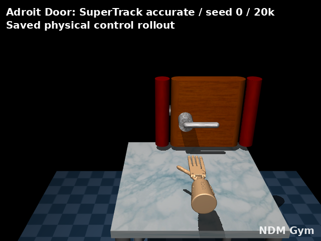

# Full-budget Adroit Door tracking results

Both methods complete the door-opening reference on every evaluated start, but neither improves overall tracking against the untrained reference-control prior. SuperTrack has the lower normalized tracking error among the two trained configurations and supplies the README preview. This is a complete matched-budget study with a negative learned-improvement result, not evidence that opening was learned from scratch.

## Frozen study

The [protocol](full_protocol_v1.json) was fixed before the six runs. Each method uses fresh seeds **0, 1, 2**, 20,000 iterations in 2,048 worlds, 40,960,000 training transitions, 80,000 world-model optimizer steps and 19,700 policy updates. SuperMimic additionally performs 394,000 critic optimizer steps. The 65,536 warmup transitions per seed are separate. No historical bootstrap or development checkpoint initializes these runs.

Applicable capacities, batch sizes and optimizer settings come from `hand-supertrack-accurate` and `hand-supermimic-accurate` at upstream `69b818e2f7eae33828b8de0f434409d72394555e`. This is a native articulated Door adaptation with demonstration-control residuals, original MuJoCo contact/controller settings and finite-clip termination. XHand Cartesian state, position targets, soft-failure termination and CUDA physics collection graphs are not claimed equivalent.

Every final checkpoint is evaluated over the complete 226-control clip on the same 256 starts: one nominal and 255 fixed multivariate hand/root perturbations. All **1,536** policy episodes are finite and open the door. Targets and initial states are not fitted to policy outcomes. Results cover one demonstration; they do not establish held-out-motion or large-perturbation robustness.

## Final tracking

Each trained entry is the **mean ± sample standard deviation over three training seeds**, after averaging each seed over all 256 starts. The control column is the mean over the same starts without training; it has no training-seed standard deviation. Higher return and opening are better; lower errors are better.

| Metric | Deployed reference-control prior | SuperTrack | SuperMimic |
| --- | ---: | ---: | ---: |
| Tracking return ↑ | 9.03533 | 9.02324 ± 0.01019 | 8.92959 ± 0.05251 |
| Root translation RMSE ↓ (mm) | 0.5789 | 0.5647 ± 0.0335 | 1.0705 ± 0.1822 |
| Hand RMSE ↓ (rad) | 0.00387 | 0.02183 ± 0.00731 | 0.04931 ± 0.00570 |
| Door RMSE ↓ (rad) | 0.00420 | 0.00492 ± 0.00235 | 0.01662 ± 0.01081 |
| Latch RMSE ↓ (rad) | 0.00251 | 0.00365 ± 0.00147 | 0.02470 ± 0.01057 |
| Final opening ↑ (%) | 100.0 | 100.0 ± 0.0 | 100.0 ± 0.0 |

SuperTrack slightly reduces root translation error, but worsens hand, door and latch errors and total return. SuperMimic worsens all four mean tracking errors and return. The control prior physically replays an already successful demonstration, so these small initial perturbations provide a strong control baseline and limited room for improvement. Opening alone conceals these tracking regressions.

The [precision addendum](baseline_precision_addendum_v1.json), fixed before any final policy evaluation, requires the control to use the same float32 action rounding as the deployed policy. The original float64 control is also retained in the [machine-readable results](full_results_v1.json); its mean return differs by less than 3e-9. This does not explain the learned-policy regressions.

## Every final seed

| Method | Seed | Return | Root (mm) | Hand (rad) | Door (rad) | Latch (rad) | Opening | Train (min) | Eval (s) |
| --- | ---: | ---: | ---: | ---: | ---: | ---: | ---: | ---: | ---: |
| supertrack | 0 | 9.01148 | 0.5921 | 0.03027 | 0.00742 | 0.00529 | 256/256 | 87.48 | 5.73 |
| supertrack | 1 | 9.02927 | 0.5746 | 0.01765 | 0.00275 | 0.00318 | 256/256 | 88.66 | 5.75 |
| supertrack | 2 | 9.02898 | 0.5273 | 0.01757 | 0.00459 | 0.00247 | 256/256 | 86.68 | 5.78 |
| supermimic | 0 | 8.97498 | 0.8695 | 0.04286 | 0.01068 | 0.01700 | 256/256 | 90.55 | 5.72 |
| supermimic | 1 | 8.94171 | 1.1174 | 0.05366 | 0.01008 | 0.02034 | 256/256 | 92.76 | 5.71 |
| supermimic | 2 | 8.87208 | 1.2247 | 0.05140 | 0.02909 | 0.03675 | 256/256 | 88.02 | 5.69 |

## Execution cost and efficiency

Runtime: Python 3.12.3, PyTorch 2.11.0+cu126, MuJoCo 3.15.0, NVIDIA L40S and Xeon Platinum 8468V. Each run uses one GPU and eight physical CPU cores. At most three seeds run concurrently; each seed queue runs SuperTrack followed by SuperMimic. The host is shared, so these are observed run times rather than isolated hardware benchmarks.

| Method | Training minutes per seed, mean ± sample SD |
| --- | ---: |
| supertrack | 87.61 ± 1.00 |
| supermimic | 90.44 ± 2.37 |

The six-run study takes **183.27 minutes wall time** and **8.9949 summed guarded GPU-hours**. Guarded allocation includes admission, exact-capacity warmup, startup, training and final evaluation; it is not GPU busy time. Training timers start after reference/model loading. Evaluation timers include physical evaluation and artifact writing. Per-run guarded costs are retained in the JSON.

The [failed first launch](failed_launch_cost_v1.json) adds 20.80 seconds wall time and 0.0172 guarded GPU-hours; it failed before any training transition because the import path was missing. Development experiments, checks and rendering are separate from these study totals. These figures are not total project-development cost.

The [matched collector measurement](collector_speed_v1.json) compares Python and compiled native stepping with identical solver settings and 2,048 worlds on eight physical cores. At three physical phases, medians are 316.8/333.8/341.4 ms for Python and 64.0/198.5/62.7 ms for the compiled path. Contact trajectories, resets and previous actions match the serial oracle bit for bit. This is a collection speed comparison, not a controlled whole-training speedup or a comparison with XHand on an A100.

## Selected trained-policy preview

The preregistered [selection rule](presentation_plan_v1.json) gives normalized tracking RMSE **0.042896** for SuperTrack and **0.114529** for SuperMimic over all seeds and starts. The selected video shows SuperTrack seed 0, nominal episode 0, final iteration 20,000, at native speed. It displays every second saved frame in [0, 226), excluding the terminal state. No best-seed or visually favorable episode is selected.

The native scene and NDM Gym mark are retained. This is a render of saved physical policy-evaluation states, not another physics run. The [preview provenance](preview_v1.json) records input/output hashes and camera/window settings. DAPG and Gymnasium-Robotics provide the reference and native assets; see the repository [NOTICE](../../NOTICE).

## Upstream synchronization

The formal runs retain their frozen runtime source identity, included in commit
`bebd40b45ce1016e663c6306afd3e4e7cb7562e9`. The contribution was subsequently
synchronized with upstream `cc1d71cfceb99cbefe1dcb2c25e503839726b769` to resolve a
NOTICE conflict and preserve upstream's newer algorithms and documentation.
Door's referenced symbols in changed shared modules are structurally unchanged.
The [compatibility record](upstream_compatibility_v1.json) compares the frozen and
merged versions: both methods' 20-update full-capacity probes are bit-exact in
model/optimizer, collector, replay and random state; redeployment of all six
original final checkpoints gives identical physical arrays and per-episode
metrics for all 1,536 episodes. These checks are additional compatibility
evidence, not new full-budget runs or replacements for the frozen study.

## Validation and reproduction

The final submission tree passes `make test-fast` (837 passed, 221 skipped, 64 deselected) and `make test` (844 passed, 278 skipped), with unchanged upstream equivalence and golden tests. Separate Door GPU checks pass 44 tests; two fused-on-CPU combinations are intentionally unsupported. The [validation record](validation_v1.json) states exact versions, scope, timings and evidence hashes. Skipped upstream GPU tests are not passes: known unmodified Triton configurations exceed L40S per-block shared memory. This does not certify the complete upstream GPU suite.

The [task guide](../../docs/tasks/adroit_door.md) provides pinned input preparation, native-loop build, training, evaluation and rendering commands. The [preparation check](preparation_equivalence_v1.json) regenerates the frozen physical arrays exactly. Fresh-process recovery for both full-capacity methods preserves optimizer, replay, simulator and random state exactly. The result aggregator verifies frozen source/input identities, all six final checkpoint hashes, complete update counts, identical evaluation starts and finite raw episode metrics before computing the statistics.

Raw demonstration archives, meshes, checkpoints, run logs and trajectory archives remain outside Git. Compact result/provenance records and the selected WebP are included. Historical reduced-budget results remain in the development notes and do not substitute for these runs.
