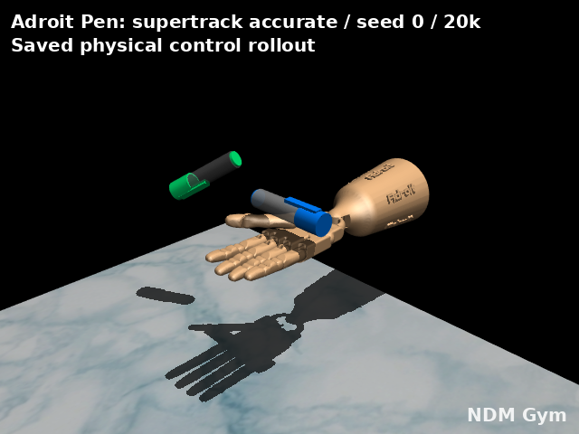
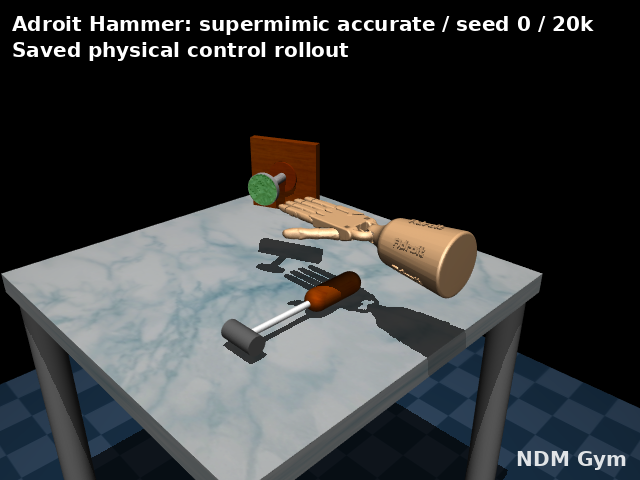
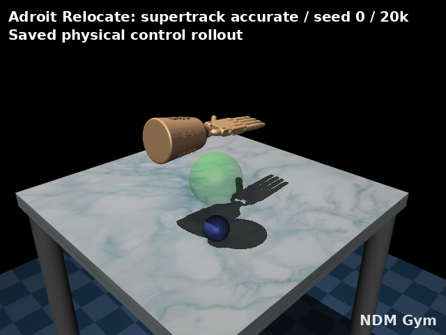

# Full-budget single-seed results

Each learned entry is one fresh seed (0), 20,000 iterations and 2,048 worlds, evaluated at the final checkpoint on the same 256 starts as the float32 reference-control prior. Door remains in its independent three-seed contribution. No standard deviation across training seeds can be estimated here.

| Task | Controller | Normalized tracking RMSE ↓ | Tracking return ↑ | Native final success | Native ever success | Training (min) |
| --- | --- | ---: | ---: | ---: | ---: | ---: |
| Pen | Reference-control prior | 0.402369 | 5.1731 | 58.59% | 59.38% | — |
| Pen | SuperTrack | 0.049232 | 5.9781 | 98.05% | 98.05% | 137.45 |
| Pen | SuperMimic | 0.167484 | 5.8363 | 99.61% | 100.00% | 148.76 |
| Hammer | Reference-control prior | 0.038914 | 24.9052 | 51.17% | 51.17% | — |
| Hammer | SuperTrack | 0.058518 | 24.8751 | 100.00% | 100.00% | 121.96 |
| Hammer | SuperMimic | 0.047741 | 24.9019 | 0.00% | 0.00% | 141.28 |
| Relocate | Reference-control prior | 0.031565 | 14.0622 | 100.00% | 100.00% | — |
| Relocate | SuperTrack | 0.047707 | 14.0474 | 100.00% | 100.00% | 93.49 |
| Relocate | SuperMimic | 0.235133 | 13.3688 | 100.00% | 100.00% | 109.82 |

Native success is an independently recomputed original frame predicate, not the complete original D4RL benchmark evaluation. Normalized tracking RMSE combines the fixed coordinate-group widths; object angular terms are wrapped scalar-joint errors, not Cartesian SO(3) errors. All episodes, including failures, are retained.

## Coordinate errors

### Pen

| Controller | Metric | Mean RMSE |
| --- | --- | ---: |
| Reference-control prior | `hand_rotation_joint_rmse_rad` | 0.05768272 |
| Reference-control prior | `object_translation_rmse_m` | 0.00545219 |
| Reference-control prior | `object_rotation_joint_rmse_rad` | 0.17925546 |
| SuperTrack | `hand_rotation_joint_rmse_rad` | 0.01251671 |
| SuperTrack | `object_translation_rmse_m` | 0.00081187 |
| SuperTrack | `object_rotation_joint_rmse_rad` | 0.01806992 |
| SuperMimic | `hand_rotation_joint_rmse_rad` | 0.05017509 |
| SuperMimic | `object_translation_rmse_m` | 0.00325210 |
| SuperMimic | `object_rotation_joint_rmse_rad` | 0.05127682 |

### Hammer

| Controller | Metric | Mean RMSE |
| --- | --- | ---: |
| Reference-control prior | `hand_rotation_joint_rmse_rad` | 0.00477916 |
| Reference-control prior | `nail_rmse_m` | 0.00042618 |
| Reference-control prior | `object_translation_rmse_m` | 0.00058235 |
| Reference-control prior | `object_rotation_joint_rmse_rad` | 0.01540512 |
| SuperTrack | `hand_rotation_joint_rmse_rad` | 0.02544950 |
| SuperTrack | `nail_rmse_m` | 0.00034649 |
| SuperTrack | `object_translation_rmse_m` | 0.00135036 |
| SuperTrack | `object_rotation_joint_rmse_rad` | 0.00817200 |
| SuperMimic | `hand_rotation_joint_rmse_rad` | 0.02202435 |
| SuperMimic | `nail_rmse_m` | 0.00022273 |
| SuperMimic | `object_translation_rmse_m` | 0.00097875 |
| SuperMimic | `object_rotation_joint_rmse_rad` | 0.00859459 |

### Relocate

| Controller | Metric | Mean RMSE |
| --- | --- | ---: |
| Reference-control prior | `hand_translation_rmse_m` | 0.00035773 |
| Reference-control prior | `hand_rotation_joint_rmse_rad` | 0.00386122 |
| Reference-control prior | `object_translation_rmse_m` | 0.00043290 |
| Reference-control prior | `object_rotation_joint_rmse_rad` | 0.01606274 |
| SuperTrack | `hand_translation_rmse_m` | 0.00041009 |
| SuperTrack | `hand_rotation_joint_rmse_rad` | 0.02446533 |
| SuperTrack | `object_translation_rmse_m` | 0.00046315 |
| SuperTrack | `object_rotation_joint_rmse_rad` | 0.01127524 |
| SuperMimic | `hand_translation_rmse_m` | 0.00290179 |
| SuperMimic | `hand_rotation_joint_rmse_rad` | 0.07411731 |
| SuperMimic | `object_translation_rmse_m` | 0.00301073 |
| SuperMimic | `object_rotation_joint_rmse_rad` | 0.10042884 |

## Interpretation

- Pen: SuperTrack has the lower error of the two trained methods. Its normalized tracking RMSE is 87.8% lower than the reference-control prior on these starts. The selected preview shows seed 0, nominal episode 0; selection does not search episodes or checkpoints.
- Hammer: SuperMimic has the lower error of the two trained methods. Its normalized tracking RMSE is 22.7% higher than the reference-control prior on these starts. The selected preview shows seed 0, nominal episode 0; selection does not search episodes or checkpoints.
- Relocate: SuperTrack has the lower error of the two trained methods. Its normalized tracking RMSE is 51.1% higher than the reference-control prior on these starts. The selected preview shows seed 0, nominal episode 0; selection does not search episodes or checkpoints.

Hammer's success gap requires care. The original predicate is nail-to-goal distance **strictly below 10 mm**. A post-evaluation diagnostic recomputing native forward kinematics from each archived final state found:

| Controller | Minimum / median / maximum final distance (mm) | Successful starts |
| --- | --- | ---: |
| Prior | 9.805 / 9.925 / 10.407 | 131/256 |
| SuperTrack | 9.833 / 9.833 / 9.833 | 256/256 |
| SuperMimic | 10.000279 / 10.166 / 10.196 | 0/256 |

These sub-millimetre margins explain why average tracking and native success disagree. SuperTrack's observed 100% is not evidence of a large success margin under stronger disturbances. SuperMimic's selected nominal preview fails the threshold; it is retained under the fixed tracking-error selection rule. [Diagnostic values](hammer_threshold_v1.json). This analysis did not change training, evaluation starts, checkpoints or preview selection.

One demonstration and one training seed per method do not establish held-out-motion generalization or seed robustness. The explicit residual prior already supplies demonstration controls; its successes cannot be credited to policy learning.

## Compute and audit

The six guarded runs span 2.56 hours of wall time and sum to 12.68 allocated GPU-hours. Each uses one L40S and eight disjoint physical CPU cores. These costs include guard overhead and final evaluation, but exclude reference preparation, prechecks, CPU software tests and rendering. Per-run training times above are measured, not extrapolated from a short prefix.

Every run completed 40,960,000 training transitions plus 65,536 warmup transitions, 80,000 world-model optimizer steps and 19,700 policy optimizer steps. SuperMimic additionally completed 394,000 critic optimizer steps. Checkpoint/input/source identities, counts, all 256 starts and finite stored physical trajectories are audited by `tools/summarize_adroit_suite.py`.

[Machine-readable results and evidence hashes](results_v1.json) · [Fixed protocol](protocol_v1.json) · [Preflight performance and equivalence](preflight_v1.md) · [Contribution checklist](contributing_checks.md).

## Selected trained-policy previews

**Pen — SuperTrack.** Final seed 0; native speed; no terminal frame.

**Hammer — SuperMimic.** Nominal episode fails the native success threshold. Final seed 0; native speed; no terminal frame.

**Relocate — SuperTrack.** Final seed 0; native speed; no terminal frame.

