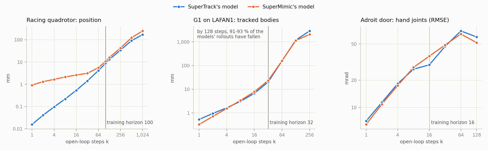

# Drift over long rollouts

A world model run open loop, with recorded actions and no correction from the simulator, drifts away from it. This page
measures how fast, on three tasks with both algorithms' world models, and shows why training does not depend on long
open-loop rollouts.

<i>The error after k open-loop steps, mean over three training seeds; the vertical line is the policy's imagined horizon. The world models of each task's most accurate configurations, run in fp32 on a CPU.</i>

## In short

- **The system sets the rate.**
  - The quadrotor integrates its errors. Its attitude error stays below 0.2 deg, but the position integrates velocity:
    SuperTrack's model is 0.016 mm off after one step, 8.69 mm after 100 and 169 mm after 1,024 (fitted exponents
    1.25-1.7).
  - The balancing G1 amplifies them. The body error grows 1.5-2.4x per doubling of k up to 16 steps, 3.0-3.1x from 16 to
    32 and 6.8-7.8x from 32 to 64. After 128 steps the task's own test has ended 89.6-93.7 % of the models' rollouts.
  - The Adroit hand's servos pull each joint to its recorded target. Its error grows as about k^0.6-0.7 to 8 steps, more
    slowly after, and stops growing between 64 and 128 steps.
- **A physics solver drifts as fast.** On the G1, Steel, a rigid-body solver that did not learn from the task's
  simulator, grows 6.7x from 8 to 32 steps; the world models grow 6.5-7.3x. MuJoCo Warp run in Newton is 0.20 mm from
  the task's simulator (MuJoCo Warp in Isaac Lab) after 32 steps.
- **Training uses only the first steps.** Each imagined rollout lasts the task's horizon (100, 32 and 16 steps here) and
  starts from a state the simulator recorded, so the drift starts from zero in every rollout. At those horizons the
  errors are 8.69 / 10.7 mm, 20.1 / 23.3 mm and 29.4 / 36.6 mrad (SuperTrack's / SuperMimic's model).
- **Training perturbs, and the simulator judges.** The three tasks train with noise on the simulator's actions and with
  perturbed starts; the G1 also with random friction, centre of mass and joint offsets. The policies are then scored
  closed loop in the simulator, from perturbed starts or under pushes.

## The measure

- **Open-loop error after k steps.** From a state the simulator recorded, the world model steps alone under the recorded
  actions (setpoints, commands or controls) and contexts; after k steps its state is compared with the recorded one.
- **The same starts.** Every model and every k start from the same recorded states. A window holds no episode end (no
  termination, reset or flight end) before its last step.
- **Growth.** The doubling ratio e(2k) / e(k), and the exponent p of e = c k^p fitted by least squares on log e against
  log k over a stated range of k (two steps give the exponent between them).
- **Models and precision.** The world models of each task's most accurate configurations, three training seeds each,
  trained on A100 40GB GPUs. The errors were computed in fp32 on a CPU; the checks below compare them with the published
  GPU numbers.

| task | recorded states | starts | models (training seeds) | error |
|---|---|---|---|---|
| racing quadrotor, the ellipse | the simulator under the policy with exploration noise 0.1, from training's perturbed starts at random frames | 4,096 worlds; at k, those whose flight has not ended | `quadrotor-supertrack-accurate`, `quadrotor-supermimic-accurate` (0-2) | position (mm) |
| G1 on LAFAN1 | the task's simulator under a SuperTrack MLP policy in evaluation conditions, 4,096 worlds × 400 steps | 4,096 windows of 256 steps | `lafan1-supertrack-accurate`, `lafan1-supermimic-accurate` and their RigidFormer configurations (7-9) | tracked bodies' position (mm) |
| Adroit door, door and latch started up to 0.3 rad open | each run's evaluation: 256 episodes of 226 steps from its perturbed starts | every 16th frame from 0 to 96, 1,792 starts | `--method supertrack --residual-scale 0.2 --door-latch-offset 0.3`, `--method supermimic --door-latch-offset 0.3` (0-2) | hand joints' RMSE and the door's angle (mrad) |

## Racing quadrotor

Position error (mm), mean over the worlds, mean ± SD over seeds 0-2:

| k | worlds | SuperTrack's model | SuperMimic's model |
|---:|---:|---:|---:|
| 1 | 4,093 | 0.0156 ± 0.0006 | 0.915 ± 0.038 |
| 2 | 4,093 | 0.0409 ± 0.0016 | 1.31 ± 0.06 |
| 4 | 4,091 | 0.0962 ± 0.0037 | 1.66 ± 0.08 |
| 8 | 4,083 | 0.218 ± 0.009 | 2.12 ± 0.11 |
| 16 | 4,072 | 0.532 ± 0.020 | 2.61 ± 0.12 |
| 32 | 4,037 | 1.40 ± 0.05 | 3.09 ± 0.13 |
| 64 | 3,963 | 4.11 ± 0.14 | 5.53 ± 0.15 |
| 100 | 3,859 | 8.69 ± 0.31 | 10.7 ± 0.2 |
| 128 | 3,789 | 13.0 ± 0.5 | 15.9 ± 0.2 |
| 256 | 3,464 | 34.1 ± 1.8 | 42.5 ± 0.6 |
| 512 | 2,855 | 90.9 ± 7.1 | 123 ± 4 |
| 1,024 | 1,620 | 169 ± 36 | 248 ± 42 |

- **The two parameterizations drift differently.** The acceleration model integrates its velocities, so one step's
  position error is tiny (0.016 mm) and grows as about k^1.25-1.4 (fits over 1-8, 8-32 and 32-128 steps on the same
  worlds: 1.25, 1.27, 1.39). The increment model predicts the position change directly: its one-step error is 0.92 mm,
  and it grows as about k^0.3-0.4 to 32 steps, then as fast as the acceleration model's (1.72 and 1.73 over 128-512 and
  512-1,024 steps; the acceleration model's 1.68 and 1.47).
- **The same worlds at every k.** Fewer worlds reach the longer horizons as their flights end, and early frames of the
  ellipse are easier. On the 1,620 worlds that reach 1,024 steps the errors are 0.0108 / 0.584 mm after one step and
  4.03 / 4.90 mm after 100.
- **The attitude stays.** The rotation error is 0.055 / 0.022 deg after one step and 0.116 / 0.186 deg after 1,024: the
  rate controller holds the attitude, and the position error accumulates through the velocity.
- **The check.** The simulator here is MuJoCo's C library, which steps this drone as MuJoCo Warp does: from the
  evaluation's recorded states its one-step position differs from MuJoCo Warp's by at most 0.0019 mm, and the policy's
  whole 17.3 s flight by at most 0.0040 mm. With the configurations of the earlier published rows (64-step horizon), the
  errors after 1 / 8 / 32 / 64 / 100 steps are 0.0154 / 0.221 / 1.38 / 4.01 / 8.47 mm and 1.88 / 4.16 / 6.18 / 10.8 /
  20.4 mm, against the published 0.015 / 0.21 / 1.35 / 3.93 / 8.25 and 1.84 / 4.11 / 6.18 / 10.8 / 20.4 mm (A100, TF32).

## G1 on LAFAN1

Tracked bodies' position error (mm), mean over the windows, mean ± SD over seeds 7-9; in the last two rows, the share of
windows whose rollout the task's termination test has ended:

| k | SuperTrack, MLP | SuperMimic, MLP | SuperTrack, RigidFormer | SuperMimic, RigidFormer |
|---:|---:|---:|---:|---:|
| 1 | 0.533 ± 0.012 | 0.327 ± 0.002 | 0.673 ± 0.004 | 0.326 ± 0.003 |
| 2 | 0.954 ± 0.017 | 0.715 ± 0.004 | 1.16 ± 0.01 | 0.655 ± 0.009 |
| 4 | 1.65 ± 0.02 | 1.54 ± 0.02 | 1.81 ± 0.01 | 1.37 ± 0.02 |
| 8 | 3.08 ± 0.04 | 3.36 ± 0.08 | 2.64 ± 0.03 | 3.08 ± 0.05 |
| 16 | 6.71 ± 0.22 | 7.84 ± 0.23 | 5.85 ± 0.11 | 7.51 ± 0.19 |
| 32 | 20.1 ± 0.9 | 23.3 ± 1.0 | 18.3 ± 0.4 | 22.9 ± 0.6 |
| 64 | 157 ± 12 | 157 ± 13 | 128 ± 0 | 159 ± 5 |
| 64, ended | 5.8 % | 3.7 % | 2.8 % | 3.5 % |
| 128, ended | 91.2 % | 93.4 % | 89.6 % | 93.7 % |

- **Three regimes.** Fitted exponents over 1-8 / 8-32 / 32-64 steps: 0.84 / 1.36 / 2.96 (SuperTrack, MLP), 1.12 / 1.40 /
  2.76 (SuperMimic, MLP), 0.66 / 1.39 / 2.81 and 1.08 / 1.45 / 2.80 (RigidFormers). After 128 steps the errors are
  1,132-1,178 mm: the models' robots have fallen.
- **Against other engines** (the [Steel comparison](../steel/results.md)'s rows: the same recording, 8,192 windows of 32
  steps, on an A100 under each run's autocast). After 1 / 8 / 32 steps: Steel at the task's physics 0.46 / 3.72 / 24.90
  mm, the world models 0.51 / 2.99 / 19.56 mm (SuperTrack, MLP) and 0.32 / 3.36 / 22.81 mm (SuperMimic, MLP), MuJoCo
  Warp 3.17 in Newton on Steel's model 0.00 / 0.02 / 0.20 mm. From 8 to 32 steps Steel's error grows 6.7x, the four
  world models' 6.5-7.3x.
- **The check.** On those 8,192 windows the fp32 errors here are within -4.1 % and +5.9 % of those rows' for every seed
  and step (1, 8, 32).
- **Other data.** Recordings 2 and 3 give errors within 0.10 mm (8 steps) and 0.71 mm (32 steps) of recording 1's. On
  held-out sets collected in training conditions (random friction, centre of mass and joint offsets; action noise 0.1)
  with earlier policies of each algorithm, the errors are higher. After 32 steps they are 24.5 / 28.1 mm (SuperTrack's /
  SuperMimic's MLP) on the SuperTrack policy's set and 27.2 / 28.6 mm on the SuperMimic policy's; the RigidFormers' 22.7
  / 26.6 and 24.2 / 26.7 mm. On every set 88.7-93.9 % of the rollouts have ended by 128 steps.

## Adroit door

Each world model on its own policy's evaluation episodes; hand joints' RMSE / the door's angle error (mrad), mean ± SD
over seeds 0-2:

| k | SuperTrack's model | SuperMimic's model |
|---:|---:|---:|
| 1 | 7.10 ± 0.53 / 0.902 ± 0.058 | 6.51 ± 0.47 / 1.20 ± 0.09 |
| 2 | 11.4 ± 1.4 / 1.42 ± 0.16 | 10.9 ± 0.9 / 1.82 ± 0.11 |
| 4 | 18.3 ± 2.8 / 2.18 ± 0.16 | 17.4 ± 1.1 / 2.42 ± 0.22 |
| 8 | 26.4 ± 3.1 / 3.80 ± 0.25 | 27.6 ± 0.7 / 4.01 ± 0.47 |
| 16 | 29.4 ± 2.4 / 6.54 ± 1.00 | 36.6 ± 1.2 / 6.95 ± 0.73 |
| 32 | 47.0 ± 14 / 9.31 ± 1.30 | 48.6 ± 2.4 / 9.43 ± 0.87 |
| 64 | 69.4 ± 18 / 14.9 ± 1.0 | 64.3 ± 6.2 / 8.77 ± 1.60 |
| 128 | 59.6 ± 15 / 83.9 ± 34 | 51.6 ± 6.1 / 20.6 ± 6.5 |

- **The hand's error levels off.** Fitted exponents of the hand's error over 1-8 / 8-32 / 32-128 steps: 0.64 / 0.42 /
  0.17 (SuperTrack's model) and 0.69 / 0.41 / 0.04 (SuperMimic's). The door, which the hand pushes, drifts further:
  after 128 steps its error is 83.9 and 20.6 mrad (medians 18.8 and 6.7).
- **On the other policy's episodes** the errors are larger: after 16 steps the hand's 102 mrad for both models
  (2.8-3.5x), the door's 31.4 and 24.2 mrad (3.5-4.8x). Each model is most accurate on the states its own policy visits.
- **The starts.** Room for 128 steps leaves the frames 0-96 of each episode; on the 2,816 starts of the published rows
  (every 16th frame from 0 to 160, 64 steps) the errors here match those rows to three digits (seed 0).

## HDMI's 13 human-object tasks

The published offline fits ([NDMs as simulators](../ndm_speed/results.md)) were scored after 8 and 32 steps, each on its
own windows. From 8 to 32 steps the keypoint error grows 4.15-6.36x over the 52 models (13 tasks; MLP and RigidFormer;
accelerations and increments), median 5.03x: exponents 1.03-1.33, median 1.17, the G1 on LAFAN1's range (1.36-1.45).

## How training keeps the drift short

- **Short rollouts from recorded states.** The world model is fit on 8-step windows of recorded transitions. The policy
  learns on imagined rollouts of the task's horizon, each started from a state the simulator recorded. SuperMimic's
  critic also estimates the return after the window; SuperTrack has none.

  | task | imagined horizon | the error at the horizon, SuperTrack's / SuperMimic's model |
  |---|---:|---|
  | racing quadrotor | 100 steps (1 s) | position 8.69 / 10.7 mm |
  | G1 on LAFAN1 | 32 steps (0.64 s) | tracked bodies 20.1 / 23.3 mm |
  | Adroit door | 16 steps (0.16 s) | hand joints 29.4 / 36.6 mrad, door 6.54 / 6.95 mrad |

  The other tasks imagine 64 steps (HDMI's), 32 (the two G1s, the muscles), 16 (the hands, the Go2, the other Adroit
  tasks, robomimic) and 3 (the Wuji piano's most accurate configuration).

- **Noise and perturbations in training**, both algorithms unless named:

  | task | in the simulator | in imagination |
  |---|---|---|
  | racing quadrotor | action noise 0.1; starts at random frames with Gaussian noise of 0.1 m, 0.1 rad, 0.3 m/s and 0.5 rad/s | SuperTrack: noise 0.1 on its imagined actions |
  | G1 on LAFAN1 | action noise 0.1 (0.3 for SuperMimic's RigidFormer); friction 0.3-1.2, torso centre of mass ± 2.5-5 cm, joint offsets ± 0.01 rad; perturbed starts; observation noise | SuperTrack: noise 0.1 on its PD offsets; SuperMimic: random root-velocity kicks (std 0.15 m/s) at the imagined starts; observation noise |
  | Adroit door | action noise 0.1; the door and latch started up to 0.3 rad open | SuperTrack: noise 0.2 on its correction |

- **Scored in the simulator.** The quadrotor's policies fly 256 rollouts of the whole flight from perturbed starts; the
  G1's run every clip from its first frame and again under 1 and 2 m/s pushes; the door's open from 255 perturbed starts
  and the nominal one.

## What the policies tolerate

- **Tighter than the models' drift.** Closed loop in the simulator, the quadrotor's policies track the ellipse to 3.06 /
  5.71 mm (success 100 %, 256 perturbed starts), the G1's to an MPJPE-local of 10.8 / 16.7 mm, and the door's open 99.3
  / 99.5 % of starts. Open loop over one training window, their world models drift 8.69 / 10.7 mm, 20.1 / 23.3 mm and
  29.4 / 36.6 mrad.
- **Lower open-loop error is not always a better policy.** On LAFAN1 the RigidFormer has 7-21 % lower open-loop error
  offline, and its online policies are level with the MLP's at equal iterations ([key
  findings](../../README.md#key-findings)).
- **Two drifts, one outcome.** On the door SuperMimic's model drifts less beyond 32 steps (8.77 against 14.9 mrad at 64
  steps), and the two policies open the door as often (99.5 / 99.3 % of starts).
- **A longer window can still help.** On the quadrotor, 16 steps are too short for SuperTrack (no rollout succeeds), and
  100 steps instead of 64 lower both algorithms' error (2.57 to 2.51 mm and 5.66 to 5.05 mm, nine runs each), though the
  models' error at the window's end grows from 4.11 / 5.53 mm (64 steps) to 8.69 / 10.7 mm (100). On the Wuji piano,
  horizons 3 and 8 swap order between two sets of finals ([the piano](../../README.md#wuji-hand-piano-playing)).
- **Perturbations change robustness, both ways** (LAFAN1's leave-one-out study, seeds 1-3, 3 h,
  [ablations](../g1_lafan1_tracking/ablations.md)). Without its imagination kicks SuperMimic fails 6.0 / 18.7 of 40
  clips under 1 / 2 m/s pushes instead of 1.7 / 9.3; with action noise 0.1 instead of 0.3, 3.7 instead of 1.7 at 1 m/s.
  Without its imagination noise SuperTrack fails 20.0 instead of 24.7 at 2 m/s. Return and MPJPE do not change
  significantly in these three.
- **Noise can become a dependence.** With action noise 0.3, SuperMimic's MLP policies dropped late and tracked only with
  that noise on; with 0.1 they did not ([key findings](../../README.md#key-findings)).
