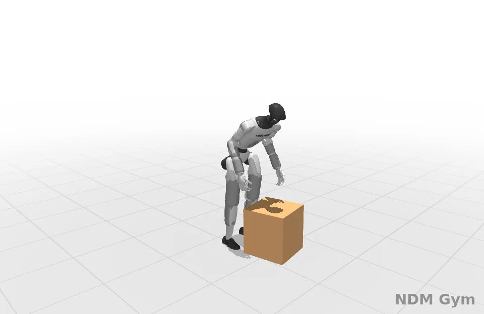
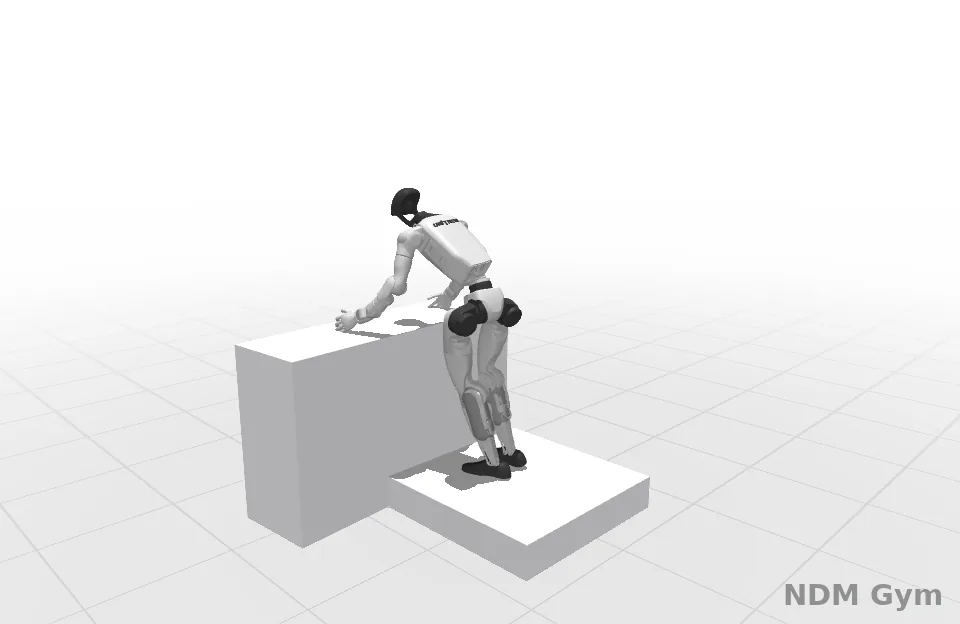
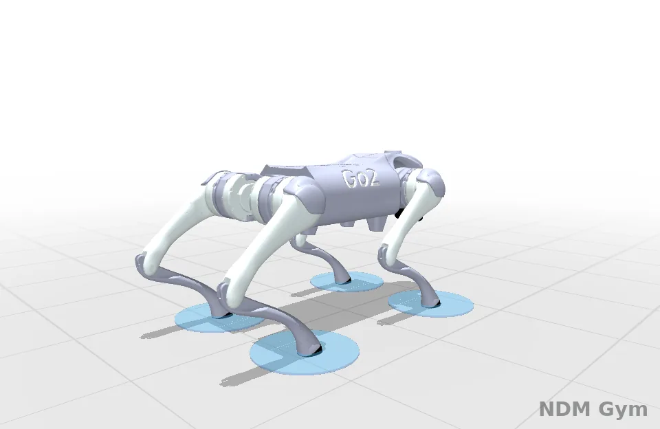
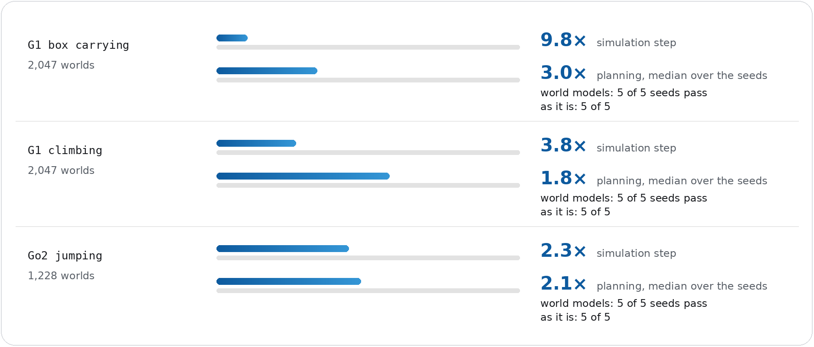

# RoboKit's planner on a world model

[RoboKit](https://github.com/openrobokit/robokit) (at `736f112`, MIT) plans with sampling MPC over batched MuJoCo Warp
rollouts. Here its planner's simulator is this library's world model of the same MuJoCo model
(`ndm_gym/worldmodels/mjcf.py`); every plan still executes on MuJoCo Warp. On G1 box carrying, G1 climbing and Go2 jumping,
the plans on the world model pass with every seed, as MuJoCo Warp's do, and planning is 1.8-3.0 times faster. One A100 40GB
SXM4 with nothing else running.

<table>
<tr>
<td align="center" width="33%"><br><sub>G1 box carrying</sub></td>
<td align="center" width="33%"><br><sub>G1 climbing</sub></td>
<td align="center" width="33%"><br><sub>Go2 jumping</sub></td>
</tr>
</table>
<p align="center"><sub>The world model in the planner, MuJoCo Warp executing; planner seed 0. Rendered by <code>tools/render_robokit.py</code>: RoboKit's white background and soft shadows, with a grid floor. G1 box carrying tracks an OMOMO clip: for non-commercial illustration only (<a href="../../NOTICE">see NOTICE</a>).</sub></p>

<p align="center"></p>
<p align="center"><sub>Bars: time against MuJoCo Warp's at full width, at the planner's own worlds. Made by <code>tools/make_robokit_chart.py --tasks g1_carry g1_climb go2_jump</code> from <code>benchmarks/robokit_ndm/summarize.py</code>'s json.</sub></p>

| Task | Simulation step, MuJoCo Warp → world model | Planning time, MuJoCo Warp → world model | Outcome over planner seeds 0-4 |
|---|---|---|---|
| G1 box carrying | 1.81 → 0.19 ms (9.8x), 2,047 worlds | 9 → 3 s (3.0x) | 5 of 5 pass with each |
| G1 climbing | 1.32 → 0.35 ms (3.8x), 2,047 worlds | 7 → 4 s (1.8x) | 5 of 5 pass with each |
| Go2 jumping | 0.59 → 0.26 ms (2.3x), 1,228 worlds | 65 → 31 s (2.1x) | 5 of 5 pass with each |

## Setup

- **Tasks.** RoboKit's MPC examples `04_g1_carry.py`, `03_g1_climb.py` and `12_go2_jump.py`, run as published.
- **Data.** Each example ran with its simulator recording 64 of its rollout worlds and the executed trajectory: G1 climbing and
  Go2 jumping three times (planner seeds 0-2), seeds 0 and 1 training; G1 box carrying nine times (seeds 0-8), all but seed 2
  training. Seed 2 is held out.
- **World models.** SuperTrack's acceleration model and SuperMimic's increment model, each with and without LayerNorm: an MLP
  of 3 x 1024, 20,000 updates of 512 windows of 8 steps. Each task plans on the fit with the lowest held-out error at the
  planning horizon (`benchmarks/robokit_ndm/select_arms.py`; within 2 %, the faster network).

  | Task | Horizon | SuperTrack's model | without LayerNorm | SuperMimic's model | without LayerNorm |
  |---|---|---|---|---|---|
  | G1 box carrying | 40 steps of 20 ms | **0.555** | 0.579 | 0.643 | 0.766 |
  | G1 climbing | 40 steps of 20 ms | **0.531** | 0.640 | 0.619 | 0.632 |
  | Go2 jumping | 20 steps of 20 ms | **0.0283** | 0.0337 | 0.0297 | 0.0430 |

  Held-out error at the horizon, in units of one true step's spread (`fit_mjcf`'s `norm`); in bold, the fit the task plans on.
- **Simulation step.** MuJoCo Warp's step as RoboKit runs it (replayed as a CUDA graph) against the world model's step inside
  the planner's simulator (`NdmSim`: the world model in bf16 as one CUDA graph, plus the MuJoCo Warp stages the task's costs
  read: none for G1 box carrying; kinematics and sensor positions for G1 climbing, and also collisions for Go2). Both start
  from the held-out run's executed states, copied back every horizon as the planner restarts its rollouts; 20 warm-up and 200
  timed steps, the median of three. G1 box carrying's step was timed with the same network fitted on two of its recordings
  (seeds 0 and 1); a network's time does not depend on its weights.
  - At 8,192 worlds: G1 box carrying 4.53 → 0.47 ms (9.7x), G1 climbing 3.13 → 0.64 ms (4.9x), Go2 jumping 1.38 → 0.60 ms (2.3x).
  - The network alone takes 0.21 ms (G1 climbing, 2,047 worlds) and 0.15 ms (Go2 jumping, 1,228 worlds).
- **Planning.** The example's own planning time for its whole motion, the median over the planner's seeds 0-4 (each seed
  within 1 s of it). With a simulator whose step does nothing, planning takes 2 s (G1 box carrying and G1 climbing) and 9 s
  (Go2 jumping), and the plans fail: the planner's own share, which no simulator removes.

## Reproducing

RoboKit at `736f112` in its own environment (Python 3.12; mujoco and mujoco-warp 4.0.1, warp-lang 1.19.0, torch 2.14), with
this library importable. G1 climbing below. Go2 jumping: `12_go2_jump.py`, `--eval_k 1 8 20`, `--derived kinematics collision
sensor_pos`, `--nworld 1228 8192 --reset_every 20`, and `--stages fine` for the plans. G1 box carrying: `04_g1_carry.py`
recorded with seeds 0-8 and fitted on all but seed 2, `--derived` with no stage.

```bash
EX=robokit/src/robokit/examples/sim_mpc
# record the example three times (planner seeds 0-2), 64 rollout worlds each
for s in 0 1 2; do python -m ndm_gym.wmbench.collect_robokit --example $EX/03_g1_climb.py --out data/g1_climb_s$s --record 64 --seed $s; done
# fit SuperTrack's model with LayerNorm; --no_ln and --wm_param increment give the other three
python -m ndm_gym.wmbench.fit_mjcf --model data/g1_climb_s0_planner0.mjb \
  --train data/g1_climb_s0_rollout_dt20.npz data/g1_climb_s1_rollout_dt20.npz \
  --test held=data/g1_climb_s2_rollout_dt20.npz executed=data/g1_climb_s2_executed0.npz \
  --steps 20000 --batch 512 --window 8 --compile --cut 300 --eval_every 2000 --eval_k 1 8 20 40 \
  --out fits/rfit_g1_climb_dt20_acc_ln.csv --save fits/rfit_g1_climb_dt20_acc_ln.pt
# choose among the fits
python benchmarks/robokit_ndm/select_arms.py fits/ --out best_arms.json
# time the step against MuJoCo Warp's
python -m ndm_gym.wmbench.speed_mjcf --meta data/g1_climb_s0.json --states data/g1_climb_s2_executed0.npz --nworld 2047 8192 \
  --what physics ndm ndmsim --dtype bf16 --ckpt fits/rfit_g1_climb_dt20_acc_ln.pt --derived kinematics sensor_pos \
  --reset_every 40 --out speed.csv
# plan on the world model (the plan executes on MuJoCo Warp), then render the executed motion
python -m ndm_gym.wmbench.plan_robokit --example $EX/03_g1_climb.py --seed 0 --ndm 0.02=fits/rfit_g1_climb_dt20_acc_ln.pt \
  --dtype bf16 --derived kinematics sensor_pos --save_executed runs/g1_climb.npz --out runs/g1_climb.json
MUJOCO_GL=egl python tools/render_robokit.py runs/g1_climb.npz g1_climb.webp --azimuth 45 --distance 2.9 --elevation -13 --lookat_z 0.8
```

The Go2 animation: `--azimuth 45 --distance 1.15 --elevation -8 --lookat_z 0.22 --grid 0.25`; G1 box carrying's: `--azimuth 45
--distance 3.0 --elevation -13 --lookat_z 0.7`.

`plan_robokit` without `--ndm` plans as the example does, on MuJoCo Warp.
