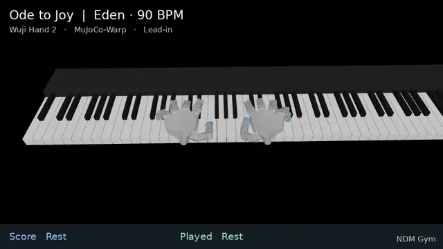
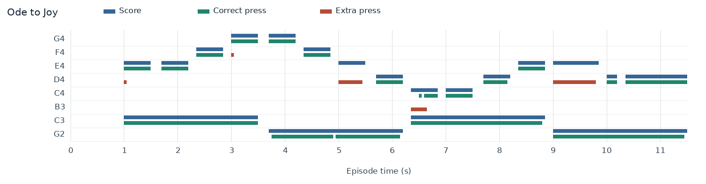

# Wuji Hand piano playing

Two freely moving Wuji Hand 2 beta2 hands play Eden’s 90 BPM *Ode to Joy* on 88 passive keys in MuJoCo-Warp. Both NDM Gym policies receive the same score, independent wrist and finger controls, and physical key state. The scripted reference uses the same scene and evaluator.

| Final measurement | SuperTrack | SuperMimic | Script |
|---|---:|---:|---:|
| Eden framewise F1 | 0.8490 ± 0.0705 | 0.4123 ± 0.2090 | 0.6325 |
| Both pitches down during two-note frames | 69.4% | 10.5% | 23.8% |
| Timely paired attacks | 44.7% | 1.6% | 50.0% |
| Timed training per seed on RTX 3060 | 323.1 s | 361.3 s | — |

Each final checkpoint played 256 identical starts. The learned results average three training seeds. Paired attacks require both onsets within 50 ms of the score and one another. [SuperTrack](ode_to_joy_results.md) · [SuperMimic](ode_to_joy_supermimic_results.md) · [Per-note timing, baseline and world-model predictions](note_timing_results.md)



## Eden Ode to Joy with 52 independent controls

On Linux with Python 3.12+, install a CUDA build of PyTorch appropriate for the GPU (the runs used 2.13.0+cu129), then install the hand simulator, SciPy and the rendering dependencies in the same environment. FFmpeg or imageio-ffmpeg and the DejaVu Sans fonts are needed for MP4. From the repository root:

```bash
python -m pip install -e '.[hand,contacts]' pillow imageio-ffmpeg
python benchmarks/wuji_piano/download_assets.py
bench=benchmarks/wuji_piano
run=data/wuji_piano/ode-to-joy
"$bench/run.sh" supertrack "$run/supertrack"
"$bench/run.sh" supermimic "$run/supermimic"
"$bench/run.sh" scripted "$run/scripted"
python "$bench/summarize_ode_to_joy.py" "$run/supertrack"
python "$bench/summarize_ode_to_joy.py" "$run/supermimic"
python "$bench/note_events.py" "$run"/{supertrack,supermimic}/seed{0,1,2}/evaluation.npz "$run/scripted/evaluation.npz"
```

Use a fresh output directory for each run. The runner passes extra trainer options through, e.g. `--seeds 0`. Set `WUJI_PIANO_ASSETS` to use another asset root and `PYTHON` to choose the interpreter. The download verifies the SHA-256 digest of each of the 57 files, including the MIT license for the Wuji models and the keyboard’s attribution to RoboPianist. [Pinned file hashes](assets.sha256) · [Third-party notices](../../THIRD_PARTY_NOTICES.md#wuji-hand-piano)

Replay and render the final seed-0 SuperTrack checkpoint. The nominal rollout is the first start. Audio is synthesized from detected physical key presses.

```bash
"$bench/run.sh" replay "$run/replay" "$run/supertrack/seed0/last.pt" --eval-starts 32
assets=${WUJI_PIANO_ASSETS:-data/wuji_piano}
hands="$assets/wuji-description-c2cd7f8d1ef8b6dc8cb907c17daa5a88b4442d95/hand2/hand2_beta2/body/mjcf"
MUJOCO_GL=egl python "$bench/render_fur_elise.py" --song ode_to_joy --hand-dir "$hands" \
  --keyboard "$assets/keyboard/piano.xml" --rollout "$run/replay/seed0/rollout.npz" --out "$run/ode.mp4"
python "$bench/piano_roll_figure.py" "$run/replay/seed0/rollout.npz" "$run/ode-roll.webp"
python "$bench/model_onsets.py" --hand-dir "$hands" --keyboard "$assets/keyboard/piano.xml" \
  "$run"/{supertrack,supermimic}/seed{0,1,2}
```



## Protocol and changes from the claim

- The completed single-hand learning exercise was two strikes of middle C. The subsequent scale used two hands. These exercises replaced the proposed single-hand *Twinkle Twinkle* phrase. The opening of *Für Elise* and the five-finger scale below are earlier experiments with restricted controls. The reported *Ode to Joy* policies use the full 52-dimensional action space.
- The pre-run target was a validation Eden F1 of 0.95. None of the six runs reached it. The comparison used equal experience (102,400 physical transitions per seed) and equal counts of world-model and actor updates. SuperMimic also fitted a critic. Elapsed training times differed from the equal wall-clock budget in the initial claim. Timing includes collection, training and validation.
- Eden framewise scoring uses all 88 keys at 87% of their travel, including rests. The secondary event evaluation works at the 50 ms recording interval. Contact location, finger identity and wrist posture earn no evaluation credit. The passive-key contact smoke check below uses hysteresis at the 5 ms physics interval for a separate mechanical check.

## Earlier integration exercises

### CPU contact smoke check

After downloading the right hand MJCF with its meshes and the Eden keyboard MJCF,
run the following with the repository's hand extra installed. Replace the paths
with the locations of the downloaded assets.

```bash
python benchmarks/wuji_piano/check_contact.py \
  --hand /path/to/wuji/hand2/hand2_beta2/body/mjcf/right.xml \
  --keyboard /path/to/eden/objects/piano/piano.xml
```

This check moves the right wrist laterally between notes at 20 Hz and reads
key travel at 200 Hz. It requires exactly C–D–E–E through index-finger contact,
with a release between the repeated notes and all keys returning to rest.

Pass `--left-hand /path/to/mjcf/left.xml` to also check a two-hand C+E chord.
The notes must start within 20 ms of one another and overlap before release.

On a CUDA-visible host, append `--cuda-worlds 32` to replay the same controls
in 32 MuJoCo-Warp worlds. Each world must match the CPU note events, return
all keys to rest, and match the CPU event times within two physics steps (10 ms).
This diagnostic reads back key state every physics step to detect crossings.

### Repeated-note learning prototype

With CUDA-enabled PyTorch and the same assets, run:

```bash
python benchmarks/wuji_piano/train_repeated_note.py \
  --hand /path/to/wuji/hand2/hand2_beta2/body/mjcf/right.xml \
  --keyboard /path/to/eden/objects/piano/piano.xml \
  --out data/wuji_piano/repeated-note-eden
```

The policy controls wrist height over middle C. The other position targets stay
fixed. A reduced-state world model learns from randomized MuJoCo-Warp transitions.
The policy trains through eight imagined steps with Eden's due-key depth reward
and wrong-key penalty for middle C, plus a small action-magnitude regularizer.
The binary wrong-key term uses a sigmoid surrogate for its gradient. This
prototype uses the existing model-based trainer and a single wrist action.

The score has two presses at 0.60 s and 1.60 s and releases at 1.05 s and 2.05 s.
After each 50 ms control step, evaluate all 88 keys against the score for the
step just taken. A key is down at or above 87% of its joint travel. Compute
precision, recall and F1 per frame, giving 1 to a metric with a zero denominator,
then average over the 50 frames and the evaluation starts. Checkpoint selection
uses mean F1 on nine validation starts. Final evaluation uses the nominal start
and 16 perturbed wrist heights up to 3 mm. Replay with the same command and
`--evaluate <checkpoint.pt>`. The JSON report includes every frame's played keys.
[Eden implementation](https://github.com/embodied-ai-nexus/Eden/tree/148d972beaee94b801c6a55808f00445bedb381b/eden/tasks/piano/custom_terms)

### Two hands on the opening of Für Elise

See the [three-seed RTX 3060 results](fur_elise_results.md) for accuracy, training time, and the baseline.

The training excerpt is the two-sixteenth pickup followed by the first five
complete bars in 3/8. The treble and bass staves retain their original pitches
and durations. Use quarter note = 72 from Stelios Samelis's public-domain
[Mutopia edition 931](https://www.mutopiaproject.org/cgibin/piece-info.cgi?id=931).
This keyboard task measures depressed keys and omits the sustain pedal.

```bash
python benchmarks/wuji_piano/train_fur_elise.py \
  --hand-dir /path/to/hand2/hand2_beta2/body/mjcf \
  --keyboard /path/to/objects/piano/piano.xml \
  --out data/wuji_piano/elise-72bpm
```

Defaults run seeds 0, 1 and 2 sequentially, with 32 MuJoCo-Warp worlds and up to
12 training rounds per seed. Each score-conditioned policy controls both wrists
in three translational axes. The two index fingers press physical keys, with
finger joint targets held at a fixed posture. A score-derived geometric wrist
target and a learned residual determine each command. The residual has a
parameter per frame and axis plus a shared wrist-feedback MLP. This is a
piece-specific controller.

In each round, batched physics searches wrist commands and keeps six candidate
trajectories. A neural model fits next-step travel on the 14 pitches used in the
excerpt from phase, wrist states and actions. The actor is fitted to the selected
trajectory and refined through the model. Each round uses 140 model updates and
80 actor updates, with minibatches of 384. The search evaluates all 88 keys.
Wrist controllers briefly unload the fingertip during traverses. Finger PD gains
are increased for this movement, retaining the hand model's effort limits.

Eden precision, recall, and F1 use all 88 keys at 20 Hz and the 87% key-down
threshold. Grade the 133 musical frames, excluding 0.5 s of positioning and
0.25 s of release. Select each seed's first checkpoint with the highest mean
validation F1 over 32 starts. Final evaluation covers the entire score on 256
starts, including a nominal start and ±3 mm wrist-position perturbations
(evaluation RNG seed 789). The same starts are used for every policy. The score
and tempo are fixed throughout training and evaluation.

Use `--reference` to evaluate the geometric controller before learning, and
`--replay <checkpoint.pt>` to replay a trained policy. Use a fresh `--out`
directory for each evaluation. Results include numerical per-rollout metrics,
binary key states and a nominal pose trace. Training time is synchronized GPU
wall time for the learning loop, including validation and checkpoint selection.
Scene creation and final evaluation are timed separately. Time to target is the
first validation measurement with mean F1 at least 0.95.

To render a saved GPU rollout, install FFmpeg (or `imageio-ffmpeg`), Pillow and
DejaVu Sans, then use the same hand and piano assets:

```bash
MUJOCO_GL=egl python benchmarks/wuji_piano/render_fur_elise.py \
  --hand-dir /path/to/hand2/hand2_beta2/body/mjcf \
  --keyboard /path/to/objects/piano/piano.xml \
  --rollout data/wuji_piano/elise-72bpm/seed0/rollout.npz --out fur-elise.mp4
```

The audio is synthesized from the detected key states. Green marks a correct
press, blue a due key that is up, and red an extra press.

### Eden five-finger scale with two hands

[Three-seed RTX 3060 results and training times](five_finger_scale_results.md)

The built-in Eden exercise has nine single notes at 80 BPM. Preserve its
one-second lead-in, 0.75-beat note lengths and 0.25-beat gaps. The exercise
leaves the fingering open. In this arrangement the left index and thumb play
C4 and D4, and the right thumb, index and middle fingers play E4, F4 and G4.
Both wrists are fixed. Each of the five policy outputs controls a four-joint
stroke between static hover and press postures. No reference trajectory or
timed finger actions are supplied to the policy. [Eden score source](https://github.com/embodied-ai-nexus/Eden/blob/148d972beaee94b801c6a55808f00445bedb381b/eden/tasks/piano/songs.py)

Train three independent policies on CUDA with the same assets as above.

```bash
python benchmarks/wuji_piano/train_five_finger_scale.py \
  --hand-dir /path/to/hand2/hand2_beta2/body/mjcf \
  --keyboard /path/to/objects/piano/piano.xml \
  --out data/wuji_piano/five-finger-scale/supertrack
```

The task adapter calls NDM Gym's hand SuperTrack world-model and policy updates,
GPU replay buffer, hand policy MLP and optimizer pipeline. MuJoCo-Warp supplies
physical hand and key transitions. The policy observes five finger stroke
positions, five key depths, their changes over the last control step, the last
action, and the current score plus ten upcoming frames. The factorized
acceleration model learns two-step dynamics from replay. The policy backpropagates
four imagined steps of due- and wrong-key travel error through the frozen model.
All 88 keys are graded after each control step using the existing Eden scorer.

By default each seed runs eight rounds in 32 worlds, with 105 world-model and
75 policy updates per round. Each final checkpoint is evaluated over the complete
score on one nominal and 255 perturbed starts. Validation and evaluation share
the score and use different perturbations. To replay an existing policy, supply
`--replay /path/to/seed0/last.pt` and a new `--out` directory to the same command.
To render its saved episode, run the renderer below with the same assets.

```bash
MUJOCO_GL=egl python benchmarks/wuji_piano/render_fur_elise.py \
  --song five_finger_scale --rollout data/wuji_piano/five-finger-scale/supertrack/seed0/rollout.npz \
  --hand-dir /path/to/hand2/hand2_beta2/body/mjcf --keyboard /path/to/objects/piano/piano.xml \
  --out five-finger-scale.mp4
```
