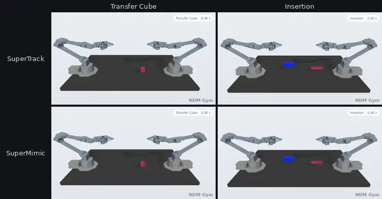

# Bimanual demonstration tracking

ALOHA's two arms (Zhao et al., "Learning Fine-Grained Bimanual Manipulation with Low-Cost Hardware", RSS 2023) track a
demonstration of ACT's two simulated tasks in physics: the arms' joints, the grippers and the objects, from the
demonstration's simulator states. The scenes are ACT's and run on MuJoCo-Warp directly (no Isaac Lab), on the path of
[manipulation demonstration tracking](robomimic.md): its simulator, task, algorithms, training and evaluation scripts. One
policy tracks one demonstration, or several.

The scenes and meshes are [ACT](https://github.com/tonyzhaozh/act)'s (MIT), downloaded at a pinned commit and checked
against SHA-256 sums. The demonstrations are generated on the user's machine with ACT's scripted policies, as ACT records
an episode, with the simulator's whole state kept: ACT's own recordings (and their copies on the Hugging Face Hub) hold the
arms' joints, the actions and a camera image, not the objects' poses. Neither is redistributed here.

```bash
pip install -e '.[hand]'                             # MuJoCo-Warp

# the demonstrations: ACT's scenes and its scripted policies, in an environment of its own with MuJoCo 2.3.7
python -m venv /tmp/act-mujoco && /tmp/act-mujoco/bin/pip install mujoco==2.3.7 numpy
/tmp/act-mujoco/bin/python tools/make_aloha_demos.py   # into data/aloha: 10 demonstrations per task, pinned

# one demonstration: train (SuperTrack, then SuperMimic), evaluate from perturbed starts beside the open-loop targets
python -m ndm_gym.train_robomimic --config aloha-supertrack --task aloha_insertion --log_dir logs/insertion_st
python -m ndm_gym.train_robomimic --config aloha-supermimic --task aloha_insertion --log_dir logs/insertion_sm
python -m ndm_gym.evaluate_robomimic --ckpt logs/insertion_st/last.pt --out logs/insertion_st/eval
MUJOCO_GL=egl python tools/render_robomimic.py --rollout logs/insertion_st/eval/rollout_0.npz --out insertion.webp --title SuperTrack
```

## Demonstrations

`tools/make_aloha_demos.py` follows ACT's `record_sim_episodes.py`. In ACT's end-effector scene (each gripper welded to a
mocap body) the scripted policy's waypoints are followed for 400 control steps of 20 ms; the arms' joint positions and the
grippers' commands of every step are then replayed as the position actuators' targets in the joint-controlled scene, from
the same object poses. The state after every control step, the targets and ACT's staged reward are written; an episode is
kept if its replay reaches ACT's highest reward. The objects start where ACT draws them (the cube in 20 x 20 cm of the
table, the peg and the socket in 10 x 20 cm each), from a seeded generator; the default set (10 kept episodes per task,
seed 0) is the benchmark's, and its arrays' SHA-256 is pinned.

The tool runs with MuJoCo 2.3.7, the version ACT's instructions install, and refuses another: how the grippers follow
their mocap bodies depends on the version, and with MuJoCo 3.15 the scripted grasps miss (1 of 12 episodes kept on
Transfer Cube, none on Insertion; 12 of 12 with 2.3.7). Training and evaluation read the demonstrations' states and run
on the library's MuJoCo-Warp.

## Scenes

`ndm_gym/robots/aloha_scenes.py` loads ACT's joint-controlled scenes as they are.

| | Transfer Cube | Insertion |
|---|---|---|
| arms | two ViperX 300, six joints and two finger slides each | the same |
| objects tracked | the cube (4 cm, 50 g) | the peg (2 cm across, 12 cm long) and the socket (opening 3.6 cm) |
| the demonstration | the right arm picks the cube up and hands it to the left arm in the air | the left arm picks up the socket, the right arm the peg, and the peg goes into the socket until it touches the pin inside |
| demonstrations | 10, 8 s each | 10, 8 s each |
| success (ACT's reward of 4, from the contacts) | the cube touches the left gripper's finger and not the table | the peg touches the pin |

- **Actuators:** ACT's 16 position actuators with its gains (800, 1600, 800, 10, 50 and 20 N m / rad on an arm's joints,
  200 N / m on a finger) and force ranges, and the joints' friction as the scene has it. ACT commands a gripper by one value,
  its two fingers mirrored; here too one action drives both.
- **Physics:** MuJoCo-Warp at ACT's rates: 2 ms physics steps, 50 Hz control (10 physics steps a control step, replayed as
  one CUDA graph). `--solver_iterations` sets the solver's iterations (the results: 20, the manipulation task's).

## Task

`ndm_gym/tasks/robomimic_tracking.py`, the manipulation task's, with the scene's control step and its mirrored fingers; the
reference is one or more demonstrations (`--demo`), each with its last state held for 0.5 s.

| | |
|---|---|
| state | the scene's qpos and qvel: the arms', the fingers' and the objects' |
| action | 14 values, as ACT's: per arm six offsets of the joints' position targets (at most 0.25 rad) and one of its gripper's (at most 2 cm a finger, mirrored), about the reference's joint positions at the next frame |
| observation | the actuated joints and their velocities, the grippers' keypoints (end effector and fingers), each tracked object about each end effector, its rotation and velocities, the previous action |
| goal | 5 reference frames ahead about the state: the joints' offsets, the tracked objects' offsets and relative rotations, the keypoints' offsets |
| reward | kernels on the keypoints (4 cm), the arms' joints (0.4 rad), the objects' positions (4 cm) and rotations (0.5 rad); an action-rate cost |
| termination | a tracked object 15 cm or a keypoint 20 cm from its reference |
| episode | from a random frame of the reference with noise on the arms' joints (the objects and the grippers as recorded), to its demonstration's end |

The policy does not read the position targets that the demonstration recorded (ACT's actions): its action is an offset
about the reference's joint positions, as in the manipulation task. The evaluation replays the recorded targets open loop
beside the policy (`demonstration_targets`), and the reference's joint positions as targets (`reference_targets`).

**Success.** ACT scores a state by the geoms in contact (`get_reward` of its `TransferCubeTask` and `InsertionTask`, stages
0 to 4) and counts an episode a success if its highest reward is 4. `evaluate_robomimic` reads the simulator's contacts
after every control step (`RobomimicSim.touching`, a collision pass at the state) for the same pairs of geoms
(`aloha_scenes.CONTACTS`), and a rollout succeeds if it never terminates and its highest reward is 4. These are rollouts
that track a demonstration from perturbed starts, not ACT's success rate of an imitation policy from images.

Beside it the evaluation reports the last stage as a function of the state at the demonstration's last frame
(`final_state_rate`; `aloha_scenes`), as the manipulation task reads its success: the cube off the table at the left
gripper's grasp point with the gripper closed on it; the peg inside the socket's opening with its end within 2 mm of the
pin's. On the demonstrations' frames it agrees with ACT's reward of 4 on 99.4 % and 98.8 %, and every frame with that
reward passes. Training's log has this state test (`success`).

## Method

Both algorithms fit MjcfWorldModel (worldmodels.mjcf, the scene in generalized coordinates: fixed bases, the objects as
free joints) over one control step on windows of simulator transitions, and train the policy through imagined rollouts of
the frozen model (`ndm_gym/algos/robomimic_algos.py`), as in the manipulation task.

`--config list` prints the configurations with what each measured. `aloha-supertrack` and `aloha-supermimic` take
`robomimic-supertrack`'s and `robomimic-supermimic`'s algorithm options with episodes of up to 500 control steps (10 s; the
choice of the benchmark's tuning round on demonstration 1, for both), `--solver_iterations 20` and the benchmark's budget
(6,000 iterations with the learning rate's cosine over them).

Results: [benchmarks/aloha_bimanual_tracking](../../benchmarks/aloha_bimanual_tracking/results.md). In short (demonstration
0, seeds 0 / 1 / 2, the last checkpoint of 6,000 iterations, each run alone on an A100 80GB SXM4; in every case some run
had not settled, so these are the cap's numbers and no comparison is drawn from them): SuperTrack a success of
100 / 30.9 / 100 % on Transfer Cube with the cube within 2.22 / 2.07 / 1.37 mm, and 0 / 0 / 100 % on Insertion with the peg
and the socket within 1.92 / 1.60 / 1.84 mm and no rollout ended early; SuperMimic 69.1 / 0.4 / 69.5 % on Transfer Cube
with the cube within 13.4 / 24.0 / 10.1 mm, and 0.4 / 0 / 0 % on Insertion with 69 to 100 % of the rollouts ended early.
On Insertion a checkpoint's rollouts mostly all touch the pin or none does (SuperTrack: 8 / 2 / 12 of a run's 30
checkpoints meet the target). Success is ACT's reward of 4 from the simulator's contacts on a rollout that never
terminated.



Per case the seed with the highest success, then the lowest object error, from the unperturbed start, the demonstration's
arms and objects in translucent blue (in SuperMimic's Insertion rollout the peg stays on the table). The animations:
[Transfer Cube](https://raw.githubusercontent.com/Frank-ZY-Dou/ndm-gym/main/docs/media/aloha/transfer_cube_st.webp), [Insertion](https://raw.githubusercontent.com/Frank-ZY-Dou/ndm-gym/main/docs/media/aloha/insertion_st.webp) (SuperTrack);
[Transfer Cube](https://raw.githubusercontent.com/Frank-ZY-Dou/ndm-gym/main/docs/media/aloha/transfer_cube_sm.webp), [Insertion](https://raw.githubusercontent.com/Frank-ZY-Dou/ndm-gym/main/docs/media/aloha/insertion_sm.webp) (SuperMimic).
