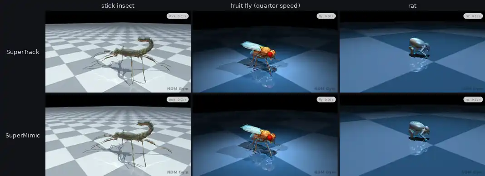

# Animal motion tracking

Anatomically detailed bodies of three animals track their animals' recorded kinematics on MuJoCo-Warp: MIMIC-MJX's rat, fruit
fly and stick insect (Zhang, Yang et al., "MIMIC-MJX: Neuromechanical Emulation of Animal Behavior", arXiv 2511.20532), with
the clips of its dataset ([talmolab/MIMIC-MJX](https://huggingface.co/datasets/talmolab/MIMIC-MJX), MIT) and the bodies of
[talmolab/vnl-playground](https://github.com/talmolab/vnl-playground) (BSD-3-Clause; the fly is
[flybody](https://github.com/TuragaLab/flybody)'s, Apache-2.0). They are the library's first non-human animal bodies.

```bash
pip install -e '.[hand]'                                         # MuJoCo-Warp
python tools/download_mimic_mjx.py                               # the clips and the bodies at pinned revisions into data/mimic_mjx (2.9 GB)
python -m ndm_gym.train_animal --config stick-supertrack --log_dir logs/stick_st     # <animal>-<algorithm>: the benchmark's settings
python -m ndm_gym.evaluate_animal --ckpt logs/stick_st/last.pt --repeats 4 --record --out logs/stick_st/eval
python -m ndm_gym.evaluate_animal --ckpt logs/stick_st/last.pt --clip_ids 10-19 --out logs/stick_st/eval_heldout   # held-out clips
MUJOCO_GL=egl python tools/render_animal.py --rollout logs/stick_st/eval/rollout.npz --world 3 --out stick.webp   # or .mp4
```

## The bodies

`ndm_gym/robots/animals.py` builds each body as MIMIC-MJX's environments build it, attached to its arena's floor:

| | rat | fruit fly | stick insect |
|---|---|---|---|
| qpos / qvel | 74 / 73 | 43 / 42 | 48 / 47 |
| actuators | 38 torque actuators (its motors' gain the largest force), first-order activation filters (40 ms) | 36 position servos on the legs | 41 torque actuators, gear scaled by 1e-5 |
| edits | scaled by 0.9 (gear by 0.81), a free root | as its file holds it, spawned 5 cm above the floor | its feet's floor contacts as explicit pairs (0.2 ms spring), damping and armature floors |
| units | m | cm (gravity 981) | m |
| physics step, control step | 2 ms, 10 ms | 0.2 ms, 2 ms | 2 ms, 10 ms |
| clips | 842 x 250 frames at 50 Hz | 1,730 x 600 frames at 500 Hz | 75 x 225 frames at 50 Hz |

Every body runs at MIMIC-MJX's solver settings (Newton, 5 iterations and 5 line-search iterations, no noslip: MuJoCo-Warp has
none). The clips hold stac-mjx's qpos and qvel of the body per frame; their layouts match the bodies' exactly, and a control
step on MuJoCo-Warp from the clips' frames matches MuJoCo's to 2e-8 (median).

**The reference's velocities.** At the pinned revision the clips' `qvel` is not the velocity of their `qpos`: the root's linear
velocity is 10 times the positions' forward difference for the rat and the stick insect and 0.1 times for the fly, and joint
speeds are clipped at 20 rad/s (1.7 % of the rat's joint entries and 25.5 % of the stick insect's, over the first 20 clips;
stac-mjx's #135 fixed both after that revision). The task reads the reference's velocities at an episode's start, in the goal,
in the joint-velocity reward and in that reward's scale (the reference's RMS joint speed). `--ref_qvel positions` takes them
from the reference's positions at the control rate (`motion.sources.mimic_mjx.velocities_from_positions`: MuJoCo's velocity
from each frame to the next, the last frame's that of the frame before); `--ref_qvel stored`, the default, reads the file's.
The named configurations and the benchmark use `--ref_qvel positions`.

**The rat's activations.** Its actuators filter their controls (an activation a with da/dt = (u - a) / 40 ms), so qpos and
qvel are not its whole state. Over a control step with the control held, MuJoCo's Euler step of the filter has a closed form
(`robots.animals.activation_filter`): from a0 under u the step ends at u + (a0 - u) r and its physics steps' forces see the
mean activation u + (a0 - u) r̄, exact against MuJoCo to 1e-8. The task carries the activations in its state and steps them in
closed form; the world model (`worldmodels.animal`, this task's own: the library's MjcfWorldModel on the body without its
filters) reads the mean and the start activation in the controls' place, which fix the forces' course over the step.

## Task

`ndm_gym/tasks/animal_tracking.py`; one policy per body on a set of clips (`--clip_ids`).

| | |
|---|---|
| state | qpos, qvel and the activations (the rat's) |
| action | one per actuator in [-1, 1]: the control over its range (torque actuators), or an offset of the target about the reference's joint (position servos, `--action_scale` at 1) |
| observation | the root's height, its tilt, its velocities in its frame, the joints, the activations, the end effectors about the root in its frame, the previous action |
| goal | 5 reference frames ahead about the state in the root's frame: the root's offset and relative rotation, the joints' offsets, the root's velocity, the end effectors about the reference's root |
| reward | kernels on the root's position and rotation, the joints and their velocities, the tracked bodies' and the end effectors' positions; lengths in fractions of the body's size (the bodies' median largest distance from the root), so one setting serves the three bodies' units; an action-rate and a control cost |
| termination | MIMIC-MJX's: the root farther than 0.1 m (rat), 0.5 cm (fly) or 0.05 m (stick insect) from its reference, turned more than 120 / 30 / 120 degrees away, or the joints' L2 error above 4.5 / 20 / 4.5 rad |
| episode | from a random frame of a clip at the reference's state (its velocities by `--ref_qvel`; noise of 0.02 rad on the joints), to its clip's end |

## Method

Both algorithms fit MjcfWorldModel (worldmodels.mjcf: an MLP on the body's generalized coordinates, invariant to the root's
heading and horizontal position) over one control step on 8-step windows of simulator transitions, and train the policy through
imagined rollouts of the frozen model (`ndm_gym/algos/animal_algos.py`): SuperTrack with the acceleration model and L1 errors of
the root, the joints, the bodies and the end effectors; SuperMimic with the increment model, the imagined reward and a critic.
The systems options are the hand task's; `--wm_lr` (the world model's own rate) and `--fused_fk` (the forward kinematics body
by body, far fewer kernels once compiled) come from the G1 path.

`--config list` prints the six configurations (`stick`, `fly`, `rat` with `supertrack` or `supermimic`) with what each
measured. Results: [benchmarks/mimic_mjx_animal_tracking](../../benchmarks/mimic_mjx_animal_tracking/results.md).



Each case's run with the lowest bodies' error on a clip it lives through (the fly at a quarter of real time), the reference
in translucent blue. The animations: [stick insect](https://raw.githubusercontent.com/Frank-ZY-Dou/ndm-gym/main/docs/media/animals/stick_st.webp), [fruit fly](https://raw.githubusercontent.com/Frank-ZY-Dou/ndm-gym/main/docs/media/animals/fly_st.webp), [rat](https://raw.githubusercontent.com/Frank-ZY-Dou/ndm-gym/main/docs/media/animals/rat_st.webp)
(SuperTrack); [stick insect](https://raw.githubusercontent.com/Frank-ZY-Dou/ndm-gym/main/docs/media/animals/stick_sm.webp), [fruit fly](https://raw.githubusercontent.com/Frank-ZY-Dou/ndm-gym/main/docs/media/animals/fly_sm.webp), [rat](https://raw.githubusercontent.com/Frank-ZY-Dou/ndm-gym/main/docs/media/animals/rat_sm.webp) (SuperMimic).
