# Hand-object tracking

Contributed by [Dechen Gao](https://github.com/gaodechen): the task with SuperMimic on it
([#2](https://github.com/Frank-ZY-Dou/ndm-gym/pull/2)), the Allegro and the Inspire hand ([#6](https://github.com/Frank-ZY-Dou/ndm-gym/pull/6)).

A dexterous hand tracks a human hand-object demonstration: a right hand on a position-controlled floating palm (the XHand, the Allegro hand or the Inspire hand) reaches an object, grasps it and lifts it, on MuJoCo-Warp directly (no Isaac Lab;
`ndm_gym/sim/rigid/hand_sim.py`). The clips and scenes are [SPIDER](https://github.com/facebookresearch/spider)'s
(`retarget/retarget_full`: DexYCB, HRDexDB and OakInk demonstrations retargeted to robot hands).

The reference is SPIDER's **kinematic** retarget of the demonstration (inverse kinematics of the human hand's motion, `trajectory_kinematic.npz`), resampled to 50 Hz, with the last pose held for 0.5 s. No physics shaped it: the fingers may float off or cut into the object, as a retargeted humanoid motion's feet do with the floor. The policy has to find
the contacts that make the object follow.

```bash
pip install -e '.[hand]'                             # MuJoCo-Warp
python tools/download_hand_clips.py                  # the benchmark's clips into data/spider
benchmarks/xhand_tracking/run.sh apple 0             # train, evaluate and render one task and seed (SuperMimic's defaults)

# or step by step: SuperTrack, then SuperMimic
CLIP=data/spider/processed/hrdexdb_24f/xhand/right/apple-0/0
python -m ndm_gym.train_hand --clip $CLIP --algo supertrack --lr 4e-4 --st_fail_w 2 --st_imag_noise 0.2 --st_task_weights --log_dir logs/apple_st
python -m ndm_gym.train_hand --clip $CLIP --log_dir logs/apple_sm
python -m ndm_gym.evaluate_hand --ckpt logs/apple_st/last.pt --out logs/apple_st/evaluation
python tools/render_hand.py --clip $CLIP --rollout logs/apple_st/evaluation/rollout.npz --out apple_st.mp4
```

## Hands

A hand is read from its scene (`ndm_gym/robots/hands.py`), so a clip's path chooses it: its joints are the actuated ones
in the actuators' order (the palm's three slides and three hinges, then the fingers' hinges), its keypoints the palm's
site and the fingertip sites it has. The task, the world model, the policy and the replay take their sizes from it.

| hand | finger joints | keypoints | clip |
|---|---|---|---|
| XHand | 12 | palm, 5 fingertips | `.../xhand/right/<task>/0` |
| Allegro | 16 | palm, 4 fingertips | `.../allegro/right/<task>/0` |
| Inspire | 12 | palm, 5 fingertips | `.../inspire/right/<task>/0` |

```bash
python tools/download_hand_clips.py --robots allegro inspire      # default: every hand of the task list
# each algorithm's time configuration on the Allegro hand
ROBOT=allegro benchmarks/xhand_tracking/run.sh apple 0 data/spider logs/allegro_st --config hand-supertrack-fast --st_fail_w 5
ROBOT=allegro benchmarks/xhand_tracking/run.sh apple 0 data/spider logs/allegro_sm --config hand-supermimic-fast
```

## Task

| | |
|---|---|
| state | the hand's joint positions and velocities (the palm's 6, then the fingers'; 18 joints in all on the XHand and the Inspire hand, 22 on the Allegro hand); the object's position, rotation, linear and angular velocity |
| action | one offset per joint in [-1, 1] about the next reference frame's pose (3 cm palm translation, 0.3 rad palm rotation, 0.4 rad fingers), as position targets |
| observation | the joints, the fingertips and the object in the palm's frame, the previous action |
| goal | the next 5 reference frames about the state: joint offsets, the object's offset and relative rotation |
| reward | tracking kernels on the keypoints (palm and fingertips), the finger joints, the palm's rotation and the object's position and rotation; an action-rate penalty; with `--target_rate_w`, a target-rate penalty ([smooth targets](#smooth-targets)) |
| termination | the object or the palm more than 15 cm from its reference |
| episode | from the reference's first frame (joints and the object's position perturbed) to its last |

Everything is an analytic function of the state and the reference frame (`ndm_gym/tasks/hand_tracking.py`), so the
simulator's transitions and the world model's imagined rollouts share it.

## Method

Both algorithms fit an MLP world model of the hand-object state (`ndm_gym/worldmodels/hand.py`) on 8-step windows of
simulator transitions and train the policy through imagined rollouts of the frozen world model from replayed states,
over `--horizon` steps (`ndm_gym/algos/hand_algos.py`). Training takes `ndm_gym.train`'s arguments with its own
defaults (`ndm_gym.train_hand.HAND_DEFAULTS`); those it does not implement are refused.

[SuperTrack](../algorithms/supertrack.md) (`--algo supertrack`): the world model predicts the accelerations of the
joints and of the object, integrated over a control step. The policy minimizes the L1 errors of what the task tracks
over the imagined window (the keypoints, the palm's rotation, the finger joints, the object's position and rotation;
the fingertips about the palm with the calibrated weights), plus a failure penalty on the task's soft termination
(`--st_fail_w`) and a regularizer on the actions; no reward, no critic.

| option | the terms' weights |
|---|---|
| default | each term weighs 1 at the first policy update (calibration) |
| `--st_unit_scales` | calibration, terms of one unit sharing a weight: the object's position and the fingertips about the palm per metre as the keypoints, the object's rotation per radian as the palm's |
| `--st_task_weights` | no calibration: each of the task's five quantities weighs the reward's weight over its kernel's width |
| `--st_obj_w k` | the object's two terms weigh `k` times that |
| `--st_vel_terms` | adds the velocities of the joints and of the object (calibrated weights only) |

A clip whose reference pose alone does not lift the object starts with a large error of the object; calibrated by
itself the object then weighs little, and the finger joints, whose first error is small, weigh much. The task's weights
trade the hand's pose against the object as the reward does.

[SuperMimic](../algorithms/supermimic.md) (the default): the world model predicts the increments of the state; the
policy maximizes the imagined tracking return with a soft survival weight and a critic beyond the horizon.
`--bptt_decay` scales the gradient through the imagined state at every step.

## Smooth targets

A policy's action is an offset about the next reference pose. Nothing in SuperTrack's loss, and only a weak term in
SuperMimic's reward (`w_action_rate`, 0.05 times the actions' mean squared change), ties one step's offset to the next, so
the fingers' position targets can jump back and forth at every control step.

`--target_rate_w w` (both algorithms; 0, the default, is off) adds a cost per step (`HandTask.smooth_cost`): `w` times the
mean over the joints of the change of the policy's part of the position targets since the previous step, each joint's over
its tracking kernel's width (`keypoint_std` for the palm's translation, `palm_ori_std` for its rotation, `finger_std` for
the fingers), squared. A jump costs; following the reference does not. SuperMimic's reward subtracts it. SuperTrack's loss
adds it, summed over the imagined window, or with `--st_cost_mean` (with `--st_task_weights`) as its mean over the window,
the scale of the task-weighted tracking terms, so that it weighs against them as in the reward. The XHand's rows in the
README use `--target_rate_w 4`, SuperTrack's with `--st_cost_mean`
([results](../../benchmarks/xhand_tracking/results.md#the-xhand-with-the-target-rate-penalty)).

`tools/hand_motion_check.py` measures an evaluation's unperturbed rollout against its clip's references, on the finger
joints: the acceleration and jerk of their positions, the share of their velocity's spectral power above 5 Hz, the change of
their position targets per step, limit hits, and the slips of the fingertips and of the object. It reads what
`ndm_gym.evaluate_hand --save_targets` writes; several evaluations under one label give their mean:

```bash
python -m ndm_gym.evaluate_hand --ckpt logs/apple_st/last.pt --out logs/apple_st/evaluation --save_targets
python tools/hand_motion_check.py st=logs/apple_st/evaluation --json motion.jsonl
```

The README's motion check: over a configuration's runs, the share above 5 Hz, the jerk and the targets' change per step
at most 2, 1.5 and 2 times its clips' kinematic references'.

## Systems options

Off by default (`ndm_gym/algos/hand_fast.py`); with all of them off the loop and the agents compute what they compute
without them. Each applies to both algorithms.

| option | what it does | what it changes in a run's numbers |
|---|---|---|
| `--fused_adam` | Adam's fused CUDA kernel for every optimizer | rounding |
| `--reset_masked` | ended worlds are reset by masked writes of fixed shapes, the draws made for every world | the random stream |
| `--no_sync` | no host-device synchronization in an iteration: the control step on Warp's stream, the normalizers' freeze test and the skip of a non-finite policy step on the device (needs the two above) | rounding |
| `--collect_graph` | a collection step with its physics, resets and replay write as one CUDA graph (needs `--no_sync`) | the random stream of the replay's sampling |
| `--compile_eager` | the collection step's forward kinematics as a compiled function (needs `--no_sync`) | rounding |
| `--update_graphs` | the iteration's world-model updates as one CUDA graph, its policy (and critic) update as another (needs `--no_sync`) | the random stream of the replay's sampling |
| `--pi_opt muon`, `--wm_opt muon` | Muon on the hidden matrices of the policy's or the world model's MLP, Adam on the rest | the optimizer |
| `--pi_ema d` | a moving average of the policy with decay `d`, stored as the checkpoint's `pi` (the trained policy as `pi_live`) | the policy that is evaluated |
| `--compile_updates` | the updates' parts that otherwise run eagerly between the compiled ones, compiled (needs `--no_sync`) | rounding |
| `--compile_collect` | the collection step's torch work before and after the physics as two compiled functions, captured with the physics (needs `--no_sync`) | rounding |
| `--elementwise_3x3`, `--combo_kernels` | inside compiled functions, products of 3 x 3 matrices and 3-vectors as fused elementwise products; independent small kernels launched together | rounding |
| `--autotune_gemm` | each compiled matrix product from the faster of cuBLAS and compiled Triton templates, timed per shape at compilation (longer compilations) | rounding |
| `--wm_palm_fk` | the world model's fit computes the palm's kinematics alone, the only part of them it reads | none |
| `--sm_reuse_input` | SuperMimic: an imagined step's policy input is the critic's input computed the step before | rounding |
| `--st_no_imag_r` | SuperTrack: the imagined steps without the task's reward, which its loss does not read (the log's `imag_r` is then NaN) | rounding |
| `--layout AL`, `--layout AWL` | the iteration's steps at the same time on the first two or three GPUs the trainer sees, each on the others' results of the previous iteration: AL the actor (simulator, collection, replay, world model) and the policy's learner; AWL also the world model's learner, on a copy of the replay; `--layout_devices` places them otherwise (needs `--no_sync --update_graphs`) | the training: each step reads the others' results of the previous iteration |
| `--pi_lr_mult m` | the policy's learning rate is `--lr` times `m`, ramped to 1 over `--lr_decay_len` iterations from the log row where `sim_r` reaches `--lr_decay_ret`, at the latest from `--lr_decay_by` | the policy's schedule |

The speed options of the fastest configurations are `--compile_updates --elementwise_3x3 --combo_kernels --wm_palm_fk
--compile_collect --autotune_gemm`, with SuperMimic also `--sm_reuse_input` and, on the XHand with smooth targets,
SuperTrack also `--st_no_imag_r` ([why they are fast](../../README.md#hand-object-tracking)); a configuration's first run
compiles for about 3 minutes.
The three-GPU times add `--layout AWL`.
`--phase_times` writes each iteration's phases (collection, world-model updates, policy update, critic update, log rows,
checkpoints, the host's rest), the device synchronized at every boundary, to `phase_times.csv`.
`--amp bf16` (the MLPs' products in bf16) combines with all of them. `HAND_PROFILE=1` prints, with every log row, the
time of the collection step, the world-model updates and the policy update, the device synchronized around each.

## Evaluation and videos

`ndm_gym.evaluate_hand` rolls the policy out from the first frame to the last without resets: once from the
unperturbed start (saved for rendering), and from `--num_envs` perturbed starts, each also with the reference pose as
the position targets in the policy's place, for comparison. A rollout succeeds if it never terminates and the object ends
within 5 cm of its last reference position. `--save_targets` also saves the unperturbed rollouts' position targets and the
policy's actions at every control step, for `tools/hand_motion_check.py`; the evaluation is the same.

`tools/render_hand.py` renders a saved rollout in the look of `tools/render.py`, at 1920x1080, 60 fps and half speed:
the simulated hand and object solid, the kinematic reference a translucent ghost, a camera that follows them, the NDM
Gym mark (`--no_mark`: none). `--source reference_targets` renders the rollout with
the reference pose as the targets, `--source reference` the reference alone; `tools/side_by_side.py` joins two renders.
`--look noir` renders on a dark stage, `--brightness` scales its sky, floor and lights, and `--ghost_overlay` draws the
reference over the frame as a blue silhouette. The README's animations use `--look noir --brightness 1.6 --orbit 30
--zoom 0.72 --follow_z --elevation -12 --ghost_overlay` (the Allegro hand's `--zoom 0.9`);
`benchmarks/xhand_tracking/scripts/hand_grid.py` tiles the 18 renders (three hands, two algorithms, three clips) into
the README's grid as one synchronized loop, and the single animations are
`docs/media/hand/<hand>_<algorithm>_<clip>.webp`. On the dark stage a hand darker than mid grey (the Allegro's, the
Inspire's) is lifted to graphite.

The README's animations one by one (per hand, algorithm and clip one policy: on the XHand's spray bottle and can a run
with smooth targets, elsewhere the lowest object error among that algorithm's configurations of record; which runs and
why: [results](../../benchmarks/xhand_tracking/results.md#the-readmes-animations)):

| | apple | spray bottle | can |
|---|---|---|---|
| XHand, SuperTrack |  | 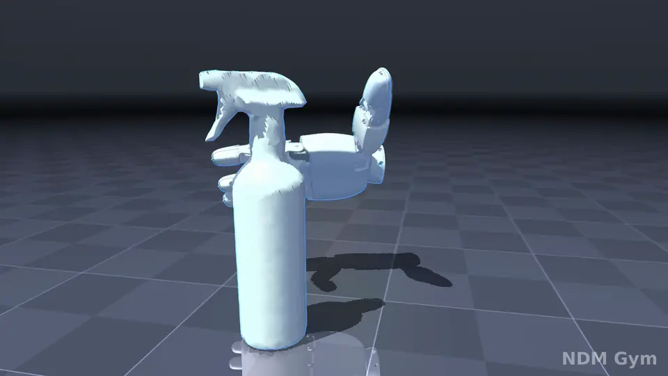 | 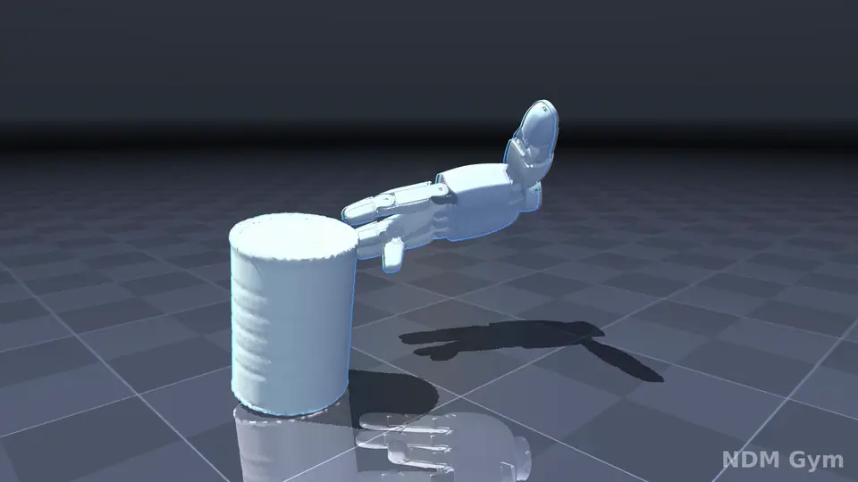 |
| XHand, SuperMimic | 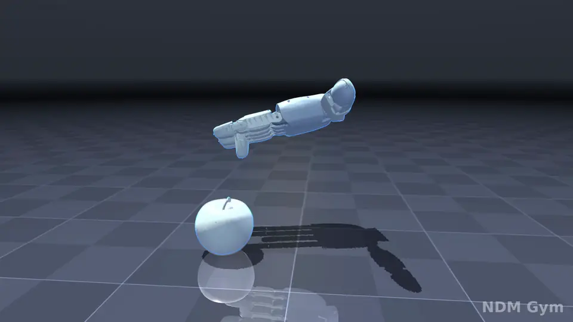 | 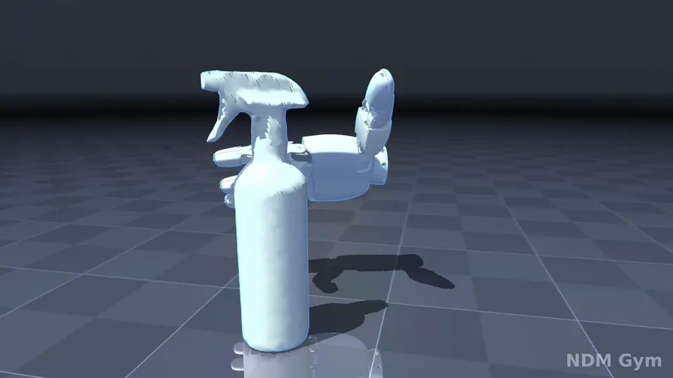 |  |
| Allegro, SuperTrack | 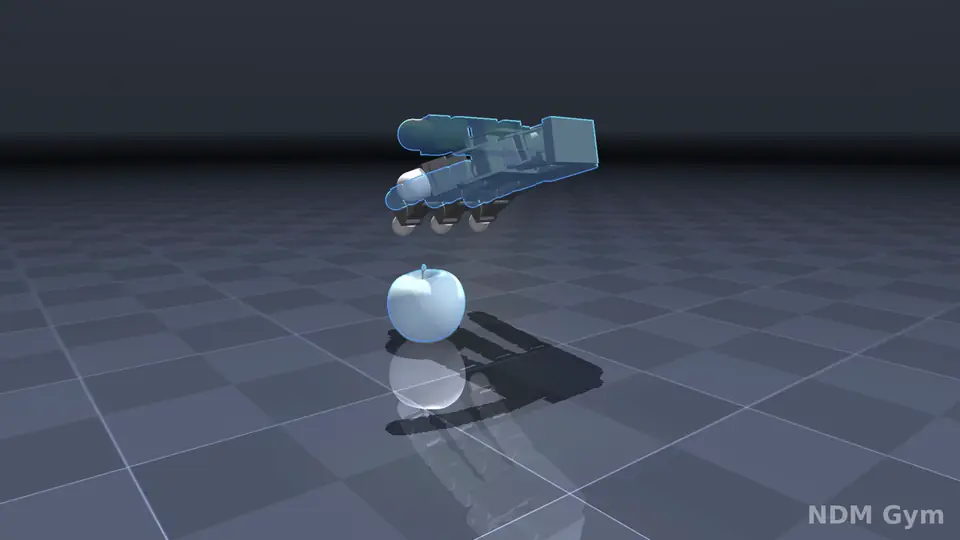 |  |  |
| Allegro, SuperMimic | 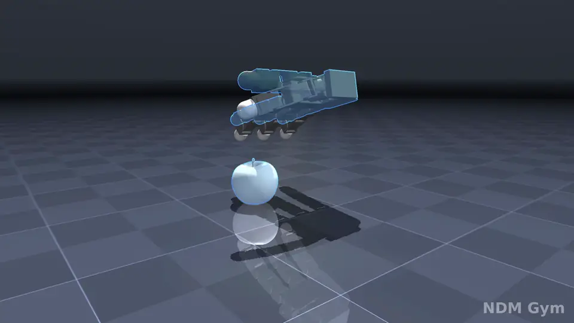 | 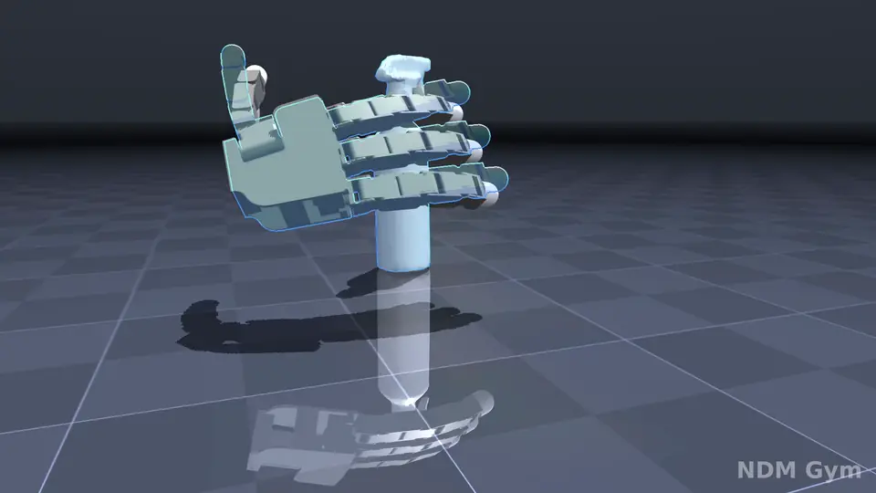 | 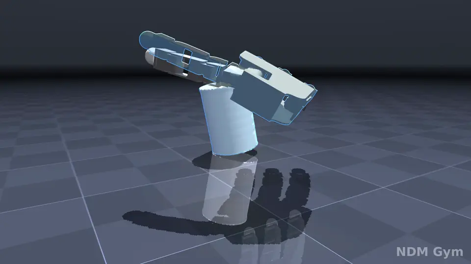 |
| Inspire, SuperTrack | 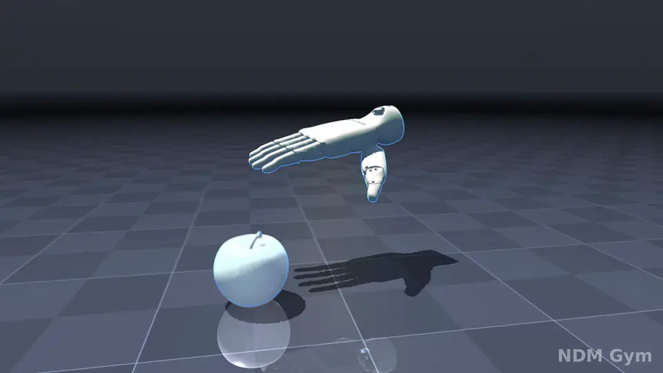 |  |  |
| Inspire, SuperMimic | 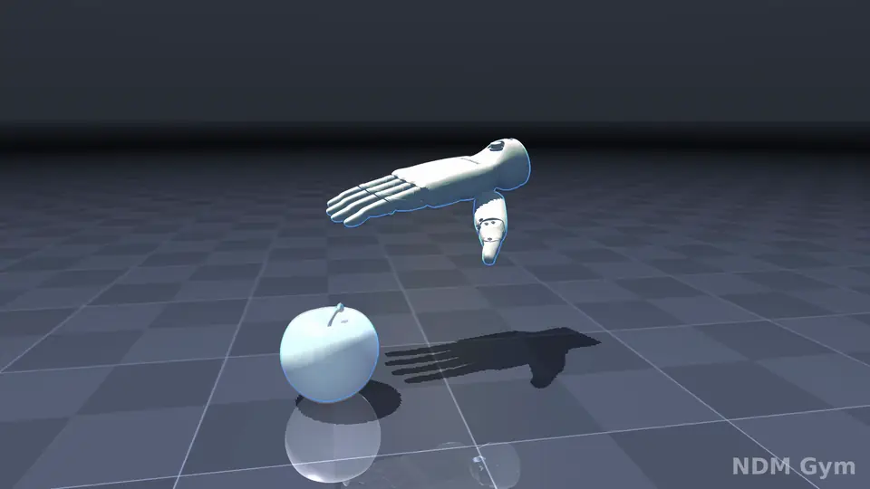 | 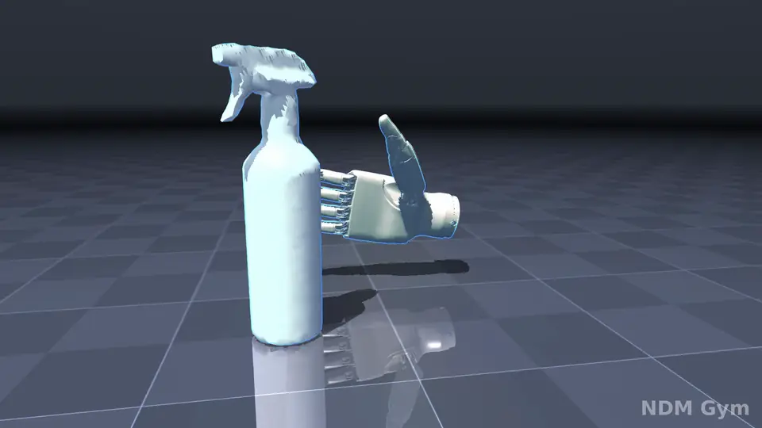 | 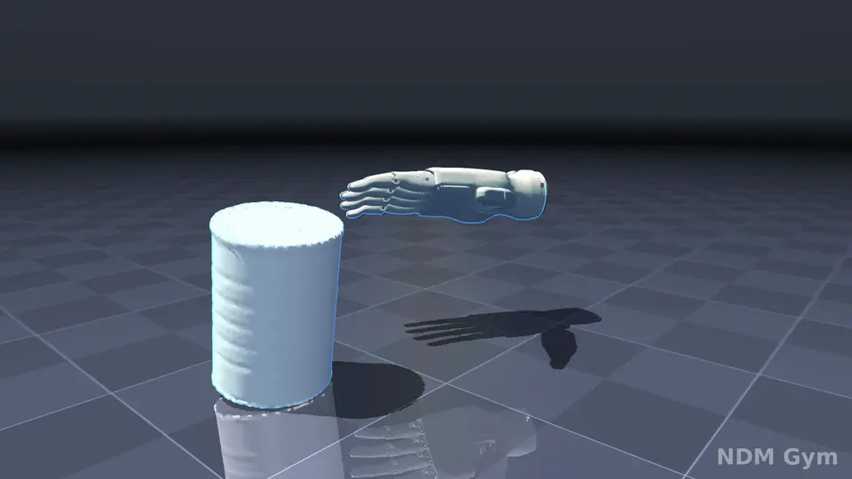 |

Tasks and results: [`benchmarks/xhand_tracking`](../../benchmarks/xhand_tracking/results.md).
