# Human-object interaction

HDMI's 13 tasks retain its observations, rewards, terminations and randomization (`ndm_gym/tasks/hdmi.py`,
`ndm_gym/tasks/hdmi_tasks.py`), scenes and G1 variant on Isaac Lab 3 and MuJoCo-Warp
(`ndm_gym/sim/rigid/hdmi_sim.py`). The world models also predict the contact forces. HDMI's PPO teacher is the
model-free baseline (`ndm_gym.train_ppo_hoi`).

The tasks (`--task`): `carry_and_place_bread_box`, `carry_box_over_shoulder`, `move_foam`, `move_stool-climb`,
`move_suitcase`, `open_door-feet`, `open_foldchair-sit`, `push_box`, `push_door-hand`, `roll_ball-hand`,
`topple_wood_board_and_cross`, `traverse_door`, `truman`.

| | | |
|---|---|---|
| 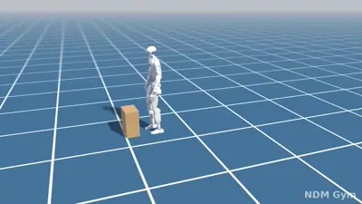<br>`move_suitcase` | 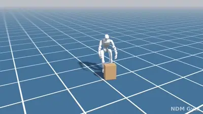<br>`carry_box_over_shoulder` | 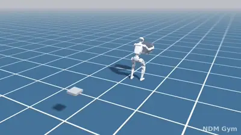<br>`carry_and_place_bread_box` |
| 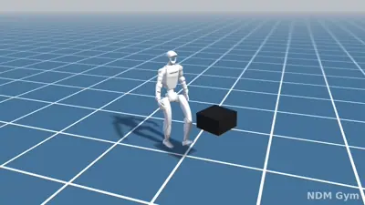<br>`move_foam` | 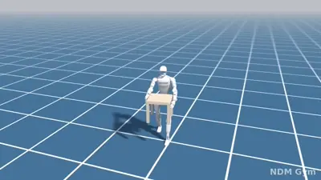<br>`move_stool-climb` | 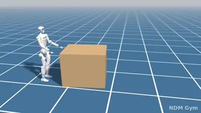<br>`push_box` |
| 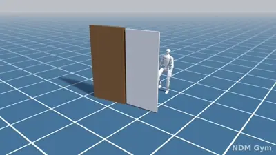<br>`push_door-hand` | 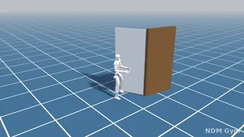<br>`open_door-feet` | 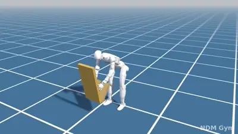<br>`open_foldchair-sit` |
| 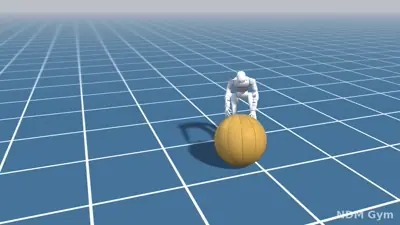<br>`roll_ball-hand` | 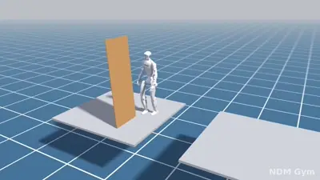<br>`topple_wood_board_and_cross` | 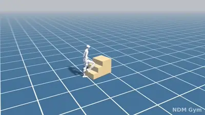<br>`truman` |

One policy per task on twelve of HDMI's thirteen tasks, trained in the world model and run in the simulator (evaluation seed 1). Each episode runs to the end of its clip; 8 s of it are shown.

Renders of policies tracking HDMI's reference motions, with the robot and object models of HDMI's release (its repository has no license), for non-commercial illustration only; not covered by this repository's MIT license ([see NOTICE](../../NOTICE)).

```bash
bash tools/download_hdmi.sh && python tools/convert_hdmi.py    # HDMI's clips and objects into data/hdmi/ (not redistributed)
python -m ndm_gym.train_hoi --task move_suitcase --algo supertrack --log_dir logs/hoi_st
python -m ndm_gym.train_hoi --task move_suitcase --algo supermimic --log_dir logs/hoi_sm
python -m ndm_gym.train_ppo_hoi --task move_suitcase --log_dir logs/hoi_ppo
python -m ndm_gym.evaluate_hoi --run_dir logs/hoi_st --watch
```

Collect transitions, fit offline, measure open-loop errors and benchmark throughput against physics:

```bash
python -m ndm_gym.wmbench.collect_hoi --task move_suitcase --seed 0 --out hoi_s0.pt
python -m ndm_gym.wmbench.collect_hoi --task move_suitcase --seed 1 --out hoi_s1.pt
python -m ndm_gym.wmbench.fit_hoi --task move_suitcase --kind accel --backbone rigidformer --train hoi_s0.pt --test held=hoi_s1.pt --out fit.csv
python -m ndm_gym.wmbench.speed_hoi --task move_suitcase --mode physics --num_envs 4096 --out speed.csv
python -m ndm_gym.wmbench.speed_hoi --task move_suitcase --mode ndm --backbone rigidformer --compile reduce-overhead --num_envs 4096 --out speed.csv
```

The task as implemented, item by item: [design](../hoi_design.md), [HDMI task specification](../hdmi_task_spec.md). Simulation throughput:
[`results.md`](../../benchmarks/ndm_speed/results.md).
