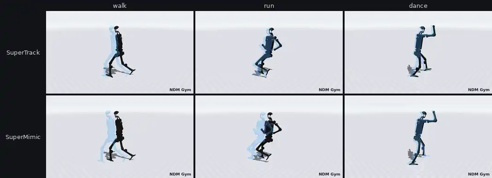

# Humanoid motion tracking on MuJoCo-Warp (H1)

A Unitree H1 tracks LAFAN1 clips retargeted to it, on MuJoCo-Warp directly (no Isaac Lab), with SuperTrack and SuperMimic
through the library's MLP world model of a robot's generalized coordinates (`worldmodels/mjcf.py`). One policy tracks 34
of LAFAN1's 40 clips: all but the six `fallAndGetUp` clips, of which the policies complete few rollouts or none
([results](../../benchmarks/h1_lafan1_tracking/results.md), "All 40 clips"). The rules of the measurements and the
results are in [`benchmarks/h1_lafan1_tracking`](../../benchmarks/h1_lafan1_tracking/README.md).

```bash
pip install -e '.[hand]'          # MuJoCo-Warp
tools/download_h1.sh              # the H1 clips and description at the G1's pinned revision, hash-checked, converted to MJCF

python -m ndm_gym.train_humanoid --config h1-supertrack --log_dir logs/h1_st            # one policy, 34 clips
python -m ndm_gym.train_humanoid --config h1-supermimic --log_dir logs/h1_sm
python -m ndm_gym.train_humanoid --config h1-supermimic --clips walk1_subject1 --log_dir logs/h1_sm_walk   # one clip
python -m ndm_gym.evaluate_humanoid --ckpt logs/h1_sm/last.pt --out logs/h1_sm/evaluation --num_envs 64 --push 1 2
python -m ndm_gym.evaluate_humanoid --open_loop --robot h1 --out logs/h1_open_loop    # the reference's targets only
benchmarks/h1_lafan1_tracking/run.sh selected 0 logs/h1_sm --config h1-supermimic     # train and evaluate, as the results
```

## Data and robot

- **Motions:** the H1 retargets of LAFAN1 (Ubisoft La Forge; CC BY-NC-ND 4.0) in the
  [LAFAN1 Retargeting Dataset](https://huggingface.co/datasets/lvhaidong/LAFAN1_Retargeting_Dataset), folder `h1/`, at the
  revision `tools/download_data.sh` pins for the G1 (`ce15729`): 40 CSV clips at 30 fps, each row the pelvis' position and
  quaternion (x, y, z, w) and the 19 joints in the URDF's order. The retargets are kinematic. `tools/download_h1.sha256`
  holds every file's hash. `motion.sources.lafan1.load_dir(path, num_joints)` reads them, the G1's (29 joints) as before.
- **Robot:** the dataset's `robot_description/h1` (Unitree's [unitree_ros](https://github.com/unitreerobotics/unitree_ros),
  BSD-3-Clause), converted by `tools/urdf_to_mjcf.py --robot h1` (the G1's conversion, a free pelvis): 19 hinges (5 per
  leg with one ankle joint, the torso, 4 per arm), 51.6 kg. `robots/humanoid.py` adds a floor and a position servo per
  joint:
    - the gains of Unitree's H1 training configuration
      ([unitree_rl_gym](https://github.com/unitreerobotics/unitree_rl_gym), BSD-3-Clause): stiffness 150 / 200 / 40 / 300 /
      150 / 100 N m/rad at the hips, knees, ankles, torso, shoulders and elbows, damping 2 / 4 / 2 / 6 / 2 / 2;
    - the URDF's efforts as the force limits (hips 200, knees 300, ankles 40, torso 200, shoulder pitch and roll 40,
      shoulder yaw and elbows 18 N m);
    - the joints' armature (0.1 kg m²) and damping (1 N m s/rad) of Unitree's own MuJoCo model of the H1
      ([unitree_mujoco](https://github.com/unitreerobotics/unitree_mujoco), `unitree_robots/h1/h1.xml`, BSD-3-Clause;
      [MuJoCo Menagerie](https://github.com/google-deepmind/mujoco_menagerie)'s `unitree_h1/h1.xml` has the same values).
      The URDF has no armature; without it the light distal links under the stiff servos move faster than a control step
      resolves, and the world model's error of a step was about three times larger (SuperTrack's loss 1.4 against 0.4,
      one clip, seed 0).

  The geometry, masses, inertias and joint ranges are the URDF's. The robot's collision geoms (the URDF's meshes and
  cylinders) touch the floor and not each other. The solver settings are those of the library's G1 on Isaac Lab: a 2 ms
  step, pyramidal friction cones, implicitfast integration; a control step of 20 ms is one CUDA graph.
- **`--robot g1`:** the library's G1 description and BeyondMimic's actuator model (`robots/g1.py`) on the same scene and
  task. It served to check this path against the library's G1 training (`ndm_gym/train.py`) and is not measured here;
  the library's G1 benchmark is [`benchmarks/g1_lafan1_tracking`](../../benchmarks/g1_lafan1_tracking/results.md).

## Task

`tasks/humanoid_tracking.py`, on the floating-base path of the quadruped task (its simulator `sim/rigid/quadruped_sim.py`,
its agents `algos/quadruped_algos.py`, its trainer and evaluation, which read the task's sizes and state layout):

- **State:** MuJoCo's `qpos` and `qvel`. **Action:** per joint an offset of the position target about the next reference
  pose in units of `0.25 * effort / stiffness` (BeyondMimic's scale, as the G1's), `b * tanh(y / b)` of the policy's output
  with `--action_bound b` (4 in the selected configurations; 1, the quadruped task's `tanh`, by default). The library G1's
  policy (`ndm_gym/train.py`) is unbounded; a bound of 1 caps the corrective torque of an offset at a quarter of the
  motor's effort.
- **Position targets** (`--target_range`): the servos accept targets within the joint's range (`joint`, the default),
  within that range widened by effort / stiffness (`effort`), or any (`free`, the library G1's and the selected
  configurations'); the joints' stops and effort limits stay the robot's.
- **Observation** (heading invariant): the pelvis' height, tilt, body-frame velocities, the joints and their velocities,
  the tracked bodies about the pelvis in its frame and the previous action. **Goal:** for each of the next 5 frames the
  reference pelvis' offset, rotation and velocities in the pelvis' heading frame and the joints' offsets.
- **Reward:** the G1 / LAFAN1 task's (`tasks/tracking.py`): kernels of the tracked bodies' positions (the reference
  re-anchored to the pelvis' horizontal position and heading), rotations, linear and angular velocities (widths 0.3 m,
  0.4 rad, 1 m/s, 3.14 rad/s) and, at half weight, the pelvis' world position and rotation (0.3 m, 0.4 rad); action-rate
  and soft joint-limit penalties. The tracked bodies are the G1's that the H1 has (no wrists): pelvis, hips, knees,
  ankles, torso, shoulders, elbows.
- **Termination:** the library G1's (the pelvis' height 0.25 m off the reference's, or its tilt, the height of its z axis,
  0.8 off). `--term_pos d` adds the pelvis more than `d` m from the reference's (off by default).
- **Training episodes** (`sim/rigid/humanoid_sim.py`; options of `train_humanoid`, off by default, on in the selected
  configurations): the library G1's `--max_episode_steps 500` (10 s), its return-based start sampling over 1 s bins of
  the clips (`--bin_starts`, with BlinkMimic's per-step averaging of a bin's episodes) and its failure-focused share of
  starts (`--fail_reset 0.3`). The bins' returns are discounted with the trainer's `--gamma`, as the library G1's:
  0.99 with SuperTrack, which has no discount of its own, and SuperMimic's 0.97 in the selected configurations. Not ported from the library's G1 training: its evaluation-guided resets (`--eprobe_*`),
  its domain randomization (friction, the torso's centre of mass, joint offsets), observation noise and history, and its
  policy's encoder-decoder.

The selected configurations (`ndm_gym/configs.py`, `h1-supertrack` and `h1-supermimic`) are the Go2 task's with the
options above and 8,000 iterations. SuperTrack's tuning started from `--horizon 32` (the library G1's SuperTrack's
imagined window; the Go2's is 16) and `--pi_batch 2048` (the Go2's is 4096); each algorithm then has the changes its
tuning round selected ([results](../../benchmarks/h1_lafan1_tracking/results.md), "Beside the starting point"):
`--horizon 48 --lr 8e-4 --st_fail_w 1 --st_imag_noise 0.4 --action_noise 0.2` for SuperTrack, `--gamma 0.97` for
SuperMimic.

## Options kept for comparison

Each is off by default and not in the selected configurations; the results page gives the runs.

| option | what it changes | source |
|---|---|---|
| `--gains tracking` | stiffer, more damped servos (hips 200 / 5, knees 300 / 6, ankles 40 / 2, torso 300 / 6, shoulders and elbows 100 / 2) | the H1 gains of [HumanoidVerse](https://github.com/LeCAR-Lab/HumanoidVerse) (MIT) and [ProtoMotions](https://github.com/NVlabs/ProtoMotions) (values only) |
| `--kp_scale`, `--kd_scale` | the servos' stiffness and damping, times the robot's; the action scale stays that of the robot's stiffness (with `--gains` it follows the stiffness in use) | |
| `--foot menagerie` | the H1's foot collision as three capsules in place of the URDF's ankle mesh | [MuJoCo Menagerie](https://github.com/google-deepmind/mujoco_menagerie)'s `unitree_h1/h1.xml` (BSD-3-Clause) |
| `--ankle_effort_scale` | the ankles' effort limit, times the URDF's 40 N m: for diagnosis, not the robot's | |
| `--ref_ground clip`, `stance` | a height correction of the reference against the floor (one offset per clip; also a smooth lift where a supporting foot goes into the floor) | |
| `--reset_noise g1` | the library G1's uniform start perturbation in place of the Gaussian one | `ndm_gym/train.py` |
| `--goal_anchor reference` | the goal's pelvis offsets from the reference's pelvis (no drift feedback), as the library G1's goal | `ndm_gym/train.py` |
| `--st_terms g1`, `--st_balance_w` | SuperTrack with the library G1's loss terms | `ndm_gym/algos/supertrack.py` |
| `--utd`, `--wm_lr` | updates per collection step (1 / `utd` collection steps per iteration on average) and the world model's learning rate, as LAFAN1 training's | `ndm_gym/train.py` |
| `--accel_mean_velocity` | SuperTrack's world model advances the position with the control step's mean velocity | |

## Evaluation

`ndm_gym.evaluate_humanoid` is the quadruped evaluation ([its metrics](quadruped.md#evaluation-and-renders)) with the
humanoid's task and the errors of the library's G1 evaluation (`ndm_gym.evaluate`): MPJPE of the tracked bodies in the
world and about the pelvis, the pelvis' position and rotation, and the joints' mean absolute error.

- Every whole clip (the 34 selected ones: 2.2 to 4.6 minutes) is rolled out from its first frame with the training's Gaussian start
  perturbation, without exploration noise and without resets, `--num_envs` times per clip. A rollout fails when it meets
  the termination above, and the return counts nothing after a failure. The library's G1 benchmark
  (`ndm_gym/evaluate.py`) plays each clip once from its unperturbed first frame; the success rate here is over several
  perturbed starts per clip.
- `--push 1 2` adds the same rollouts with a horizontal velocity of that size (m/s) given to the pelvis every 2 s;
  `--open_loop` (and `reference_targets` in every `metrics.json`) uses the reference's joint positions as the targets
  with no policy.
- `--run <dir>` evaluates the last checkpoint and every kept one (`train_humanoid --keep_ckpts`) in one pass over the
  clips; `--clips` evaluates other clips than the checkpoint's (the benchmark's held-out clips); `--window_s` cuts the
  clips into windows for a fast scan (not the benchmark's whole-clip metrics).
- The benchmark uses 64 rollouts per clip for the last checkpoint (about 5 minutes for 34 clips on an RTX 6000 Ada) and
  4 per clip for every kept checkpoint.

## Renders

`tools/render_humanoid.py` (`pip install -e '.[render]'`) renders one clip of a rollout saved with `--save_rollout`
(one rollout per clip from the unperturbed start), with the quadruped renderer's code and look: the simulated robot solid
and the retargeted reference laid over it as a translucent blue silhouette, as an animation in real time (`--out` ending
in `.webp`) or as a contact sheet of frames. `--start` and `--seconds` pick a window of the clip.

```bash
python -m ndm_gym.evaluate_humanoid --ckpt logs/h1_sm/last.pt --clips walk1_subject1,run1_subject2 --out logs/h1_sm/render --num_envs 4 --save_rollout
MUJOCO_GL=egl python tools/render_humanoid.py --robot h1 --rollout logs/h1_sm/render/rollout.npz --clip run1_subject2 --start 59 --seconds 8 --out run.webp
```



*Seed 0 of each algorithm's selected configuration, 8 s of `walk1_subject1`, `run1_subject2` and `dance2_subject3` from
the unperturbed start, real time; the reference laid over the robot in translucent blue (where the robot's black shows,
it is off the reference). Single animations: [walk](https://raw.githubusercontent.com/Frank-ZY-Dou/ndm-gym/main/docs/media/h1/walk_st.webp), [run](https://raw.githubusercontent.com/Frank-ZY-Dou/ndm-gym/main/docs/media/h1/run_st.webp),
[dance](https://raw.githubusercontent.com/Frank-ZY-Dou/ndm-gym/main/docs/media/h1/dance_st.webp) (SuperTrack); [walk](https://raw.githubusercontent.com/Frank-ZY-Dou/ndm-gym/main/docs/media/h1/walk_sm.webp), [run](https://raw.githubusercontent.com/Frank-ZY-Dou/ndm-gym/main/docs/media/h1/run_sm.webp), [dance](https://raw.githubusercontent.com/Frank-ZY-Dou/ndm-gym/main/docs/media/h1/dance_sm.webp)
(SuperMimic). Renders of LAFAN1 motions (© 2018 Ubisoft Entertainment; CC BY-NC-ND 4.0), for non-commercial illustration
only (see [NOTICE](../../NOTICE)).*
