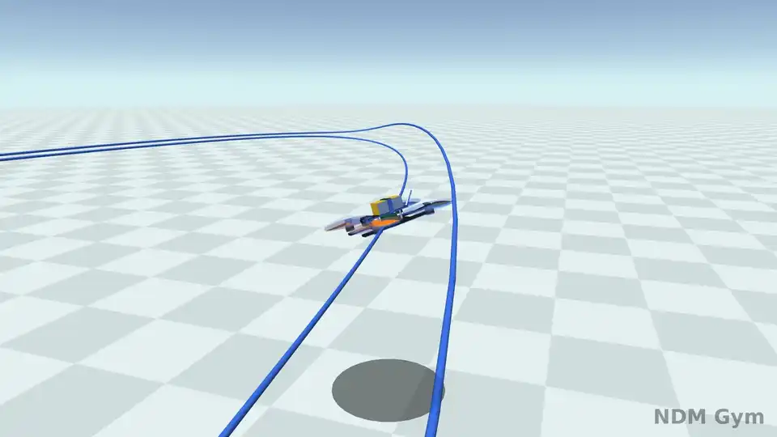
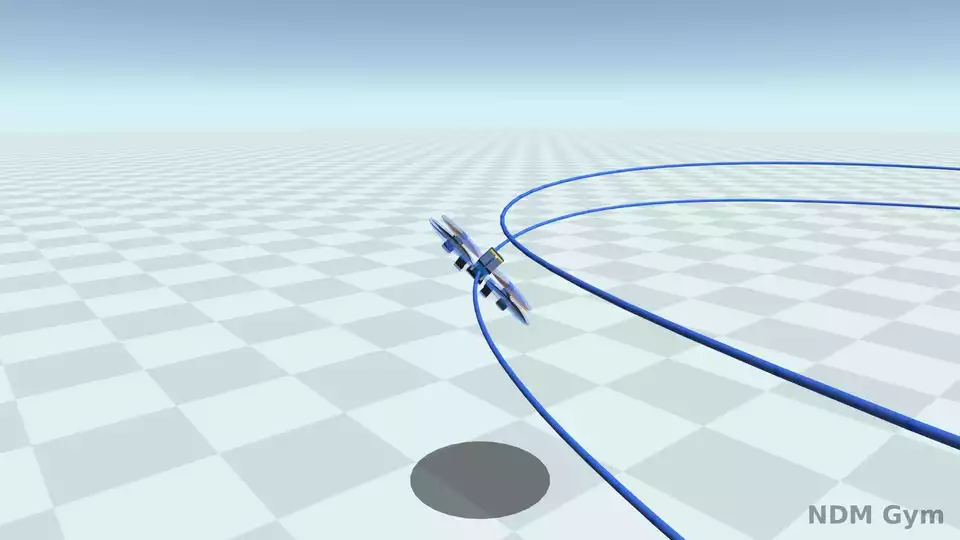
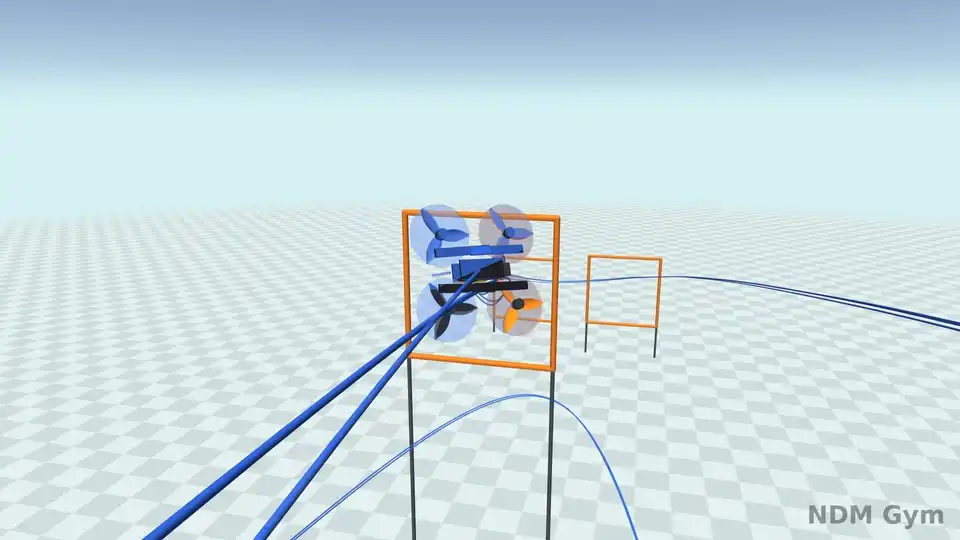

# Quadrotor trajectory tracking

A racing quadrotor tracks flown trajectories: the autonomous flights of
[Race Against the Machine](https://github.com/tii-racing/drone-racing-dataset) (Bosello et al., RA-L 2024; the data CC BY
4.0), a 5-inch racing drone recorded by motion capture at 275 Hz on an ellipse, a lemniscate and a 3-D race track of
seven gates, flown by its controller (the autonomous flights, two or three smooth laps; the benchmark's at up to 21.7,
10.0 and 21.2 m/s) and by human pilots (the piloted flights: the benchmark's 14 laps of the ellipse and 12 of the
lemniscate at up to 8.3 m/s with a line of their own on every lap, and a professional pilot's 8 laps of the race track at
up to 19.3 m/s and 9 g), on MuJoCo-Warp directly (no Isaac Lab;
`ndm_gym/sim/rigid/quadrotor_sim.py`). It is the library's flying embodiment: an underactuated rigid body without contacts,
with fast dynamics and four commands.

```bash
pip install -e '.[hand]'                                      # MuJoCo-Warp
python tools/download_drone_racing.py --set both              # the 18 autonomous and the 18 piloted flights into data/drone_racing
benchmarks/quadrotor_racing_tracking/run.sh ellipse 0         # train and evaluate one task and seed (SuperMimic's defaults)

# or step by step: SuperTrack, then SuperMimic
python -m ndm_gym.train_quadrotor --flight flight-01a-ellipse --config quadrotor-supertrack-accurate --log_dir logs/ellipse_st
python -m ndm_gym.train_quadrotor --flight flight-01a-ellipse --config quadrotor-supermimic-accurate --log_dir logs/ellipse_sm
python -m ndm_gym.evaluate_quadrotor --ckpt logs/ellipse_st/last.pt --out logs/ellipse_st/evaluation
MUJOCO_GL=egl python tools/render_quadrotor.py --rollout logs/ellipse_st/evaluation/rollout_flight-01a-ellipse.npz --out ellipse_st.mp4
```

`--flight` takes several flights for one policy on all of them. The benchmark's tasks are the first autonomous flight of
each track and the first piloted one (`benchmarks/quadrotor_racing_tracking/tasks.json`).

## The drone

No MJCF of the dataset's drone is published. `ndm_gym/robots/quadrotor.py` writes one from the paper's specification: one
rigid body of 870 g (with the battery), 215 mm between diagonal propellers, a thrust-to-weight ratio of 7.5. Three things are
not in the paper and are estimates: the inertia (2.9, 2.4 and 5.0 g m², of the size of a 5-inch racing quadrotor's of this
mass), a linear drag of 0.35 N s/m, and the rate controller's gains. `evaluate_quadrotor --inertia_scale`, `--drag_scale`
and `--mass_scale` fly a trained policy on a model with other values
([results](../../benchmarks/quadrotor_racing_tracking/results.md)).

The drone is commanded as its flight controller is, by a collective thrust and body rates (CTBR). The thrust is a force
along the body's z axis; each body rate is tracked by a proportional controller's torque about its axis, with time constants
of 20 ms (roll, pitch) and 50 ms (yaw) and the torque limited. Both are MuJoCo actuators, so the rate loop runs at the
physics rate (400 Hz) inside the simulator, and a policy's command is held for a control step (100 Hz).

**How the model fits the data.** The force that the flights' accelerations need, against gravity and the model's drag, lies
along the motion-captured body z axis (the cosine's median is 1.000 on the three tasks' flights, its 5th percentile 0.987 or
more) and stays below the model's largest thrust (at most 58.5 of 64.0 N, on the ellipse). These flights are therefore
flyable by the model; the professional pilot's race track needs up to 77 N at its peaks, where the command is clamped ([the
piloted flights](../../benchmarks/quadrotor_racing_tracking/results.md#the-piloted-flights)). The results are tracking in
simulation; nothing is claimed about the real drone.

## Task

| | |
|---|---|
| reference | a flight's part above 0.5 m (its hover, its laps, its hover): the motion-captured poses smoothed with a Gaussian of 12 ms and resampled at 100 Hz; velocities by central differences |
| state | position, rotation, linear velocity (world) and body rates (13 numbers: MuJoCo's qpos and qvel of the free joint) |
| action | four offsets in [-1, 1] about the reference's feedforward command: 17 N of thrust, 6 rad/s of roll and pitch rate, 3 rad/s of yaw rate |
| feedforward | the thrust along the reference's body z that gives its acceleration against gravity and drag; its body rates |
| observation | the world's up axis and the linear velocity in the body's frame, the body rates, the previous action |
| goal | 5 reference frames 1, 6, 11, 16 and 21 control steps ahead (`--goal_frames`, `--goal_stride`), about the state in the body's frame: the position's offset, the relative rotation, the reference's velocity |
| reward | tracking kernels on position (0.3 m), rotation (0.5 rad), linear velocity (2 m/s) and body rates (4 rad/s), with weights 2, 1, 0.5 and 0.25; an action-rate penalty |
| termination | the position more than 1 m from its reference |
| episode | from a random frame of the reference, at its state with noise (0.1 m, 0.1 rad, 0.3 m/s, 0.5 rad/s), for at most 5 s (`--episode`) |

Everything is an analytic function of the state and the reference frame (`ndm_gym/tasks/quadrotor_tracking.py`), so the
simulator's transitions and the world model's imagined rollouts share it. The policy's inputs and the world model's are in
the body's frame: they do not depend on the position or the heading.

## Method

Both algorithms fit an MLP world model of the rigid body (`ndm_gym/worldmodels/quadrotor.py`: 13 inputs, the up axis and
the linear velocity in the body's frame, the body rates and the command) on 8-step windows of simulator transitions and
train the policy through imagined rollouts of the frozen world model from replayed states
(`ndm_gym/algos/quadrotor_algos.py`). Training takes `ndm_gym.train`'s arguments with its own defaults
(`ndm_gym.train_quadrotor.QUAD_DEFAULTS`, the hand task's); those it does not implement are refused.

[SuperTrack](../algorithms/supertrack.md) (`--algo supertrack`): the world model predicts the linear acceleration in the
body's frame and the body rates' derivative, integrated over a control step in closed form for the simulator's four
substeps. The policy minimizes the L1 errors of the position, the rotation, the linear velocity and the body rates over the
imagined window, plus a failure penalty on the task's soft termination (`--st_fail_w`) and a regularizer on the actions; no
reward, no critic. `--st_task_weights`: each term weighs the reward's weight over its kernel's width, in place of the
calibration that weighs every term 1 at the first update.

[SuperMimic](../algorithms/supermimic.md) (the default): the world model predicts the increments of the state in the body's
frame; the policy maximizes the imagined tracking return with a soft survival weight and a critic beyond the horizon.

**The imagined window.** A body rate changes the position only through the attitude and the acceleration: over a window of
length t its effect on the position grows as t cubed. SuperTrack, which has no critic, needs a window long enough for a
position error to be worth correcting (`--horizon 64`, 0.64 s); with the hand task's 16 steps its position error does not
fall. With the calibrated weights the body rates' term, whose first error is small, weighs much and holds the policy at the
feedforward command; the task's weights do not ([results](../../benchmarks/quadrotor_racing_tracking/results.md)).

## Systems options

The hand task's (`ndm_gym/algos/hand_fast.py`, [their table](hand.md#systems-options)), off by default: `--fused_adam`,
`--reset_masked`, `--no_sync`, `--collect_graph`, `--update_graphs`, `--pi_opt muon`, `--wm_opt muon`, `--pi_ema`,
`--pi_lr_mult`. `--compile_eager` is refused: the collection step has no forward kinematics to compile. `QUAD_PROFILE=1`
prints, with every log row, the time of the collection step, the world-model updates and the policy update.

## Evaluation and videos

`ndm_gym.evaluate_quadrotor` rolls the policy out over each whole flight without resets and without exploration noise:
once from the unperturbed first frame (saved for rendering, beside the same start under the reference's command and the
flight's gates), and from `--num_envs` perturbed starts, and as many with the
reference's feedforward command alone in the policy's place (open loop). A rollout succeeds if it never terminates. The
errors are means over the frames of the rollouts that succeed, the largest position error is taken after the flight's first
second (the perturbed start); `flown_s` is the mean time in the air. `--flight` evaluates
on other flights than the checkpoint's.

`tools/render_quadrotor.py` renders a saved rollout under the sky and over the checker floor of `tools/render_musclevae.py`
(`--look noir`: the dark stage of `tools/render_hand.py`; `--look studio`: `tools/render.py`'s light one): the simulated
drone solid with its trail of the last 0.7 s in orange, the flown reference a
translucent blue drone with its path through the arena, the flight's gates where the dataset's motion capture placed them
(their openings' edges), a camera behind the reference's direction of flight (`--view follow`: from a fixed side; `--view
arena`: the whole path in view), the NDM Gym mark; at 1920x1080 and 60 fps, in real time. `--hud` adds the simulated
drone's speed, its distance from the reference and a map of the path from above. `--source reference_command` renders the
same start under the reference's command, open loop. No mesh of the dataset's drone is published: the renderer builds one
after it from the paper's specification, a carbon H-frame with the battery, the camera and the antenna, and 5.1-inch
tri-blade propellers of its own making (the shape of the T-Motor T5147 it flies, in size) that turn as it flies. The drones
are drawn 1.5 times their size; a dark disc on the floor stands for the drone's shadow. The README's grid (`tools/make_grid.py`, the command in its docstring) joins twelve
such renders of 9 s, one lap of each flight from a second after it reaches 3 m/s (the piloted flights' with
`--path_seconds 2`: a pilot's dozen laps drawn whole are a tangle); the animations below are the `--preview` of the same 9 s of
each task's autonomous flight (960 pixels wide, 30 fps).

| | |
|---|---|
|  |  |
|  | |

SuperTrack's selected configuration, the last checkpoint of seed 0 from the unperturbed start, in real time, on the ellipse
(up to 21.7 m/s), the lemniscate and the race track; the flown reference in blue, the gates, the drone's trail in orange.

Tasks and results: [`benchmarks/quadrotor_racing_tracking`](../../benchmarks/quadrotor_racing_tracking/results.md).
