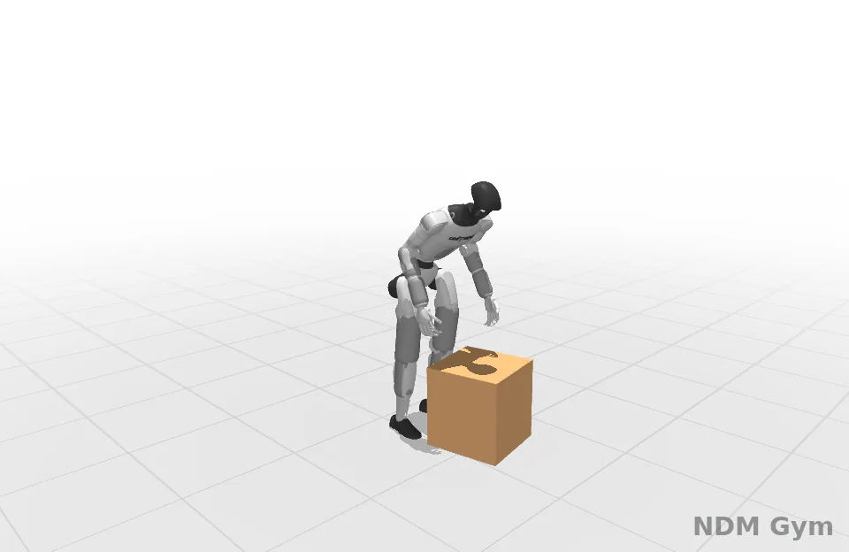
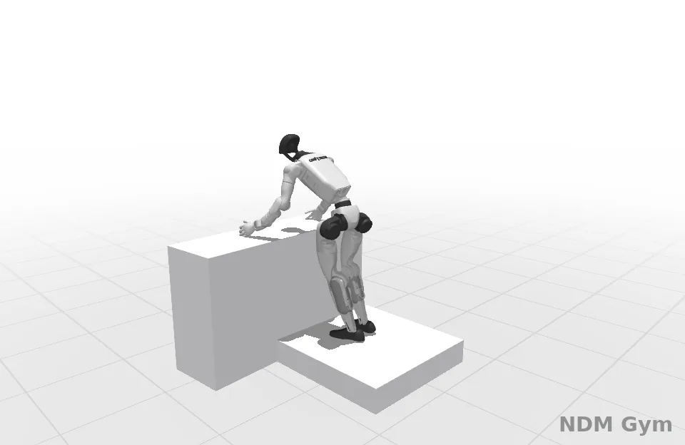
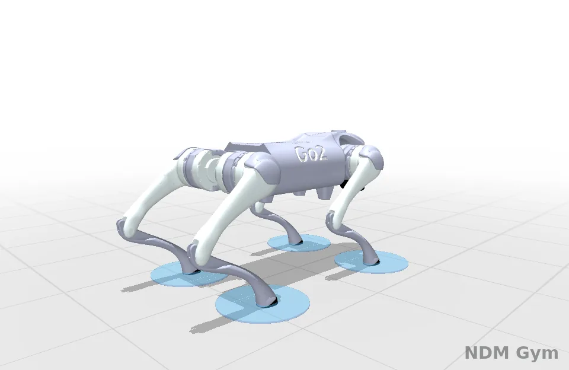

# RoboKit's planner on a world model

[RoboKit](https://github.com/openrobokit/robokit) (MIT) plans with sampling MPC over batched MuJoCo Warp rollouts. Here its
planner's simulator is this library's world model of the same MuJoCo model (`ndm_gym.worldmodels.mjcf`): RoboKit's examples
run unmodified, their simulator class swapped at run time, and every plan still executes on MuJoCo Warp.

| G1 box carrying | G1 climbing | Go2 jumping |
|---|---|---|
|  |  |  |

The world model in the planner, MuJoCo Warp executing; in translucent blue, the example's reference (the G1's motion and
the box's) and Go2's foot targets. G1 box carrying tracks an OMOMO clip: for non-commercial illustration only (see the
repository's NOTICE).

| example | simulation step | planning time | outcome, planner seeds 0-4 |
|---|---|---|---|
| G1 box carrying | 1.81 → 0.19 ms (9.8x) | 9 → 3 s (3.0x) | 5 of 5 pass, as on MuJoCo Warp |
| G1 climbing | 1.32 → 0.35 ms (3.8x) | 7 → 4 s (1.8x) | 5 of 5 pass, as on MuJoCo Warp |
| Go2 jumping | 0.59 → 0.26 ms (2.3x) | 65 → 31 s (2.1x) | 5 of 5 pass, as on MuJoCo Warp |

One A100 40GB SXM4, the planner's own worlds (2,047 for the G1s, 1,228 for Go2), the median over the planner's seeds. The
method, the world models chosen and every command are in the
[results](https://github.com/Frank-ZY-Dou/ndm-gym/blob/main/benchmarks/robokit_ndm/results.md).

## Setup

RoboKit at `736f112` in its own environment, with torch and this library importable. The results were measured with
Python 3.12, mujoco and mujoco-warp 4.0.1, warp-lang 1.19.0 and torch 2.14. The examples fetch their own assets (robot
models, motion clips) on first use.

```bash
git clone https://github.com/openrobokit/robokit && git -C robokit checkout 736f112
# in RoboKit's environment (its own installation instructions), with torch installed:
pip install -e /path/to/ndm-gym --no-deps
EX=robokit/src/robokit/examples/sim_mpc
```

## The pipeline

```bash
# 1. record the example as published (planner seed 0): 64 of its rollout worlds and the executed trajectory
python -m ndm_gym.wmbench.collect_robokit --example $EX/03_g1_climb.py --out data/g1_climb_s0 --record 64 --seed 0
# 2. fit world models on the recorded rollouts: SuperTrack's accelerations (the default) or SuperMimic's increments
#    (--wm_param increment), with or without LayerNorm (--no_ln)
python -m ndm_gym.wmbench.fit_mjcf --model data/g1_climb_s0_planner0.mjb --train data/g1_climb_s0_rollout_dt20.npz \
  --test held=data/g1_climb_s2_rollout_dt20.npz --compile --cut 300 --out fits/rfit_g1_climb_dt20_acc_ln.csv \
  --save fits/rfit_g1_climb_dt20_acc_ln.pt
# 3. choose the fit with the lowest held-out error at the planning horizon
python benchmarks/robokit_ndm/select_arms.py fits/ --out best_arms.json
# 4. time the world model's step inside the planner's simulator against MuJoCo Warp's
python -m ndm_gym.wmbench.speed_mjcf --meta data/g1_climb_s0.json --states data/g1_climb_s2_executed0.npz \
  --nworld 2047 8192 --what physics ndm ndmsim --ckpt fits/rfit_g1_climb_dt20_acc_ln.pt --derived kinematics sensor_pos
# 5. plan on the world model; the plan executes on MuJoCo Warp
python -m ndm_gym.wmbench.plan_robokit --example $EX/03_g1_climb.py --ndm 0.02=fits/rfit_g1_climb_dt20_acc_ln.pt \
  --derived kinematics sensor_pos --save_executed runs/g1_climb.npz --out runs/g1_climb.json
# 6. the example's reference (no planning), then a render of the executed motion with it in blue
python -m ndm_gym.wmbench.plan_robokit --example $EX/03_g1_climb.py --save_reference runs/g1_climb_ref.npz --out runs/ref.json
MUJOCO_GL=egl python tools/render_robokit.py runs/g1_climb.npz g1_climb.webp --reference runs/g1_climb_ref.npz
```

`plan_robokit` without `--ndm` plans as the example does, on MuJoCo Warp; with `--null`, on a simulator whose step does
nothing (the planner's own share of the time).

## How it works

- **The world model** (`worldmodels.mjcf.MjcfWorldModel`) reads an `MjModel` once (`MjcfLayout`: free, ball, hinge and
  slide joints; joint and fixed-tendon actuators with a fixed gain and an affine or no bias; joint equalities, which every
  step then satisfies exactly) and predicts one step of the generalized coordinates (qpos, qvel) from the controls. SuperTrack's
  parameterization predicts the accelerations and integrates them as MuJoCo's semi-implicit Euler does; SuperMimic's
  predicts the step's increments. The inputs do not depend on the robot's heading and horizontal position, and the error
  is taken in the tangent space, in units of one true step's spread.
- **The planner's simulator** (`sim.robokit_ndm.ndm_sim`) is a subclass of RoboKit's `MjWarpSim` whose step runs the world
  model's bf16 inference copy as one CUDA graph inside RoboKit's captured rollouts, plus the MuJoCo Warp stages the task's
  costs read (`--derived`). A step length without a world model is an error; `--physics` names step lengths that run
  MuJoCo Warp's own step instead (a hybrid planner).
- **The recordings** (`sim.robokit_rec.recording_sim`) come from a subclass of RoboKit's simulator that writes the first
  worlds' transitions into a ring buffer on the device, inside RoboKit's graph captures.

## References

- RoboKit: J. Ye, X. Peng, C. Mc Gartoll, C. Jing, L. Wei, J. Chen, X. Zou, X. Wang. *RoboKit: Accelerating Parallel
  Differentiable Optimization for Robot Learning.* CoRL 2026. [code](https://github.com/openrobokit/robokit)
- G1 box carrying's clip: OMOMO (J. Li, J. Wu, C. K. Liu. *Object Motion Guided Human Motion Synthesis.* ACM Transactions
  on Graphics 42(6), 2023. [DOI](https://doi.org/10.1145/3618333)), as InterMimic processed it (S. Xu et al., CVPR 2025,
  [arXiv:2502.20390](https://arxiv.org/abs/2502.20390)).
- G1 climbing's motion: OmniRetarget (L. Yang et al., 2025, [arXiv:2509.26633](https://arxiv.org/abs/2509.26633)), from
  [Holosoma](https://github.com/amazon-far/holosoma).
- The G1's scene: SPIDER's example data
  ([retarget/retarget_example](https://huggingface.co/datasets/retarget/retarget_example); C. Pan et al., 2025,
  [arXiv:2511.09484](https://arxiv.org/abs/2511.09484)). Go2: [MuJoCo Menagerie](https://github.com/google-deepmind/mujoco_menagerie).
- The simulator: [MuJoCo Warp](https://github.com/google-deepmind/mujoco_warp).

Every entry in full: the README's [Papers and repositories](https://github.com/Frank-ZY-Dou/ndm-gym#-papers-and-repositories).
