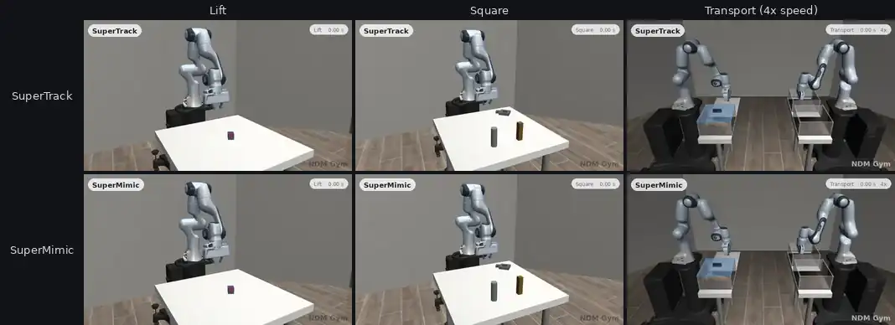

# Manipulation demonstration tracking

A Franka Panda arm with its parallel gripper (two of them for Transport) tracks a human teleoperated demonstration in
physics: the arm's joints, the gripper and the objects it handles, from the demonstration's own simulator states. The scenes
run on MuJoCo-Warp directly (no Isaac Lab; `ndm_gym/sim/rigid/robomimic_sim.py`). One policy tracks one demonstration, or
several of one scene.

The demonstrations are robomimic's proficient-human ones (Mandlekar et al., "What Matters in Learning from Offline Human
Demonstrations for Robot Manipulation", CoRL 2021;
[robomimic/robomimic_datasets](https://huggingface.co/datasets/robomimic/robomimic_datasets), v1.5, MIT), recorded at 20 Hz
with [robosuite](https://github.com/ARISE-Initiative/robosuite) 1.5.0 (MIT). Each holds MuJoCo's flattened state at every
control step and the scene it was recorded in, so the objects' trajectories are the demonstration's own. Both are downloaded
at pinned revisions by a script and are not redistributed here; robosuite itself is not a dependency.

```bash
pip install -e '.[hand]'                             # MuJoCo-Warp
python tools/download_robomimic.py                   # the demonstrations and robosuite 1.5.0's assets, pinned, into data/robomimic

# one demonstration: train (SuperTrack, then SuperMimic), evaluate from perturbed starts beside the reference's targets
python -m ndm_gym.train_robomimic --config robomimic-supertrack --task square --log_dir logs/square_st
python -m ndm_gym.train_robomimic --config robomimic-supermimic --task square --log_dir logs/square_sm
python -m ndm_gym.evaluate_robomimic --ckpt logs/square_st/last.pt --out logs/square_st/eval
MUJOCO_GL=egl python tools/render_robomimic.py --rollout logs/square_st/eval/rollout_0.npz --out square.webp --title SuperTrack
```

## Scenes

`ndm_gym/robots/robomimic_scenes.py` compiles a demonstration's scene (its `model_file`) with robosuite's meshes and
textures resolved under the downloaded assets.

| | Lift | Square | Transport |
|---|---|---|---|
| arms | one Panda | one Panda | two Pandas |
| objects tracked | the cube | the square nut | the hammer, the trash, the start bin's lid |
| demonstrations | 200, 1.8-3.2 s | 200, 5.4-11.8 s | 200, 18.7-35.7 s |
| success (robosuite's test, from the state) | the cube 4 cm above the table | the nut on its peg | the hammer in its bin and the trash in the trash bin |

- **Actuators:** robosuite drives each arm's torque actuators by operational-space control with gravity compensation. Here
  each becomes a joint position servo, force = kp (target - q) - kd q̇ with kp of 600, 600, 600, 600, 250, 150 and
  50 N m / rad, clipped to the torque actuator's own range (80 N m on joints 1-5, 12 N m on 6 and 7), and the robots' bodies
  are compensated for gravity (`gravcomp`). The grippers keep their position servos.
- **Physics:** MuJoCo-Warp at the demonstrations' rates: 2 ms physics steps, 20 Hz control (25 physics steps a control
  step, replayed as one CUDA graph). `--solver_iterations` sets the solver's iterations (the results: 20).

## Task

`ndm_gym/tasks/robomimic_tracking.py`; the reference is one or more demonstrations of one scene (`--demo`), each with its
last state held for 0.5 s.

| | |
|---|---|
| state | the scene's qpos and qvel: the arms', the grippers' and every free object's |
| action | one per actuator: an offset of its position target about the reference's joint position at the next frame |
| observation | the actuated joints and their velocities, the grippers' keypoints (end effector and fingers), each tracked object about each end effector, its rotation and velocities, the previous action |
| goal | 5 reference frames ahead about the state: the joints' offsets, the tracked objects' offsets and relative rotations, the keypoints' offsets |
| reward | kernels on the keypoints (4 cm), the arms' joints (0.4 rad), the objects' positions (4 cm) and rotations (0.5 rad); an action-rate cost |
| termination | a tracked object 15 cm or a keypoint 20 cm from its reference |
| episode | from a random frame of the reference with noise on the arms' joints (the objects and the grippers as recorded, so that a grasp stays a grasp), to its demonstration's end |

## Method

Both algorithms fit MjcfWorldModel (worldmodels.mjcf, the scene in generalized coordinates: fixed bases, the objects as
free joints) over one control step on windows of simulator transitions, and train the policy through imagined rollouts of
the frozen model (`ndm_gym/algos/robomimic_algos.py`): SuperTrack with the acceleration model and L1 errors of the
keypoints, the joints, the fingers and the objects' poses; SuperMimic with the increment model, the imagined reward and a
critic. The systems options are the hand task's.

`--config list` prints the configurations with what each measured. Results:
[benchmarks/robomimic_manipulation_tracking](../../benchmarks/robomimic_manipulation_tracking/results.md).



Each case's best run from the unperturbed start (Transport at four times real time), the demonstration's arms and objects in
translucent blue. The animations: [Lift](https://raw.githubusercontent.com/Frank-ZY-Dou/ndm-gym/main/docs/media/robomimic/lift_st.webp), [Square](https://raw.githubusercontent.com/Frank-ZY-Dou/ndm-gym/main/docs/media/robomimic/square_st.webp), [Transport](https://raw.githubusercontent.com/Frank-ZY-Dou/ndm-gym/main/docs/media/robomimic/transport_st.webp)
(SuperTrack); [Lift](https://raw.githubusercontent.com/Frank-ZY-Dou/ndm-gym/main/docs/media/robomimic/lift_sm.webp), [Square](https://raw.githubusercontent.com/Frank-ZY-Dou/ndm-gym/main/docs/media/robomimic/square_sm.webp), [Transport](https://raw.githubusercontent.com/Frank-ZY-Dou/ndm-gym/main/docs/media/robomimic/transport_sm.webp) (SuperMimic).
